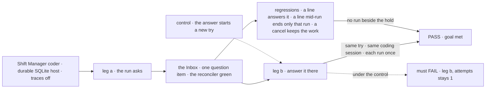
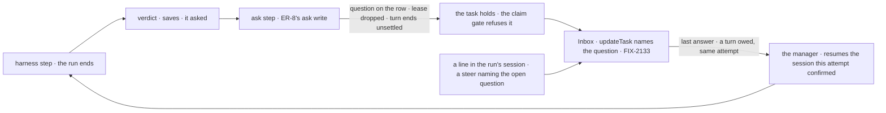

# FIX-2132 · A coding run's question holds its task, and the answer continues its coding session

**Spec** · [Decisions](DECISIONS.md)

## Six people, before and after

| Someone who… | Today | After |
|---|---|---|
| **answers a coding run's question in Shift Manager** | Can't: the question parks the task where the Inbox can't see it | Sees it in the Inbox as a question and answers it there. The next run continues the same coding session, on the same try |
| **filed the coding work** | Sees the task *parked*; the answer starts a new try and spends a retry | Sees the task held on the question, with its text; no retry is spent |
| **types a line into the run's session while it waits** | The line waits for the next try; the question still waits | The line answers the question, as the Inbox's answer does, and the next run continues the same coding session with it. No run starts beside the hold |
| **cancels the task while it waits** | The task cancels; the harness inbox row stays open | The item closes, no further run starts, and the work already done stays on its branch and in its kept files |
| **leaves the question unanswered** | It waits for good | It waits until someone answers it or the task is cancelled: a question has no deadline unless the host sets one. At a set deadline, the next run continues the same coding session, told no answer came, and goes ahead from its brief. The epic decided this ([decided](../../epics/FIX-2058/DECISIONS.md#decided-in-review-recorded-so-no-child-reopens-them)) |
| **runs the conductor lab** | Answers with the lab's `answer` action, onto the harness inbox | Answers through the board's `updateTask` action, as the Inbox does; `status` lists tasks held on questions |

A run's own question, the judge's *ask* and a saved-work mismatch all ask the same way.

## The goal, and how we'll know it's met

**A coding run that needs a person's answer shows its question in the Inbox, and the answer
carries the work on in the same coding session, on the same try, with no finished work run again.**

| Is it the right goal? | |
|---|---|
| **The real need** | The concept's *Inbox items*, last paragraph: "Its question ends the run, and its task holds on the question. The answer, a steer, starts the next run in the same coding session, using no attempt." The epic's legs a and b for this kind ([FIX-2058](../../epics/FIX-2058/SPEC.md#the-goal-and-how-well-know-its-met)) |
| **Smaller, and rejected** | "The harness inbox is deleted and the question parks on the board." Met while the answer still spends a try, and the Inbox still can't show the question |
| **Bigger, and not this issue's** | The hold itself, its answer action and its deadline ([FIX-2133](https://linear.app/fixpoint-labs/issue/FIX-2133), ER-8); questions and reviews from every other flow, and removing the board's `awaitReview` API (FIX-2131; this issue moves harness-manager's own calls); the filer told of the question (FIX-2070); the five kinds together (FIX-2134) |
| **Not done if** | The answer starts a new try · the next run starts a fresh coding session · a line starts a run while the task holds · a harness run's verdict becomes a stop anywhere but the ask module · the harness inbox still answers a question · the check ran with trace observability on only |



The check reads the Inbox, the task through `getTask`, the checkout, and what each harness run was handed.

| How we verify | |
|---|---|
| **Goal check** | `goals/shift-manager/a-coding-runs-question-is-answered-in-the-inbox/` · real model, Claude Code through the devteam harness, for legs a and b, the ones only a real coding run can show; the three regressions on the devteam harness stub · run by the implementer at completion · verdict in the implementation PR |
| **Signal** | a: the snapshot lists one `question` item with the run's text; `getTask` shows the open question, `attempts` 1, no lease; the checkout lease is free. b: after the Inbox answer, `attempts` stays 1, the next run resumes the session id the first confirmed, and a fact only the first run learned (LAB-154's technique) lands in the checkout; no harness run is handed the same prompt twice; the task completes and the item closes. A second question in the same try passes the same way. FIX-2133's reconciler is green with the coding question present. Regressions: a line typed in the run's session while it holds answers it, through FIX-2133's `steerFromLine`, and the next run resumes the confirmed session; a line while a run works ends that run, not the request (`stopsOnAbort`); cancelling a task whose coding run is held on a question leaves its branch's commit and its kept files in place. Cancel itself, the deadline and which question a line answers are FIX-2133's to prove (its legs d and e). Sweep: `answerQuestion`, `inboxCollection`, `parkOnBoardQuestion` and `announce` have no references in package or lab source; harness-manager's `askQuestion` export and its inbox import path have none; and `awaitReview`, `HarnessRunParked` and `waitForUser` have none in `harness-manager` (*amended 2026-10-24:* FIX-2163's implementation later allows exactly one `waitForUser` reference, its review step; this issue's implementation keeps none) |
| **Input** | A coding task whose brief forces one question; for the second-question case, one that forces two in a row |
| **Anti-game** | Don't assert on store internals or the run record; answer the way the Inbox does, never through the store. Run with `FSDEV_TRACE_OBSERVABILITY=0`, so a suspension added later can't pass on a traces-on replay |
| **Control that must fail** | `GOAL_CONTROL=new-attempt` fails leg b on *`attempts` stays 1*. `GOAL_CONTROL=fresh-session` fails leg b on *resumes the session the first confirmed*. Today's `main` fails leg a (no Inbox item) and the sweep |

## What changes


Read down each column: every red cell today is a question the Inbox can't see, or a retry spent on an answer.

**A host needs no new code. A host that answered through the harness inbox stops:**

```diff
- import { answerQuestion, listQuestions } from "@flow-state-dev/harness-manager";
- await answerQuestion(ctx, topic, "Use the v2 endpoint");
+ // The question is held on the task's row; a screen answers it as the user, naming the question:
+ await updateTask_tasks({ id: task.id, question: q.id, message: "Use the v2 endpoint" });   // FIX-2133
- harnessManager({ ..., announce: (event) => notify(event.question) })   // refused by name
+ harnessManager({ ... })
```

**What a phase's prompt builder gets after an answer:**

```diff
  buildPrompt: (run) => [run.task.goal, ...run.answers.map((a) => `${a.question}\n${a.answer}`)].join("\n\n"),
- // run.answers: answered inbox rows, read on the NEXT try
+ // run.answers: this try's answered questions, read from the task's row, oldest first
- // write a question to run.askMarkerPath (.fsdev/ask/<attempt>.md)
+ // write a question to run.askMarkerPath (.fsdev/ask/<attempt>-<run>.md)
```

**Docs:** update the `harness-manager` README (*Continuing a run*, *Running a conversation's
tasks*, the judge's ask, the held-work mismatch, the export surface, *Limits*) and
`apps/docs/docs/orchestration/harness-manager.md` (*Asking and being answered*: the task holds,
no retry is spent; *Talking to a run*: a line while it holds answers the question), and the
conductor lab's README. A changeset with a migration note for the removed exports, `announce` and
the marker path; it says the name `askQuestion` now belongs to the orchestration model tool (FIX-2131). No new page.

## How the answer reaches the next run



The request ends with the ask; the answer's turn is a new request on the same attempt, FIX-2086's
steer turn. Nothing is suspended in between, so the manager's own path has no resume to run a step
twice. A host's own harness block may still suspend, and that path needs FIX-2137 ([D1](DECISIONS.md#d1)).

## What stays as it is

- **The ask marker**: the run still asks by writing a file the prompt names.
- **A coding session resumed by id** (the `resume` feed), and a fresh one told the question
  and answer when the harness never confirmed one.
- **The steer step** and `stopsOnAbort` (FIX-2086): a steer while a run works ends that run
  where the harness can be stopped safely, and the next run continues the session.
- **Talk** after the task finishes, and the judge's *done* and *not done*.

## What's already here, and the debt

| Already here | What this does with it |
|---|---|
| Ways a coding run asks, in `harness-manager`: the inbox row (`askQuestion`, `answerQuestion`, `announce`), the board's question park (`parkOnBoardQuestion`), and the fixed board's `awaitReview` park (`manager.ts`, the verdict's arm 1 and `parkOnMismatch`). Every one asks a question; none asks an approval or a review. Searched `ask`, `park`, `awaitReview`, `answer`, `inbox`, `suspend` | **Replaces** all three with the epic's hold on questions, through one ask step |
| [FIX-2133](https://linear.app/fixpoint-labs/issue/FIX-2133) ([ER-8](../../epics/FIX-2058/DECISIONS.md#who-owns-what), #3747): the hold on questions, its one write, the re-entry on the same attempt, the answer through `updateTask` and the deadline. It also holds a coding task whose questions are known up front before any run starts | **Builds on** it, and adds no hold, write or route of its own. This ask step is the mid-run case only |
| [FIX-2129](https://linear.app/fixpoint-labs/issue/FIX-2129)'s `waitForUser` ([ER-1](../../epics/FIX-2058/DECISIONS.md#who-owns-what)): approvals, reviews and input suspend | **Not used** for a question. *Amended 2026-10-24:* [FIX-2163](../FIX-2163/SPEC.md) adds one review of a run's changes, when the host sets `reviewChanges` |
| FIX-2086's steer step and its owed steer turn on the same attempt | **Builds on**: the answer's turn is that turn, and its run resumes this attempt's session |
| [LAB-154](../../../goals/harness-manager/answered-run-continues-its-session/goal.md): an answered run continues its coding session on the next try | **Amended**: the same session, on the same try. Its goal check answers through `updateTask` |
| [FIX-1766 D2](../FIX-1766/DECISIONS.md#d2): a saved-work mismatch parks the row for the run's owner | **Amended**: the owner is asked through the same hold; the answer's turn continues from the base |
| [FIX-1666 D1](../FIX-1666/DECISIONS.md#d1): the coder's question isn't an Inbox item, because it parks off the Inbox | **Resolved**: it is one now; its EM approval is kept |
| [LAB-162](https://linear.app/fixpoint-labs/issue/LAB-162) ([#1612](https://github.com/fixpoint-labs/flow-state-dev/pull/1612)), superseded by the epic | **Not revived**; shared harness dispatch is kept |

| The debt | |
|---|---|
| **Removes** | The harness inbox (`inbox.ts`, ten exports), `announce` (refused by name), `parkOnBoardQuestion`, harness-manager's four `awaitReview` sites and `HarnessRunParked`, the inbox fold in the prompt, the conductor lab's `answer` action (LAB-154's check moves to `updateTask`), a retry spent per answer. Each deleted name joins `PERSON_STOPS_REMOVED` in the same PR: harness-manager's `answerQuestion`, `parkOnBoardQuestion`, `inboxCollection` ([FIX-2134 D2](../FIX-2134/DECISIONS.md#d2)) |
| **Adds** | One ask-step module in place of the three park sites (`manager.ts`'s verdict arm and fixed-board review, and `parkOnMismatch`): the one place a harness run's verdict becomes a stop, for this issue and FIX-2163's review alike, so no third path; the claim-time ticket carried into the run, the subtle part, since a fixed-board run holds no `state.claim`; the marker path, the run counter and its incarnation binding; `run.answers` read from the row in `buildPrompt`, a public phase-API change. Permanent by design. The manager's attempt-only ownership checks (three in `manager.ts`, one in `run-record.ts`) move onto FIX-2133's ticket fence or check its turn generation, since two turns now share an attempt |
| **Leaves** | The run record's `parked` outcome word, until FIX-2071's renames |

**Net: down.** One of the three ask paths the epic counts goes, with ten exports and an option, and
the manager gains no suspension.

## Sign off

**[The goal](#the-goal-and-how-well-know-its-met), at that size:** in the Inbox, the same session
and try, nothing run twice. If wrong: coding questions stay off-screen, or each answer spends a retry.

**[The debt](#whats-already-here-and-the-debt), net down:** the harness inbox and its option go;
one step comes. If wrong: a host loses a status read it built on the inbox.

1. **[D1](DECISIONS.md#d1) · FIX-2137 stays a blocker.** The manager's own path never suspends for a question (FIX-2163 adds a review that does, behind a host option),
   but a host's harness block may, and its resume needs FIX-2137. Engineering, decided; it would
   flip only if no host-supplied block or callback in the manager chain could suspend. FIX-2137 is
   merged, so the edge is satisfied. If wrong: nothing; the edge no longer delays anything.

**Open: none of its own.** At a set deadline it goes ahead, as the [epic decided](../../epics/FIX-2058/DECISIONS.md#decided-in-review-recorded-so-no-child-reopens-them).

Feature · `harness-manager`, conductor lab, a goal check · medium · epic FIX-2058 · blocked by FIX-2133, FIX-2137, FIX-2056
