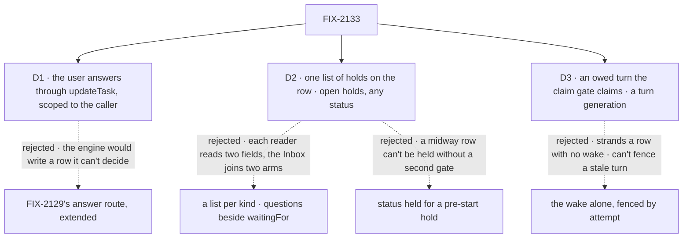

# FIX-2133 · Decisions

[Spec](SPEC.md) · **Decisions**

The owner decided the hold (epic [D1](../../epics/FIX-2058/DECISIONS.md#d1)) and, relayed on
2026-10-25, its shape: one list of holds per task
([the epic's amendment](../../epics/FIX-2058/DECISIONS.md#amendment--2026-10-25--one-list-of-holds-per-task)).
The epic set its invariants ([ER-8](../../epics/FIX-2058/DECISIONS.md#who-owns-what)). Three calls
are this spec's: which path takes the answer, what the hold is on the row, and how a midway task
gets its turn back.

## The tree

Solid edges are what you're signing. Dashed edges lost, and the label says why.

## D1 · The user answers through the board's `updateTask` action, scoped to the caller

*Adopted in the epic's [ER-7](../../epics/FIX-2058/DECISIONS.md#who-owns-what) (2026-10-23).*

| | |
|---|---|
| **Instead of** | FIX-2129's answer route, extended to take a question |
| **Because** | A question has no suspension: answering it is a row write and releasing it is the board's rule. The engine route would need a new seam back into the board to do what `updateTask_<board>` already does as the signed-in user. ER-7's reason holds: nothing from the caller re-enters a handler, and the server sets who answered |
| **Locks in** | `updateTask` gains `question`, the id of the row hold it answers (the name stays until FIX-2071's renames). The public action takes any open row hold; the filer's tool only a midway one on a task not routed, refused by name otherwise (ER-4). Before it reads a status or a question, the action checks that the caller reaches the row: the user, tenant and org recorded at filing from the filing request's verified identity, compared the way `callerReachesRequest` compares them (BP-031). A row it doesn't reach is answered as not found, with nothing written. The server sets `by` |

It comes down to who decides the release: through the engine route, a new seam back into the board.

**What would change my mind:** FIX-2129's route growing a seam into the board for its own reasons.
Then a question's answer rides it, and `updateTask` drops `question`.

## D2 · One list of holds on the row, `holds[]`, whatever its status, with no status of its own

*Amended 2026-10-25 onto the owner's relayed decision ([epic](../../epics/FIX-2058/DECISIONS.md#amendment--2026-10-25--one-list-of-holds-per-task)).*

| | |
|---|---|
| **Instead of** | A list per kind: `questions` on the row (this spec's approved shape) beside FIX-2129's `waitingOn: "user"` and `waitingFor` (#3866), which #3854's two-arm Inbox joined. Before that, `status: "held"` for a task held before it starts |
| **Because** | Five readers ask one thing, *does anything hold this row?*: the claim check, cancel, the deadline pass, crash debt and the Inbox. With a list per kind each reads two fields, and the Inbox joins two arms and needs `bothArms` to prove it never lists one stop twice. One list answers it once. A status still can't hold a running row: a midway row is `in_progress`. The predicate lands once: in the shared admission helper (`isClaimable`, FIX-1005, which the claim path, the wake probe and the preview read; `isReady` built on the same helper) and in the settle guard |
| **Locks in** | `holds` on the row, each a `TaskHold` (`id`, `actor`, `ask`, `source`, `openedAt`, `due`), with `actor` and `releasedBy` written from the first write, and one predicate, `openHolds`, beside the write in `orchestration/src/tasks/collection/`. A **row hold** (`source: "row"`, a question or a confirm) is open while no steer carries its id, so "answered" is never stored twice; `due` is empty when no deadline is set. A **suspension hold** (`source: "suspension"`) is the claim gate's stop arm's record of a task run's `waitForUser` stop, in `waitingFor`'s place: opened in the write that drops the lease, closed by the write that admits its resume, and after a cancel kept, closed, with its address until the `cancelled` resume it owes (`resumeOwed`) is paid. How a close is recorded is the implementer's, inside those rules. A row's open holds come from one source at a time. Before the start the row is `pending`; midway, `in_progress` with no lease. It settles only by cancel, which closes every hold. `held` may be derived for a screen, never read to gate. A plain `held: true` composes: both must clear. Because the gate reads the predicate, no release (the legacy `heldFromBlocked` one included) can start a row unanswered. The concept's glossary and FIX-2080 D1's note, "pending until the user answers", stand |

![D2: what holds a task on its row. One list of holds on the row, on any status, chosen, beside a list per kind, questions beside FIX-2129's waitingFor. Decides it: what every reader of held reads; one predicate, open holds, against two fields per reader and a join for the Inbox. The price: shipped code moves, since #3866's waitingFor write goes onto a suspension hold. A tie: every start path reads one shared admission helper. Locks in: holds on the row, open holds the one read. Flips if the mirror can't close in the write that resumes its suspension](figures/d2-one-hold.svg)

It comes down to the readers: five of them ask one question, and a list per kind makes each ask it twice.

**What would change my mind:** a suspension hold that can't close in the write that admits its
resume. Then the mirror can drift from the stop, and readers go back to the suspension store.

## D3 · The last midway answer owes a turn the claim gate can claim, and a turn generation fences every claim-ticket write

| | |
|---|---|
| **Instead of** | Re-entry through FIX-2078's wake alone, as FIX-2086's steer turn starts today, with tickets fenced by row, status and attempt |
| **Because** | The wake is written before the row write and is absent on a host without `RequestWakes`, so a turn owed only by a wake can be stranded. And a same-attempt re-entry means two turns share an attempt: an attempt fence can't tell the asking turn's late renewal or result from its successor's |
| **Locks in** | **Ask:** one write opens the row holds, drops the lease and ends the turn unsettled. **Lease fence:** `renewLease` and `reclaim()` refuse a row with an open hold, decided on the committed row, so a renewal racing an ask loses. **Release:** the write that closes the last open row hold makes a `pending` row claimable with a fresh budget, or sets the hold's own owed-turn mark on an `in_progress` row in that same write; FIX-2086's `waitingOn: "steer"` keeps only its own meaning, a steer no request has taken (amended 2026-10-25; the mark's name is the implementer's). **Claim:** the gate claims an `in_progress` row with either mark, no lease and no open hold for its same attempt, uncharged, and clears the mark in the claim write; a wake only starts that claim sooner, and whichever claims first wins. FIX-2086's late-steer turn gets the same backstop. **Generation:** every claim advances a turn generation on the row, one more field on `TaskClaimTicket`, minted by `ticketForClaim` and checked where every claim-ticket write already converges, `transitionDeclineReason` (`internal.ts`); ask, renew, complete, fail and settle refuse a ticket whose generation isn't the row's. An unclaimed row's generation is 0. It extends the fence, not a new mechanism, so every copy that re-checks ownership by comparing `attempts` outside that point moves onto the one predicate or checks the generation too, or a stale turn of the same attempt passes: `holds` (`task-board/task-request.ts`), `advisory-write-back.ts`, `task-entry.ts`'s dispatch check, and harness-manager's three in `manager.ts` and one in `run-record.ts` (FIX-2132 names those two). **Invariants**, tested on both backings: at most one live turn per attempt; a row with no open hold is never left with no lease, no mark and nothing to claim it; a stop ends exactly once |

![D3: how a midway task gets its turn back. An owed mark on the row that the claim gate claims, with a turn generation, chosen, beside the wake alone fenced by attempt. Decides it: a host with no wake; the gate claims the row, against the row stranded. The price: two starters for one turn, which the generation fence makes safe. A tie: the same attempt, no budget spent, either way. Locks in: the mark, the lease fences and the generation on every claim-ticket write. Flips if the wake became one write with the row on every host](figures/d3-owed-turn.svg)

It comes down to a host with no wake: the row must carry its own debt, or it is stranded.

**What would change my mind:** a wake written in the same transaction as the row on every host.
Then the gate's backstop could go; the generation stays either way.

## Decided, not asked

- **Two PRs** (amended 2026-10-25). **PR 1 reshapes #3854** onto one Inbox item type over open
  holds, read by orchestration (below); `bothArms` stops being a clause and its job becomes the
  drift check, and the `INBOX_READ` rule keeps one clause. Until PR 2, the read builds a task
  run's item from #3866's `waitingFor`, the one hold a row can carry then, so the item type and
  its answer call land first and do not change. **PR 2 is the row holds**, and its
  first change moves #3866's `waitingOn: "user"` and `waitingFor` write onto a `source:
  "suspension"` hold, so every later change in it reads one list.
- **One pure hold write**, beside the predicate in `orchestration/src/tasks/collection/`,
  which both backings call to open, release, pay a deadline and cancel (ER-8; the second-look's
  finding). Cancel runs it from both backings' direct and cascade cancel, closing every hold with
  the row. The stop arm opens and the resume admission closes a suspension hold through it too.
- **An identical retry is a success; a competing answer is refused.** An answer is a user steer
  keyed to its row hold. The same words from the same user again return `unchanged`, reported as
  done, so a retry after a lost response succeeds. That match is checked before the terminal guard:
  if the row already carries the same hold key, words and sender, the answer is `unchanged`
  even when the row has since finished. Different words, or another user, are refused as already
  answered; any other answer to a finished row is refused as finished.
- **The steer cap keeps room for answers** (owned here; FIX-2131's tools and composer call it). An answer is a steer and counts against
  `MAX_STEERS`. Every open row hold reserves its answer's place: an ask is refused when the row's
  steers plus open row holds reach the cap, and an ordinary steer at that same count. So a row hold
  is always answerable, and a row never holds more than the cap. A refused ask tells the model it
  can't ask more and to go on from its brief. The check sits inside the one hold write: the ask
  takes the reservation, and the answer or the deadline's "no answer came" steer fills it. FIX-2086's
  turn bound stays 20.
  A prompt-length cap is the implementer's (BP-042).
- **One wait per turn, enforced in the writes** (FIX-2131 states the rule: a row's open holds come
  from one source at a time). The ask refuses a row with an open suspension hold, and this issue's
  addition to the claim gate's stop arm refuses to open a suspension hold on a row that has an
  open row hold. The engine creates the suspension before that mark is tried, so the step that refuses
  the mark also cancels the suspension it was for, through ER-1's cancel (it resumes `cancelled`),
  in the same step: no Inbox item survives for it.
- **The deadline:** a row hold has none unless one is set ([epic D3](../../epics/FIX-2058/DECISIONS.md#d3),
  owner, 2026-10-24). Once FIX-2129's host setting lands, a host that sets it gives every row hold
  that long from when it is opened; until then, and in tests, a test hook sets one (this issue's leg e
  uses it). A set deadline is paid by the board's debt pass on a touch past
  due (rule 8). It closes the row hold with a "no answer came" steer from a new server-written
  sender, the board, and the last close lets the work go on as an answer would. A board nobody
  touches pays late. A row hold with no deadline is never closed by the debt pass: it stays open
  until it is answered or its task is cancelled. Going ahead at a set deadline is the owner's
  ([epic](../../epics/FIX-2058/DECISIONS.md#decided-in-review-recorded-so-no-child-reopens-them), 2026-10-24).
  A suspension hold's `due` copies its suspension's deadline; the engine ends it, never the debt pass.
- **Who asks.** The filer, at filing; midway, only the turn holding the current ticket, through the
  collection's ask, which FIX-2131's `askQuestion({ question })` tool calls. Answers arrive as
  `updateTask({ id, question, message })` (D1). A fixed-board harness run holds no `state.claim`
  (`harness-manager/src/manager.ts`, its mismatch park), so its ask presents the ticket minted at
  claim time (`ticketForClaim` on the fixed board: the row's identity, the run's `identity.attempt`
  as the attempt fence, and the turn generation it was claimed under), carried into the run, and is
  refused when any of them isn't the row's. It never mints one from the row read at ask time, so a
  stale turn can't park a row deleted and recreated under the same id. Nobody changes
  or removes a row hold once it is open. **`confirm`** is asked only at filing, `createTask`'s
  `questions` taking `{ kind: "confirm", prompt }` beside plain prompts: a task that waits for the
  user's go before it starts. Midway a model asks only questions; its yes or no is an approval,
  which suspends (the epic's [Open](../../epics/FIX-2058/DECISIONS.md#open)). At filing, row holds
  are refused where `held` is (a
  step for a worker's own turn), since nothing waits; midway, any claimed task can ask.
- **Midway, what stands:** the turn's writes, messages and last checkpoint; the next turn starts from
  the brief, that checkpoint and the answer (the epic's seam).
- **The Inbox item** is one per row with open `actor: "user"` holds, `pending` or `in_progress`,
  every open hold on it shown, read from the board snapshot in one pass, and counted in the
  "needs you" totals. A confirm shows as a yes and a no. The board's
  `counts` stay keyed by status; a held-on-questions count is derived beside them.
- **One Inbox item type over open holds** (amended 2026-10-25, replacing one listing source per
  kind). An item is a row's open `actor: "user"` holds, with an `answerable` flag and one answer
  call that routes by `source`: a suspension to FIX-2129's route, a row hold to `updateTask` (D1).
  A suspension in a request with no task row lists from `readAsks` as the same item type, and
  `readAsks` skips a task run's suspensions, so each stop lists once from one place. The read is
  orchestration's: a server read plus a browser client, as workforce's `createWorkforceClient` is,
  which puts `@flow-state-dev/client` in orchestration's dependencies. Shift Manager and FIX-2157's
  lab both consume it, in place of `reads.ts` merging its sources and of #3854's
  `shift-manager/src/lib/inbox.ts`; FIX-2131 lists reviews through it.
- **The Inbox invariant comes first**, as this issue's first PR, before the hold's write (the
  epic's other-shapes analysis). It reshapes #3854. A pure `reconcileInbox(items, truth)` helper,
  beside the orchestration read, returns missing, duplicate, orphan, drift, unanswerable and
  reopened, and is green when all are empty. `truth` comes from reads independent of the listing,
  or the check proves nothing: `listTasks` rows' open holds, and
  `listSessionRequests({ status: "suspended" })` filtered by ER-1's predicate, never `readAsks` or
  `deriveSuspensions` over session items. **`bothArms` goes as a clause:** one item type has no
  arms. Its job, one stop never shown two ways, becomes **drift**: every task-run suspension in
  `truth` has exactly one open suspension hold on its task's row, and every open suspension hold
  has its live suspension. Until PR 2 moves the write, drift reads #3866's `waitingFor` as the
  hold. **Reopened** stays: after an answer or a cancel its key is in no later read. Today's
  `main` fails the answerable clause (a task run's approval listed as
  `DISPATCHED_RUN_UNANSWERABLE`, the `REOPENED_SOURCES` path), which FIX-2129's route turns
  green once the item routes by `source`; the controls `duplicate-item`, `drop-row-holds` and
  `mirror-skips-close` (the resume leaves the hold open) fail it too. Every child's acceptance is
  the reconciler green with its kind present. **The `INBOX_READ` sweep rule keeps one clause:**
  nothing outside the orchestration read builds an Inbox item. Its clauses on `deriveSuspensions`
  and on a board row's `questions` go, since the item type is the only thing an Inbox can render.
- **A line answers the oldest open question**, in one server-side home: orchestration's
  `steerFromLine` (`tasks/steers.ts`), which harness-manager's session door and workforce's steer
  share, writes the line through the one hold write as the answer to the row's oldest open
  question, from the user the request was verified as. With two open, it answers the oldest and
  leaves the other open. It never answers a `confirm`: a typed line is no yes or no
  ([FIX-2131 D1](../FIX-2131/DECISIONS.md#d1)), so a confirm is answered in the Inbox or by
  `updateTask`. FIX-2131's composer sends the plain line and the server decides, so no
  client picks the question (BP-031); FIX-2132's door changes nothing.
- **One public read of what holds a task.** `getTask` and `listTasks` show a row's open holds, so a
  reader sees one shape for every stop, a suspension or a question. It replaces the derived
  `waitingOn: "user"` and `waitingFor: { kind: "question" }` this spec had planned, and #3866's
  `waitingFor` field on the tools' row view.
- **The edges** (adopted in the epic): blocked by FIX-2056 alone, blocking FIX-2131 and FIX-2132.
  The first draft's flip condition, a question with a deadline, fired; the debt pass pays it, so
  FIX-2063 and FIX-2129 stay off.
- **A released pre-start task's first attempt is a start, never a resume.**

## Considered and dropped

| Alternative | Why not |
|---|---|
| Ask with `waitForUser` in the task's first turn | Rule 12: it starts no sooner than the last answer. Midway, a question the work can go on without is not input |
| FIX-2129's answer route, extended | D1 |
| `status: "held"` for the pre-start hold | D2 |
| A list per kind: `questions` beside `waitingFor`, joined by a two-arm Inbox | D2, as amended 2026-10-25 |
| Event releasers now, with `ctx.waitForEvent` | Out of the epic (owner, relayed 2026-10-25). `releasedBy` stores the shape, so adding one later needs no migration |
| The wake alone; tickets fenced by attempt | D3 |
| An `answered` flag beside the keyed steer | Two sources for one fact, and an "answered with no steer" state |
| Answers outside the cap, under a question cap of their own | A second bound beside the steer cap. Bypassing the cap with no bound grows the row without limit |
| Pruning taken steers at the cap | A retry's brief reads every steer |
| One Inbox item per question | Rule 11: the questions show as one item |
| A transient "held: waiting on N answers" item | It would fire on every admission probe. The claim's refusal reason goes on its trace span instead, and the DevTool shows `getTask`'s `questions` |

## Notes from review, for the implementer

- *Second look:* check what readers of `steers` assume about its bound (brief assembly,
  `takeSteersPatch`), and that a filer can't use the cap to starve answers.
- *Second look:* keep the Inbox's routing (item kind to path) in one place in its client.
- *Cursor:* derive held-question items in the snapshot pass stops use, with no second scan, and keep
  `tasksSummary` in step.
- *Codex:* a fixed-board ask must carry the claim-time ticket into the run; check the manager's run
  state holds it, not only the task id and attempt, so a recreated row can't match.
- *Cursor:* the people table and the grid overlap; trimmed in the re-spec.
- *Reuse review, 2026-10-25:* `holds()`, the claim-ownership check in `task-board/task-request.ts`,
  shares the field's name; rename the function. The mirror is a move of `waitingFor`, not a copy:
  no `waitingFor` stays beside it. FIX-2132's `run.answers` reads this try's answered row holds.

## Settled

- **No POC.** The two facts the approach rests on were read in the code: tickets are fenced by
  row, status and attempt only (`internal.ts`, `attemptOwnsTask`), and a wake is written before its
  debt and absent without `RequestWakes` (`core/src/types/request-host.ts`). The mechanism is
  proved by the implementation's tests on both backings, as ER-8 asks.

## Owner decisions

- **Owner, relayed 2026-10-25** — one list of holds per task (D2): the engine unchanged and
  mirrored, questions and `confirm` as row holds, `actor` and `releasedBy` stored from the start,
  event releasers out. This spec's confirmation is the epic amendment's direction gate.
- **Owner, 2026-10-23** — no old data: stores are reset, so no migrated questions and no +1 allowance; the turn bound is 20 (BP-030 waived for this epic's persisted shapes).

## How it got here

- **Draft:** the held start with a different release, questions on a `held` row.
- **Re-spec, after the epic amendment (#3748):** one hold before the start and midway, the
  predicate in place of `held`; the re-entry, lease and turn fences; the deadline as a board debt;
  the caller check on `updateTask`; idempotent retries and the steer cap from review.
- **Analysis and reuse review, 2026-10-24:** the turn generation is one field on the existing
  ticket fence, with the attempt-only copies named; one listing source per kind and the derived
  read; the Inbox list one package read, owned here. Other shapes: the Inbox reconciler as the
  first PR, and `steerFromLine` as the one home for a line's answer.
- **Owner, 2026-10-24:** no default deadline (epic D3). The 7-day constant goes; a question is due
  only where the host setting or the test hook sets it, and leg e proves one with none stays open.
- **Amended 2026-10-25, the owner's relayed decision:** `questions` and the derived read become
  `holds[]`, and #3866's `waitingFor` moves onto a suspension hold; the Inbox is one item type
  over open holds, read by orchestration; `bothArms` becomes drift; `confirm` joins at filing; the
  owed turn gets its own mark. Two PRs: #3854 reshaped, then the row holds.

## Open

None of this issue's. Where `confirm` sits beside an approval is the epic's
[Open](../../epics/FIX-2058/DECISIONS.md#open); the filing-only line above is the recommendation.
