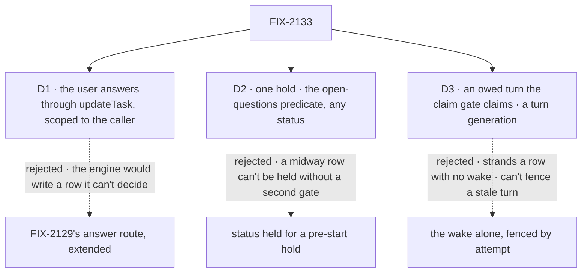

# FIX-2133 · Decisions

[Spec](SPEC.md) · **Decisions**

The owner decided the hold (epic [D1](../../epics/FIX-2058/DECISIONS.md#d1)) and the epic set its
invariants ([ER-8](../../epics/FIX-2058/DECISIONS.md#who-owns-what)). Three calls are this spec's:
which path takes the answer, what the hold is on the row, and how a midway task gets its turn back.

## The tree

Solid edges are what you're signing. Dashed edges lost, and the label says why.

## D1 · The user answers through the board's `updateTask` action, scoped to the caller

*Adopted in the epic's [ER-7](../../epics/FIX-2058/DECISIONS.md#who-owns-what) (2026-10-23).*

| | |
|---|---|
| **Instead of** | FIX-2129's answer route, extended to take a question |
| **Because** | A question has no suspension: answering it is a row write and releasing it is the board's rule. The engine route would need a new seam back into the board to do what `updateTask_<board>` already does as the signed-in user. ER-7's reason holds: nothing from the caller re-enters a handler, and the server sets who answered |
| **Locks in** | `updateTask` gains `question`. The public action takes any open question; the filer's tool only a midway one on a task not routed, refused by name otherwise (ER-4). Before it reads a status or a question, the action checks that the caller reaches the row: the user, tenant and org recorded at filing from the filing request's verified identity, compared the way `callerReachesRequest` compares them (BP-031). A row it doesn't reach is answered as not found, with nothing written. The server sets `by` |

It comes down to who decides the release: through the engine route, a new seam back into the board.

**What would change my mind:** FIX-2129's route growing a seam into the board for its own reasons.
Then a question's answer rides it, and `updateTask` drops `question`.

## D2 · One hold: open questions on the row, whatever its status, with no status of its own

| | |
|---|---|
| **Instead of** | `status: "held"` for a task held before it starts (this spec's first draft), with a midway question marked some other way |
| **Because** | The owner's hold is one predicate before the start and midway. A midway row is `in_progress`; it can't read `held` without a new transition, and a status for the pre-start case beside a predicate for midway is two gates. The predicate lands once: in the shared admission helper (`isClaimable`, FIX-1005, which the claim path, the wake probe and the preview read; `isReady` built on the same helper) and in the settle guard |
| **Locks in** | `questions` on the row, each `{ id, prompt, askedAt, due }`, written once. A question is open while no steer carries its key, so "answered" is never stored twice. Before the start the row is `pending`; midway, `in_progress` with no lease. It settles only by cancel. `held` may be derived for a screen, never read to gate. A plain `held: true` composes: both must clear. Because the gate reads the predicate, no release (the legacy `heldFromBlocked` one included) can start a row unanswered. The concept's glossary and FIX-2080 D1's note, "pending until the user answers", stand |

It comes down to the midway case: a status can't hold a running row, so only the predicate covers both.

**What would change my mind:** a start path that can't read the shared helper. Then that path needs
its own guard, and the goal check's leg a must name it.

## D3 · The last midway answer owes a turn the claim gate can claim, and a turn generation fences every claim-ticket write

| | |
|---|---|
| **Instead of** | Re-entry through FIX-2078's wake alone, as FIX-2086's steer turn starts today, with tickets fenced by row, status and attempt |
| **Because** | The wake is written before the row write and is absent on a host without `RequestWakes`, so a turn owed only by a wake can be stranded. And a same-attempt re-entry means two turns share an attempt: an attempt fence can't tell the asking turn's late renewal or result from its successor's |
| **Locks in** | **Ask:** one write adds the questions, drops the lease and ends the turn unsettled. **Lease fence:** `renewLease` and `reclaim()` refuse a row with an open question, decided on the committed row, so a renewal racing an ask loses. **Release:** the write that closes the last question makes a `pending` row claimable with a fresh budget, or sets the owed-turn mark on an `in_progress` row (FIX-2086's `waitingOn: "steer"`) in that same write. **Claim:** the gate claims a marked `in_progress` row with no lease and no open question for its same attempt, uncharged, and clears the mark in the claim write; a wake only starts that claim sooner, and whichever claims first wins. FIX-2086's late-steer turn gets the same backstop. **Generation:** every claim advances a turn generation on the row; the ticket carries it; ask, renew, complete, fail and settle refuse a ticket whose generation isn't the row's. An unclaimed row's generation is 0. **Invariants**, tested on both backings: at most one live turn per attempt; a row with no open question is never left with no lease, no mark and nothing to claim it; a stop ends exactly once |

![D3: how a midway task gets its turn back. An owed mark on the row that the claim gate claims, with a turn generation, chosen, beside the wake alone fenced by attempt. Decides it: a host with no wake; the gate claims the row, against the row stranded. The price: two starters for one turn, which the generation fence makes safe. A tie: the same attempt, no budget spent, either way. Locks in: the mark, the lease fences and the generation on every claim-ticket write. Flips if the wake became one write with the row on every host](figures/d3-owed-turn.svg)

It comes down to a host with no wake: the row must carry its own debt, or it is stranded.

**What would change my mind:** a wake written in the same transaction as the row on every host.
Then the gate's backstop could go; the generation stays either way.

## Decided, not asked

- **One pure question write**, beside the predicate in `orchestration/src/tasks/collection/`,
  which both backings call for ask, answer, deadline and cancel (ER-8; the second-look's finding).
  Cancel runs it from both backings' direct and cascade cancel, closing every question with the row.
- **An identical retry is a success; a competing answer is refused.** An answer is a user steer
  keyed to its question. The same words from the same user again return `unchanged`, reported as
  done, so a retry after a lost response succeeds. That match is checked before the terminal guard:
  if the row already carries the same question key, words and sender, the answer is `unchanged`
  even when the row has since finished. Different words, or another user, are refused as already
  answered; any other answer to a finished row is refused as finished.
- **The steer cap keeps room for answers** (owned here; FIX-2131's tools and composer call it). An answer is a steer and counts against
  `MAX_STEERS`. Every open question reserves its answer's place: an ask is refused when the row's
  steers plus open questions reach the cap, and an ordinary steer at that same count. So a question
  is always answerable, and a row never holds more than the cap. A refused ask tells the model it
  can't ask more and to go on from its brief. The check sits inside the one question write: the ask
  takes the reservation, and the answer or the deadline's "no answer came" steer fills it. FIX-2086's
  turn bound stays 20.
  A prompt-length cap is the implementer's (BP-042).
- **One wait per turn, enforced in the writes** (FIX-2131 states the rule: a row holds an open
  question or a person suspension, never both). The ask refuses a row marked `waitingOn: "user"` (renamed from `"person"` in FIX-2129, #3735),
  and this issue's addition to the claim gate's stop arm refuses to mark a row that has an open
  question. The engine creates the suspension before that mark is tried, so the step that refuses
  the mark also cancels the suspension it was for, through ER-1's cancel (it resumes `cancelled`),
  in the same step: no Inbox item survives for it.
- **The deadline:** each question is due 7 days after it is asked: a 7-day constant until FIX-2129's
  host setting lands and replaces it. A test hook overrides the question deadline (FIX-2132's leg e
  uses it). It is paid by the board's debt pass on a touch past due (rule 8). It
  closes the question with a "no answer came" steer from a new server-written sender, the board,
  and the last close lets the work go on as an answer would. A board nobody touches pays late.
  If the owner picks "fail" in the epic's [Open](../../epics/FIX-2058/DECISIONS.md#open), this
  write fails the try instead.
- **Who asks.** The filer, at filing; midway, only the turn holding the current ticket, through the
  collection's ask, which FIX-2131's `askQuestion({ question })` tool calls. Answers arrive as
  `updateTask({ id, question, message })` (D1). A fixed-board harness run holds no `state.claim`
  (`harness-manager/src/manager.ts`, its mismatch park), so its ask presents the ticket minted at
  claim time (`ticketForClaim` on the fixed board: the row's identity, the run's `identity.attempt`
  as the attempt fence, and the turn generation it was claimed under), carried into the run, and is
  refused when any of them isn't the row's. It never mints one from the row read at ask time, so a
  stale turn can't park a row deleted and recreated under the same id. Nobody adds,
  changes or removes a question afterwards. At filing, questions are refused where `held` is (a
  step for a worker's own turn), since nothing waits; midway, any claimed task can ask.
- **Midway, what stands:** the turn's writes, messages and last checkpoint; the next turn starts from
  the brief, that checkpoint and the answer (the epic's seam).
- **The Inbox item** is one per row with an open question, `pending` or `in_progress`, read from the
  board snapshot in the same pass as stops, and counted in the "needs you" totals. The board's
  `counts` stay keyed by status; a held-on-questions count is derived beside them.
- **The edges** (adopted in the epic): blocked by FIX-2056 alone, blocking FIX-2131 and FIX-2132.
  The first draft's flip condition, a question with a deadline, fired; the debt pass pays it, so
  FIX-2063 and FIX-2129 stay off.
- **A released pre-start task's first attempt is a start, never a resume.**

## Considered and dropped

| Alternative | Why not |
|---|---|
| Ask with `waitForUser` in the task's first turn | Rule 12: it starts no sooner than the last answer. Midway, a question the work can go on without is not input |
| FIX-2129's answer route, extended | D1 |
| `status: "held"` for the pre-start hold | D2 |
| The wake alone; tickets fenced by attempt | D3 |
| An `answered` flag beside the keyed steer | Two sources for one fact, and an "answered with no steer" state |
| Answers outside the cap, under a question cap of their own | A second bound beside the steer cap. Bypassing the cap with no bound grows the row without limit |
| Pruning taken steers at the cap | A retry's brief reads every steer |
| One Inbox item per question | Rule 11: the questions show as one item |

## Notes from review, for the implementer

- *Second look:* check what readers of `steers` assume about its bound (brief assembly,
  `takeSteersPatch`), and that a filer can't use the cap to starve answers.
- *Second look:* keep the Inbox's routing (item kind to path) in one place in its client.
- *Cursor:* derive held-question items in the snapshot pass stops use, with no second scan, and keep
  `tasksSummary` in step.
- *Codex:* a fixed-board ask must carry the claim-time ticket into the run; check the manager's run
  state holds it, not only the task id and attempt, so a recreated row can't match.
- *Cursor:* the people table and the grid overlap; trimmed in the re-spec.

## Settled

- **No POC.** The two facts the approach rests on were read in the code: tickets are fenced by
  row, status and attempt only (`internal.ts`, `attemptOwnsTask`), and a wake is written before its
  debt and absent without `RequestWakes` (`core/src/types/request-host.ts`). The mechanism is
  proved by the implementation's tests on both backings, as ER-8 asks.

## Owner decisions

- **Owner, 2026-10-23** — no old data: stores are reset, so no migrated questions and no +1 allowance; the turn bound is 20 (BP-030 waived for this epic's persisted shapes).

## How it got here

- **Draft:** the held start with a different release, questions on a `held` row.
- **Re-spec, after the epic amendment (#3748):** one hold before the start and midway, the
  predicate in place of `held`; the re-entry, lease and turn fences; the deadline as a board debt;
  the caller check on `updateTask`; idempotent retries and the steer cap from review.

## Open

None of this spec's. The deadline's outcome is the epic's.
