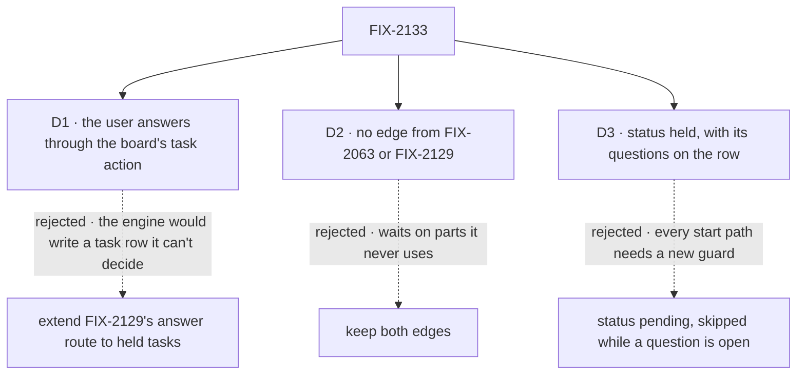

# FIX-2133 · Decisions

[Spec](SPEC.md) · **Decisions**

The concept decided what a held task does (rules 11 and 12, *Inbox items*). Three calls are left:
which server path takes the answer, what the issue depends on, and what the row's status says.

## The tree

Solid edges are what you're signing. Dashed edges lost, and the label says why.

## D1 · The user answers a held question through the board's task action, not FIX-2129's answer route

| | |
|---|---|
| **Instead of** | Extending FIX-2129's answer route, which [ER-7](../../epics/FIX-2058/DECISIONS.md#who-owns-what) names for every Inbox item, to take a held task's question |
| **Because** | A held task has no request and no suspension: answering it is a write to a row that hasn't started, and releasing it is a board's rule. That route lives in the engine, which can't decide a board's rules, so it would call back into the board through a new seam to do what `updateTask_<board>` already does. The task action already acts as the signed-in user, is refused to another user, and is how a screen cancels or releases a task; the concept names it for this ("a screen calls them as the user to … answer its questions"). ER-7's reason holds: nothing from the caller re-enters a task's handler, and the server sets who answered |
| **Locks in** | `updateTask`'s `question`, accepted only from the public action (a person), refused by name from the model's tool (ER-4). The Inbox keeps one answer call for the person; behind it, a stop goes to FIX-2129's route and a held task to its board's action. The epic's ER-7 reads "one route per kind of item, both already trusted"; the coordinator amends the epic to say so |

It comes down to who decides the release: through the engine route, a new seam back into the board.

**What would change my mind:** FIX-2129's route growing a seam into the board for its own reasons,
such as FIX-2131's steer. Then a held answer rides it, and the task action drops `question`.

## D2 · Held on questions needs neither durable execution nor FIX-2129; both edges go

| | |
|---|---|
| **Instead of** | Keeping FIX-2063 and FIX-2129 as blockers, as the epic's set table has them |
| **Because** | Nothing here suspends. The questions, their answers and the release are row writes on a durable board, which the task actions already require; there is no request to keep, no deadline to fire, no stop to resume. The row's record of a question is this issue's own `questions`, not FIX-2129's `waitingFor`, and D1 needs no route of FIX-2129's. The epic's round-1 note asked for exactly this check: "If the spec finds it needs neither, raise this to the epic to drop the edge, so FIX-2063's kill line does not also freeze it" |
| **Locks in** | FIX-2133 is blocked by FIX-2056 alone and can be built beside FIX-2063, FIX-2129 and FIX-2131. If FIX-2063's kill line fires, this still ships. The coordinator drops the two edges in a follow-up to the epic spec; FIX-2134 still closes over it. Its Inbox change lands beside FIX-2131's in the same files, an ordering of merges, not a dependency |

It comes down to what the held start uses: it never suspends, so it waits on nothing it touches.

**What would change my mind:** a held question that must expire at a deadline, as a stop does. Then
it needs FIX-2063's sweeper and FIX-2129's deadline, and the edges stay.

## D3 · A task held on questions reads `status: "held"`, not `pending`

*An engineering call, decided; recorded because it fixes what every reader of a task sees.*

| | |
|---|---|
| **Instead of** | `status: "pending"` with open questions, as the concept's glossary words it and [FIX-2080 D1](../FIX-2080/DECISIONS.md#d1)'s note reads it, every start path skipping a row with an open question |
| **Because** | `held` already means "filed, not started, until something says go", and every start path already skips it: the claim, the drain, a dispatcher, a dependent's check, the cascade. A `pending` row with a question would need that guard in each of them, and one missed is a task that starts unanswered. With `held`, the invariant has one point: the release write refuses a row with an open question unless the write is its last answer. The row's `questions` tell the two holds apart, and a screen reads both |
| **Locks in** | `status: "held"` plus `questions` on the row. `updateTask`'s `status: "pending"` on it is refused, naming the questions; so is `held: true` with `questions` at filing (one hold at a time). The board's `counts.held` counts it. The concept's glossary and FIX-2080's note are amended to *held* |

It comes down to how many places must refuse the start: one release write, or every start path.

## Decided, not asked

- **One convergence point for the release.** A held row with an open question leaves `held` only
  through the collection's settings write (the one `hold` and `release` share in both backings),
  and that write releases it only as the write that answers its last question. Every releaser
  passes through it: the filer's `updateTask` tool and action (a plan step releasing the delegation
  task it gates among them), `release` on the collection, and the legacy `blocked` release.
  Each is refused there, by name.
- **An answer is a steer from the user,** keyed to its question so a replay adds nothing, written in
  the same write that marks the question answered. The brief carries it through the path every
  worker already reads (FIX-2086), and a retry keeps it. The question's record keeps the prompt and
  whether it is answered; the answer's words live once, in the steer. An answer is checked before
  the steer cap, so a held question is always answerable.
- **First answer wins per question.** A second answer to the same question is refused as already
  answered. An answer to a task that is no longer held (released, cancelled, started) is refused
  naming its status.
- **The filer can still edit, steer and cancel** a held-on-questions task, as any held task. It
  can't add, change or remove a question after filing, and its message never answers one (ER-4).
- **Where `held` is refused, so are questions**: a step for a worker's own turn, and anything the
  board's own rules refuse a hold. Questions on a plan row follow the plan board's held rules.
- **The Inbox item is read from the board snapshot**, one per held row with an open question, on
  the user's own ledger. No `getTask` or `listTasks` per refresh (the epic review's note). The row's
  browser projection gains `questions`. The item closes because the row stops matching: answered,
  cancelled, or released.
- **Bounds.** A cap on the number of questions and on a prompt's length, so a row and a list stay
  small (BP-042); the numbers are the implementer's.
- **A released task's first attempt is a start, never a resume** (the epic's round-1 note). Its
  message budget is a fresh one, by the concept; that rule is FIX-2070's.

## Considered and dropped

| Alternative | Why not |
|---|---|
| Ask with `waitForUser` in the task's first turn (simpler: no new setting) | The task would start, use an attempt and hold a claim to ask. The concept's rule 12 says it starts no sooner than the last answer |
| Keep the answers in their own field, read by the brief | A second way into the brief beside steers, which every worker would have to learn; a steer already reaches them all |
| A filer `release` that answers nothing, kept for held-on-questions | Rule 11: only the user answers held questions. A release would start the task unanswered |
| One Inbox item per question | Rule 11 and the issue: the questions show as one item |
| Extend FIX-2129's answer route to held tasks | D1 |

## Settled

- **No POC.** Every part this rests on is shipped and tested: the held status and its start guards
  (FIX-2080), steers in the brief (FIX-2086), the task actions as the user. The new parts are a
  field and one guard on those. No counted fact carries the approach, so there is no checker
  either.

## How it got here

- **Draft** — framed as the held start with a different release: questions on a `held` row, each
  answer a user's steer through the board's task action, the last one releasing it in the same
  write; no suspension, so the edges to FIX-2063 and FIX-2129 go.

## Open

None.
