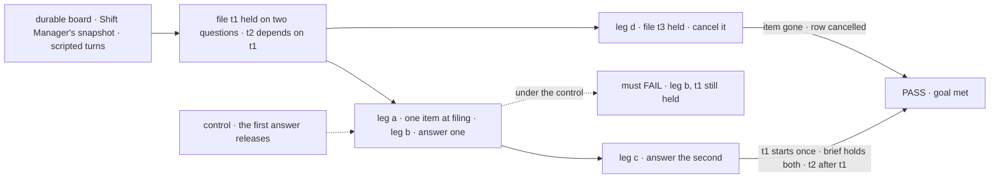
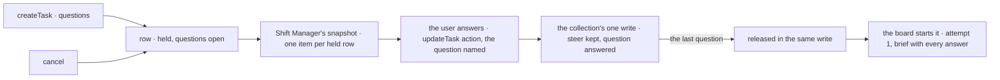

# FIX-2133 · A task can be held on questions

**Spec** · [Decisions](DECISIONS.md)

## Seven people, before and after

| Someone who… | Today | After |
|---|---|---|
| **files work that needs an answer first**, a worker's model or an app | Guesses, or starts the task and lets it stop midway, or files it held with nowhere to put the question | Files it with its questions. It doesn't start until the user answers them |
| **is the user** | Sees nothing for a held task unless they go looking on a board | Sees the task as one Inbox item as soon as it is filed, every question on it |
| **answers one of two questions** | n/a | The answer is kept; the item stays, with one question left; the task still hasn't started |
| **answers the last one** | n/a | The task starts its first attempt, and its brief carries every answer, from the user |
| **filed it, and tries to release it or answer it** | Releases a held task with `status: "pending"` | Refused, naming the rule: held questions are the user's. The filer can still edit, steer or cancel it |
| **has a task that depends on it** | Waits until it completes | The same: it waits through the hold, and starts after the held task completes |
| **cancels it while it is held** | The row cancels | The row cancels and the item goes; its dependents are cancelled, as today |

## The goal, and how we'll know it's met

**A filer can hold a task on questions: the user sees them as one Inbox item as soon as it is filed,
each answer joins the brief, and the task starts its first attempt no sooner than the last answer,
with its dependents waiting behind it; cancelling it closes the item.**

| Is it the right goal? | |
|---|---|
| **The real need** | The issue: "The filer has no way to say 'don't start until a person answers these'." Rules 11 and 12 of [the concept](../../../docs/internal/design/workforce-coordination-concept.md#the-rules): one Inbox item; "a task held on questions starts no sooner than its last answer." The epic's leg a and leg b for this kind ([FIX-2058](../../epics/FIX-2058/SPEC.md#the-goal-and-how-well-know-its-met)) |
| **Smaller, and rejected** | "A task's row can carry questions, and `getTask` shows them." Met while the user never sees them, and a filer can still release the task unanswered |
| **Bigger, and not this issue's** | Every kind of stop proved together in Shift Manager on one `main` commit (FIX-2134). A screen to compose a held task (the issue's *Out*) |
| **Not done if** | The first answer starts the task · an answer reaches the worker only as a row field, not in its brief · the filer's model answers or releases it · a dependent starts before the held task completes · a cancelled task's item stays listed · the check answered through the store |



The check reads what Shift Manager's Inbox read lists and what `getTask` returns, and answers the
way the Inbox does, never through the store.

| How we verify | |
|---|---|
| **Goal check** | `goals/task-board/holds-a-task-on-questions/` · model-free (`n/a`, scripted turns call the real tools) · run by the implementer at completion · verdict in the implementation PR |
| **Signal** | a: right after `createTask` with two questions, the snapshot lists one held item for t1 with both prompts, and `getTask` shows `status: "held"`, `attempts: 0`. b: after one answer the item lists one open question, t1 is still `held` with `attempts: 0`, and the worker's start counter is 0. c: after the second answer t1 runs exactly once, attempt 1; the brief its worker received holds both answers, each from the user; the item is gone; t2 is `pending` until t1 completes, then runs. The filer's model calling `updateTask` with `status: "pending"` or with a `question` is refused by name, and t1 stays held. d: t3's item leaves the list on cancel, and an answer after the cancel is refused as finished |
| **Input** | "Which CSV export should the script read?" and "Which date column?" Any two prompts pass the same way |
| **Anti-game** | Don't assert on rows written by hand or on store internals; read through the snapshot, `getTask`, and the brief the worker received. The start counter is the real worker's, not item counts |
| **Control that must fail** | `GOAL_CONTROL=release-on-first` fails leg b on *t1 still held*. `GOAL_CONTROL=answer-off-brief` (the answer recorded on the row only) fails leg c on *the brief holds both*. Today's `main` fails leg a: `createTask` has no questions |

## What changes


Read down each column: today a task can't carry a question at all, so every cell after filing is empty or a guess.

**A filer holds a task on questions:**

```diff
  createTask({
    goal: "Write the adoption script",
    assignee: "coder",
-   held: true,   // held until the filer releases it; nowhere to put the question
+   questions: ["Which CSV export should the script read?"],   // held until the user answers
  })
```

**What a reader of the task sees, before and after the answer:**

```diff
  { id: "t7", status: "held", attempts: 0,
+   questions: [{ id: "q1", prompt: "Which CSV export should the script read?", answered: false }] }
```

**The Inbox answers, as the user** ([D1](DECISIONS.md#d1)):

```diff
+ updateTask_tasks({ id: "t7", question: "q1", message: "The March export, exports/2026-03.csv" })
+ // kept as the user's steer; the last answer releases the task in the same write
```

**Docs:** extend `apps/docs/docs/orchestration/task-board.md` (*One task, five tools*: the
`questions` start setting; *What `updateTask` can change*: a user's answer, and the release a
held-on-questions task refuses) and `apps/docs/docs/orchestration/task-substrate.md` (its held
section: the questions, and what releases them). Update the line on `held` in
`apps/docs/docs/workforce/delegating-work.md`, and the `orchestration` and `shift-manager` READMEs
(the Inbox lists held tasks). Amend the concept's glossary, "pending until the user answers its
questions", to *held* ([D3](DECISIONS.md#d3)). A changeset: `createTask` and `updateTask` gain a
field each, and the row gains `questions`. No new page; the one-way-to-stop story is FIX-2131's.

## How an answer reaches the task



An answer and its release are one row write, decided inside the collection, so two answers at once
release the task once, and an answer that lands after a cancel is refused. The item is read from the
row each refresh, so a cancel, a release or an edit needs nothing else to close it.

## What stays as it is

- **The plain held start** (`held: true`, `status: "held"` / `"pending"`, FIX-2080). A task filed
  with `held` is released by its filer, as today.
- **Steers** (FIX-2086): a filer's or user's message to a held task joins its brief and answers
  nothing.
- **Dependencies** (FIX-2080): a dependent starts only on `completed`, so it waits through the hold
  with no new rule, and a cancel takes it along as today.
- **Stops for a person midway** (FIX-2129, FIX-2131), their answer route and their Inbox items.
- **Messages and their budget** (FIX-2070).

## What's already here, and the debt

| Already here | What this does with it |
|---|---|
| Ways to keep a filed task from starting, across `packages/`: `held: true` with `hold`/`release` (FIX-2080, the closest), which a plan step also uses to gate a delegation task, harness-manager's held work (a coding checkout, not a row). Searched `held`, `hold(`, `release(`, `undispatched`, `questions` | **Extends** the closest. Held on questions differs from it only in what releases it, so it is the same `held` status with its questions on the row, not a new status or a second hold. This would be the first way to ask before a start, and the second way a held row is released |
| Ways to ask a person and wait: `waitForUser` (FIX-2129), `ctx.suspend`, the two parks (until FIX-2131), the harness inbox (until FIX-2132). Searched `suspend(`, `park`, `ask`, `waitForUser` | **Not used.** Each needs a request to suspend, and a held task has none: it never started |
| Ways to add words to a brief: the steer (FIX-2086), kept on the row and read by every attempt | **Builds on it:** an answer is a steer from the user tied to its question, so every worker reads it through the brief it already reads |
| [FIX-2080 D1](../FIX-2080/DECISIONS.md#d1): one status, `held`, for filed and not started; its note reads held on questions as *pending* | **Extended**, and the note **superseded in part** ([D3](DECISIONS.md#d3)) |
| [Epic ER-7](../../epics/FIX-2058/DECISIONS.md#who-owns-what): the Inbox answers every item through one trusted route, which records a held task's answers on its row | **Amended in its letter** ([D1](DECISIONS.md#d1)): held answers go through the board's task action as the user, which already exists; no new route |
| The epic's set table and graph: FIX-2133 blocked by FIX-2063 and FIX-2129 | **Amended** ([D2](DECISIONS.md#d2)): it needs neither |
| The epic's seam: "FIX-2133 adds held on questions, released by its last answer, never by `status`" | **Kept** |

| The debt | |
|---|---|
| **Removes** | Nothing; there was no way to ask before a start |
| **Adds** | `questions` at filing and on the row, `question` on a user's `updateTask`, one guard on the release write, one Inbox item kind. All permanent by design |
| **Leaves** | The Inbox read gains its third source beside FIX-2131's two; folding them is the closure's to judge (FIX-2134) |

**Net: up, slightly, and by design.** One setting and one field; no second hold, no second brief,
no second answer route.

## Sign off

**[The goal](#the-goal-and-how-well-know-its-met), at that size:** one item at filing, each answer
in the brief, the start on the last, dependents behind it, cancel closes. If wrong: the epic wraps
with a task that still can't ask before it starts.

**[The debt](#whats-already-here-and-the-debt), up slightly:** a setting and a field on the task
tools. If wrong: a second way to hold a task that drifts from the first.

1. **[D1](DECISIONS.md#d1) · The user answers a held question through the board's task action, not
   FIX-2129's answer route.** If wrong: the Inbox calls two server paths and they drift.
2. **[D2](DECISIONS.md#d2) · Held on questions needs neither durable execution nor FIX-2129;
   both edges go.** If wrong: it ships before the parts it leans on and has to be reworked.
3. **[D3](DECISIONS.md#d3) · A task held on questions reads `status: "held"`, not `pending`.**
   Engineering, decided. If wrong: app code reading `held` as "the filer releases it" misreads it.

**Open: none.** D1 is the one to weigh: it reads the epic's ER-7 by its reason, not its letter.

Feature · `orchestration`, `workforce`, `shift-manager` · medium · epic FIX-2058 · blocked by FIX-2056 (D2 drops FIX-2063 and FIX-2129)
