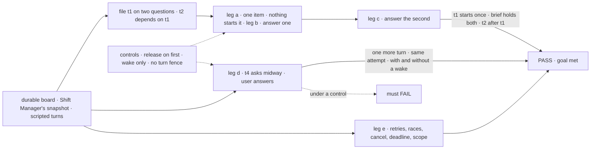
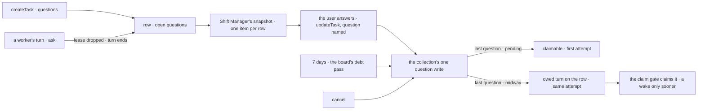

# FIX-2133 · A task can be held on questions

**Spec** · [Decisions](DECISIONS.md)

## Six people, before and after

| Someone who… | Today | After |
|---|---|---|
| **files work that needs an answer first**, a worker's model or an app | Guesses, or files it held with nowhere to put the question | Files it with its questions. It doesn't start until the user answers them |
| **is a worker that hits a question midway** | Parks the task on a question (until FIX-2131), or guesses | Puts the question on its own row and ends its turn. The answer comes back as one more turn on the same attempt |
| **is the user** | Sees nothing for a held task unless they go looking | Sees one Inbox item per held task, every open question on it, before the start or midway |
| **answers the last question, or never does** | n/a | The work goes on from its brief with every answer. After 7 days with no answer, it goes on told none came |
| **filed it, and tries to release or answer it** | Releases a held task with `status: "pending"` | Nothing it writes releases the hold. It can answer only a midway question, on a task not routed (ER-4) |
| **cancels it while it is held** | The row cancels | The row cancels, every question closes and the item goes; dependents are cancelled, as today |

## The goal, and how we'll know it's met

**A task can be held on questions, before it starts or midway. The user sees them as one Inbox
item; each answer joins the brief; the last answer, or 7 days without one, lets the work go on:
a task not yet started starts its first attempt, a midway one takes one more turn on the same
attempt. Nothing else releases it, no two turns run at once, and a cancel closes it.**

| Is it the right goal? | |
|---|---|
| **The real need** | The issue: "The filer has no way to say 'don't start until a person answers these'." The owner's rule (epic [D1](../../epics/FIX-2058/DECISIONS.md#d1)): if the work can pick up from its brief, the task holds on its row, at filing or midway. Rules 11 and 12 of [the concept](../../../docs/internal/design/workforce-coordination-concept.md#the-rules). The epic's [ER-8](../../epics/FIX-2058/DECISIONS.md#who-owns-what) and legs a, b and c |
| **Smaller, and rejected** | "The pre-start hold only." The owner decided one hold for both cases; a midway question would need a second hold, which ER-8 rules out |
| **Bigger, and not this issue's** | The model's midway ask tool and the park's retirement (FIX-2131); a coding run's question (FIX-2132); every stop proved together in Shift Manager (FIX-2134) |
| **Not done if** | The first answer starts the task · an answer reaches the worker only as a row field, not its brief · any start path starts a row with an open question · a midway row is reclaimed, renewed or settled while a question is open · two turns of one attempt run at once · a row with no open question is left with nothing to start it · a question outlives its 7 days · another user, tenant or org can answer it · the check answered through the store |



The check reads what Shift Manager's Inbox read lists and what `getTask` returns, and answers the
way the Inbox does, never through the store.

| How we verify | |
|---|---|
| **Goal check** | `goals/task-board/holds-a-task-on-questions/` · model-free (`n/a`, scripted turns call the real tools) · both store backings · run by the implementer at completion · verdict in the implementation PR |
| **Signal** | a: right after `createTask` with two questions, one item for t1 with both prompts; `getTask` shows `pending`, `attempts: 0`; a claim, a drain, a dispatching board and the ready preview all leave it. b: after one answer, one open question, the start counter still 0. c: after the second, t1 runs once, attempt 1, its brief holding both answers from the user; the item is gone; t2 runs after t1 completes. d: t4's scripted turn asks one question; the row is `in_progress` with no lease, `attempts: 1`; a renewal and a reclaim are refused; the user answers; exactly one more turn runs, attempt 1, the answer in its message. Run with the host's wake and with none. e: the same answer twice is one steer and a success; a different second answer is refused as answered; two at once start one turn; a cancel closes t3's item and a later answer is refused as finished; t5's question, 7 days on and a board touch later, closes "no answer came" and t5 starts; an answer from another user, tenant or org is answered as not found and writes nothing; with the steers plus open questions at 20, an ask is refused and so is an ordinary steer, while an open question still takes its answer; at 19, an ask and an ordinary steer committed at once leave exactly one, on both the state and the resource backings, and the surviving reservation is filled by an answer and, in a second run, by the deadline steer; t1's answer retried after t1 completes returns `unchanged`, while a new answer there is refused as finished; an ask on a row marked `waitingOn: "user"` (FIX-2129's rename) is refused, and the claim gate's stop arm refuses to mark a row with an open question |
| **Input** | "Which CSV export should the script read?" and "Which date column?" Any two prompts pass the same way |
| **Anti-game** | Assert on the snapshot, `getTask` and the brief the worker received, never on rows written by hand. The start and turn counters are the real worker's |
| **Control that must fail** | `GOAL_CONTROL=release-on-first` fails b. `answer-off-brief` fails c. `wake-only` (the claim gate ignores the owed mark) fails d's no-wake run: t4 is stranded. `no-turn-fence` (claim tickets fenced by attempt only) fails d: the asking turn's late write lands after the answer's claim. Today's `main` fails a: `createTask` has no questions |

## What changes


Read down each column: today a task can't carry a question at all, so each cell is a guess, a park
or nothing.

**A filer holds a task on questions; a worker asks midway** (the verb's shape is the implementer's):

```diff
  createTask({
    goal: "Write the adoption script",
-   held: true,   // held until the filer releases it; nowhere to put the question
+   questions: ["Which CSV export should the script read?"],   // held until the user answers
  })
+ askQuestion({ question: "Which date column?" })   // midway, FIX-2131's tool on the collection's ask: drops the lease, ends the turn unsettled
```

**What a reader sees, before and after the answer:**

```diff
  { id: "t7", status: "pending", attempts: 0,
+   questions: [{ id: "q1", prompt: "Which CSV export should the script read?", open: true }] }
```

**The Inbox answers, as the user** ([D1](DECISIONS.md#d1)):

```diff
+ updateTask_tasks({ id: "t7", question: "q1", message: "The March export, exports/2026-03.csv" })
+ // kept as the user's steer; the last answer lets the work go on in the same write
```

**Docs:** extend `apps/docs/docs/orchestration/task-board.md` (the `questions` start setting, a
midway ask, `updateTask`'s `question`) and `task-substrate.md` (what holds a row and what releases
it). Update `held` in `apps/docs/docs/workforce/delegating-work.md`, and the `orchestration` and
`shift-manager` READMEs. A changeset for `createTask`, `updateTask` and the row. The concept's
glossary already reads "pending until the user answers its questions" and stands.

## How an answer reaches the task



Every change to a row's questions is one pure write both backings call, decided on the committed
row, so two answers at once release once and an answer after a cancel is refused. The Inbox item is
read from the row each refresh, so nothing else closes it.

## What stays as it is

- **The plain held start** (`held: true`, FIX-2080), released by its filer. On a row that also has
  open questions, both must clear.
- **Steers** (FIX-2086): a message naming no question joins the brief and answers nothing.
- **Dependencies** (FIX-2080): a dependent starts only on `completed`, so it waits through the hold.
- **Suspensions for a person** (FIX-2129): approvals, reviews and input, their route and items.

## What's already here, and the debt

| Already here | What this does with it |
|---|---|
| Ways to keep a row from starting: `held` (FIX-2080), and the one admission predicate `isClaimable` the claim path, wake probe and preview share (FIX-1005) | **Extended.** The open-questions predicate joins the admission helper once, not a new status ([D2](DECISIONS.md#d2)) |
| Steers on the brief, kept on the row (FIX-2086), capped at 20 | **Builds on:** an answer is a keyed user steer; each open question reserves its answer's place under the 20 (FIX-2131's rule, owned here) |
| FIX-2086's owed steer turn: `waitingOn: "steer"`, no lease, started only by FIX-2078's wake, which is absent without `RequestWakes` (`request-host.ts`) | **Extended:** the claim gate can claim it on its same attempt ([D3](DECISIONS.md#d3)); FIX-2086's own late-steer turn gets the same backstop |
| Claim tickets fenced by row, status and attempt (`internal.ts`, `attemptOwnsTask`) | **Extended** with a turn generation, since two turns now share an attempt (D3) |
| The board's task actions as the signed-in user; the resume route's `callerReachesRequest` (`route-utils.ts`) | **Builds on** the first, scoped the way the second scopes ([D1](DECISIONS.md#d1)) |
| The board's debt pass (rule 8), paying an owed cascade on a touch past due | **Builds on:** it pays a question's deadline. No sweeper, no durable execution |

| The debt | |
|---|---|
| **Removes** | Nothing here. FIX-2131 retires both parks and `answerTask`; FIX-2132's coding question holds through it. Both wait on this issue |
| **Adds** | `questions` on the row and `createTask`; a midway ask; `question` on `updateTask`; one pure question write in both backings; the predicate in admission and settlement; a turn generation; two lease fences; the owed mark claimable by the gate; a deadline debt; a board sender for steers; one Inbox item kind |
| **Leaves** | The Inbox read's third source beside FIX-2131's two; folding them is the closure's to judge (FIX-2134) |

**Net: up, by design.** One hold for both cases, one write, one answer route; it is what lets
FIX-2131 and FIX-2132 remove three.

## Sign off

**[The goal](#the-goal-and-how-well-know-its-met), at that size:** one hold before the start and
midway, one item, each answer in the brief, the work going on at the last answer or 7 days. If
wrong: the epic wraps with a midway question that still needs a park.

**[The debt](#whats-already-here-and-the-debt), up by design.** If wrong: a hold whose re-entry
strands rows or runs two turns.

1. **[D1](DECISIONS.md#d1) · The user answers through the board's `updateTask` action, scoped to
   the caller's user, tenant and org.** Adopted in the epic's ER-7. If wrong: two answer paths that
   drift.
2. **[D2](DECISIONS.md#d2) · One hold: open questions on the row, whatever its status, with no
   status of its own.** If wrong: a start path that reads `pending` without the predicate starts a
   task unanswered.
3. **[D3](DECISIONS.md#d3) · The last midway answer owes a turn on the row that the claim gate can
   claim, and a turn generation fences every claim-ticket write.** If wrong: a row stranded on a
   host with no wake, or a stale turn writing over its successor.

**Open:** what an unanswered question does at its deadline is the [epic's](../../epics/FIX-2058/DECISIONS.md#open).
Built on "goes ahead"; if the owner picks "fail", the deadline write fails the try instead.

Feature · `orchestration`, `workforce`, `shift-manager` · medium · epic FIX-2058 · blocked by FIX-2056 · blocks FIX-2131, FIX-2132
