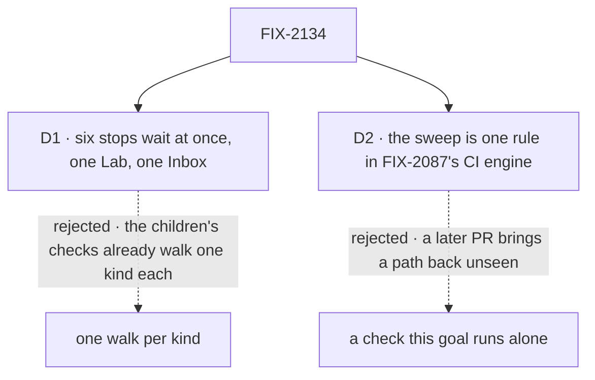

# FIX-2134 · Decisions

[Spec](SPEC.md) · **Decisions**

The plan's four rows are the [closure rule's](../../../docs/contributing/orchestration.md#the-closure-issue-every-epic-ends-in-qa)
and its legs are the [epic's](../../epics/FIX-2058/SPEC.md#the-goal-and-how-well-know-its-met).
Two calls are this spec's: how the walk opens its stops, and where the sweep keeps running.

## The tree

Solid edges are what you're signing. Dashed edges lost, and the label says why.

## D1 · All six stops wait at once, in one Lab and one Inbox, not one walk per kind

| | |
|---|---|
| **Instead of** | Six short walks, one kind of stop each, each on a fresh Lab |
| **Because** | Each child's own check is already a walk of one kind. What none of them can see is the set colliding: an Inbox answer resuming the wrong one of two waiting stops, one stop listed by two of the Inbox's three reads (FIX-2129's suspensions, FIX-2131's reviews, FIX-2133's held rows), a cancel or a steer on one task touching its neighbour's item. Those need several kinds waiting at the same moment, in one Inbox, on one host |
| **Locks in** | A closure run that costs a real model, a Claude Code run and some minutes per attempt, repeated in full per finding. A red stop does not stop the others' assertions: each is tagged `<leg>:<assertion>`, and every attempt is printed |

It comes down to collisions between kinds: a walk of one kind can never produce one.

**What would change my mind:** a host that can't hold six waiting stops at once, such as a lease or
session limit. Then two overlapping walks of three, each mixing a suspended and a held kind.

## D2 · The no-old-path sweep is one rule in the CI sweep FIX-2087 built, not a check this goal runs alone

| | |
|---|---|
| **Instead of** | The five names swept only when someone runs this goal |
| **Because** | The epic promises one way to stop for a person and one route per kind to answer it. The likeliest way to break that after the wrap is a later PR bringing back a park or `answerTask` under its old name. Only CI sees every PR. FIX-2087's engine already runs in CI with plants, and FIX-2131 already edits it to drop the two allowances, so this is a list beside its own, not a second sweep |
| **Locks in** | A PR whose package source names one of the five fails CI until it edits the list, where a reviewer sees it. `answerQuestion` is matched only as harness-manager's export, so the word stays free elsewhere |

It comes down to a later PR: run only here, a returned park is seen at the next closure, if ever.

**What would change my mind:** FIX-2087's #3692 not reaching `main` before this run. Then the rule
runs in this goal alone, and its CI step is filed as an ordinary issue, not built here.

## The plan in full

| # | What runs | PASS means |
|---|---|---|
| 1 | Legs a to d and the sweep ([SPEC](SPEC.md#the-goal-and-how-well-know-its-met)) | Each green; each control red where named |
| 2 | **j1** *files work:* the filer's steer naming its task's midway question answers it, and a later Inbox answer is told so; its steer to a routed task's question, or to an approval, answers nothing. **j2** *writes a flow that asks:* with the person-stop default shortened, an approval reads as a no, an unhandled input fails try 1, a caught one goes on, a held question goes ahead from its brief told no answer came (`j2:held-deadline-goes-ahead`); a user's stop of a waiting run ends it, closes the item and cancels the task. **j3** *runs it locally:* the host is killed while leg a's six wait; after a restart all six are listed once and leg b passes on them | Each green |
| 3 | Every child's goal check with its controls, read from Linear at run time and printed; FIX-2133's on both store backings. FIX-2137 is a bug with no goal; leg b's work counter is its check. One the walk covers only in part runs | Each PASS beside its documented FAIL |
| 4 | The gap sweep: each [coordination seam](../../epics/FIX-2058/DECISIONS.md#coordination-seams) read from both sides; the human-in-the-loop guide and the task-board page followed as written; each epic *not done if* state absent; the Inbox's three reads judged (below) | Every seam two-sided |

**Must be green first:** every other child merged with its goal's PASS and control's FAIL in its PR;
FIX-2087's #3692 for D2, or the rule runs in this goal alone.

## Decided, not asked

- **A session line answers only by becoming an id-carrying steer.** ER-7 allows one route per kind:
  a held question is answered by a steer carrying its question id through `updateTask`. The coding
  session's `harnessSessionDoor` is the one place a typed line answers, and it does so by writing
  that steer for the oldest open question (FIX-2132). Leg d fails if a plain message to a
  non-coding task's session answers anything.

- **Inherited from [FIX-2087 D1](../FIX-2087/DECISIONS.md#d1):** on a real model, a structural miss
  (counts, attempts, which route answered, what a row reads) on any attempt is a finding; only a
  judgment miss (what the model chose to write) earns another attempt.
- **The stops are raised where the epic's rule puts them.** Approval, review and input come from
  blocks in the Lab's worker flows that read the answer next, so they suspend with `waitForUser`.
  The two questions come from a model: one files a task with `questions`, one calls `askQuestion`
  midway. The coding run asks through its ask marker. The prompts force each; whether the model
  asks is judgment, what the row then reads is structural.
- **Six kinds, not the epic's five:** input is named on its own, since it suspends and is answered
  through FIX-2129's route, and a task held before it starts is apart from a midway question, since
  one starts its first attempt and the other takes one more turn on its same attempt.
- **Both store backings.** Shift Manager's conversation boards are resource-backed, so the walk
  runs there. FIX-2133's check, run in full in row 3, reads the state backing too, and the gap
  sweep reads that both backings' direct and cascade cancels call the hold's one write. No row of
  the plan is skipped for the state backing.
- **The Inbox's three reads are judged by the walk.** Six kinds open at once, each listed exactly
  once, is the evidence that they don't overlap. A double listing or a missed stop is a Bug under
  FIX-2058. A fold with no failing case is a deepening, filed outside the epic's gate, not built here.
- **The children are read from Linear at run time:** every child blocking this issue. A child that
  joins later is in the plan with no amendment, and the set read is printed at the top of the report.
- **The closure's two new controls** each swap one module, as the children's do, and the build fails
  if the swap never fired. `cancel-keeps-item` writes the cancel and skips resolving the stop;
  `steer-ignores-mark` admits a steer as if the row carried no person mark.
- **No legacy leg.** Stores are reset (owner), so no stored parked row is read, and ER-5's map gets
  no entry (FIX-2131).
- **`waitingOn: "user"`,** FIX-2129's rename of `"person"`, is what leg a reads.
- **No factual-base checker.** The spec counts nothing in today's code. Its one claim about `main`
  was checked by hand on 2026-10-23: all five swept names have references in package source
  (`answerTask` 3 files, `parkOnQuestion` 5, `awaitReview` 10, `unparkAndDrain` 4,
  `answerQuestion` 2) and `waitForUser` has none, so the sweep and leg a fail there today.

## Considered and dropped

| Alternative | Why not |
|---|---|
| Re-run the children's checks and stop there | The smaller goal, rejected in `SPEC.md`: none has six stops in one Inbox |
| The walk model-free, on scripted turns | Cheaper and steadier, but the epic's goal check says real model, and a model filing and asking is how Alice meets these stops. The children's checks are the model-free half, in row 3 |
| A browser walk through the Inbox screen | The Inbox's pending read is what the screen draws, and the children's Shift Manager checks cover the screen. A browser leg is added only if the gap sweep finds the screen and the read disagree |
| Its own CI step | A second engine to keep in step with FIX-2087's. D2 adds a list to the one that exists |

## How it got here

- **Draft** — framed as the epic's goal check on the assembled set, with six kinds waiting at once
  so the gaps between children show; FIX-2087's closure shape and D1 kept; the sweep added to its
  CI engine.
- **Review, the Architect's coherence read** — leg d's session line was reworded so it can't read as
  a third answer route: a held question is answered only by a steer carrying its id (ER-7, ER-8).

**Open: none of its own.** What a held question does at its deadline is the
[epic's](../../epics/FIX-2058/DECISIONS.md#open); `j2:held-deadline-goes-ahead` is the leg that flips.
