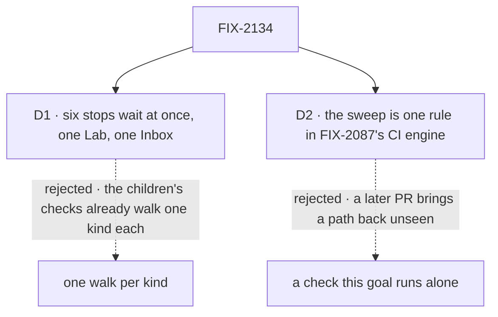

# FIX-2134 · Decisions

[Spec](SPEC.md) · **Decisions**

The plan's four rows are the [closure rule's](../../../docs/contributing/orchestration.md#the-closure-issue-every-epic-ends-in-qa)
and its legs are the [epic's](../../epics/FIX-2058/SPEC.md#the-goal-and-how-well-know-its-met).
Two calls are this spec's: how the walk opens its stops, and where the sweep keeps running.

## The tree

Solid edges are what you're signing. Dashed edges lost, and the label says why.

## D1 · All six stops wait at once, in one Lab and one Inbox, not one walk per kind

| | |
|---|---|
| **Instead of** | Six short walks, one kind of stop each, each on a fresh Lab |
| **Because** | Each child's own check is already a walk of one kind. What none of them can see is the set colliding: an Inbox answer resuming the wrong one of two waiting stops, one stop listed twice, from `readAsks` and from a task row, a cancel or a steer on one task touching its neighbour's item. Those need several kinds waiting at the same moment, in one Inbox, on one host |
| **Locks in** | A closure run that costs a real model, a Claude Code run and some minutes per attempt, repeated in full per finding. A red stop does not stop the others' assertions: each is tagged `<leg>:<assertion>`, and every attempt is printed |

It comes down to collisions between kinds: a walk of one kind can never produce one.

**What would change my mind:** a host that can't hold six waiting stops at once, such as a lease or
session limit. Then two overlapping walks of three, each mixing a suspended and a held kind.

## D2 · The no-old-path sweep is one rule in the CI sweep FIX-2087 built, not a check this goal runs alone

| | |
|---|---|
| **Instead of** | The removed names swept only when someone runs this goal |
| **Because** | The epic promises one way to stop for a person and one route per kind to answer it. The likeliest way to break that after the wrap is a later PR bringing back a park or `answerTask` under its old name. Only CI sees every PR. FIX-2087's engine already runs in CI with plants, and FIX-2131 already edits it to drop the two allowances, so this is a list beside its own, not a second sweep. **It ratchets:** each child adds the names it deletes in the same PR that deletes them, so the rule is green in CI from that child on: FIX-2132 harness-manager's `answerQuestion`, `parkOnBoardQuestion` and `inboxCollection`; FIX-2131 `answerTask`, `parkOnQuestion`, `awaitReview`, `unparkAndDrain`, `unpark` and the scoped `onReview`. This closure checks the list is complete |
| **Locks in** | A PR whose package source names one of the nine fails CI until it edits the list, where a reviewer sees it. The list carries FIX-2131's and FIX-2132's sweep names too, so the closure guards what they removed. A name too common to ban bare carries its scope: `answerQuestion` is matched only as harness-manager's export, and `onReview` everywhere but the board's by-name refusal, so neither false-positives on unrelated code |

It comes down to a later PR: run only here, a returned park is seen at the next closure, if ever.

**If #3692 isn't on `main` when the first child adds a name:** the rule still runs in CI. That
child, FIX-2132 as it merges first, adds the smallest CI step that runs it standalone, and it
moves into FIX-2087's engine once that lands. The
closure is not done until the rule runs in CI (coordinator, 2026-10-23).

## The plan in full

| # | What runs | PASS means |
|---|---|---|
| 1 | Legs a to d and the sweep ([the signal](SPEC.md#the-signal)) | Each green; each control red where named |
| 2 | **j1** *files work:* the filer's steer answers its own midway question, nothing else (`j1:filer-answers-own`, `j1:routed-answers-nothing`). **j2** *writes a flow that asks:* deadlines and a user's stop (`j2:approval-reads-no`, `j2:input-fails-try`, `j2:held-deadline-goes-ahead`, `j2:stop-cancels-task`). A stop has no deadline by default ([epic D3](../../epics/FIX-2058/DECISIONS.md#d3)), so j2 sets each: a call's `deadline` on the approval and the input, and the host's person-stop setting for the held question, on j2's own host, so leg a's six keep none. **j3** *runs it locally:* the host restarts while six wait; all six are listed once, then each is answered once through its route and carries on the same attempt, as leg b (`j3:six-after-restart`, `j3:answered-after-restart`). Detail lives in the goal tree | Each green |
| 3 | Every child's goal check with its controls, read from Linear at run time and printed, **skipping any whose legs row 1 already walks in full**: each skip printed beside the leg that covers it, and a check walked only in part runs. FIX-2133's on both store backings. FIX-2137 is a bug with no goal; leg b's work counter is its check | Each PASS beside its documented FAIL |
| 4 | The gap sweep: each [coordination seam](../../epics/FIX-2058/DECISIONS.md#coordination-seams) from both sides; the human-in-the-loop guide and task-board page followed as written; each epic *not done if* state absent; the one-source-per-kind rule checked | Every seam two-sided |

**Must be green first:** every other child merged with its goal's PASS and control's FAIL in its PR;
the D2 rule in CI, in FIX-2087's engine or, if #3692 hasn't merged, a standalone step this closure adds.

**The deadline.** A held question goes ahead from its brief at a set deadline, as the
[epic decided](../../epics/FIX-2058/DECISIONS.md#decided-in-review-recorded-so-no-child-reopens-them) (owner, 2026-10-24); `j2:held-deadline-goes-ahead` checks it.

## Decided, not asked

- **A session line answers only as an id-carrying steer.** ER-7 allows one route per kind.
  Orchestration's `steerFromLine` is the one place a typed line answers, by writing that steer for
  the oldest open question (FIX-2133), shared by every session; a `sendMessage` to a task's session
  answers nothing.
- **[FIX-2087 D1](../FIX-2087/DECISIONS.md#d1), inherited:** a structural miss on any attempt is a
  finding; only a judgment miss (what the model chose to write) earns another attempt.
- **Stops raised where the epic's rule puts them:** approval, review and input from blocks that read
  the answer next; the two questions from a model (`questions` at filing, `askQuestion` midway); the
  coding run through its ask marker.
- **Six kinds, not five:** input suspends through FIX-2129's route; held-before-start starts its
  first attempt where a midway question takes one more turn.
- **Both store backings:** the walk runs on the resource backing Shift Manager's boards use;
  FIX-2133's check, never skipped for this, reads the state backing; the gap sweep checks both
  backings' cancels call the hold's one write.
- **One item type over open holds** (the epic's amendment, 2026-10-25): every stop on a task row
  lists from its open hold, a suspension's mirror or a row hold, and only a suspension with no task
  row lists from `readAsks` ([FIX-2133](../FIX-2133/DECISIONS.md#decided-not-asked)).
  FIX-2133's reconciler checks it, drift included: green over six kinds at once is leg a, and a
  double listing, a missed stop or a mirror out of step with its suspension is a Bug.
- **Two new controls**, each one module swap that fails the build if it never fired:
  `cancel-keeps-item` writes the cancel but resolves neither the suspension nor the row's holds; `steer-ignores-mark` ignores the row's open hold.
- **No legacy leg:** stores are reset (owner). Leg a reads the rows' open holds, never
  `waitingOn: "user"` or `waitingFor`, which FIX-2133 moves onto the hold.
- **A coding run's review** ([FIX-2163](../FIX-2163/SPEC.md), epic FIX-2152) consumes this set's
  review suspension and FIX-2132's manager. Whether this closure walks it is FIX-2156's call.
- **Today's `main`:** the sweep and leg a fail there; no factual-base checker, since the spec counts
  nothing in the code.

## Considered and dropped

| Alternative | Why not |
|---|---|
| Re-run the children's checks and stop there | Each kind alone is already proved by its own child; row 3 re-runs them. What none can show is kinds colliding, which needs them waiting at once (D1) |
| Two overlapping walks of three | Kept only as D1's fallback, if a host can't hold six stops at once |
| The walk model-free | The epic's goal says real model; the children's checks are the model-free half |
| A browser walk | The children's Shift Manager checks cover the screen; added only if the gap sweep finds the screen and the read disagree |
| Its own CI step, kept | A second engine beside FIX-2087's. It exists only as D2's stopgap while #3692 is open |

## How it got here

- **Draft** — the epic's goal check on the assembled set, six kinds waiting at once; FIX-2087's
  shape and D1 kept; the sweep added to its CI engine.
- **Review** — leg d reworded so a session line can't read as a third answer route (Architect);
  row 3 gained FIX-2087's skip map (Cursor).
- **Owner, 2026-10-24** — no default deadline on a person's stop (epic D3): j2 sets its deadlines
  explicitly, and `a:no-deadline-waits` proves the six stops, with none set, still wait. From the
  epic's analysis: the sweep list gains FIX-2131's and FIX-2132's names and scopes the common
  ones; the walk's model name updated; FIX-2163 named as a consumer. Other shapes: leg a is
  FIX-2133's reconciler green over all kinds; D2's list ratchets, each child adding what it
  deletes; a session line answers through `steerFromLine`.

## Notes from review

- "Hand-verified reference counts on `main` … belong in a Settled / review note." — Cursor ([thread](https://github.com/fixpoint-labs/flow-state-dev/pull/3778#discussion_r4364220505)). The 2026-10-23 counts: `answerTask` 3 files, `parkOnQuestion` 5, `awaitReview` 10, `unparkAndDrain` 4, `answerQuestion` 2, `waitForUser` 0.

**Open: none of its own.**
