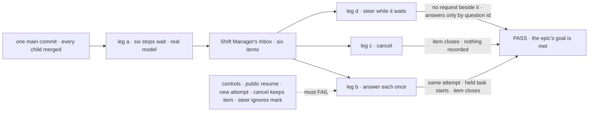

# FIX-2134 · Closure: every stop for a person is one Inbox item

**Spec** · [Decisions](DECISIONS.md)

## Five people, before and after

| Someone who… | Today | After this closes |
|---|---|---|
| **decides whether the epic is done** | Each child green on its own commit; nothing opens every kind of stop at once | One report on one `main` commit, every check beside its control's FAIL |
| **uses Shift Manager, like Alice** | The Inbox lists approvals and input; a review, a question and a coding run's question wait where she can't see them | Six stops wait at once on a real model and her Inbox shows six items, each answered once there, the work carrying on the same attempt |
| **files work, or writes a flow that asks** | Answers with `answerTask`; an input past its expiry stays parked | A filer's steer answers only its own task's midway question; a stop has no deadline unless one is set, and at a set one an approval is a no and a held question goes ahead from its brief |
| **runs Shift Manager on their own machine** | A stop needs an app setting to survive a restart | The host is killed while all six wait; after a restart all six are still listed once |
| **maintains the framework** | Six forms of stopping, three answer paths | CI fails a later PR that brings an old path back ([D2](DECISIONS.md#d2)) |

## The goal, and how we'll know it's met

**On one `main` commit with every other child merged, a person using Shift Manager on a real model
sees every stop that waits on them as exactly one Inbox item, answers each once through its one
route, and the work carries on the same attempt, or for a task held before it starts, starts its
first; a cancel closes the item, and a steer never runs beside a waiting request.**

| Is it the right goal? | |
|---|---|
| **The real need** | [The epic's goal](../../epics/FIX-2058/SPEC.md#the-goal-and-how-well-know-its-met) on the assembled set: the gaps *between* children ([closure rule](../../../docs/contributing/orchestration.md#the-closure-issue-every-epic-ends-in-qa)). |
| **Smaller, and rejected** | "Re-run every child's check." None has six stops in one Inbox, so an answer reaching the wrong stop, or a stop two Inbox reads both list, still passes |
| **Not done if** | A check ran on another commit · a structural miss was retried away ([FIX-2087 D1](../FIX-2087/DECISIONS.md#d1)) · a control was skipped or passed · one store backing never ran · the check answered through the store · a finding is open |



The walk reads Alice's Inbox and the rows through public task actions; each control breaks one leg.

| How we verify | |
|---|---|
| **Goal check** | `goals/shift-manager/every-stop-is-one-inbox-item/` · real model `openai/gpt-6-luna`, Claude Code through the devteam harness for the coding run · run by the closure worker on one `main` commit · the report is the closure PR's body |
| **Signal** | Every `<leg>:<assertion>` in [the signal table](#the-signal) passes |
| **Input** | A goal-local Lab served by Shift Manager's command, no durability or store setting in its config; prompts and the coding run's held-out fact picked at run time |
| **Anti-game** | Assert on the Inbox's pending read and `getTask` / `listTasks` as Alice; no fixture writes a row; `FSDEV_TRACE_OBSERVABILITY=0`, so a step run twice shows as a work counter of 2 |
| **Control that must fail** | `public-resume` (FIX-2129's) **`b:approval-same-attempt`** · `new-attempt` (FIX-2132's) **`b:coding-same-attempt`** · `cancel-keeps-item`, the cancel written but neither the suspension nor the hold resolved, **`c:item-closes`** and **`c:held-cancel-closes-questions`** · `steer-ignores-mark` **`d:no-request-beside`** · `default-deadline` (FIX-2129's) **`a:no-deadline-waits`** · the sweep's `--control` its plants · today's `main` **`a:six-items`** and the sweep |

### The signal

| Assertion | Passes when |
|---|---|
| `a:six-items` | FIX-2133's `reconcileInbox` is green over all six kinds at once: no missing, duplicate or orphan item, no drift between a task run's suspension and its hold, every item answerable through its item's `source`, as each cell of the [six-stop figure](#what-changes) says |
| `a:no-deadline-waits` | None of the six has a deadline set; past the sweeper's interval and a board touch, all six are still listed and none has resumed or released ([epic D3](../../epics/FIX-2058/DECISIONS.md#d3)) |
| `a:rows-read` | The three suspended rows each carry one open suspension hold and keep their claim; the three held rows carry an open row hold and no lease; no row reads `parked` |
| `b:<stop>-same-attempt` | Each stop, answered once in the Inbox, carries on as its figure row says: `attempts` never past 1, work counter 1 |
| `b:answered-once` | The item leaves the list; a second answer is told the stop is resolved |
| `c:item-closes` | Cancelling a suspended and a held task closes both items; nothing the resumed block writes is kept |
| `c:held-cancel-closes-questions` | `getTask` on the cancelled held row shows no open hold. The item would vanish on the status alone, so this reads the row |
| `d:no-request-beside` | A steer into a task waiting on a review starts no request beside it; one more turn takes it after the answer |
| `d:answer-by-id` | A held question is answered only by a steer carrying its question id: through `updateTask` ([FIX-2133 D1](../FIX-2133/DECISIONS.md#d1)), or by a line typed in the task's session, which orchestration's `steerFromLine` writes as that steer for the oldest open question, in every session alike ([FIX-2133](../FIX-2133/DECISIONS.md#decided-not-asked)) |
| `d:plain-answers-nothing` | A plain message to a non-coding task's session (conversation outside the task, owner 2026-10-22), and a steer naming no question, answer nothing |
| `sweep:no-old-path` | None of `PERSON_STOPS_REMOVED` has a reference in package source, each read at its scope: `answerTask`, `parkOnQuestion`, `awaitReview`, `unparkAndDrain`, `parkOnBoardQuestion`, `inboxCollection` and `unpark` anywhere; `onReview` beyond the board's by-name refusal; `answerQuestion` as harness-manager's export only |

**The rest of the plan** is [in DECISIONS](DECISIONS.md#the-plan-in-full): three team journeys,
the children's checks under a skip map, and the gap sweep. A failure becomes a child of FIX-2058
blocking this issue, and the whole plan runs again on a fresh commit.

## What changes


Red cells are today's six forms; the closure asserts every right half at once.

**The sweep, one rule in the engine CI already runs** ([D2](DECISIONS.md#d2)), filled by the children as they delete; here it is complete:

```diff
  // goals/workforce-coordination/runs-on-one-task/rules.mjs (FIX-2087, #3692)
  export const TOOLS_ALLOWED = {
-   answerTask: "FIX-2056 D2: kept until FIX-2058 retires it",          // FIX-2131 drops both
-   parkOnQuestion: "FIX-2056 D2: the worker's question park, kept until FIX-2058",
  };
+ // FIX-2058's old ways to stop for a person or answer one: no reference in package source,
+ // matched as the REMOVED rows are, with the same `--control` plant
+ export const PERSON_STOPS_REMOVED = [
+   "answerTask", "parkOnQuestion", "awaitReview", "unparkAndDrain",
+   "parkOnBoardQuestion", "inboxCollection", "unpark",          // FIX-2131's and FIX-2132's sweeps
+   { name: "onReview", allow: "the board's by-name refusal" },  // FIX-2131 keeps that one
+   { name: "answerQuestion", in: "packages/harness-manager" },  // the export; the word stays free elsewhere
+ ];
```

**Docs:** no documentation impact. The closure ships checks; a page that doesn't hold when followed
is a finding against its child.

**Stays as it is:** all product code; every composed check, as it is on `main`. No legacy leg:
stores are reset (owner).

## What's already here, and the debt

| Already here | What this does with it |
|---|---|
| The epic's goal check, legs a to d | **Builds on.** Input and held-before-start named as stops of their own |
| The children's goal checks and controls | **Builds on.** Composed; two controls reused |
| [FIX-2087](../FIX-2087/SPEC.md), the last closure, and its `rules.mjs` (#3692, open) | **Kept** its shape and D1; **extended** by one rule ([D2](DECISIONS.md#d2)) |
| [FIX-2133](../FIX-2133/DECISIONS.md#decided-not-asked)'s rule, one listing source per kind, in one package read | **Checked** here, by the walk |
| Anything else grading the assembled set | **None.** Searched `goals/` for `inbox`, `waitForUser`, `askQuestion`, `held`, `closure` |

| The debt | |
|---|---|
| **Removes** | Nothing. The children remove; this proves it |
| **Adds** | One goal and one CI sweep rule. Permanent by design |
| **Leaves** | Nothing of the Inbox's: a stop listed twice or missed is a Bug against FIX-2133's rule |

**Net: up, a little.** One goal and one rule, for a promise that stays true.

## Sign off

**[The goal](#the-goal-and-how-well-know-its-met), at that size:** six stops at once, one Inbox,
answered once, the same attempt, on a real model and one commit. If wrong: the epic wraps on pieces
that pass apart and collide together.

**[The debt](#whats-already-here-and-the-debt), net up a little:** one goal and one CI rule. If
wrong: a CI rule that fails a later PR reusing one of nine names.

1. **[D1](DECISIONS.md#d1) · All six stops wait at once, in one Lab and one Inbox, not one walk per
   kind.** If wrong: a longer run whose failures are harder to split.
2. **[D2](DECISIONS.md#d2) · The no-old-path sweep is one rule in FIX-2087's CI sweep, not a check
   only this goal runs.** If wrong: one more CI rule to edit when a name is reused.

**Open: none of its own.** D1 is the one to weigh.

Improvement · closure (QA) · `goals/` and one CI rule · large, repeats per finding · epic
[FIX-2058](../../epics/FIX-2058/SPEC.md), closure · required · runs after every other child merges
(FIX-2063, FIX-2129, FIX-2131, FIX-2132, FIX-2133; FIX-2137 done) · the D2 rule runs in CI before it is done · Linear [FIX-2134](https://linear.app/fixpoint-labs/issue/FIX-2134)
