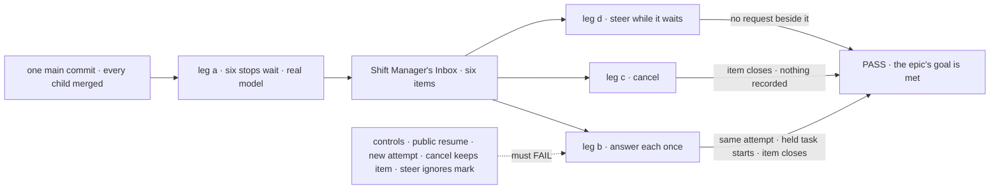

# FIX-2134 · Closure: every stop for a person is one Inbox item

**Spec** · [Decisions](DECISIONS.md)

## Five people, before and after

| Someone who… | Today | After this closes |
|---|---|---|
| **decides whether the epic is done** | Each child will be green on its own commit. Nothing opens every kind of stop at once, the way a person meets them | One report on one `main` commit: every check beside its control's FAIL, every finding with its retest |
| **uses Shift Manager, like Alice** | The Inbox lists approvals and input. A review, a question and a coding run's question wait where she can't see them; a task can't ask before it starts | On a real model, six stops wait at once and her Inbox shows six items. Each answers once, there, and the work carries on the same attempt; a task held before it starts starts its first |
| **files work, or writes a flow that asks** | Answers a question with `answerTask`; an input past its expiry stays parked for good | A filer's steer answers only its own task's midway question. At a deadline an approval is a no, an input fails the try unless caught, and a held question goes ahead from its brief |
| **runs Shift Manager on their own machine** | A stop for a person needs an app setting to survive a restart | The host is killed while all six wait; after it restarts, all six are still listed once and still answer on the same attempt |
| **maintains the framework** | Six forms of stopping and three answer paths | No package source names the old paths, and CI fails a later PR that brings one back ([D2](DECISIONS.md#d2)) |

## The goal, and how we'll know it's met

**On one `main` commit with every other child merged, a person using Shift Manager on a real model
sees every stop that waits on them as exactly one Inbox item, answers each once through its one
route, and the work carries on the same attempt, or for a task held before it starts, starts its
first; a cancel closes the item, and a steer never runs beside a waiting request.**

| Is it the right goal? | |
|---|---|
| **The real need** | [The epic's goal](../../epics/FIX-2058/SPEC.md#the-goal-and-how-well-know-its-met) on the assembled set, and the [closure rule](../../../docs/contributing/orchestration.md#the-closure-issue-every-epic-ends-in-qa): the gaps *between* children. No end-state POC was built for the epic, so this run is its first integrated proof |
| **Smaller, and rejected** | "Re-run every child's check on one commit." Each opens one kind of stop, on its own fixture; none has six waiting in one Inbox, so an answer that reaches the wrong stop, or a stop two Inbox reads both list, still passes |
| **Bigger, and not this issue's** | Fixing anything: a finding is a child of FIX-2058 · telling the filer by a message (FIX-2070) · the renames (FIX-2071) |
| **Not done if** | A check ran on another commit · a structural miss on some attempt was retried away ([FIX-2087 D1](../FIX-2087/DECISIONS.md#d1)) · a control was skipped or passed · a child's check was skipped though the walk covers it only in part · one store backing was never run · the check answered through the store · a finding is open |



The walk reads what Alice's Inbox lists and the rows through the public task actions; each control
breaks the one behaviour its leg proves.

| How we verify | |
|---|---|
| **Goal check** | `goals/shift-manager/every-stop-is-one-inbox-item/` · real model, `openai/gpt-5.4-mini`, and Claude Code through the devteam harness for the coding run · run by the closure worker on one `main` commit after every other child merges · the report is the closure PR's body |
| **Signal** | Tagged `<leg>:<assertion>`; the six stops are [the figure's rows](#what-changes). **a**: six items, one per stop, kind named. The three suspended rows read `waitingOn: "user"` and keep their claim (a second worker claims nothing); the three held rows carry an open question and no lease; no row reads `parked`. **b**: each answered once in the Inbox carries on as its row says, `attempts` never past 1 and the work counter at 1; the item leaves the list; a second answer is told the stop is resolved. **c**: cancelling a suspended task and a held one closes both items; nothing the resumed block writes is kept; no turn follows. **d**: a steer into a task waiting on a review starts no request beside it and is taken by one more turn after the answer; a line in a held task's session answers its question; a steer naming no question answers nothing. **Sweep**: `answerTask`, `parkOnQuestion`, `awaitReview`, `unparkAndDrain` and harness-manager's `answerQuestion()` have no references in package source |
| **Input** | A goal-local Lab served by Shift Manager's command, with no durability or store setting in its config. Prompts and the held-out fact the coding run must carry are picked at run time |
| **Anti-game** | Assert on the Inbox's pending read and on `getTask` / `listTasks` as Alice; answer the way the Inbox does; no fixture writes a row. Run with `FSDEV_TRACE_OBSERVABILITY=0`, so a resume that runs a step twice shows as a work counter of 2 |
| **Control that must fail** | `GOAL_CONTROL=public-resume` (FIX-2129's) **`b:approval-same-attempt`**; `new-attempt` (FIX-2132's) **`b:coding-same-attempt`**; `cancel-keeps-item`, the cancel written but its stop never resolved, **`c:item-closes`**; `steer-ignores-mark`, steer admission blind to the row's mark, **`d:no-request-beside`**. The sweep's `--control` reports its plants. Today's `main` FAILs **`a:six-items`** and the sweep |

## The plan, in the order it runs

| # | What runs | PASS means |
|---|---|---|
| 1 | Legs a to d and the sweep, above | Each green; each control red where named |
| 2 | **A journey per team the walk misses**, same Lab. **j1** *files work:* the filer's steer answers its task's midway question, and a later Inbox answer is told so; its steer to a routed task's question, or to an approval, answers nothing. **j2** *writes a flow that asks:* with the person-stop default shortened, an approval reads as a no, an unhandled input fails try 1, a caught one goes on, and a held question goes ahead from its brief told no answer came (**`j2:held-deadline-goes-ahead`**); a user's stop of a waiting run ends it, closes the item and cancels the task. **j3** *runs it locally:* the host is killed while leg a's six wait; after a restart all six are listed once and leg b passes on them | Each green |
| 3 | **Every child's goal check with its controls**, read from Linear at run time and printed: FIX-2063, FIX-2129, FIX-2131, FIX-2132, FIX-2133 on both store backings. FIX-2137 is a bug with no goal; leg b's work counter is its check. Any the walk covers only in part runs | Each PASS beside its documented FAIL |
| 4 | **The gap sweep**: each [coordination seam](../../epics/FIX-2058/DECISIONS.md#coordination-seams) read from both sides; the human-in-the-loop guide and the task-board page followed as written; each epic *not done if* state absent; the Inbox's three reads judged ([decided, not asked](DECISIONS.md#decided-not-asked)) | Every seam two-sided, every promise backed |

Any failure becomes a child of FIX-2058 that blocks this issue, and the whole plan runs again on a
fresh commit once it merges.

## What changes


Read across each row: the red cells are today's six forms; the closure asserts every row's right
half at once, in one Inbox.

**The sweep, one rule in the engine CI already runs** ([D2](DECISIONS.md#d2)):

```diff
  // goals/workforce-coordination/runs-on-one-task/rules.mjs (FIX-2087, #3692)
  export const TOOLS_ALLOWED = {
-   answerTask: "FIX-2056 D2: kept until FIX-2058 retires it",          // FIX-2131 drops both
-   parkOnQuestion: "FIX-2056 D2: the worker's question park, kept until FIX-2058",
  };
+ // FIX-2058's old ways to stop for a person or answer one: no reference in package source,
+ // matched as the REMOVED rows are, with the same `--control` plant
+ export const PERSON_STOPS_REMOVED = ["answerTask", "parkOnQuestion", "awaitReview", "unparkAndDrain", "answerQuestion"];
```

**Docs:** no documentation impact. The closure ships checks; the one-rule story is FIX-2131's and
the durable default FIX-2063's, and a page that doesn't hold when followed is a finding against it.

## What stays as it is

- **No product code.** A gap becomes a child of FIX-2058.
- **Every composed check** runs as it is on `main`; a red one is a finding against its owner.
- **No leg reads a row stored before the epic:** stores are reset (owner), so there is no legacy leg.
- **What a held question does at its deadline** is the epic's [open question](../../epics/FIX-2058/DECISIONS.md#open). The run is written against "goes ahead"; if the owner picks "fail", `j2:held-deadline-goes-ahead` flips to a failed try, with FIX-2132's leg e and FIX-2133's deadline leg in row 3. Nothing else moves.

## What's already here, and the debt

| Already here | What this does with it |
|---|---|
| The epic's goal check, legs a to d ([FIX-2058](../../epics/FIX-2058/SPEC.md#the-goal-and-how-well-know-its-met)) | **Builds on.** This is it, with input and the held-before-start kind named as stops of their own |
| The children's goal checks and their named controls | **Builds on.** Composed; `public-resume` and `new-attempt` reused, not copied |
| [FIX-2087](../FIX-2087/SPEC.md), the last epic's closure: its plan's shape and [D1](../FIX-2087/DECISIONS.md#d1) | **Kept.** The same four rows; a structural miss on any attempt is a finding |
| FIX-2087's `rules.mjs` and its CI step (#3692, open) | **Extended** by one rule ([D2](DECISIONS.md#d2)) |
| [FIX-2133](../FIX-2133/SPEC.md#whats-already-here-and-the-debt) *Leaves*: the Inbox's third read, "folding them is the closure's to judge" | **Judged** here, by the walk ([decided, not asked](DECISIONS.md#decided-not-asked)) |
| [ER-5](../../epics/FIX-2058/DECISIONS.md#who-owns-what): parked rows read through FIX-2080's map | **No leg:** stores are reset, and FIX-2131 adds no entry |
| Anything else that grades the assembled set | **None.** Searched `goals/` for `inbox`, `waitForUser`, `askQuestion`, `held`, `closure` |

| The debt | |
|---|---|
| **Removes** | Nothing. The children remove; this proves it |
| **Adds** | One goal and one sweep rule in CI. Permanent by design: the promise outlives the epic |
| **Leaves** | The Inbox's three reads, unless the walk finds one listing a stop twice or missing one, which is a finding |

**Net: up, a little.** One goal and one rule, for a promise that stays true.

## Depends on

| Must be green before it runs | Why |
|---|---|
| FIX-2063, FIX-2129, FIX-2131, FIX-2132, FIX-2133 merged, each with its goal's PASS and its control's FAIL in its PR; FIX-2137 (done) | The walk composes them; a child unmerged leaves a leg with nothing to read |
| FIX-2087's #3692 merged | [D2](DECISIONS.md#d2)'s rule lives in its engine; if it hasn't landed, the rule runs in this goal alone |

## Sign off

**[The goal](#the-goal-and-how-well-know-its-met), at that size:** six stops at once, one Inbox,
answered once, the same attempt, on a real model and one commit. If wrong: the epic wraps on pieces
that pass apart and collide together, or waits on a walk nobody needed.

**[The debt](#whats-already-here-and-the-debt), net up a little:** one goal and one CI rule. If
wrong: a CI rule that fails a later PR reusing one of five names for something else.

1. **[D1](DECISIONS.md#d1) · All six stops wait at once, in one Lab and one Inbox, not one walk per
   kind.** If wrong: a closure run that takes longer and fails for reasons that are hard to split.
2. **[D2](DECISIONS.md#d2) · The no-old-path sweep is one rule in the CI sweep FIX-2087 built, not a
   check run only by this goal.** If wrong: one more CI rule to edit when a name is reused.

**Open: none of its own.** The deadline is the epic's; the leg that flips is named above. D1 is the
one to weigh.

Improvement · closure (QA) · `goals/` and one CI rule · large, repeats per finding · one PR after a
clean run · epic [FIX-2058](../../epics/FIX-2058/SPEC.md), closure · required · runs after every
other child merges · Linear [FIX-2134](https://linear.app/fixpoint-labs/issue/FIX-2134)
