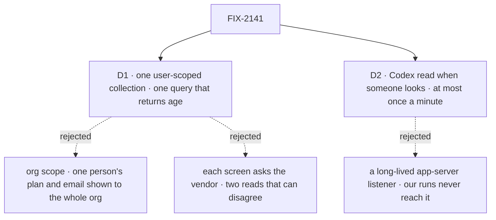

# FIX-2141 · Decisions

[Spec](SPEC.md) · **Decisions**

The epic's storage note asked for one record that sources write and one query that everyone
reads, held by a primitive FSD already has. These two say where that record lives and how fresh a
Codex number is. Everything else follows from the brief's rules: vendor numbers only, sanctioned
sources only, and a plain reason in place of a guess.

## The tree

Solid edges are what you're signing. Dashed edges lost, and the label says why.

## D1 · Usage is kept per person, in one collection, and read through one query that always returns its age

| | |
|---|---|
| **Instead of** | An `org`-scoped collection, which would show one person's Codex plan and email to everyone in the org. Or no stored record, with each screen asking the vendor, which gives two reads that can disagree and a Claude number nobody can ask for (Claude reports only during a run) |
| **Because** | The brief is "your own subscriptions", and a person's own sign-in is theirs to see. A `user`-scoped resource collection is the primitive harness-manager's run record already uses, at the same scope and for the same principal, so this adds no new way to hold state (FIX-2056 bar; tenet 3, *earn every addition*). One writer and one query mean the screen and a worker see the same row and the same age, and Claude Code's writer (FIX-2142) lands in the same place |
| **Locks in** | The query name `harnessUsage` and the collection `harness-usage/**`, keyed by harness and account, owned by `@flow-state-dev/harness-manager`. Each row carries its windows, its status (`windows`, `api-key`, `signed-out`, `unavailable`), `checkedAt`, and the query adds `ageMs` and `rolledOver`. Two people on one machine share one Codex sign-in but hold two rows, each as fresh as that person's last look |

It comes down to whose numbers a reader sees: an org-wide row shows one person's plan to all.

**What would change my mind:** a Lab where several people deliberately share one subscription and
expect one number. Then the row moves to `org` scope, keyed by account, and the query filters by
who may see that account.

## D2 · Codex is read when someone looks, at most once a minute, not kept live

| | |
|---|---|
| **Instead of** | Keeping one `codex app-server` running and recording each `account/rateLimits/updated` notification as it arrives |
| **Because** | That notification is a sparse update the app-server sends while it runs turns (its schema says to merge it into the last read). Our Codex harness runs through `@openai/codex-sdk`, which starts `codex exec`, so a listener would sit idle while Codex work used the pool. A read on demand is one documented call (`account/rateLimits/read`) that sees the whole pool, whatever used it. A minimum age of one minute stops a screen that re-renders from starting a process per render |
| **Locks in** | A Codex number is as old as the last look, and the view says how old. Opening Usage, or a worker calling `harnessUsage({ refresh: true })`, starts one short-lived app-server child when the row is older than a minute. `refresh` on a harness with no reader (Claude Code) returns its stored row unchanged |

It comes down to where our runs go: they never pass through an app-server a listener could hear.

**What would change my mind:** the Codex harness moving onto app-server (so its runs report there),
or the Codex SDK surfacing rate limits on its own events. Then a run writes through `onUsage`, as
Claude Code's will, and the on-demand read stays for screens.

## Decided, not asked

- **The neutral shape lives in core, beside the harness contract.** `core/types/harness.ts`
  gains the window type and schema, `HarnessUsageHook` (a twin of `HarnessSessionHook`, fired by a
  harness during a run) and `HarnessUsageReader` (an on-demand read with no run). No vendor word
  and no Workforce word, as the file's own rule says. Layer 1 gets the shape; harness-manager holds
  the store.
- **The convergence point.** `recordHarnessUsage` is the collection's only writer, and the
  `harnessUsage` query its only reader. Writers that pass through it: a registered reader's
  result (Codex now), and the `onUsage` slot feed harness-manager hands every harness (Claude Code
  in FIX-2142). The collection is not client-readable on its own: the Usage view reads the query,
  so it can never show a row without its age.
- **One record per harness and account, windows inside it.** A Codex read returns every window
  at once and replaces the record; a sparse event (Claude's) sets one window by id. Keying by
  window too would make "this account is now on an API key" a write to every window.
- **Latest only, no history.** A record holds the last snapshot of each window. A window that
  rolls over is overwritten by its next reading, never appended. A time series is a different
  feature and gets its own issue if anyone asks for it.
- **A write never goes backwards.** `recordHarnessUsage` refuses a window whose `checkedAt` is
  older than the stored one for that window, so a slow refresh can't overwrite a fresher
  `rate_limit_event` from FIX-2142. The goal check's leg a adds the case: a reading older than the
  stored one leaves the stored one.
- **A read is a read.** `harnessUsage()` without `refresh` has no side effects and starts no
  process. `refresh: true` is the only path that starts a vendor process, with a 10 s timeout per
  reader (the default `probeClaudeAccount` uses). A refresh that fails or times out returns the
  stored rows with their `ageMs` and a per-harness `refreshError`; it never fails the whole query.
- **Readers are named once, where the host wires its harnesses.** The host hands the capability
  one `readers` map keyed by harness. There is no global registry, and no field on a harness
  block: a harness here is a block factory, and a person can have a Codex subscription Shift
  Manager doesn't run (it runs Claude Code or the stub today). Tying readers to installed harnesses
  would hide that Codex pool.
- **A window is its length in minutes plus the vendor's id for it.** Codex gives
  `windowDurationMins` (300, 10 080); Claude gives a type (`five_hour`, `seven_day_opus`). The view
  labels by minutes where known ("5-hour", "weekly") and by the vendor's name otherwise. Percent is
  0 to 100 as the vendor sent it, never derived.
- **Rolled over is the query's to compute, not the writer's.** `rolledOver` is `resetsAt < now`
  at read time. A rolled-over window keeps its stored percent for the record, and the view shows
  "reset at …, not checked since" instead of it.
- **What has no number says why.** Codex's `account/read` tells signed out (`account: null`)
  from an API key (`type: "apiKey"`); both refuse `account/rateLimits/read` with `-32600`. Any
  other failure, a timeout or a missing binary is `unavailable` with its reason. None of them
  writes a percent. An API-key row's tokens and cost come with FIX-2145.
- **Local only, said where a host wires it.** OpenAI's app-server docs permit its sign-in on a
  person's own machine, not in a hosted service. The reader can't tell where it runs, so it is
  opt-in: a host passes it, and the Codex docs say when not to.
- **The Codex CLI the reader starts is the harness's own pin** (`@openai/codex` 0.152.1, beside
  `@openai/codex-sdk`), found the way the SDK finds it, so the reader and a run read one sign-in.
- **Settled by POC: the read works as documented, and the two no-number states are real.**
  [`poc/app-server-read/`](poc/app-server-read/NOTES.md) ran the pinned CLI. Signed out:
  `account/read` → `account: null`, the read → `-32600 "codex account authentication required to
  read rate limits"`. API key: `account: {type: "apiKey"}`, the read → `-32600 "chatgpt
  authentication required to read rate limits"`. The signed-in shape is the CLI's published
  `GetAccountRateLimitsResponse`, not yet seen live: goal leg f.
- **Left out: Claude Agent SDK's experimental usage call.** SDK 0.3.234 has
  `usage_EXPERIMENTAL_MAY_CHANGE_DO_NOT_RELY_ON_THIS_API_YET()`, which reads the claude.ai usage
  endpoint. The SDK says not to rely on it, and the brief bans that endpoint. FIX-2142 records
  `rate_limit_event` only.

## Considered and dropped

| Option | Why it lost |
|---|---|
| The collection in `@flow-state-dev/workforce` | Claude's events arrive at the harness slot, which harness-manager feeds. Workforce reads through the query |
| The collection in core | Core holds builders and contracts, not a store a host installs. The shape is there; the store is not |
| One record per window | See *Decided, not asked*: an account change would touch every window |
| A new kind of resource that refreshes itself on read | A second way to hold state for one caller. The query does the refresh in front of an ordinary collection |
| Reading Codex's session logs (`rate_limits` in its JSONL) | Often null, as the issue says, and a log is not an interface |
| ChatGPT's `wham/usage` endpoint | Undocumented and banned by the brief |

## How it got here

- **Draft** — framed as the epic's storage note made concrete: the shape in core beside the
  harness contract, one user-scoped collection in harness-manager with one writer and one query
  that returns age, and Codex read through app-server when someone looks, because our Codex runs
  never reach an app-server listener. The two no-number states were checked on the pinned CLI
  first.
- **Architect** — `fsd-architect` agreed with the collection's home, the shape in core and no new
  ledger ([agent-mailbox#45](https://github.com/fixpoint-labs/agent-mailbox/pull/45#issuecomment-6372035349)),
  and asked for four rules. Three are in *Decided, not asked*: a write never goes backwards, a
  read is a read, latest only. The fourth, readers hung on the harness definition, was declined:
  there is no such object to hang them on, and it would hide a Codex pool the host doesn't run.
