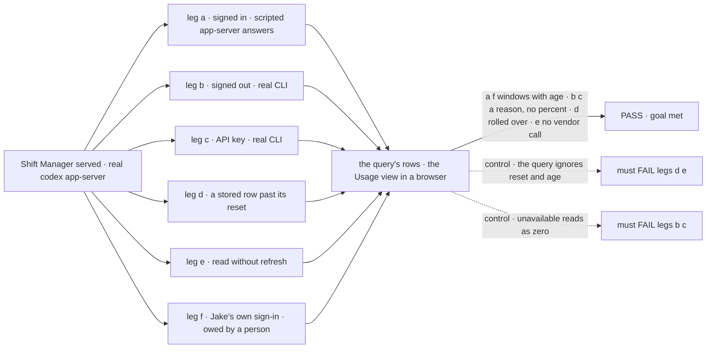
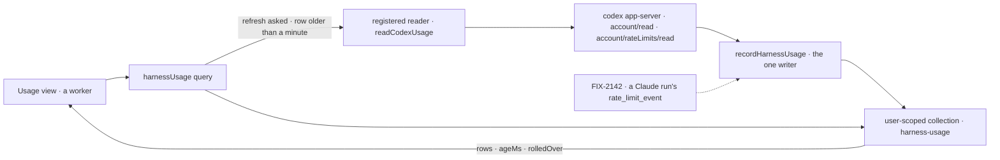

# FIX-2141 · Codex: read subscription usage from app-server and define the usage snapshot

**Spec** · [Decisions](DECISIONS.md)

## Five people, before and after

| Someone who… | Today | After |
|---|---|---|
| **runs Shift Manager on their own ChatGPT sign-in** | Can't see how much of Codex's 5-hour or weekly window is left until a run fails | Opens Usage and sees each Codex window: percent used, when it resets, "from Codex", checked a few seconds ago |
| **opens Usage again an hour later** | Nothing to open | Sees the number refresh. A window whose reset time has passed shows "reset at 14:00, not checked since", never the old percent |
| **runs Codex with an API key** | Nothing | Sees "Codex uses an API key: no subscription limit". No percent |
| **has never signed Codex in on this machine** | Nothing | Sees "Codex is not signed in: not available automatically". No percent, no guess |
| **builds a screen or a worker that needs usage** | Would have to call Codex itself | Calls one query, `harnessUsage`, and gets the same rows and ages the Usage view shows |

## The goal, and how we'll know it's met

**A person running Shift Manager on their own subscription sees, for Codex, the percent used and
reset time of every window Codex reports, with where it came from and how old it is; and anything
that wants those numbers reads them through one query that Claude Code and the others will reuse.**

| Is it the right goal? | |
|---|---|
| **The real need** | *"Work fails with no warning when a pool runs out, and we can't plan which harness to use"* (the epic). *"A clean way to query usage at any point"* (Jake, on the epic) |
| **Smaller, and rejected** | "Show Codex's numbers on one screen." It would meet the first quote and miss the second: the next harness would invent its own store and its own read, which is the duplicate the epic's storage note forbids (FIX-2056 bar) |
| **Bigger, and not this issue's** | Claude Code's numbers (FIX-2142, writes the same snapshot). Tokens per worker, labelled as usage (FIX-2145). Cursor and Grok Build (FIX-2143, FIX-2144, on hold) |
| **Not done if** | A stale number reads as current · a window past its reset shows its old percent · signed out or API key shows any percent · a screen or worker reads Codex directly · the query and the screen can disagree · the snapshot has a second home |



The check reads what the query returns and what the Usage view draws. Each control must fail,
or the check proves nothing.

| How we verify | |
|---|---|
| **Goal check** | `goals/shift-manager/it-shows-codex-usage-left/` · no model · run by the implementer at completion · verdict in the implementation PR |
| **Signal** | a: two windows (300 and 10 080 minutes) with the scripted percents and resets, `checkedAt` within the run, and the view shows both with "from Codex"; a reading older than the stored one leaves the stored one. b: `signed-out`, the reason shown, no percent anywhere on the card. c: `api-key`, the same. d: a row whose `resetsAt` is past returns `rolledOver: true` and the view shows no percent for it. e: a row 3 hours old returns `ageMs` ≥ 3 h and the scripted app-server logs no read. f: Jake's real sign-in shows the same percents as `codex` `/status` within the same minute |
| **Input** | Legs b and c run the real `codex app-server` from the pinned `@openai/codex` (0.152.1) against an empty and an API-key `CODEX_HOME`. Leg a replays the protocol shape the pinned CLI's `generate-ts` publishes |
| **Anti-game** | No assertions on the reader's input or on a stubbed query. Rows read through the query over HTTP, the view read in a browser |
| **Control that must fail** | `GOAL_CONTROL=ignore-age` must FAIL d on *rolled over* and e on *no vendor call*. `GOAL_CONTROL=unavailable-as-zero` must FAIL b and c on *no percent*. `GOAL_CONTROL=last-write-wins` must FAIL a on *leaves the stored one* |

Leg f needs a ChatGPT sign-in, which no CI has. The implementation PR stays marked *goal owed:
leg f* until Jake or `fsd-qa` runs it.

## What changes


One store per person and one query in front of it. Codex fills it when someone looks; Claude Code
will fill it as runs report.

```diff
 // packages/shift-manager/teams/devteam/fsdev.config.mts (the host)
+import { readCodexUsage } from "@flow-state-dev/codex";
+import { harnessEnv } from "@flow-state-dev/core";
 …
 const lab = await openLab({
   stores: sqliteStores({ filename: STORE }),
   harness: harness.slot,
+  // Read when someone opens Usage. Local only: OpenAI does not permit app-server auth in a hosted service.
+  usage: { codex: () => readCodexUsage({ env: harnessEnv({ pass: ["PATH", "HOME", "CODEX_HOME"] }) }) },
   …
 });
```

`openLab` hands `usage` to harness-manager's `harnessUsageCapability({ readers })`, which the
Lab's flows already carrying harness-manager pick up. A host outside Shift Manager passes the
same `readers` to the capability directly.

```ts
// any reader, server side or through the client
const { harnesses } = await harnessUsage({ refresh: true });
// [{ harness: "codex", status: "windows", account: "jake@…", plan: "pro",
//    windows: [{ minutes: 300, usedPercent: 42, resetsAt, checkedAt, ageMs, rolledOver: false, origin: "read" }, …] }]
```

**Docs:** update *Tools → Codex* (reading usage left, local only), *Tools → Coding agents* (the
shared usage shape), *Orchestration → Harness manager* (the usage collection and query), and the
READMEs of `core`, `codex`, `harness-manager` and `shift-manager`. No new page.

## How a number gets to the screen



The query is the only reader and `recordHarnessUsage` the only writer. Nothing else opens the
collection.

## What stays as it is

- **The Codex harness.** Runs still go through `@openai/codex-sdk`. Reading usage starts its own
  short-lived `codex app-server` and never touches a run.
- **The harness contract.** `HarnessRunHandle` and its `usage` and `cost` fields are unchanged.
  The new shape sits beside them.
- **The run record.** `runs/**` keeps its per-attempt tokens and cost. Totals per worker are
  FIX-2145's.
- **Credentials.** Nothing reads a token file or calls an undocumented endpoint. The reader
  asks the Codex CLI, as `probeClaudeAccount` asks Claude Code.

## What's already here, and the debt

| Already here | What this does with it |
|---|---|
| Ways to read a vendor's subscription usage | **None.** Searched `rateLimit`, `rate_limit`, `usedPercent`, `utilization`, `quota`, `usage` across `packages/` and `apps/`: hits are per-run token counts and provider error codes. This is the first |
| Ways to hold host-wide harness facts per person | **One:** harness-manager's `user`-scoped run record (`runs/**`). **Builds on** its scope and principal; a second collection beside it, not a second mechanism |
| `probeClaudeAccount` (claude-code), which asks the harness's own CLI with no model turn | **Builds on** its shape for `readCodexUsage` |
| `HarnessSessionHook` in `core/types/harness.ts`, fired by a harness during a run | **Builds on.** A `HarnessUsageHook` twin is declared here for FIX-2142 |
| The harness-manager slot feeds (`cwd`, `resume`, `onSession`) | **Extends** with `onUsage`, wired to the one writer. Codex fires nothing yet |
| Shift Manager's gap for a task's harness, tokens and cost (FIX-1652) | **Leaves alone.** Per-task cost is that issue's; per-worker totals are FIX-2145's |

| The debt | |
|---|---|
| **Removes** | Nothing. There was no usage read to replace |
| **Adds** | One collection, one writer, one query, one Codex reader, one neutral type. A Codex app-server child process per refresh, at most once a minute ([D2](DECISIONS.md#d2)). Permanent by design |
| **Leaves** | Workforce's Error Reporter runs Claude Code outside harness-manager, so its `rate_limit_event`s are not recorded until it is fed `onUsage`. FIX-2142 decides it |

**Net: up, small.** A new capability with one read and one write, and no second way to hold
state.

## Sign off

**[The goal](#the-goal-and-how-well-know-its-met), at that size:** Codex's windows on screen,
and the one query every harness reuses. If wrong: Claude Code arrives with its own store, and the
two can disagree.

**[The debt](#whats-already-here-and-the-debt), net up, small:** one collection and its query,
beside the run record. If wrong: a store nothing reads but one screen.

1. **[D1](DECISIONS.md#d1) · Usage is kept per person, in one collection, and read through one
   query that always returns its age.** The one to weigh. If wrong: two people on one machine see
   different ages for one shared Codex pool.
2. **[D2](DECISIONS.md#d2) · Codex is read when someone looks, at most once a minute, not kept
   live.** If wrong: a run eats the window between looks, and the view is a minute behind.

**Open: none.** `fsd-architect` agreed with the collection's home on
[agent-mailbox#45](https://github.com/fixpoint-labs/agent-mailbox/pull/45#issuecomment-6372035349);
three of its four rules are folded in, and the fourth is declined with the reason in
[Decisions](DECISIONS.md#how-it-got-here).

Feature · `core` + `codex` + `harness-manager` + `shift-manager` · medium · first child of epic FIX-2139
