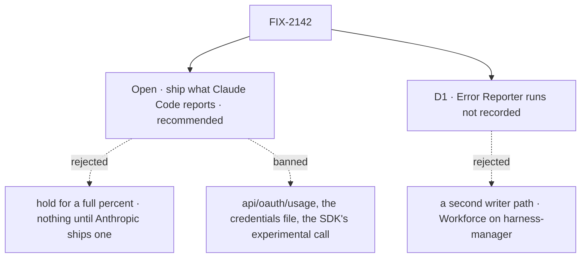

# FIX-2142 · Decisions

[Spec](SPEC.md) · **Decisions**

FIX-2141 built the store, its one writer and its one query, and left three things for the first
run-time writer: the hook, the slot feed and the one-window write. This issue adds them, for the
one source Claude Code sanctions: the `rate_limit_event` a run sends. What that event carries
decides the rest, so the pinned CLI was read first ([POC](poc/rate-limit-event/NOTES.md)).

## The tree

Solid edges are what you're signing. Dashed edges lost, and the label says why.

## Open · Ship Claude's view with what Claude Code reports, or hold it?

**Recommended: ship it.**

| | |
|---|---|
| **Plain terms** | Claude Code tells a run its limits only when they change. Below a warning line it says which window binds, "ok", and when it resets, with no percent. Near a limit it sends the percent. At the limit it says "reached" and when it resets. The issue asked for a percent on every window after every run; no allowed source gives that today |
| **Ship it** | A person gets the warning the epic asks for (a percent as a window nears its limit, and "reached until 14:00"), and a reset time otherwise. The view says "under Claude's warning line", never a number it wasn't sent |
| **Hold it** | Nothing for Claude until Anthropic stabilises a usage read. The SDK has one, named `usage_EXPERIMENTAL_MAY_CHANGE_DO_NOT_RELY_ON_THIS_API_YET`, and it calls the endpoint the brief bans |
| **Locks in** | `HarnessUsageWindow.usedPercent` may be `null`, and the window gains `level`: `ok`, `warning`, `reached`, or `null` (Codex, which always sends a percent). A missing percent is never stored or shown as 0. The record gains `accountAt`, when its account was last set; a row #3768 stored without it reads as 0, so the first rebind always wins |
| **What would change my mind** | Anthropic stabilising a usage read in the Agent SDK, or a headless run shown to run a status line (which gets both windows' percent on every response; one try did not run it). Either fills the percent through the same writer |
| **What being wrong costs** | Someone below the line plans with a reset time and no number. Cheap to reverse: a fuller source writes the same window |

It comes down to whether a warning now beats a full number later.

## D1 · The Error Reporter's Claude runs are not recorded

| | |
|---|---|
| **Instead of** | Giving the Error Reporter's harness feeds an `onUsage` and installing the usage collection on its flow |
| **Because** | An event reports the whole pool, whatever used it, so the next coding run or the next look reports what a bug report used. Recording it would add a second flow that writes the collection and make Workforce depend on harness-manager for a rare, short run (tenet 3, *earn every addition*). Workforce stays a reader of the query |
| **Locks in** | Claude usage is written by harness-manager's coding runs, by its session door's talks (the same harness, run as the person talking), and by a refresh. `ErrorReporterHarnessFeeds` gains nothing |

It comes down to what the next run tells us: the same pool, so the reporter's own write adds little.

**What would change my mind:** a host that runs Claude only for bug reports, or Workforce gaining
coding runs of its own.

## Decided, not asked

- **The hook is the session hook's twin, in core.** `HarnessUsageHook` takes a report (the
  harness's name, one `HarnessUsageWindow`, when it was observed, when the run started, and the
  account id the run is signed in as, or `null`) and the run's context. It names no vendor and no Workforce idea. The
  report names its harness, so the manager's feed writes under `claude-code` without knowing which
  harness sits in its slot. `claudeCodeAgent` asks its own running query for `accountInfo()` once,
  at the first event (no extra process), so a run's windows are bound to the account that sent them.
- **Only the run owner's row.** The feed writes through the run's own context, so the
  `user`-scoped row is the principal that drained the task (or, on the session door, the person
  talking). It never lists or writes another person's row, as FIX-2141 D1 requires; another
  person's copy ages, and its age says so.
- **The one-window write goes through `recordHarnessUsage`,** still the collection's only writer:
  a second form inside the same function, under the same compare-and-swap. It upserts one window
  by id with `origin: "run"` and keeps the others. It compares against that window's own
  `checkedAt` (an older event is refused) and leaves the record's `checkedAt`, account and plan
  alone: the record clock stays the reader's. It lifts a no-number status to `windows` only when
  the *run started* after the record's `checkedAt`. A run that was already going when a look found
  `api-key` or `signed-out` belongs to the old sign-in, so its later events don't undo the look.
  On a shared window id, the newer `checkedAt` wins, whichever wrote it.
- **The collection is installed where the writes happen.** `harnessUsageCollection` joins the
  manager's capability and the session door's, and `harness-usage` joins the manager's reserved
  accessors, so a host can't claim it. Without that, the feed would throw on a missing collection
  and the swallow would hide it. `HarnessFeeds` in harness-manager gains `onUsage` at both places
  that build it (the manager and the door, which stubs `onSession` today); the Lab's own
  `HarnessFeeds` is a superset of it. `onUsage` stays out of `claudeCodeAgent`'s in-session-only
  guard: it owns no continuity, so it races nothing.
- **Windows belong to one account at a time, and a change of account is one step.** The record
  keeps `accountAt`, when its account was last set. A run write or a full reading whose account
  differs from the stored one is a rebind. It wins only if it was observed after `accountAt`, and
  then it replaces the account and `accountAt`, clears the plan and every window the new account
  didn't send. An older rebind is refused whole, so a retried event from account A can't land in a
  record that account B already took, and it can't wipe B's windows either. A move from a `null`
  account to a named one is a rebind too. A `null` account may be a real token-only sign-in, so its
  windows are never handed to a named account. A sign-in change shows no old account's percent or
  plan, whether a run or a look notices it first. A reading with no account keeps the stored one. A full reading replaces its
  own windows and keeps `run` windows it doesn't name while the account matches; a no-number status
  clears them all, as FIX-2141's leg h requires. Codex has no `run` windows, so nothing changes for
  it.
- **A token-only sign-in has no account id.** `probeClaudeAccount` can answer with a token source
  and no email; the run's `accountInfo()` gives the same. Then the account is `null`, and a move
  between two token-only accounts isn't seen as a change: their windows age and roll over instead.
  A named limit, not a guess at an identity.
- **Claude's account comes from the existing probe.** `readClaudeUsage` (in `claude-code`) maps
  `probeClaudeAccount`: a key source is `api-key`; a sign-in or an OAuth token source is `windows`
  with the email, when there is one, as the account id (hashed by the writer, never stored) and the plan, and no
  windows; `none` is `signed-out`; `sdk-missing` is `unavailable`. FIX-2141's throttle and
  timeout apply.
- **What maps, and the units.** `rateLimitType` is the window id; `five_hour` is 300 minutes and
  every `seven_day*` 10 080; others (`overage`) have none and are labelled by id. `utilization`, a
  fraction, is multiplied by 100: a unit change, not a derivation. `resetsAt` (seconds) becomes
  ms. `status` maps to level: `allowed` → `ok`, `allowed_warning` → `warning`, `rejected` →
  `reached`. An event with no `rateLimitType` (an API-key run) writes nothing. Overage fields are
  not shown.
- **A usage write never touches the run.** The agent awaits `onUsage` like `onSession` (tracked,
  so a late write can't land after the run ends), but a throw is logged and swallowed, and the
  feed is not fenced: a replaced attempt's event is still a true reading of the pool.
- **The view says why a number is missing.** `null` percent with `ok` reads "under Claude's
  warning line"; with `reached`, "limit reached". The server's clock still decides `rolledOver`.
  `level` defaults to `null` so Codex rows stored by #3768 still parse; the Codex reader sets it
  `null`, and the view (which assumes a number today) handles a missing one.
- **Settled by POC: what an event carries.** [`poc/rate-limit-event/`](poc/rate-limit-event/NOTES.md)
  read the pinned CLI (SDK 0.3.234): sent on change only, at least once per run on a subscription;
  percent only on a warning; `utilization` a fraction; `resetsAt` in seconds; no window on an API
  key. 8 of 8 found, and the control (`/bin/ls`) finds 0 and fails. A live event is goal leg g.

## Considered and dropped

| Option | Why it lost |
|---|---|
| The SDK's experimental usage call | It says not to rely on it, and it calls the banned endpoint |
| A status-line command on each run | A terminal feature; one headless try did not run it. Named under *what would change my mind* |
| Writing the event to every person's row | One pool on one machine, but a person's row is theirs (FIX-2141 D1). The age covers the gap |
| Turning "ok" into a percent (say, under 90 %) | A guess, which the brief forbids |
| A record per run, summed | Events report the pool, not the run's share. Per-worker tokens are FIX-2145 |

## How it got here

- **Draft** — framed as FIX-2141's reserved run-time half: the hook twin in core, the slot feed
  and one-window write in harness-manager, and Claude's account from the existing probe. Reading
  the pinned CLI first showed the event carries a percent only near a limit, so the issue's
  "percent on every window" is put to Jake as an open question, recommended: ship what Claude
  Code reports.

- **Architect** — `fsd-architect` found the set coherent
  ([agent-mailbox#45](https://github.com/fixpoint-labs/agent-mailbox/pull/45#issuecomment-6374320229))
  and pinned five things now in *Decided, not asked*: the collection installed on the manager and
  the door, the one-window form inside the one writer, the run write leaving the record clock
  alone, a `null` account adopting rather than clearing, and the newer window winning a shared id.

- **Review round 1** — Codex showed that a run's windows had no account, so a sign-in change
  before the next look left one account's percent beside another's; the hook now carries the
  run's account from its own `accountInfo()`, and the token-only case is a named limit. It also
  added the session door's talk to the goal check's ownership leg. Cursor's notes are below.

- **Review round 2** — Codex found four ways the account rules could still mix accounts. A run
  that started before a look found `api-key` could reopen the windows. A token-only account's
  windows could pass to a named one, which reverses the Architect's "a `null` account adopts".
  A retried event could rebind a newer account. And the old plan was kept on a switch. All four
  close with one change: an account change is a whole-record step, ordered by `accountAt`, and a
  no-number status is lifted only by a run that started after it. Leg f covers the retried event.

## Notes from review

For the implementer to weigh against the real code. Recorded as given, not folded into the design.

- **Cursor, round 1 (hook payload).** *"Mirror `HarnessSessionHook` more closely — `(window, ctx)` with harness id coming from the slot feed, and `checkedAt` only on the window."* The report names its harness today because harness-manager's feed is harness-neutral; if the host's slot names it instead, either shape holds the direction.
- **Cursor, round 1 (window lengths).** *"Hard-coded `five_hour` → 300 / `seven_day*` → 10080 duplicates CLI knowledge … persist `id` + optional `minutes`, label by id when minutes are absent."*
- **Cursor, round 1 (one merge function).** *"A single named merge spec (function signature + invariants) … would shrink implementer error surface."* The run write and the read merge should share one function in `harness-usage.ts`.
- **Cursor, round 1 (what is swallowed).** *"Worth one explicit sentence on expected hook failures (only persistence errors?) so implementers don't accidentally broaden catch-all swallow."*
- **Cursor, round 1 (percent and level).** *"Consider a documented invariant … or a Claude-biased discriminated shape at the harness boundary while keeping the flat neutral type for Codex."* Note: `reached` has no percent and a warning can lack one if the header is missing, so check any invariant against the POC first.
- **Cursor, round 1 (fixtures).** *"Check in small fixture event objects (per status) as the contract tests/goal seam rely on; keep `inspect.mjs` as optional archaeology."*
- **Cursor, round 1 (docs and types).** One harness-usage section with README pointers may be enough; extend harness-manager's `HarnessFeeds` and use core's `HarnessUsageHook` in Shift Manager rather than a drifting local copy. Guard writes on an actual window change and keep per-event logging out of the message loop.
