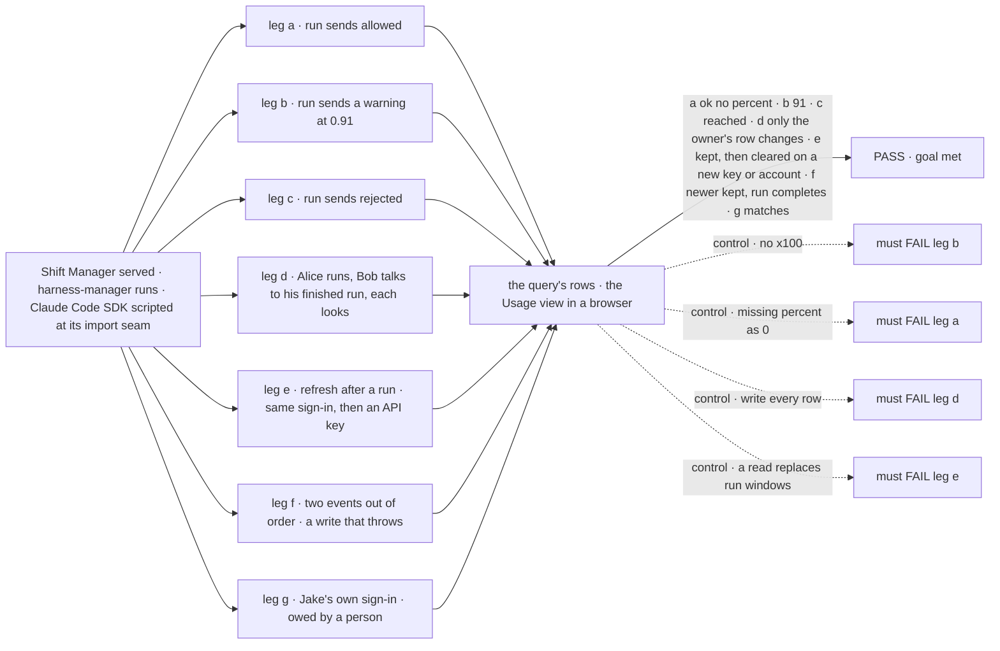
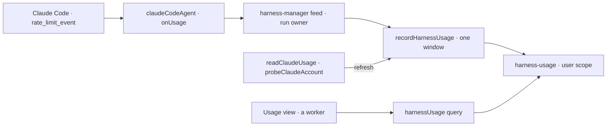

# FIX-2142 · Claude Code: record subscription usage from rate_limit_event

**Spec** · [Decisions](DECISIONS.md)

## Five people, before and after

| Someone who… | Today | After |
|---|---|---|
| **runs Claude Code in Shift Manager on a Pro or Max sign-in** | Learns a window ran out when a run fails | After any coding run, opens Usage and sees Claude's window: "5-hour · under Claude's warning line · resets 14:00", "from a run", checked 3 minutes ago |
| **is burning a window fast** | Nothing until the run fails | Sees "5-hour · 91 % used · resets 14:00" as soon as Claude Code warns, and "limit reached · resets 14:00" when it stops |
| **runs Claude Code with an API key** | Nothing | Sees "Claude Code uses an API key: no subscription limit". No percent |
| **has not signed Claude Code in on this machine** | Nothing | Sees "Claude Code is not signed in: not available automatically". No percent |
| **shares a machine with a second person** | Nothing | Each sees only the windows their own runs reported, with their age. A run never writes another person's row |

## The goal, and how we'll know it's met

**After a person's Claude Code run, Shift Manager shows them each Claude window that run reported,
with the percent when Claude Code sent one, the level and reset time always, where it came from and
how old it is, through the same query as Codex.**

| Is it the right goal? | |
|---|---|
| **The real need** | *"Work fails with no warning when a pool runs out, and we can't plan which harness to use"* (the epic). *"After any Claude run, Shift Manager shows Claude's percent used and reset time per window"* (the issue) |
| **Smaller, and shipped** | The issue's percent on every window after every run. Claude Code sends a percent only near a limit ([POC](poc/rate-limit-event/NOTES.md)); below that it sends the window, *ok* and its reset. The only sources with a full percent are banned or unstable. This is [the open question](DECISIONS.md#open), recommended: ship it |
| **Bigger, and not this issue's** | Tokens and cost on an API key (FIX-2145). Cursor and Grok Build (FIX-2143, FIX-2144) |
| **Not done if** | A missing percent shows as 0 or as a guess · a fraction shows as a percent (0.91 as "0.91 %") · a run writes a row that isn't its owner's · a refresh wipes the windows a run wrote · one account's percent shows beside another's · an older event replaces a newer window · a usage write fails a run · signed out or API key shows any percent |



The check reads what the query returns and what the Usage view draws. Each control must fail, or
the check proves nothing.

| How we verify | |
|---|---|
| **Goal check** | `goals/shift-manager/it-shows-claude-usage-left/` · no model · run by the implementer at completion · verdict in the implementation PR |
| **Signal** | a: one `five_hour` window, `usedPercent: null`, level `ok`, `resetsAt` in ms, `origin: "run"`; the view shows the reset and "under Claude's warning line", no number. b: `usedPercent: 91`, level `warning`, the view shows "91 %". c: level `reached`, the view shows "limit reached" and the reset. d: Alice's run writes Alice's row and Bob's query has no Claude window; then Bob talks to his own finished run through the session door, and only Bob's row changes. e: a refresh on the same sign-in keeps the run's window and adds the plan; after a move to an API key, the row is `api-key` with no window; after a move to account B, B's next run clears A's windows before any look. f: an event older than the stored window leaves it; account A's event retried after account B's leaves B's account, plan and windows; a run that started before a look found `api-key` doesn't bring windows back; an `onUsage` write that throws leaves the run `completed`. g: after Jake's real run, the reset time matches Claude Code's `/status` |
| **Input** | A scripted Agent SDK through `claudeCodeAgent`'s import seam, sending the event shapes the pinned CLI builds ([POC](poc/rate-limit-event/NOTES.md)). The real `probeClaudeAccount` on an empty and an API-key home for leg e |
| **Anti-game** | Events enter as SDK messages, not as hook calls. Rows read through the query over HTTP, the view read in a browser |
| **Control that must fail** | `GOAL_CONTROL=no-scale` FAILS b on *91*. `GOAL_CONTROL=absent-as-zero` FAILS a on *no number*. `GOAL_CONTROL=fan-out` FAILS d on *no Claude window*. `GOAL_CONTROL=read-replaces-run` FAILS e on *keeps the run's window* |

Leg g needs a Claude subscription, which no CI has. Until Jake or `fsd-qa` runs it, the
implementation PR says *goal met except leg g*.

## What changes


A run writes the one window it heard about; a look writes who is signed in. One writer for both.

```diff
 // packages/shift-manager/teams/devteam/harness.mts (the Lab's slot feeds)
 export interface HarnessFeeds {
   cwd: …; resume: …; onSession: …;
+  onUsage: HarnessUsageHook;
   mcpTools?: ProjectMcpToolsResolver;
 }
 // claudeCodeHarness already spreads its feeds into claudeCodeAgent({ ...feeds, … })

 // packages/shift-manager/teams/devteam/fsdev.config.mts (the host)
   usage: {
     codex: ({ signal } = {}) => readCodexUsage({ env: …, signal }),
+    "claude-code": () => readClaudeUsage({ env: claudeCodeEnv() }),
   },
```

```ts
const { harnesses } = await harnessUsage();
// [{ harness: "claude-code", status: "windows", plan: "max",
//    windows: [{ id: "five_hour", minutes: 300, usedPercent: null, level: "ok",
//                resetsAt, checkedAt, ageMs, rolledOver: false, origin: "run" }] }, …]
```

**Docs:** update *Tools → Claude Code SDK* (what a run reports about usage, and when there is no
percent), *Tools → Coding agents* (`onUsage`, a window without a percent), *Orchestration →
Harness manager* (the `onUsage` feed, run-written windows), and the READMEs of `core`,
`claude-code`, `harness-manager` and `shift-manager`. No new page.

## How a number gets to the screen



## What stays as it is

- **The store and the query.** FIX-2141's collection, its one writer and its one query. The
  window shape gains a level and may lack a percent; nothing else moves.
- **Codex.** Its windows always carry a percent, and its level stays empty.
- **Credentials.** Nothing reads the credentials file, calls `api/oauth/usage`, or uses the SDK's
  experimental usage call.
- **The run.** A usage write never fails, slows or fences a run.

## What's already here, and the debt

| Already here | What this does with it |
|---|---|
| Ways to put a harness's usage in the store | **One:** a registered reader through `harnessUsageAction` (FIX-2141, [#3768](https://github.com/fixpoint-labs/flow-state-dev/pull/3768)). **Extends** it: Claude Code gets a reader (`readClaudeUsage`), and the writer gains a one-window form for runs. This is the second *source*, not a second way to write |
| Ways a harness reports to its host during a run | **One:** `HarnessSessionHook` / `onSession` (core, fed by harness-manager's slot). **Twins** it: `HarnessUsageHook` / `onUsage`, as FIX-2141 *Decided, not asked* reserved |
| `probeClaudeAccount` (claude-code) | **Builds on** it: the reader maps its answer, so there is no second account read (FIX-2141, *Decided, not asked*) |
| FIX-2141's window shape: *"Percent is 0 to 100 as the vendor sent it, never derived"* | **Amends** it: the percent may be absent, and a level says why. Claude's fraction is scaled to 0 to 100; nothing else is derived |
| FIX-2141's record (account, plan, `checkedAt`, windows) | **Amends** it: adds `accountAt`, when the account was last set, so an account change is one ordered step. A row stored without it reads as 0 |
| The Error Reporter runs Claude Code outside harness-manager (FIX-1983) | **Leaves** it unrecorded ([D1](DECISIONS.md#d1)) |
| Kitchen-sink's Claude Code mode runs `claudeCodeAgent` with no harness-manager | **Leaves** it unrecorded: it has no usage query to feed |

| The debt | |
|---|---|
| **Removes** | Nothing. The event was dropped, not handled |
| **Adds** | One hook type and one slot feed (twins of the session pair), one reader, a one-window write, a level on the window, `accountAt` on the record. Permanent by design |
| **Leaves** | Below Claude's warning line there is no percent, until Anthropic stabilises a usage read (the SDK's call says not to rely on it). The Error Reporter's runs ([D1](DECISIONS.md#d1)) |

**Net: up, small.** One hook beside its twin and one source into an existing store.

## Sign off

**Open, recommended · [ship Claude's view with what Claude Code reports](DECISIONS.md#open)**, a
percent near a limit and the level and reset always. If wrong: someone below the warning line
plans with a reset time and no number.

**[The debt](#whats-already-here-and-the-debt), net up, small:** a hook twin and one source. If
wrong: a second way to write usage, which the one writer exists to prevent.

1. **[D1](DECISIONS.md#d1) · The Error Reporter's Claude runs are not recorded.** If wrong: a
   host that runs Claude only for bug reports shows an old Claude row, and its age says so.

Feature · `core` + `claude-code` + `harness-manager` + `shift-manager` · small to medium · second child of epic FIX-2139 · builds on [#3768](https://github.com/fixpoint-labs/flow-state-dev/pull/3768)
