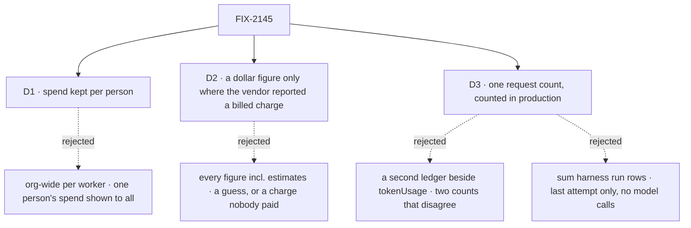

# FIX-2145 · Decisions

[Spec](SPEC.md) · **Decisions**

The epic asked for a second half beside the windows: which worker used how much. That is
attribution, not a vendor reading. These three say whose totals a reader sees, which dollar
figures appear, and what happens to the request count the totals are built on.

## The tree

Solid edges are what you're signing. Dashed edges lost, and the label says why.

## D1 · Spend is kept per person, by worker and day

| | |
|---|---|
| **Instead of** | An `org`-scoped total per worker, which would show what every person's requests spent through a shared worker to everyone in the org |
| **Because** | The epic is "your own subscriptions", and FIX-2141 [D1](../FIX-2141/DECISIONS.md#d1) keeps the windows per person for the same reason. The total sits beside those windows, so the two read the same way. A request is the person's who made it: its `userId`, server-set (BP-031); a dispatched task runs under the sender's principal. The `user`-scoped collection is the same primitive at the same scope (tenet 3) |
| **Locks in** | The query name `workerUsage` and the collection `worker-usage/**`, one record per worker and UTC day, owned by `@flow-state-dev/workforce`. The query takes no user argument. A standard worker shared by two people holds two people's records, each seeing their own. A team total needs a second read later, not a change to these records. The tenant limit of `user` scope is inherited, as on `harness-usage/**` |

It comes down to whose spend a reader sees: an org-wide total shows one person's work to all.

**What would change my mind:** a team that shares one API bill and wants one number per worker.
Then an org-level read sums the per-person records for the members a reader may see.

## D2 · A dollar figure appears only where the vendor reported a billed charge

| | |
|---|---|
| **Instead of** | Showing every cost we have: Claude Code's `total_cost_usd`, which it reports on a subscription run too, and the estimates core's price table makes for Codex, Cursor and model calls |
| **Because** | The epic's rules are "vendor-reported numbers only" and "never show a guess", and "in API-key mode, show tokens and cost". A price-table estimate is a guess, and a dollar figure on a subscription run reads as a bill nobody paid. Tokens are vendor-reported in every mode and always shown |
| **Locks in** | Each harness entry carries `billing`: `api-key`, `subscription`, or `null` when the harness can't tell. Cost shows only on an `api-key` entry whose cost the vendor reported; every other entry says "not reported". Today that is Claude Code on an API key. Codex, Cursor and model calls show tokens only, until their vendor reports a cost. Nobody compares workers in dollars on a subscription |

It comes down to the epic's rule: an estimate is a guess, and the view never shows one.

**What would change my mind:** Jake wanting API-dollar estimates to plan harness choice. Then a
separate column, labelled "estimated at API prices", never mixed into the reported one.

## D3 · One spend count per request, and it counts in production

| | |
|---|---|
| **Instead of** | A second ledger for usage beside `ctx.request.tokenUsage`, leaving the existing count to read trace items |
| **Because** | The existing count reads 0 in production: lean traces carry no `modelUsage` ([POC](poc/request-spend/NOTES.md), CONFIRMED). A second ledger would leave two counts that disagree, one of them broken, and the action `tokenBudget` silently off in production (tenet 1: one answer to one question). Fed by the runtime hook every model result already passes through, added rather than assigned, the count is right everywhere |
| **Locks in** | `ctx.request.tokenUsage` keeps its shape and counts model calls in production. **An action's `tokenBudget` starts to act in production**: checked once after the action answers, it now warns, marks the request incomplete, or fails it there as it does in development. No work is cut short. Counts also rise a little in development, because a schema-repair call is added rather than overwriting. No flow in this repository sets a budget; the changeset says so for consumers. Harness spend stays out of `byModel` and `totalConsumed`, so no budget or estimate changes because a harness ran |

It comes down to the production zero: a second ledger would leave a broken count beside it.

**What would change my mind:** a published app that relies on its budget not firing in
production. None is known; the changeset is where one would surface.

## Decided, not asked

- **L1 knows a request and a session, never a worker.** Core and the engine gain the ledger, a
  `spend` field on `RequestEnding` (spent since the request's last ending, so a resumed request
  is not counted twice), and `reportHarnessSpend(ctx, { harness, inputTokens, outputTokens, cost,
  billing })` in `core/types/harness.ts`. No vendor word, no Workforce word.
- **One request-end registry, and the session config only installs on it.** The worker writer is an
  ordinary `RequestEndHook` on the request's existing registry (FIX-2077), not a second hook: it
  runs in the same list, in order, under the same shutdown drain. A flow's session config carries
  a framework-only, symbol-keyed slot (as `REQUEST_END_SEAM` is) holding a function the engine
  calls with the request's context when the request starts; what it returns is added to that
  registry, exactly as a block's `onRequestEnded(ctx, hook)` would add it. Only
  `installation.session()` fills the slot. There is no new author-facing `SessionConfig` field,
  and the docs present it as framework-facing.
- **Why a block call alone can't carry it.** `onRequestEnded(ctx, hook)` is called from a block,
  and no block Workforce owns runs in every worker request: authors write a worker's blocks, and
  each entry (respond, task, steer, talk, coordinator) would have to remember the call, so a
  missed one undercounts silently. `installation.session()` is the one piece `register.ts`
  requires of every worker flow, so it is where the hook gets put on the registry.
- **The convergence points.** Model spend enters the ledger only through
  `onGeneratorModelResult`. The engine installs a base handler at the request (none exists
  today; per-block wrappers chain up to it), and the evaluator-as-a-tool path, which does not
  forward today, feeds it too. A model step reaches the ledger when the step completes, not
  only when its block finishes: a generator whose tool suspends for approval, or that fails,
  still counts the steps it finished, and its later aggregate report does not count them again. Harness spend enters only through `reportHarnessSpend`, called by
  each harness package when a run ends, however it ends (a `finally`, not only the success
  path), with whatever usage the vendor had sent by then: Cursor reports per turn, so a killed
  Cursor run keeps its finished turns. Only a run that received no usage at all (Claude Code
  killed before its result message) counts as one run with tokens "not reported". `recordWorkerSpend` is the only
  writer of `worker-usage/**` and `workerUsage` its only reader.
- **One install point for the worker hook.** `installation.session()` returns the hook beside
  `createCheck`; `register.ts` already refuses a worker flow without it, and a spread of it keeps
  the field. `worker-usage` is declared in `installation.resources`, which every worker flow
  installs, and the hook fails loudly in development when it is missing. A session with no
  `workerId` writes nothing.
- **An attempt is a request, so every attempt counts.** The run row keeps the last one for its
  own status read; the totals keep them all.
- **Writes add, atomically, and never fail the request.** Two requests ending at once for one
  worker and day both land (`updateStateWith`). A failed write is logged. The request's terminal
  status waits for the write, one small user-scope update per worker turn.
- **The record.** Per source (a model id, or a harness name with its billing): input and output
  tokens, reported billed cost, runs, and runs with nothing reported. Days are UTC; the view says
  so. The query takes `days` from 1 to 90, default 7, and the view offers today, 7 and 30. No
  record is deleted.
- **Billing is the harness's own knowledge, never a credential file.** Claude Code asks
  `accountInfo()` for `apiKeySource` (as `probeClaudeAccount` does), independent of
  rate-limit events. Codex is `api-key` when a key was handed to its client, otherwise `null`;
  no app-server per run. Cursor is `null` until Cursor says.
- **A worker no longer on the roster** keeps its records and shows under its id, marked as gone.
- **Workforce does not depend on harness-manager.** The harness reports into the request; the
  session reads it.

## Considered and dropped

| Option | Why it lost |
|---|---|
| Sum harness-manager's run rows per worker | Last attempt only, no model calls, no worker on the row, and the Error Reporter has no row |
| Feed harness spend through FIX-2142's `onUsage` slot | harness-manager's alone; the Error Reporter and kitchen-sink run harnesses outside it |
| Sum request records when someone looks | Records carry no spend field, finding every session of a worker has no index, and a retention policy would shrink the totals |
| Workforce calls `onRequestEnded` from each worker entry | Every entry (respond, task, steer, talk, coordinator) would have to remember it, and a missed one undercounts silently |
| A request-config `onEnded` hook | Its natural home, but nothing requires a worker flow to declare one; the session config is enforced |
| The engine attributes spend by a session-state key the host names | Puts the attribution policy in L1 |
| Show price-table estimates marked "≈" | The epic forbids a guess ([D2](#d2)) |

## Settled

- **A request counts 0 tokens in production** — **CONFIRMED** by
  [`poc/request-spend/`](poc/request-spend/NOTES.md), reproduced by the analysis pass: with trace
  observability off, an 8-token call under a 5-token budget passed; with it on, the budget fired.
  D3 rests on this.
- **A schema-repair call overwrites the block's usage** — read in `executeBlock.ts` (assigned per
  call) and `generator.ts` (the repair reports to the same hook). The ledger adds; the per-block
  trace is FIX-2207's.

## Analysis

2026-10-25 · watermark 2026-10-23 (FIX-2141 spec) · **Right approach, with changes** (folded).

1. **Reuse** — `reuse-review`: the ledger and the worker hook extend existing pieces (the request
   count, the FIX-2077 seam); `worker-usage/**` follows `harness-usage/**`; `reportHarnessSpend`
   is new, and FIX-2142's feed was weighed and loses (now in *Considered and dropped*). See
   [Builds on / Adds](SPEC.md#whats-already-here-and-the-debt).
2. **Prior art** — LLM observability tools count at the call and attribute at the end by a tag.
   Same shape. Recorded.
3. **Other shapes** — a request-config hook; recorded with why it loses. The tension with
   `SessionConfig`'s and FIX-2077's "framework-facing" wording is named in *Decided, not asked*.
4. **New factors** — of ~110 commits since the watermark, only FIX-2141/2142 touch usage.
   FIX-2162 (one client): `workerUsage` goes through the shared client. FIX-2153's harness session
   flow has no `workerId` and writes nothing, correctly. Recorded.
5. **Necessity** — real: the epic needs it, and the production zero needs fixing anyway.
6. **Ergonomics** — a third-party harness that never reports goes uncounted (debt *Leaves*);
   development counts rise with repair calls (D3). Recorded.
7. **Concerns** — folded: harness spend on failed and aborted attempts (report from `finally`);
   the evaluator-tool path and the missing base handler; D3's wording of what a budget does; the
   Net to *up, medium*. The blind goal check also folded: no estimated cost (D2), a Codex leg,
   six controls, exact numbers, and "never says left or limit".

## How it got here

- **Draft** — framed as attribution, not a vendor reading: count spend once in the request (a
  ledger fed by model results and by each harness when it settles a run), hand it to the session
  when the request ends, and let Workforce add it to a per-person record by worker and day. The
  POC showed the existing count reads 0 in production, so the draft fixes it rather than adding
  a second one.
- **Analysis and goal check** — D2 moved from "billed, estimates marked ≈" to vendor-reported
  billed cost only, because the epic forbids a guess. A harness reports on every ending, not only
  success, and the goal check gained a Codex leg and controls for each behaviour it depends on.
- **Review round 1** — Codex showed two more convergence gaps: a generator that suspends for
  approval or fails never reports its finished steps, and a killed Cursor run has per-turn usage
  that "not reported" would throw away. Both now reach the ledger.
- **Review round 2** — the FSD Architect saw a near-duplicate of `onRequestEnded` in the
  session-config hook. The writer is now an ordinary hook on the existing request-end registry,
  and the session config only puts it there; no author-facing `SessionConfig` field.

## Notes from review

- "Same identifier as block-level `onRequestEnded(ctx, hook)` with a different registration site will confuse implementers. Alternative: internal registration on the existing request-end registry (no new author-facing `SessionConfig` field), or a distinctly named config key (`requestEndHooks`)." — cursor ([thread](https://github.com/fixpoint-labs/flow-state-dev/pull/3886#discussion_r4372306173))
- "A named `spend` field on `RequestEnding` risks a second public aggregate beside the ledger. Consider a single payload (ledger snapshot or `sinceLastEnding` slice of the same type) and resume idempotency as ledger math." — cursor ([thread](https://github.com/fixpoint-labs/flow-state-dev/pull/3886#discussion_r4372306168))
- "Lock in a struct shape (separate harness accumulator, or a slice the budget getter ignores) so `recordWorkerSpend` and `tokenBudget` can't drift." — cursor ([thread](https://github.com/fixpoint-labs/flow-state-dev/pull/3886#discussion_r4372306182))
- "`workerUsage({ days: N })` should touch at most N×workers records (key prefix / range), not list all history." — cursor ([thread](https://github.com/fixpoint-labs/flow-state-dev/pull/3886#discussion_r4372306192))
- "A discriminated union for the query row (`{ billing: \"api-key\"; costUsd: number } | { billing: \"subscription\" } | …`) would match harness-usage's status pattern and reduce UI branching." — cursor ([thread](https://github.com/fixpoint-labs/flow-state-dev/pull/3886#discussion_r4372306202))
- "The `+ // Nothing to pass` hunk adds noise without code." — cursor ([thread](https://github.com/fixpoint-labs/flow-state-dev/pull/3886#discussion_r4372306197))

These are inputs, not instructions. Adopt, adapt, or discard.

**Open: none.**
