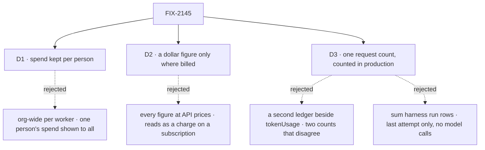

# FIX-2145 · Decisions

[Spec](SPEC.md) · **Decisions**

The epic asked for a second half beside the windows: which worker used how much. That is
attribution, not a vendor reading. These three say whose totals a reader sees, which dollar
figures appear, and what happens to the request count the totals are built on.

## The tree

Solid edges are what you're signing. Dashed edges lost, and the label says why.

## D1 · Spend is kept per person, by worker and day

| | |
|---|---|
| **Instead of** | An `org`-scoped total per worker, which would show what every person's requests spent through a shared worker to everyone in the org |
| **Because** | The epic is "your own subscriptions", and FIX-2141 [D1](../FIX-2141/DECISIONS.md#d1) keeps the windows per person for the same reason. The total sits beside those windows, so the two read the same way. A request is the person's who made it; that is its `userId`, server-set (BP-031). The `user`-scoped collection is the same primitive at the same scope (tenet 3) |
| **Locks in** | The query name `workerUsage` and the collection `worker-usage/**`, one record per worker and UTC day, owned by `@flow-state-dev/workforce`. A standard worker shared by two people holds two people's records, each seeing their own. A team total needs a second read later, not a change to these records. The tenant limit of `user` scope is inherited, as on `harness-usage/**` |

It comes down to whose spend a reader sees: an org-wide total shows one person's work to all.

**What would change my mind:** a team that shares one API bill and wants one number per worker.
Then an org-level read sums the per-person records for the members a reader may see.

## D2 · A dollar figure appears only where the spend was billed

| | |
|---|---|
| **Instead of** | Showing every cost a run reports, marked "at API prices". Claude Code reports `total_cost_usd` on a subscription run too, and Codex and Cursor costs are always our estimate from core's price table |
| **Because** | On a subscription nobody is charged per token, so a dollar figure there reads as a bill that doesn't exist. The epic's rule is "in API-key mode, show tokens and cost instead of percent left": cost is the API-key reading. Tokens are true in both modes and are always shown |
| **Locks in** | Each harness entry carries `billing`: `api-key`, `subscription`, or `null` when the harness can't tell. Only `api-key` entries show cost, with its basis (`reported` or `estimated`, shown as "≈"). A `null` entry shows tokens and "billing not known". Model calls are billed by their provider key and show core's estimate, `≈`. A person on a subscription can't compare workers in API dollars until someone asks for that view |

It comes down to a subscription run: a dollar figure there reads as a charge nobody paid.

**What would change my mind:** Jake planning harness choice in API dollars. Then a second,
labelled column ("at API prices") shows the figure the run reported, never mixed into the billed one.

## D3 · One spend count per request, and it counts in production

| | |
|---|---|
| **Instead of** | A second ledger for usage beside `ctx.request.tokenUsage`, leaving the existing count to read trace items |
| **Because** | The existing count reads 0 in production: lean traces carry no `modelUsage` ([POC](poc/request-spend/NOTES.md), CONFIRMED). A second ledger would leave two counts that disagree, one of them broken, and the action `tokenBudget` silently off in production (tenet 1: one answer to one question). Fed by the runtime hook every model result already passes through, added rather than assigned, the count is right everywhere |
| **Locks in** | `ctx.request.tokenUsage` keeps its shape and counts model calls in production. **An action's `tokenBudget` starts to act in production**, where it has never fired: a flow that set one and ran past it in production now warns, stops or fails as it does in development. The changeset says so. Harness spend rides the same ledger under the harness's name but stays outside `totalConsumed`, so no budget changes because a harness ran |

It comes down to the production zero: a second ledger would leave a broken count beside it.

**What would change my mind:** a published app that relies on its budget not firing in
production. None is known; the changeset is where one would surface.

## Decided, not asked

- **L1 knows a request and a session, never a worker.** Core and the engine gain the ledger, a
  `spend` field on `RequestEnding` (what the request spent since its last ending, so a resumed
  request is not counted twice), a session-config `onRequestEnded` hook run with the request's
  context, and `reportHarnessSpend(ctx, { harness, inputTokens, outputTokens, cost, billing })`
  in `core/types/harness.ts`. No vendor word, no Workforce word.
- **The convergence points.** Model spend enters the ledger only through the runtime's
  `onGeneratorModelResult` hook, which the engine installs at the request's base, so a
  generator, an evaluator and a schema-repair call all count wherever they run (a router branch
  with no trace usage is FIX-869's; the ledger does not depend on its trace). Harness spend enters only through `reportHarnessSpend`, called by each harness
  package where it settles its handle (claude-code, codex, cursor); so harness-manager runs, its
  session door's talk and steer turns, the Error Reporter and kitchen-sink all count without
  their own code. `recordWorkerSpend` is the only writer of `worker-usage/**` and `workerUsage`
  its only reader, as on `harness-usage/**`.
- **One install point for the worker hook.** `installation.session()` returns the hook beside
  `createCheck`, and `register.ts` already refuses a worker flow without it. A session with no
  `workerId` writes nothing.
- **An attempt is a request, so every attempt counts.** The run row keeps the last one for its
  own status read; the totals keep them all.
- **Writes add, atomically.** Two requests ending at once for one worker and day both land
  (`updateStateWith`, as the usage throttle uses). A failed write is logged and never fails the
  request: usage is a reading, not part of the work.
- **The record.** Per source (a model id, or a harness name with its billing): input and output
  tokens, billed cost by basis, and a run count. Days are UTC; the view says so. The query takes
  `days` from 1 to 90, default 7, and the view offers today, 7 and 30. No record is ever deleted.
- **Billing is the harness's own knowledge.** Claude Code reads it from the run's credential
  source (`apiKeySource`, as `probeClaudeAccount` reads it); Codex from the sign-in its reader
  already tells apart; Cursor runs on Cursor's account and reports `null` until Cursor says.
- **A worker no longer on the roster** keeps its records and shows under its id, marked as gone.
- **Workforce does not depend on harness-manager.** The harness reports into the request; the
  session reads it. FIX-2142 D1's dependency concern doesn't arise.

## Considered and dropped

| Option | Why it lost |
|---|---|
| Sum harness-manager's run rows per worker | Last attempt only, no model calls, no worker on the row, and the Error Reporter has no row |
| Sum request records when someone looks | Records carry no spend field, finding every session of a worker has no index, and a retention policy would shrink the totals |
| Workforce calls `onRequestEnded` from each worker entry | Every entry (respond, task, steer, talk, coordinator) would have to remember it, and a missed one undercounts silently |
| The engine attributes spend by a session-state key the host names | Puts the attribution policy in L1 |
| Keep the totals in harness-manager beside `harness-usage/**` | Model calls are not harness-manager's, and worker is a Workforce word |

## Settled

- **A request counts 0 tokens in production** — **CONFIRMED** by
  [`poc/request-spend/`](poc/request-spend/NOTES.md): with trace observability off, an 8-token
  call under a 5-token budget passed; with it on, the budget fired. D3 rests on this.
- **A schema-repair call overwrites the block's usage** — read in `executeBlock.ts` (assigned per
  call) and `generator.ts` (the repair reports to the same hook). The ledger adds; the per-block
  trace is FIX-2207's.

## Analysis

*(Filled in by the analysis pass before review.)*

## How it got here

- **Draft** — framed as attribution, not a vendor reading: count spend once in the request (a
  ledger fed by model results and by each harness when it settles a run), hand it to the session
  when the request ends, and let Workforce add it to a per-person record by worker and day. The
  POC showed the existing count reads 0 in production, so the draft fixes it rather than adding
  a second one.

**Open: none.**
