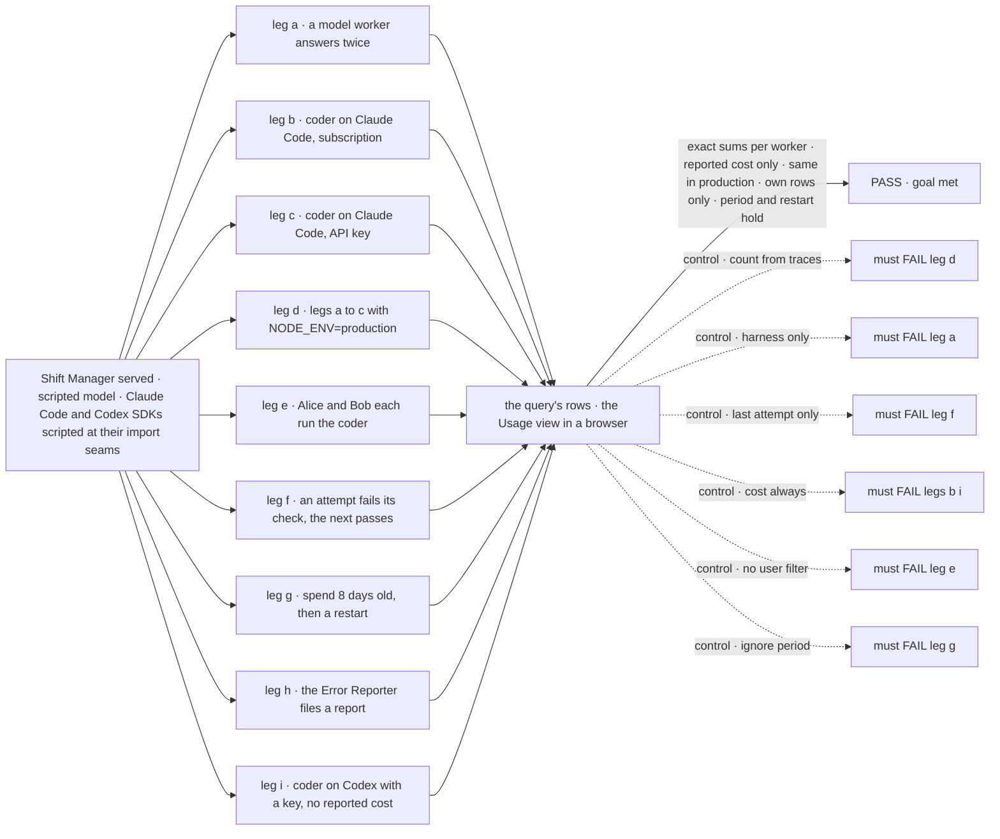
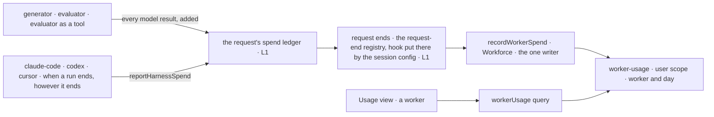

# FIX-2145 · Per-worker token usage across harnesses

**Spec** · [Decisions](DECISIONS.md)

## Six people, before and after

| Someone who… | Today | After |
|---|---|---|
| **wants to know which worker is eating their Claude window** | Sees the window drain, and nothing says who drained it | Opens Usage and sees, under the windows, each worker's tokens for today, 7 days or 30 days: "coder · 1.2 M tokens · Claude Code 1.1 M · model calls 0.1 M". Labelled as usage, not quota |
| **runs Claude Code on an API key** | Sees "uses an API key: no subscription limit" and no number | Sees each worker's tokens and the cost Claude Code reported: "coder · $4.12 reported by Claude Code" |
| **runs on a subscription, or a harness that reports no cost** | Nothing | Sees tokens per worker and no dollar figure. Where nothing was reported, it says "not reported", never 0 or a guess |
| **runs workers on model calls only** (the Shift Coordinator, the EM) | Nothing, and in production the framework counts 0 tokens for any request ([POC](poc/request-spend/NOTES.md)) | Sees those workers' tokens, in production as in development |
| **retries a coding run that failed its check** | The run's row keeps only the last attempt's tokens | Every attempt counts: the first attempt's tokens were spent too |
| **shares a Lab with a second person** | Nothing | Each sees only what their own requests spent through each worker |

## The goal, and how we'll know it's met

**A person running Shift Manager sees, for each worker, how many tokens its harness runs and
model calls used over a period they pick, and the cost wherever the vendor reported a charge, as
usage beside the subscription windows and never as a quota.**

| Is it the right goal? | |
|---|---|
| **The real need** | *"Separately, it shows which worker used how much (tokens), labeled as usage, not quota"* and *"in API-key mode there's no subscription pool, so show tokens and cost instead of percent left"* (the epic). *"Summing the tokens (and, in API-key mode, the cost) that each worker's runs reported, across harnesses and model generators alike"* (the issue) |
| **Smaller, and rejected** | Harness runs only: misses the workers that only call models, the issue's "model generators alike". Tokens only: misses the epic's API-key rule. A lifetime total: misses "over a period" |
| **Bigger, and not this issue's** | A task's own tokens and cost on its row (FIX-1652). A budget that stops a worker. A history graph. A team total ([D1](DECISIONS.md#d1)) |
| **Not done if** | Production shows 0 or less than development · a retried or failed attempt is missing · a run is counted twice · a subscription run or an estimate shows a dollar figure · a harness that reported nothing shows 0 · a worker shows another person's spend · a model-only worker, Codex or the Error Reporter is missing · totals vanish after a restart · picking a period changes nothing · a total is labelled as left, remaining or a limit |



The check reads what the query returns and what the Usage view draws. Each control must fail, or
the check proves nothing.

| How we verify | |
|---|---|
| **Goal check** | `goals/shift-manager/it-shows-worker-token-usage/` · no model · run by the implementer at completion · verdict in the implementation PR |
| **Signal** | a: the model worker's row is exactly 16 tokens (two calls of 4 + 4), cost "not reported". b: the coder's row holds 1 200 tokens under Claude Code, billing "subscription", no cost. c: 1 200 tokens and $0.42, "reported by Claude Code". d: a, b and c give the same numbers with `NODE_ENV=production` and `FSDEV_TRACE_OBSERVABILITY` unset. e: Alice's query holds only Alice's spend and Bob's only Bob's; the query takes no user argument. f: attempt one reports 300 tokens and fails its check, attempt two reports 1 200 and passes; the total is exactly 1 500. g: an entry written 8 days before now is in the 30-day total and not in the 7-day one, and both survive a server restart. h: the report's harness tokens are under the Error Reporter. i: Codex tokens under the coder, billing "api-key", cost "not reported". The view sits under the windows on Usage, says "usage", and nowhere says "left", "remaining" or "limit" in the worker section |
| **Input** | A scripted model resolver that reports fixed usage. Scripted Agent SDK and Codex SDK through `claudeCodeAgent`'s and `codexAgent`'s import seams, as FIX-2142's check does, with usage, `total_cost_usd` and the sign-in each reports. Alice and Bob are two signed-in users of one served Lab. Leg g moves the server's clock through the seam the goal server already exposes for time, or one the implementer adds and names in `goal.md` |
| **Anti-game** | No assertion on a stubbed writer, the request ledger or a row written directly. Spend enters as model results and SDK messages only; identity is the server's. Rows read through the query over HTTP; the view read in a browser |
| **Control that must fail** | `GOAL_CONTROL=from-traces` FAILS d on *same numbers*. `harness-only` FAILS a on *16 tokens*. `last-attempt-only` FAILS f on *1 500*. `cost-always` FAILS b and i on *no cost*. `no-user-filter` FAILS e on *only Alice's*. `ignore-period` FAILS g on *not in the 7-day one* |

## What changes


Count once where the tokens are spent; attribute once where the worker is known.

```diff
 // packages/shift-manager/teams/devteam/fsdev.config.mts (the host)
 const lab = await openLab({
   harness: harness.slot,
   usage: { codex: …, "claude-code": … },
+  // Nothing to pass: workerUsageAction rides the reader flow that answers harnessUsage.
 });
```

```ts
// any reader, server side or through the client
const { workers } = await workerUsage({ days: 7 });
// [{ worker: "coder", tokens: { input: 1_020_000, output: 180_000 },
//    bySource: [{ source: "claude-code", billing: "subscription", input: …, output: …, costUsd: null },
//               { source: "openai/gpt-6-luna", billing: null, input: …, output: …, costUsd: null }] }, …]
```

A worker flow changes nothing: every one already declares `session: installation.session()`,
and that is where the request-end hook rides.

**Docs:** new page *Workforce → Worker usage* (`workforce/worker-usage`, after
`workforce/inventory`). Update *Configuration → Flow* (token
budgets counting in production), *Tools → Coding agents* (a harness reports its run's spend),
*Shift Manager → Overview* (the Usage view's worker section), and the READMEs of `core`,
`engine`, `claude-code`, `codex`, `cursor`, `workforce` and `shift-manager`.

## How a token gets to the screen



Core and the engine know a request and a session, never a worker. Workforce reads the session's
`workerId` and writes.

## What stays as it is

- **The windows.** `harness-usage/**`, its writer and its query are FIX-2141's and FIX-2142's.
  The new section sits under them on the same screen.
- **The run row.** `runs/**` keeps its last attempt's tokens and cost for harness-manager's own
  status read.
- **A trace's per-block `modelUsage`.** DevTool still reads it. The request's count no longer does.
- **Credentials.** Billing is what the harness already knows about its own sign-in. Nothing
  reads a token file or calls a usage endpoint.

## What's already here, and the debt

| Already here | What this does with it |
|---|---|
| Ways to total spend | **Four, none across requests:** the request's `tokenUsage` and `costEstimate` (engine, summed from traces), the action `tokenBudget` on top of them, DevTool's `aggregateTokenUsage` over loaded items (the closest), and harness-manager's run row (one attempt). claude-code also keeps each handle in session state (`SDK_AGENT_RUNS_KEY`), per session. Searched `totalTokens`, `costUsd`, `byModel`, `tokenBudget`, `ledger`, `spend`, `usage` across `packages/`. This would be the first total across requests |
| The request's `tokenUsage`, read from trace items | **Replaces its source** with a ledger fed by model results ([D3](DECISIONS.md#d3)). Same shape, same budget check; it now counts in production |
| The request-end seam, `onRequestEnded` (FIX-2077) | **Extends** it: the ending carries what the request spent. The worker writer is an ordinary hook on the same registry; a flow's session config only puts it there when the request starts, so no block has to call it. No second hook and no author-facing `SessionConfig` field |
| `installation.session()`, which `register.ts` requires of every worker flow | **Builds on** it: the one place the worker hook is installed |
| FIX-2142's run-time feed, `onUsage` through harness-manager's slot | **Considered for harness spend, not used:** the Error Reporter and kitchen-sink don't run through that slot |
| harness-manager's `harness-usage/**` (FIX-2141 [D1](../FIX-2141/DECISIONS.md#d1)) | **Builds on** its scope, shape rules and one-writer-one-query form for `worker-usage/**`. **Keeps** D1: per person |
| FIX-2141 *Decided, not asked*: "an API-key row's tokens and cost come with FIX-2145" | **Keeps** it: those rows are here, per worker |
| FIX-2142 [D1](../FIX-2142/DECISIONS.md#d1), the Error Reporter's windows not recorded | **Leaves** it as decided for windows. Its tokens are counted here: the harness reports them itself, so no Workforce dependency on harness-manager |
| Model calls in no worker's session (the hire fit check on the roster flow) | **Leaves** them unattributed: they belong to no worker |
| Shift Manager's FIX-1652 gaps for a task's harness, tokens and cost | **Leaves alone.** Per task is that issue's |

| Builds on / Adds | Existing piece considered | Why it doesn't fit, or how this is composed |
|---|---|---|
| A request spend ledger | Trace `modelUsage` | Lean traces drop it in production, and a repair call overwrites it. The ledger is fed by the same runtime hook, added, not assigned |
| `reportHarnessSpend` in core | The run row's `usage`; FIX-2142's `onUsage` feed | Both are harness-manager's alone, and the row keeps the last attempt. One function each harness calls when a run ends covers every caller |
| The session config puts a hook on the existing request-end registry | `onRequestEnded` from a block; a request-config hook | Same registry, same hook type. Only *who registers* moves: no block Workforce owns runs in every worker request, so every entry would have to remember a block call. Request config isn't required of worker flows; the session config is |
| `worker-usage/**`, `recordWorkerSpend`, `workerUsageAction` | `harness-usage/**` | A different key (worker and day) and an additive write; windows overwrite. Same scope, same one-writer rule |

| The debt | |
|---|---|
| **Removes** | The request's count read from traces, which reads 0 in production. A repair call overwriting the request's count |
| **Adds** | One public core surface (`reportHarnessSpend`), a `spend` field on the request ending, and a framework-only slot through which a session config adds a hook to the existing registry; three harness callers; one collection, one writer, one query action, one view section. Every worker request waits for one small write before its end is reported. Permanent by design |
| **Leaves** | A trace's per-block `modelUsage` still keeps only a generator's last call (DevTool), filed as FIX-2207. Spend of a process that dies before its request ends is lost. A third-party harness that never calls `reportHarnessSpend` goes uncounted. `user` scope is not tenant-qualified, inherited from FIX-2141 |

**Net: up, medium.** One new total, one framework surface and a framework-only slot on the existing seam; the request count it builds on is
fixed rather than doubled.

## Sign off

**[The goal](#the-goal-and-how-well-know-its-met), at that size:** every worker's tokens from
harness runs and model calls, reported cost where billed, in production. If wrong: the numbers
miss model-only workers or read 0 in production.

**[The debt](#whats-already-here-and-the-debt), net up, medium:** a new total, one framework
surface and a slot on the existing seam, over a fixed count. If wrong: a second count beside the request's, which can disagree
with it.

1. **[D3](DECISIONS.md#d3) · One spend count per request, and it counts in production, so action
   token budgets start to act there.** The one to weigh. If wrong: a flow whose budget never
   fired in production starts to warn, mark requests incomplete, or fail them there.
2. **[D2](DECISIONS.md#d2) · A dollar figure only where the vendor reported a billed charge.** If
   wrong: most rows show tokens without a cost, and nobody compares workers in dollars.
3. **[D1](DECISIONS.md#d1) · Spend is kept per person.** If wrong: a team that shares one bill
   can't see one total per worker.

**Open: none.**

Feature · `core` + `engine` + `claude-code` + `codex` + `cursor` + `workforce` + `shift-manager` · medium · third child of epic FIX-2139
