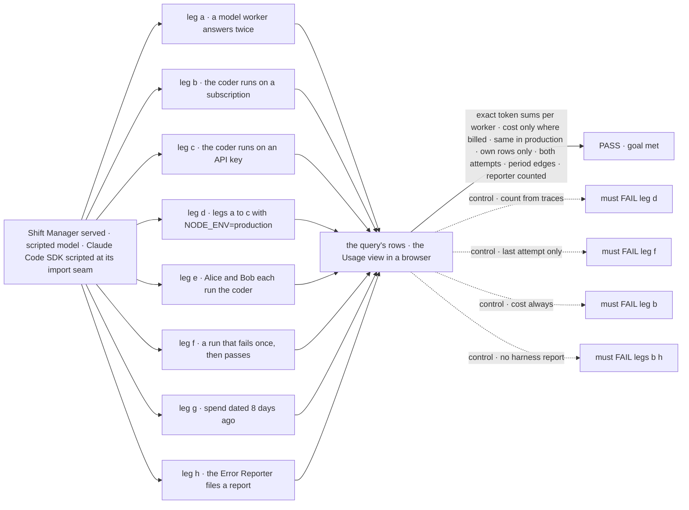
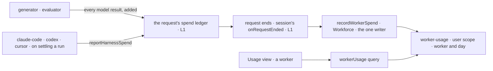

# FIX-2145 · Per-worker token usage across harnesses

**Spec** · [Decisions](DECISIONS.md)

## Six people, before and after

| Someone who… | Today | After |
|---|---|---|
| **wants to know which worker is eating their Claude window** | Sees the window drain, and nothing says who drained it | Opens Usage and sees, under the windows, each worker's tokens for today, 7 days or 30 days: "coder · 1.2 M tokens · Claude Code 1.1 M · model calls 0.1 M". Labelled as usage, not quota |
| **runs a coding harness on an API key** | Sees "uses an API key: no subscription limit" and no number | Sees each worker's tokens and what they cost: "coder · $4.12 reported by Claude Code" |
| **runs Shift Manager on a subscription** | Nothing | Sees tokens per worker and no dollar figure for subscription runs. A subscription run is not billed per token |
| **runs workers on model calls only** (the Shift Coordinator, the EM) | Nothing, and in production the framework counts 0 tokens for any request ([POC](poc/request-spend/NOTES.md)) | Sees those workers' tokens and an estimated cost, in production as in development |
| **retries a coding run that failed** | The run's row keeps only the last attempt's tokens | Every attempt counts: the first attempt's tokens were spent too |
| **shares a Lab with a second person** | Nothing | Each sees only what their own requests spent through each worker |

## The goal, and how we'll know it's met

**A person running Shift Manager sees, for each worker, how many tokens its runs and model calls
used over a period they pick, and what that cost wherever it was billed, as usage beside the
subscription windows and not as a quota.**

| Is it the right goal? | |
|---|---|
| **The real need** | *"Separately, it shows which worker used how much (tokens), labeled as usage, not quota"* and *"in API-key mode there's no subscription pool, so show tokens and cost instead of percent left"* (the epic). *"Summing the tokens (and, in API-key mode, the cost) that each worker's runs reported, across harnesses and model generators alike"* (the issue) |
| **Smaller, and rejected** | "Sum the harness run rows per worker." It misses model calls, keeps only each run's last attempt, and its source has no worker on it. Or "sum each request's token count", which reads 0 in production today |
| **Bigger, and not this issue's** | A task's own tokens and cost on its row (FIX-1652). A budget that stops a worker. A history graph |
| **Not done if** | Production shows 0 or less than development · a retried run counts once · a subscription run shows a dollar figure · a worker shows another person's spend · a model-only worker is missing · the Error Reporter's runs are missing · a total is labelled as left or as a limit |



The check reads what the query returns and what the Usage view draws. Each control must fail, or
the check proves nothing.

| How we verify | |
|---|---|
| **Goal check** | `goals/shift-manager/it-shows-worker-token-usage/` · no model · run by the implementer at completion · verdict in the implementation PR |
| **Signal** | a: the model worker's row is exactly 16 tokens (two calls of 4 + 4) with an estimated cost. b: the coder's row holds the run's 1 200 tokens under Claude Code and no cost; the view says "subscription". c: the same tokens and $0.42 marked reported. d: a, b and c give the same numbers with `NODE_ENV=production` and `FSDEV_TRACE_OBSERVABILITY` unset. e: Alice's query has only Alice's spend, Bob's only Bob's. f: both attempts' tokens are in the total. g: the entry is in the 30-day total and not in the 7-day one. h: the report's harness tokens are under the Error Reporter |
| **Input** | A scripted model resolver that reports fixed usage. A scripted Agent SDK through `claudeCodeAgent`'s import seam, as FIX-2142's check does, with `usage` and `total_cost_usd` on its result and the sign-in it reports |
| **Anti-game** | No assertion on a stubbed writer or on the request's ledger. Spend enters as model results and SDK messages; rows read through the query over HTTP; the view read in a browser |
| **Control that must fail** | `GOAL_CONTROL=from-traces` FAILS d on *same numbers*. `GOAL_CONTROL=last-attempt-only` FAILS f on *both attempts*. `GOAL_CONTROL=cost-always` FAILS b on *no cost*. `GOAL_CONTROL=no-harness-report` FAILS b on *1 200 tokens* and h |

## What changes


Count once where the tokens are spent; attribute once where the worker is known.

```diff
 // packages/shift-manager/teams/devteam/fsdev.config.mts (the host)
 const lab = await openLab({
   harness: harness.slot,
   usage: { codex: …, "claude-code": … },
+  // On by default: workerUsageAction rides the same reader flow as harnessUsage.
 });
```

```ts
// any reader, server side or through the client
const { workers } = await workerUsage({ days: 7 });
// [{ worker: "coder", tokens: { input: 1_020_000, output: 180_000 },
//    bySource: [{ source: "claude-code", billing: "subscription", input: …, output: …, costUsd: null },
//               { source: "openai/gpt-6-luna", billing: "api-key", input: …, output: …, costUsd: 0.31, basis: "estimated" }] }, …]
```

A worker flow changes nothing: every one already declares `session: installation.session()`,
and that is where the request-end hook rides.

**Docs:** new page *Workforce → Worker usage* (`workforce/worker-usage`, after
`workforce/inventory`). Update *Configuration → Flow* (a session's request-end hook, and token
budgets counting in production), *Tools → Coding agents* (a harness reports its run's spend),
*Shift Manager → Overview* (the Usage view's worker section), and the READMEs of `core`,
`engine`, `claude-code`, `codex`, `cursor`, `workforce` and `shift-manager`.

## How a token gets to the screen



Core and the engine know a request and a session, never a worker. Workforce reads the session's
`workerId` and writes.

## What stays as it is

- **The windows.** `harness-usage/**`, its writer and its query are FIX-2141's and FIX-2142's.
  The new section sits under them on the same screen.
- **The run row.** `runs/**` keeps its last attempt's tokens and cost for harness-manager's own
  status read.
- **A trace's per-block `modelUsage`.** DevTool still reads it. The request's count no longer does.
- **Credentials.** Billing is what the harness already knows about its own sign-in. Nothing
  reads a token file or calls a usage endpoint.

## What's already here, and the debt

| Already here | What this does with it |
|---|---|
| Ways to total spend | **Four, none across requests:** the request's `tokenUsage` and `costEstimate` (engine, summed from traces), the action `tokenBudget` on top of them, DevTool's `aggregateTokenUsage` over loaded items (the closest), and harness-manager's run row (one attempt). Searched `totalTokens`, `costUsd`, `byModel`, `tokenBudget`, `ledger`, `spend`, `usage` across `packages/`. This would be the first total across requests |
| The request's `tokenUsage`, read from trace items | **Replaces its source** with a ledger fed by model results ([D3](DECISIONS.md#d3)). Same shape, same budget check; it now counts in production |
| The request-end seam, `onRequestEnded` (FIX-2077) | **Extends** it: the ending carries what the request spent, and a session's own config can register a hook, so no block has to |
| `installation.session()`, which `register.ts` requires of every worker flow | **Builds on** it: the one place the worker hook is installed |
| harness-manager's `harness-usage/**` (FIX-2141 [D1](../FIX-2141/DECISIONS.md#d1)) | **Builds on** its scope, shape rules and one-writer-one-query form for `worker-usage/**`. **Keeps** D1: per person |
| FIX-2141 *Decided, not asked*: "an API-key row's tokens and cost come with FIX-2145" | **Keeps** it: those rows are here, per worker |
| FIX-2142 [D1](../FIX-2142/DECISIONS.md#d1), the Error Reporter's windows not recorded | **Leaves** it as decided for windows. Its tokens are counted here: the harness reports them itself, so no Workforce dependency on harness-manager |
| Shift Manager's FIX-1652 gaps for a task's harness, tokens and cost | **Leaves alone.** Per task is that issue's |

| Builds on / Adds | Existing piece considered | Why it doesn't fit, or how this is composed |
|---|---|---|
| A request spend ledger | Trace `modelUsage` | Lean traces drop it in production, and a repair call overwrites it. The ledger is fed by the same runtime hook, added, not assigned |
| `reportHarnessSpend` in core | The run row's `usage` | Only harness-manager writes the row, last attempt only. One function each harness calls when it settles its handle covers every caller |
| A session-config request-end hook | `onRequestEnded` from a block | Every worker entry would have to remember it. The session config is the one thing every worker flow shares |
| `worker-usage/**`, `recordWorkerSpend`, `workerUsageAction` | `harness-usage/**` | A different key (worker and day) and an additive write; windows overwrite. Same scope, same one-writer rule |

| The debt | |
|---|---|
| **Removes** | The request's count read from traces, which reads 0 in production. A repair call overwriting the request's count |
| **Adds** | A spend field on the request ending, a session-config hook, one harness report function with three callers, one collection, one writer, one query action, one view section. Permanent by design |
| **Leaves** | A trace's per-block `modelUsage` still keeps only a generator's last call (DevTool), filed as FIX-2207. `user` scope is not tenant-qualified, inherited from FIX-2141 |

**Net: up, small.** One new total; the request count it builds on is fixed rather than doubled.

## Sign off

**[The goal](#the-goal-and-how-well-know-its-met), at that size:** every worker's tokens from
harness runs and model calls, cost where billed, in production. If wrong: the numbers miss
model-only workers or read 0 in production.

**[The debt](#whats-already-here-and-the-debt), net up, small:** a new total over a fixed count.
If wrong: a second count beside the request's, which can disagree with it.

1. **[D3](DECISIONS.md#d3) · One spend count per request, and it counts in production, so action
   token budgets start to act there.** The one to weigh. If wrong: a flow whose budget never
   fired in production starts to stop or fail there.
2. **[D2](DECISIONS.md#d2) · A dollar figure only where the spend was billed.** If wrong: a person
   on a subscription can't compare workers in API dollars.
3. **[D1](DECISIONS.md#d1) · Spend is kept per person.** If wrong: a team that shares one bill
   can't see one total per worker.

**Open: none.**

Feature · `core` + `engine` + `claude-code` + `codex` + `cursor` + `workforce` + `shift-manager` · medium · third child of epic FIX-2139
