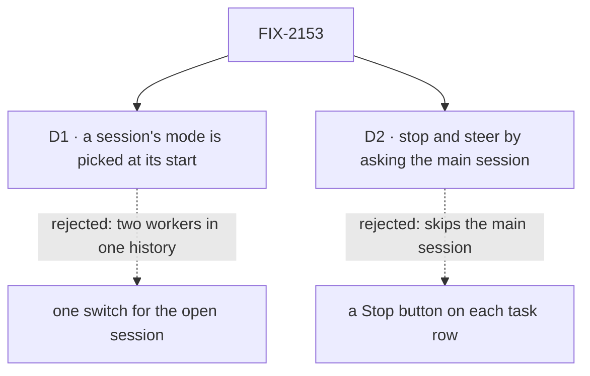

# FIX-2153 · Decisions

[Spec](SPEC.md) · **Decisions**

What was considered, what was chosen, and what each choice locks in. Two decisions are the
sign-off surface. The epic's rules ([FIX-2152 DECISIONS](../../epics/FIX-2152/DECISIONS.md))
bind this lab and are not decided again here.

## The tree

Solid edges are what you're signing. Dashed edges lost, and the label says why.

## D1 · A session's mode is picked when it starts and stays with it

| | |
|---|---|
| **Instead of** | One switch in the header that changes the mode of the open session |
| **Because** | The two modes have different main workers: a `manager` on the agent flow here, a `coordinator` in threads mode ([FIX-2152 What stays](../../epics/FIX-2152/SPEC.md#what-stays-as-it-is)). A session is a conversation with one worker. Switching it mid-history puts two workers' turns in one thread, and neither original app does that |
| **Locks in** | *New session* asks for a mode; the header and each row in the sessions list show it. To try the other mode on the same work, you start a new session. FIX-2157 adds threads mode as a second entry in the same list, not as a toggle |

It comes down to who answers in one thread: a switch puts two main workers in one history.

**What would change my mind:** FIX-2157 finding that one worker can run both behaviours as a
setting. Then a switch on an open session costs nothing, and the header becomes a toggle.

## D2 · You stop or steer a background task by asking the main session; the pane is read only

| | |
|---|---|
| **Instead of** | A Stop button, or a steer box, on each row of the tasks pane |
| **Because** | The brief: "You can only talk to the main session… Stopping or steering a task goes through the main session." Step 5 of the script proves the main session can act on tasks it filed (`updateTask` with `status: "cancelled"` or `message`). A button would call the public action directly and prove nothing about the main session |
| **Locks in** | A stop costs one typed turn. While the main session's turn runs, your line waits until it ends, as Claude Code queues it; press Stop to interrupt first. The pane shows rows and a task's work, and nothing else |

It comes down to the way of working: a button skips the main session, and the script stops proving it.

**What would change my mind:** Jake wanting the pane to be a control surface too. That is
cheap later: a button calls the public `updateTask_tasks` action, with no package change.

## Decided, not asked

- **The original's layout, copied closely.** Sessions left (*New session* on top; each row a
  title, an age and a dot while its turn runs), the thread center (your lines in a box on the
  right; the main session's text plain; tool calls as one-line mono rows; a working indicator
  with elapsed time; a composer whose send turns into Stop while a turn runs), background tasks
  right (a row per task: title, status, last progress note, worker; a row opens the task's
  work read only). Flow State theme, square corners; `attention` only where a person must act.
- **A result is a card in the thread at the point the main session took it**, labelled with
  the task's title and ending. It is drawn from the item the gap emits, never from the pane.
- **The mode switch is planned in, not built.** A mode is `{ main worker, right pane }` in one
  config object; session mode is its only entry. FIX-2157 adds threads mode as a second entry
  and a status-board pane that reads the same `listTasks` rows. *New session* shows threads
  mode disabled until then.
- **Session mode needs no flow of its own.** The main worker and `researcher` are worker files
  on the agent flow; the skill is a `SKILL.md`. The inventory may show zero flows, and that is
  the strongest result.
- **The inventory check is owned here** (ER-1). It classifies every tracked file under the lab
  as config, UI or flow by path, counts lines, writes the README table, and fails on any file
  it can't classify and on a flow over 200 lines. Its negative control plants `src/glue.ts`
  and must fail. FIX-2154 copies it; the two copies share no code (ER-3).
- **Fixtures play the script.** Until wiring, the adapter's fixtures run the five steps on a
  timer, so the mid-turn card and a stop can be seen and tested in the browser. Each fixture
  standing in for a gap carries the gap's issue id. They are deleted at wiring.
- **Working name:** `labs/claude-code-style`, private, launched with `fsdev dev --app` as Shift
  Manager is. The implementer may rename it.
- **Two PRs.** The front end on fixtures first, stacked on this spec; the wiring and the goal
  check after FIX-2056 and both gaps merge.

## Considered and dropped

| Alternative | Why not |
|---|---|
| One hired copy of the main worker per session | A roster of clones, which neither original app has (epic D3) |
| A session as a workstream session (FIX-1883) | A workstream needs a project and a lead, and caps a user at 25. fsd-architect, [#46](https://github.com/fixpoint-labs/agent-mailbox/pull/46#issuecomment-6374763392) |
| Show the result only in the pane, or after the turn | Meets a smaller goal. Claude Code shows it in the running turn, and step 4 asks for it |
| Wire the UI to today's names now | `messageWorker` and friends are about to change (epic D4) |

## How it got here

- **Draft:** framed as leg a of the epic's goal; the main worker is a `manager` on the agent
  flow with one delegate, sessions are the more-conversations gap (fsd-architect's reshaping of
  epic D3), and the front end runs on fixtures behind one adapter until wiring.

**Open: none.**
