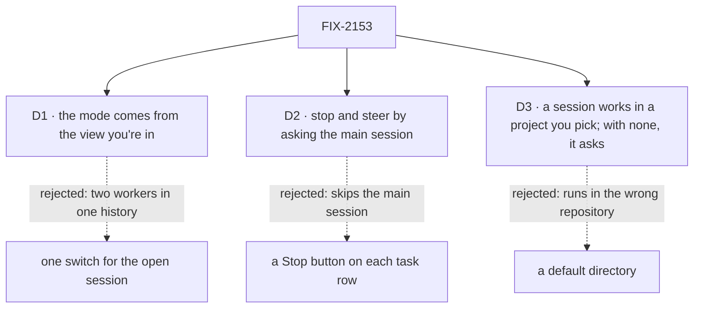

# FIX-2153 · Decisions

[Spec](SPEC.md) · **Decisions**

What was considered, what was chosen, and what each choice locks in. Three decisions are the
sign-off surface. The epic's rules ([FIX-2152 DECISIONS](../../epics/FIX-2152/DECISIONS.md))
bind this lab and are not decided again here.

## The tree

Solid edges are what you're signing. Dashed edges lost, and the label says why.

## D1 · The mode comes from the view you're in

| | |
|---|---|
| **Instead of** | One switch in the header that changes the mode of the open session |
| **Because** | The two modes have different main workers: a `manager` on the agent flow here, a `coordinator` in threads mode ([FIX-2152 What stays](../../epics/FIX-2152/SPEC.md#what-stays-as-it-is)). A session is a conversation with one worker. Switching it mid-history puts two workers' turns in one thread, and neither original app does that |
| **Locks in** | The app has two views, switched at the top of the left pane: *Sessions* (session mode) and *Projects* (threads mode). A view sets the main worker, and *New session* in it always opens a session with that worker. Each view lists only its own worker's sessions, so a session never shows in the other view, and each view keeps its own open session when you switch away and back. Nothing stores the mode on a session. To try the other mode on the same work, you open the other view and start there. FIX-2157 builds the *Projects* view; until then it shows, disabled |

It comes down to who answers in one thread: a switch puts two main workers in one history.

**What would change my mind:** FIX-2157 finding that one worker can run both behaviours as a
setting. Then a switch on an open session costs nothing, and the header becomes a toggle.

## D2 · You stop or steer a background task by asking the main session; the pane is read only

| | |
|---|---|
| **Instead of** | A Stop button, or a steer box, on each row of the tasks pane |
| **Because** | The brief: "You can only talk to the main session… Stopping or steering a task goes through the main session." Step 5 of the script proves the main session can act on tasks it filed (`updateTask` with `status: "cancelled"` or `message`). A button would call the public action directly and prove nothing about the main session |
| **Locks in** | A stop costs one typed turn. While the main session's turn runs, your line waits until it ends, as Claude Code queues it; press Stop to interrupt first. The steer path that reaches a running request mid-turn serves task turns, and the main session is a plain conversation, so it doesn't apply; Claude Code works the same way, so this is not a gap. The pane shows rows and a task's work, and nothing else |

It comes down to the way of working: a button skips the main session, and the script stops proving it.

**What would change my mind:** Jake wanting the pane to be a control surface too. That is
cheap later: a button calls the public `updateTask_tasks` action, with no package change.

## D3 · A session works in a project you pick when you create it; with none, it asks

| | |
|---|---|
| **Instead of** | A default directory when none is picked: the lab's own checkout, as Kitchen Sink's harness modes do, or a scratch directory |
| **Because** | A coding run that silently works in the lab's own repository changes the wrong code, and a scratch directory throws the work away. A project already names a repository and its files, and `projectWorkspace()` already refuses `no-project` when it finds none. The lab shows that refusal as the question |
| **Locks in** | *New session* lists the projects the person may work in (a member of a shared project, or the owner of a private one, the same rule `projectWorkspace()` applies to a run) and asks for one before the composer opens; the header shows it. The session stores it as its server-written `workProjectId`, set by `setWorkProject` right after the session is created (FIX-2161), and every task it files inherits it through `filingProjectId`, so delegates work where the session does. A task always works in its session's project: the board writes the session's project over one a task names (`ownProjectIn`), and `projectWorkspace()` refuses a different one `other-project`, so work in another project takes another session. Threads mode (FIX-2157) uses the same rule. A raw path outside any project is not offered |

It comes down to where a coding run writes: a default puts it in a repository nobody chose.

**What would change my mind:** Jake wanting Claude Code's raw folder picker. That needs a
directory that isn't a project, which is a new mechanism, so it would be filed as a gap first.

## Decided, not asked

- **The original's layout, copied closely.** Sessions left (*New session* on top; each row a
  title, an age and a dot while its turn runs), the thread center (your lines in a box on the
  right; the main session's text plain; tool calls as one-line mono rows; a working indicator
  with elapsed time; a composer whose send turns into Stop while a turn runs), background tasks
  right (a row per task: title, status, last progress note, worker; a row opens the task's
  work read only). Flow State theme, square corners; `attention` only where a person must act.
- **A result is a card in the thread at the point the main session took it**, labelled with
  the task's title and ending. It is drawn from the item the take emits, never from the pane.
- **The *Projects* view is planned in, not built.** A mode is `{ main worker, right pane }` in one
  config object, keyed by view; session mode is its only built entry. A session's mode is
  the view that lists it, never stored. FIX-2157 adds threads mode as the *Projects* entry
  and a status-board pane that reads the same `listTasks` rows. The *Projects* view shows
  disabled until then.
- **Session mode adds no flow and no block: the main worker sets `answerAgain: true`.** When
  the answer ends, the package's answer-again step runs `finishedTasksAnswerAgain`, which calls
  `takeFinishedTasks` for tasks that settled while the turn ran, and the package answers again in
  the same request under `MAX_ANSWERS_AGAIN` (epic D2, the product owner's call; FIX-2159, #3823). `researcher` is a worker file on the agent flow; the skill is a `SKILL.md`.
  The take it calls is FIX-2159's, on FIX-2078's one path with the "taken in request R" mark, so
  the deferred notice skips and each ending is heard once (ER-6). The lab only turns it on. The front end needs no change for it: the card reads the item the take emits.
- **The inventory check is owned here** (ER-1). It classifies every tracked file under the lab
  as config, UI or flow by path, counts lines, writes the README table, and fails on any file
  it can't classify and on a flow over 200 lines. Its negative control plants `src/glue.ts`
  and must fail. FIX-2154 copies it; the two copies share no code (ER-3).
- **Fixtures play the script, and prove only the UI.** Until wiring, fixtures behind the
  adapter run the five steps on a timer, so the layout, the mid-turn card and a stop can be seen
  and tested in a browser. That first PR's acceptance is the UI, not progress on the goal. The
  adapter names verbs only; wiring binds each to the package. Fixture code carries a plain
  `fixture:` marker, not an issue id (BP-006); the README lists which gap each one stands for, and
  the closure greps for the marker. This is how ER-5's "carries the gap's issue id" is met.
- **A coding harness runs only on delegated workers.** The main session stays on our generator,
  because the answer-again step owns its turn. `desk.coder` runs on the lab's one `coder` flow (epic
  ER-9). It builds one `harnessManager({ harness, workspace, ledgers })` per harness, each with
  `localWorkspaceHost({ source: projectWorkspace() })`, and runs each task through the one the
  worker's own `harness:` setting names. The hire passes that line to the flow as a setting
  (`settingsOf`, `workforce/src/hire.ts`), so a second coding worker on Codex is one more
  `WORKER.md`, not another flow. If the flow can't stay under 200 lines, this spec raises the cap
  for it once and says why, rather than copying Shift Manager's.
- **A coding run shows like any task.** Its row carries the status and progress note the run
  writes, and opening it shows its run session's items read only, the harness's steps included.
  The thread board is FIX-2157's.
- **No mid-run messages.** The harness leg never needs a coding run to message a teammate, so
  FIX-1990 is not needed.
- **Working name:** `labs/claude-code-style`, private, launched with `fsdev dev --app` as Shift
  Manager is. The implementer may rename it.
- **Two PRs.** The front end on fixtures first, stacked on this spec; the wiring and the goal
  check after FIX-2056 and both gaps merge.

## Considered and dropped

| Alternative | Why not |
|---|---|
| One hired copy of the main worker per session | A roster of clones, which neither original app has (epic D3) |
| A session as a workstream session (FIX-1883) | A workstream needs a project and a lead, and caps a user at 25. fsd-architect, [#46](https://github.com/fixpoint-labs/agent-mailbox/pull/46#issuecomment-6374763392) |
| Show the result only in the pane, or after the turn | Meets a smaller goal. Claude Code shows it in the running turn, and step 4 asks for it |
| Wire the UI to today's names now | `messageWorker` and friends are about to change (epic D4) |
| A raw directory per session, outside any project | Not in the box, and a project already names a repository. Filed first if Jake wants it (D3) |
| File and bash tools on the main session, with its sandbox in the session's directory | The main session works in text and hands code off; giving it tools would also make the session's directory a sandbox setting (`tools/src/bash/resolve-sandbox.ts`) |
| A conversation key on `WorkerSessionCriteria` for more sessions | Rejected in epic D3: nothing enforces one conversation per worker, so a new session is an ordinary session on the worker's flow |

## How it got here

- **Draft:** framed as leg a of the epic's goal; the main worker is a `manager` on the agent
  flow with one delegate, and the front end runs on fixtures behind one adapter until wiring.
- **Review:** sessions follow the corrected epic D3, ordinary sessions on the worker's flow
  listed through FIX-2158, instead of a new criteria key; the gaps cite FIX-2158 and FIX-2159.
  The control became the absence of FIX-2159's delivery, so no package carries a test switch.
  Signal 4 now names the first request, and a late settle must still get a model step.
- **Product owner's answers:** the mode comes from the view you're in (*Sessions* or
  *Projects*), not from a choice at *New session*. A result reaches the running turn through
  a turn that answers again at its end. It was first written as the lab's own flow looping back;
  FIX-2159's spec moved the loop into the package, and its merge (#3823) ships the source, so the lab only sets `answerAgain: true`. The take stays FIX-2159's, on FIX-2078's one
  path, so an ending is heard once; the epic's D2 is amended to match.
- **Product lead's second ask:** a working directory per session (D3, with the gap that lets
  an ordinary session open on a project) and a coding harness on delegated workers only. The
  script gains signal 0 and a harness leg.

## Notes from review

- "Three copies of the same UI reads … putting the data-shaping part (task row → `{title, status, note, worker, elapsed}`) in `workforce`'s React/client surface." — second look ([comment](https://github.com/fixpoint-labs/flow-state-dev/pull/3788#issuecomment-6375045433)); recorded in the debt's *Leaves* row
- "The inventory check is the same pattern … One checker taking the lab directory and a rules file would meet 'FIX-2154 can copy it' with less debt." — second look, same comment; ER-3 is the epic's call

These are inputs, not instructions.

**Open: none.**
