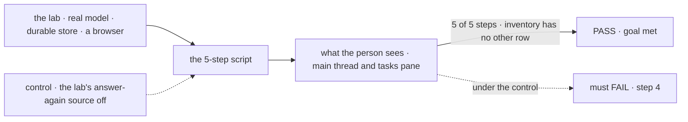
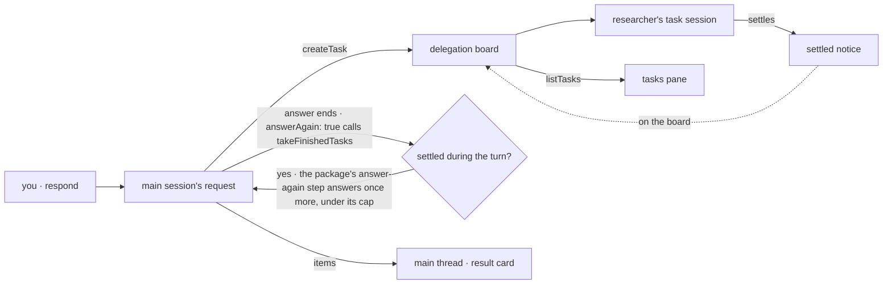

# FIX-2153 · Claude Code-style lab, session mode

**Spec** · [Decisions](DECISIONS.md)

## Eight people, before and after

| Someone who… | Today | After |
|---|---|---|
| **opens the app** | Has no app that works the way Claude Code does. Shift Manager is the only one, and it works in a new way | Sees Claude Code's layout in the Flow State theme: sessions on the left, the main thread in the center, background tasks on the right |
| **asks the main session for something big** | n/a | Watches it do part of the work itself and start background tasks, each a row in the right pane with its status and its last progress note |
| **is mid-turn when a background task finishes** | The result waits until the main session's reply ends | Sees the result as a card in the main thread while the turn is still running, and the rest of the turn uses it |
| **is idle when a background task finishes** | The main session takes a new turn to report it | The same: a new turn shows the result card and what the main session makes of it |
| **wants a background task stopped or steered** | n/a | Asks the main session, which stops or steers its own task. The pane is read only; a row opens to show the task's work ([D2](DECISIONS.md#d2)) |
| **picks where the work happens** | n/a | *New session* asks for a project before the composer opens. The project's checkout is the directory the session's tasks work in, and the session's header shows it. With none chosen it keeps asking, and never falls back to the lab's own repository ([D3](DECISIONS.md#d3)) |
| **asks for a code change** | n/a | The main session hands it to a coding worker that runs Claude Code or Codex in the session's project. Its row shows in the tasks pane like any task, and opening it shows the harness's steps. The main session itself stays on our generator |
| **starts another session** | Gets one conversation per worker | Clicks *New session* and gets a fresh session with the same main worker, listed beside the others. The mode comes from the view: *Sessions* is session mode, *Projects* is threads mode ([D1](DECISIONS.md#d1)) |

The scope is the brief's: core messaging and session management, plus a working directory per
session and a coding harness on delegated workers. No file diffs, no permission prompts, and no
harness picker in the UI: a coding worker's file fixes its harness.

## The goal, and how we'll know it's met

**A person drives Claude Code's session-mode way of working end to end in a browser, on a
real model: ask, watch the main session work and start two background tasks, see one result
land inside the running turn, and stop the other by asking. The app adds only configuration,
React UI and small flows.**

| Is it the right goal? | |
|---|---|
| **The real need** | Proof that the workforce pieces reproduce a way of working people already trust, and a list of where they don't ([FIX-2152](https://linear.app/fixpoint-labs/issue/FIX-2152), leg a of its goal) |
| **Smaller, and rejected** | "The front end matches Claude Code." It ships on fixtures in this issue's first PR, and it proves nothing about the package. It is a step, not the goal |
| **Bigger, and not this issue's** | Threads mode, where the main session delegates everything to a status board. [FIX-2157](https://linear.app/fixpoint-labs/issue/FIX-2157) adds it as this app's *Projects* view |
| **Not done if** | A step passes only on fixtures · the result card shows only after the turn · the stop works from a pane button and not by asking · the lab's inventory has an *other* row · a gap is worked around in the lab |



The check reads the page a person sees and task rows read through the public task action,
never the lab's own state. With the lab's answer-again source off, step 4 must fail.

| How we verify | |
|---|---|
| **Goal check** | `goals/claude-code-style-lab/session-mode-script/` · real model · Playwright, against `fsdev dev --app` · run by the implementer at wiring · verdict in the wiring PR. The epic's closure reruns it as leg a |
| **Signal** | 0 *New session* asks for a project, and the header shows the one you pick · 1 your line shows · 2 the main session's own text shows before any task row · 3 two task rows show, both filed by this session · 4 a result card shows while the turn's working indicator is on, and text after it in the same turn names the result; the card, the indicator and that text all carry the request id of your first `respond`, so a second request started by the settled notice does not count · 5 after you ask to stop the other task, its row reads `cancelled` through `listTasks` · **Harness leg**, run after the five: 6 ask for a one-line change to a file in the project; a coding task row shows, runs through Claude Code, and settles `completed`; its work view shows the harness's steps; the change is on the run's branch of the project's repository, and the lab's own checkout is untouched |
| **Input** | "Compare two vendors and write a summary": one quick research task and one long one. The skill tells the main session to keep working after it files them, so the turn outlasts the quick task. A different ask with one quick and one long task must pass too; a run where the turn ends before the quick task does, or the long task ends before you ask to stop it, is a bad input, not a FAIL: the check records it and reruns, up to three times |
| **Anti-game** | Don't assert on fixtures, the adapter's return values, or the lab's React state. Don't cancel through the public `updateTask` action from the test |
| **Control that must fail** | The lab with `answerAgain` left off the main worker's flow in the lab's config. FAIL on signal 4: the result then arrives in a second request after the turn. No package carries a switch for the control. And the inventory check with a planted `src/glue.ts`: FAIL. And a session created with no project: the composer stays closed and asks, and no run starts anywhere: FAIL on signals 0 and 6 if anything runs in the lab's own checkout |

## What changes


This is the UI design. The center is the only place you type. The green card is step 4: a
result that arrived while the turn was still running.

**The main worker, as a person writes it:**

```diff
+ # workforce/teams/desk/workers/main/WORKER.md
+ ---
+ description: Does the work you ask for, and starts background tasks for long pieces.
+ delegates: [desk.researcher, desk.coder]
+ ---
+ # workforce/teams/desk/skills/research/SKILL.md
+ ---
+ description: Research one topic in the background.
+ ---
+ Call createTask for desk.researcher with one topic per task. Keep working; its result reaches you.
+ # workforce/teams/desk/workers/coder/WORKER.md
+ ---
+ flow: coder
+ harness: claude-code          # or codex: a setting the hire passes to the flow
+ description: Makes code changes in the session's project.
+ ---
```

**The adapter, until wiring** ([ER-5](../../epics/FIX-2152/DECISIONS.md#who-owns-what)):

```diff
+ // src/adapter.ts: verbs only; wiring binds each to the package
+ listSessions(mode)       // a person's sessions of the mode's main worker
+ listProjects()           // the projects the person may work in: member or owner
+ openSession(mode, project) // at wiring: createSession, then setWorkProject(worker, project, { sessionId }) before the composer opens
+ send(session, message)   // the worker's door, respond
+ interrupt(session)       // abort the running request
+ watchTasks(session)      // the conversation's listTasks rows
+ watchTaskWork(task)      // the task's run session, read only
```

**Docs:** the lab's README (what it is, how to run it, its inventory) and one row in
`labs/README.md`. No `apps/docs` page, per the epic.

## How a result reaches the running turn



The main session runs on the agent worker flow with `answerAgain: true` (FIX-2159, merged as
[#3823](https://github.com/fixpoint-labs/flow-state-dev/pull/3823)), so the lab writes no block for it. When the answer ends, the package's one answer-again step
runs its pre-built `finishedTasksAnswerAgain`, which calls `takeFinishedTasks` for tasks this session filed that settled while
the turn ran. If it returns a message, the package answers again in the same request with those
results, under `MAX_ANSWERS_AGAIN` (3, shared with the plan); if it returns nothing, the turn ends. The check runs after the last model call, so a task that settles during that call is
still caught. The take is not the lab's: it goes through FIX-2078's one ending path with the
durable "taken in request R" mark ([ER-6](../../epics/FIX-2152/DECISIONS.md#who-owns-what)),
moving the notice's handling and acknowledgement into this request, so the queued
`onTaskSettled` notice for the same ending skips and the main session hears each ending once.
The lab only turns it on; the package, not the lab, goes back to the worker's turn. The result card is drawn from the item the take emits.

## What stays as it is

- **The worker model.** The main worker is a `manager`, on the agent worker flow with `answerAgain: true`. No new kind of worker, no coordinator. It has no file or bash tools: it works in text and hands code to the coding worker, so no sandbox directory is set for it.
- **Skills don't start workers.** A skill tells the model to `createTask` for a delegate.
- **Shift Manager**, its shell and its app contract. This lab copies the setup; it changes neither.
- **Core and engine.** Nothing here goes below workforce and orchestration.

## What's already here, and the debt

| Already here | What this does with it |
|---|---|
| Apps that show a worker conversation: Shift Manager's session view, Kitchen Sink, DevTool | **Leaves alone.** This is the fourth screen over the same reads, on purpose: the epic's evidence is a second app on the same pieces. It shares no code with them ([ER-3](../../epics/FIX-2152/DECISIONS.md#who-owns-what)) |
| The agent flow's planned turn, delegation board, and `resultTo: "filer"` | **Builds on.** The main session works and delegates |
| `listTasks` rows with `statusNote` and `run.sessionId`; `updateTask` cancel and steer (FIX-2081, FIX-2086) | **Builds on.** The pane, a task's work, and step 5 |
| `useSession` items, streaming and `abortRequest` | **Builds on.** The main thread and its Stop button |
| A worker running on a flow you wrote (`flow:` in `WORKER.md`, `workerFlows`, `defineSessionBoard`) | **Builds on.** The main worker sets only `answerAgain: true`, no flow or block of its own ([epic D2](../../epics/FIX-2152/DECISIONS.md#d2)) |
| `@flow-state-dev/design-system`, the `packages/ui` registry, `fsdev dev --app` | **Builds on.** The only theme, the copied components, the launch |
| `projectWorkspace()` (`workforce/src/projects/project-workspace.ts`): a harness run works in its workstream's project, its conversation's (`filingProjectId`, copied at hand-over), or the one its task names, else refuses `no-project` | **Builds on.** A task the main session files inherits the session's project through `filingProjectId`, so delegates work where the session does with no new mechanism |
| `harnessManager({ harness, workspace, ledgers })`, `localWorkspaceHost`, and the Claude Code and Codex harness blocks | **Builds on.** The lab's one coding worker flow, which builds a manager per harness and runs each task through the one its worker's `harness` setting names (`settingsOf`, `workforce/src/hire.ts`), under 200 lines ([epic ER-9](../../epics/FIX-2152/DECISIONS.md#who-owns-what)) |
| Shift Manager's `coder` worker flow (`teams/devteam/workforce/flows/workers/coder.mts`) and Kitchen Sink's harness modes | **Leaves alone.** The lab writes its own small coding flows (ER-3). Kitchen Sink falls back to the server's own checkout when unset (`lib/harness-workspace.ts`); the lab never does |
| FIX-2152 ER-1 to ER-7, D2 and D4 | **Kept.** This issue owns ER-1 to ER-5, so it builds the inventory check FIX-2154 copies |
| FIX-1883 workstream sessions as "several sessions of one worker" | **Not used.** fsd-architect showed a workstream needs a project and caps a user at 25 ([#46](https://github.com/fixpoint-labs/agent-mailbox/pull/46#issuecomment-6374763392)) |

**Gaps** ([ER-4](../../epics/FIX-2152/DECISIONS.md#who-owns-what)). The epic files them:

| Gap | Blocks |
|---|---|
| [FIX-2158](https://linear.app/fixpoint-labs/issue/FIX-2158) · **the workforce client lists a person's sessions of one worker.** A new session is an ordinary session on the worker's flow; the derived session stays the default conversation, where messages and routed tasks land ([epic D3, ER-7](../../epics/FIX-2152/DECISIONS.md#d3)). No new criteria key | The sessions list · steps 1 to 5 |
| [FIX-2159](https://linear.app/fixpoint-labs/issue/FIX-2159) · **a flow can take a settled notice inside the filer's running conversation request**, on FIX-2078's one path with the "taken in request R" mark, the handling and the acknowledgement moving as one transaction (ER-6). The take also runs the shared handling (the failure report, the dedupe key, freeing the delegate's session) before it clears, and reads committed rows, not the turn's snapshot. Plus an `answerAgain` source slot on the agent worker flow, feeding the one answer-again step already there after a plan, under one exported cap. The lab's source block calls the take at answer end, so a task that settles during the last model call is still heard in that request, and only once | Step 4 |
| [FIX-2161](https://linear.app/fixpoint-labs/issue/FIX-2161) · **an ordinary session of any worker can work in a project.** Today only the project coordinator's session carries a `projectId`, at its derived id (`workers/installation.ts`, the create check), and that field is fixed at create. FIX-2161 ([#3805](https://github.com/fixpoint-labs/flow-state-dev/pull/3805)) adds a server-written `workProjectId`, set only by `setWorkProject(worker, project, { sessionId })` after a membership check (a member of a shared project, or the owner of a private one; reading it is not enough, since `projectWorkspace()` refuses a run by a non-member with `not-a-member`). `filingProjectOf` reads it, so tasks inherit it through `filingProjectId` | Signals 0 and 6 · the session's directory |
| Checked at wiring: **the person can read a task's run session** | Opening a row; a gap only if refused |
| **`listTasks` rows carry when a task started and ended** | Nothing; without it the pane shows no elapsed time. Filed in the project, not as a child |

| The debt | |
|---|---|
| **Removes** | Nothing |
| **Adds** | One private lab under `labs/` with its inventory check and one small coding worker flow; the epic's evidence. The fixtures and their adapter bodies, deleted at wiring (the closure checks it) |
| **Leaves** | The same task-row-to-view shaping (status, note, worker, run session) lives in Shift Manager, here, and soon FIX-2154, and each lab carries its own inventory check. ER-3 forbids sharing between labs; the closure prices it ([review](https://github.com/fixpoint-labs/flow-state-dev/pull/3788#issuecomment-6375045433)). The registry has no sessions list or tasks pane, so the lab writes both |

**Net: up, by one private lab.** It is what the epic exists to produce.

## Sign off

**[The goal](#the-goal-and-how-well-know-its-met), at that size:** five steps and a harness leg,
a real model, a browser, and no *other* row. If wrong: a lab that looks right on fixtures and proves nothing.

**[The debt](#whats-already-here-and-the-debt), net up:** one private lab; the epic files the gaps.
If wrong: a lab nobody maintains.

1. **[D1](DECISIONS.md#d1) · The mode comes from the view you're in: *Sessions* or *Projects*.**
   Nothing stores it on a session; each view lists its own worker's sessions. If wrong: trying
   the other mode means a new session in the other view, and FIX-2157 builds on that.
2. **[D2](DECISIONS.md#d2) · You stop or steer a task by asking the main session; the pane is
   read only.** If wrong: a stop costs a turn, and the pane later gets buttons.
3. **[D3](DECISIONS.md#d3) · A session works in a project you pick when you create it; with
   none, it asks.** If wrong: one more click per session, and a raw-path option later.

**Open: none.** D2 is the one to weigh.

Feature · new private lab, `workforce` gaps filed by the epic · medium · epic [FIX-2152](https://linear.app/fixpoint-labs/issue/FIX-2152)
