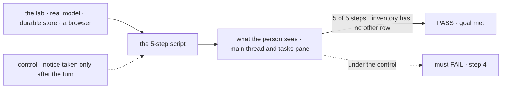
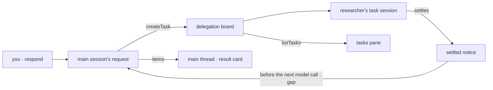

# FIX-2153 · Claude Code-style lab, session mode

**Spec** · [Decisions](DECISIONS.md)

## Five people, before and after

| Someone who… | Today | After |
|---|---|---|
| **opens the app** | Has no app that works the way Claude Code does. Shift Manager is the only one, and it works in a new way | Sees Claude Code's layout in the Flow State theme: sessions on the left, the main thread in the center, background tasks on the right |
| **asks the main session for something big** | n/a | Watches it do part of the work itself and start background tasks, each a row in the right pane with its status and its last progress note |
| **is mid-turn when a background task finishes** | The result waits until the main session's reply ends | Sees the result as a card in the main thread while the turn is still running, and the rest of the turn uses it |
| **wants a background task stopped or steered** | n/a | Asks the main session, which stops or steers its own task. The pane is read only; a row opens to show the task's work ([D2](DECISIONS.md#d2)) |
| **starts another session** | Gets one conversation per worker | Clicks *New session* and gets a fresh conversation with the same main worker, listed beside the others. Each session keeps the mode it started in ([D1](DECISIONS.md#d1)) |

The scope is the brief's: core messaging and session management. No file diffs, no
permission prompts, no harness picker.

## The goal, and how we'll know it's met

**A person drives Claude Code's session-mode way of working end to end in a browser, on a
real model: ask, watch the main session work and start two background tasks, see one result
land inside the running turn, and stop the other by asking. The app adds only configuration,
React UI and small flows.**

| Is it the right goal? | |
|---|---|
| **The real need** | Proof that the workforce pieces reproduce a way of working people already trust, and a list of where they don't ([FIX-2152](https://linear.app/fixpoint-labs/issue/FIX-2152), leg a of its goal) |
| **Smaller, and rejected** | "The front end matches Claude Code." It ships on fixtures in this issue's first PR, and it proves nothing about the package. It is a step, not the goal |
| **Bigger, and not this issue's** | Threads mode, where the main session delegates everything to a status board. [FIX-2157](https://linear.app/fixpoint-labs/issue/FIX-2157) adds it behind this app's mode switch |
| **Not done if** | A step passes only on fixtures · the result card shows only after the turn · the stop works from a pane button and not by asking · the lab's inventory has an *other* row · a gap is worked around in the lab |



The check reads the page a person sees and task rows read through the public task action,
never the lab's own state. With the mid-turn notice off, step 4 must fail.

| How we verify | |
|---|---|
| **Goal check** | `goals/claude-code-style-lab/session-mode-script/` · real model · Playwright, against `fsdev dev --app` · run by the implementer at wiring · verdict in the wiring PR. The epic's closure reruns it as leg a |
| **Signal** | 1 your line shows · 2 the main session's own text shows before any task row · 3 two task rows show, both filed by this session · 4 a result card shows while the turn's working indicator is on, and text after it in the same turn names the result · 5 after you ask to stop the other task, its row reads `cancelled` through `listTasks` |
| **Input** | "Compare two vendors and write a summary": one quick research task, one long one. A different ask with one quick and one long task must pass too |
| **Anti-game** | Don't assert on fixtures, the adapter's return values, or the lab's React state. Don't cancel through the public `updateTask` action from the test |
| **Control that must fail** | `GOAL_CONTROL=notice-after-turn` (the gap's take is off): FAIL on signal 4. And the inventory check with a planted `src/glue.ts`: FAIL |

## What changes


This is the UI design. The center is the only place you type. The green card is step 4: a
result that arrived while the turn was still running.

**The main worker, as a person writes it:**

```diff
+ # workforce/teams/desk/workers/main/WORKER.md
+ ---
+ description: Does the work you ask for, and starts background tasks for long pieces.
+ delegates: [desk.researcher]
+ ---
+ # workforce/teams/desk/skills/research/SKILL.md
+ ---
+ description: Research one topic in the background.
+ ---
+ Call createTask for desk.researcher with one topic per task. Keep working; its result reaches you.
```

**The adapter, until wiring** ([ER-5](../../epics/FIX-2152/DECISIONS.md#who-owns-what)):

```diff
+ // src/adapter.ts: each function names the package call it stands for
+ listSessions(worker)        // workforce client list · gap FIX-XXX (more conversations)
+ openSession(worker, mode)   // ensureWorkerSession({ worker, conversation }) · same gap
+ respond(session, message)   // useSession(id).sendAction("respond", { message })
+ interrupt(session)          // useSession(id).abortRequest()
+ listTasks(session)          // listTasks_tasks · public task action
+ taskWork(task)              // useSession(task.run.sessionId).items
```

**Docs:** the lab's README (what it is, how to run it, its inventory) and one row in
`labs/README.md`. No `apps/docs` page, per the epic.

## How a result reaches the running turn



The notice enters the request that is already running, the way a steer does. The lab only
draws the item it emits.

## What stays as it is

- **The worker model.** The main worker is a `manager` on the agent flow. No new role, no coordinator.
- **Skills don't start workers.** A skill tells the model to `createTask` for a delegate.
- **Shift Manager**, its shell and its app contract. This lab copies the setup; it changes neither.
- **Core and engine.** Nothing here goes below workforce and orchestration.

## What's already here, and the debt

| Already here | What this does with it |
|---|---|
| Apps that show a worker conversation: Shift Manager's session view, Kitchen Sink, DevTool | **Leaves alone.** This is the fourth screen over the same reads, on purpose: the epic's evidence is a second app on the same pieces. It shares no code with them ([ER-3](../../epics/FIX-2152/DECISIONS.md#who-owns-what)) |
| The agent flow's planned turn, delegation board, and `resultTo: "filer"` | **Builds on.** The main session works and delegates |
| `listTasks` rows with `statusNote` and `run.sessionId`; `updateTask` cancel and steer (FIX-2081, FIX-2086) | **Builds on.** The pane, a task's work, and step 5 |
| `useSession` items, streaming and `abortRequest` | **Builds on.** The main thread and its Stop button |
| The steer path, taken before each model call (`orchestration/src/skills/steer-context.ts`) | **Builds on**, through the mid-turn gap. Its notice takes the same path |
| `@flow-state-dev/design-system`, the `packages/ui` registry, `fsdev dev --app` | **Builds on.** The only theme, the copied components, the launch |
| FIX-2152 ER-1 to ER-7, D2 and D4 | **Kept.** This issue owns ER-1 to ER-5, so it builds the inventory check FIX-2154 copies |
| FIX-1883 workstream sessions as "several sessions of one worker" | **Not used.** fsd-architect showed a workstream needs a project and caps a user at 25 ([#46](https://github.com/fixpoint-labs/agent-mailbox/pull/46#issuecomment-6374763392)) |

**Gaps** ([ER-4](../../epics/FIX-2152/DECISIONS.md#who-owns-what)), for the epic thread to file:

| Gap | Blocks |
|---|---|
| **A user opens and lists more conversations with one worker.** An optional conversation key on `WorkerSessionCriteria`; the list returns each one's title and last activity. Amends "one conversation per worker per user", Jake's call | The sessions list · steps 1 to 5 |
| **A settled notice reaches the filer's running request before its next model call**, and shows as an item in that request. A delivery mode on FIX-2078's one path, after FIX-2078 | Step 4 |
| Check at wiring: **the user can read a task's run session** through `useSession` | Opening a row; a gap only if refused |
| **`listTasks` rows carry when a task started and ended** | Nothing; without it the pane shows no elapsed time |

| The debt | |
|---|---|
| **Removes** | Nothing |
| **Adds** | One private lab under `labs/` with its inventory check; the epic's evidence. The fixtures and their adapter bodies, deleted at wiring (the closure checks it) |
| **Leaves** | The registry has no sessions list or tasks pane, so the lab writes both. Not a gap: they are UI |

**Net: up, by one private lab.** It is what the epic exists to produce.

## Sign off

**[The goal](#the-goal-and-how-well-know-its-met), at that size:** five steps, a real model, a
browser, and no *other* row. If wrong: a lab that looks right on fixtures and proves nothing.

**[The debt](#whats-already-here-and-the-debt), net up:** one private lab, two package gaps.
If wrong: a lab nobody maintains.

1. **[D1](DECISIONS.md#d1) · A session's mode is picked when it starts and stays with it.**
   If wrong: switching modes needs a new session, and FIX-2157 builds on that.
2. **[D2](DECISIONS.md#d2) · You stop or steer a task by asking the main session; the pane is
   read only.** If wrong: a stop costs a turn, and the pane later gets buttons.

**Open: none.** D2 is the one to weigh.

Feature · new private lab, `workforce` gaps filed by the epic · medium · epic [FIX-2152](https://linear.app/fixpoint-labs/issue/FIX-2152)
