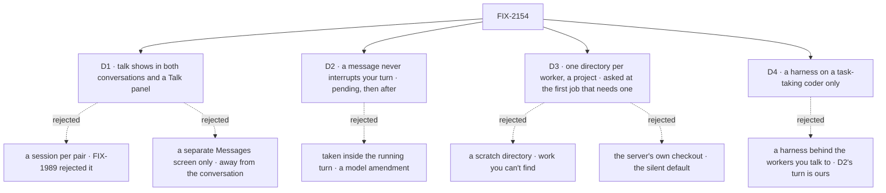

# FIX-2154 · Decisions

[Spec](SPEC.md) · **Decisions**

The epic's rules (ER-1 to ER-5) already say what the lab may hold, how it is set up and that its
front end runs on fixtures until wiring. The brief names three hard spots. Two are product calls
and come to sign-off here; the third, one conversation forever, is a package gap by the epic's
own call, recorded under *Decided, not asked*. An amendment adds two more: where a worker's work
happens on disk (D3), and which workers run a coding harness (D4).

## The tree

Solid edges are what you're signing. Dashed edges lost, and the label says why.

## D1 · Worker talk shows in both conversations as one-line cards, and in a Talk panel

*A product call the brief leaves open ("visible enough to trust, but not noise").*

| | |
|---|---|
| **Instead of** | A session for each pair of workers, which the brief's wording suggests ("their own sessions"), or Shift Manager's way: one Messages screen listing every exchange |
| **Because** | A reply matters where it changes an answer, so it is drawn there: lead's message to researcher is a one-line card in lead's conversation, researcher sees it as a line from lead in its own, and the reply lands in lead's conversation under researcher's name. A card opens to the full text. The Talk panel lists one worker's exchanges grouped by the other worker, for the person who wants the whole thread. Both read the message log, so no new session or concept is added: a per-pair session was rejected by FIX-1989's D1, and fsd-architect agreed ([#46](https://github.com/fixpoint-labs/agent-mailbox/pull/46#issuecomment-6374763392), answer 4) |
| **Locks in** | What a person sees of worker talk is a view over the user's message log, keyed to the row FIX-2070 ships. A worker-to-worker exchange has no conversation of its own the person can type into; to steer it, they talk to either worker |

It comes down to keeping a reply next to the answer it changed.

**What would change my mind:** Grok Bot's own app showing bot-to-bot talk as its own thread in
the sidebar. Then the Talk panel becomes a sidebar entry per pair, still a view over the log, with
no new session.

## D2 · A message from another worker never interrupts your turn: it shows as pending, and lands after

*A product call the brief asks outright ("Where does it land? Does it interrupt?").*

| | |
|---|---|
| **Instead of** | Taking the message inside the recipient's running turn, before its next model call, the way the epic's D2 takes a background task's result |
| **Because** | The concept already answers it: a message to a busy session queues until the current request ends (rule 10), and in this lab every worker has only its default conversation, so the reply lands there. So the reply runs as its own `receive` turn right after lead answers you, and that turn's line uses it. The lab adds the part a person needs: a pending line the moment the reply is logged, so it is never silent. Taking it mid-turn would amend the model a second time, beside the epic's D2 |
| **Locks in** | A turn you started is never changed by another worker's message. The reply is a separate line after your answer, and the answer you are waiting for does not use it. A person who wants it used asks again, or waits one turn |

It comes down to the concept's queue rule: a message to a busy session waits.

**What would change my mind:** Grok Bot reading a teammate's message inside the turn it is running.
Then a gap carries messages on the epic's ER-6 path (taken before the next model call, once), and
the pending line becomes a line inside the turn.

## D3 · Each worker has one directory, a project, asked for the first time a job needs one

*A product call fsd-product-lead raised on #46 ([comment](https://github.com/fixpoint-labs/agent-mailbox/pull/46#issuecomment-6375993020)), and settled there as talk-first ([comment](https://github.com/fixpoint-labs/agent-mailbox/pull/46#issuecomment-6376142695)). The epic's ER-8 lets each lab say when it asks.*

| | |
|---|---|
| **Instead of** | Asking up front before you can talk to a worker, a scratch directory when none is set, the server's own checkout (Kitchen Sink's fallback), or a raw path per message |
| **Because** | A Grok Bot-style worker has one conversation, so it has one place it works: the directory is set on the worker, not per session. It is a project, never a raw path, because the box already turns a project into a checkout (`projectWorkspace()`, with the operator's `checkouts` map) and already refuses a task with none (`no-project`). The lab is talk-first: talking to a worker never needs a project. The first time a job needs one (lead hands coder a task, or anything else that touches files), the screen asks. The wait is no new state: coder's run is refused `no-project` before any file exists (`projectWorkspace()`), its ending lands on the task card in lead's conversation, and the screen draws the prompt there. Your pick is sent to lead as your own line, and lead files the task again, now inheriting the project. Not a FIX-2058 `waitForUser` hold: a task session's project is fixed at hand-over, so an answer mid-run couldn't move it. The pick is stored on lead's default conversation through FIX-2161, widened to be set from the screen, and sticks to the worker. Work lead hands on inherits lead's directory through the task's project (`filingProjectId`); a task naming another project is refused (`other-project`), so it can't stray. What is missing is a project on the worker's default conversation, which FIX-2161 is widened to carry |
| **Locks in** | No run touches files until a person has said where, and a job can wait on that prompt. A worker's directory is one of the user's projects, so a repo the person hasn't added as a project can't be picked |

It comes down to the box's own refusal: a task with no project doesn't run.

**What would change my mind:** people missing the prompt, so coding jobs sit waiting. Then lead
says in its conversation that it is waiting for a project, as well as the screen asking.

## D4 · Only a task-taking coder runs a harness; the workers you talk to stay on our generator

*A product call fsd-product-lead raised on #46, in the same comment.*

| | |
|---|---|
| **Instead of** | Running lead, researcher or writer through Claude Code, so the person talks to a harness directly |
| **Because** | The workers you talk to are where messages queue and land (D2), and that turn is ours. A fourth worker, coder, takes tasks only, so it can't be messaged (`takes_tasks_only`), and runs each task through Claude Code. lead lists coder as a delegate and hands it work with `createTask`. A task card shows in lead's conversation while it runs; it opens to the run, read only, since coder has no composer. When the run ends its result lands in lead's conversation as a line from coder, and if lead is answering you then, it waits for that turn, the same deferral as D2's pending line. coder runs on the lab's one coding worker flow, which builds one `harnessManager` per harness over `projectWorkspace()` and routes each task by the worker's own `harness` setting in its `WORKER.md` (the epic's ER-9). The hire already passes a worker's non-reserved `WORKER.md` keys to its flow as settings (`settingsOf`, `workforce/src/hire.ts`), so a Codex coder is one more `WORKER.md`, with no gap. Its run shows as an ordinary task row, tagged with its harness |
| **Locks in** | A person never types to a harness in this lab. Steering a coding job means telling lead, who files the next task |

It comes down to D2: the turn messages land in has to stay ours.

**What would change my mind:** Grok Bot letting a person talk to a coding bot as one of the
teammates. Then the harness gets the epic's mid-turn path (the Claude lab's D2), a separate design.

> **Amended 2026-10-29 ([FIX-2332](https://linear.app/fixpoint-labs/issue/FIX-2332)).** In Jake's
> test, coder on the list of teammates read as a broken teammate: it was listed like the others, and
> a line to it got the door's reply. Jake chose to make coding a **background task, not a
> teammate**, the way Grok Bot hands a coding agent a job you watch rather than talk to. The
> decision stands: only coder runs a harness, the workers you talk to stay on our generator, and a
> person never types to a harness. What changed is how it shows. coder stays on the roster as the
> hidden worker coding tasks go to, and is off the screen's list. Each coding task is a background
> item under the teammates, and a card in the conversation that started it; both open to the run,
> read only, and its result lands as the coding task's, not as a line from coder. lead's
> instructions say *start a coding task*, never *give it to coder*. The *Instead of* row is
> unchanged; in *Because*, "lists coder as a delegate" and "a line from coder" no longer describe
> the screen. Making coder messageable stays out of scope (FIX-1990).

## Decided, not asked

- **No session list, no new chat.** Choosing a worker opens its one conversation,
  `ensureWorkerSession({ worker })` with no criteria. The epic's sessions gap (ER-7) is not used.
- **One conversation forever is a package gap, not lab code** (the epic's *Decided before review*).
  The lab composes `@flow-state-dev/memory` into `defineAgentWorkerFlow`, reading through `uses`
  and recording each turn through `afterAnswer: mem.captureFromItems` (without the second, memory
  records nothing and the probe would fail for the wrong reason). That is configuration. A summary of turns past the 50-turn window, an opt-in option on core's
  `historyWindow` built on core's `summarizer` and off by default, and the mark the divider reads,
  is gap G1, tracked under FIX-1613 rather than a new entry. The lab never summarizes on its own, not even in a small flow.
- **The divider says what happened.** It marks where the turns read word for word begin, and
  reads *earlier turns summarized* only when G1's summary is on; otherwise *earlier turns out of
  view*. It never calls a plain window boundary a summary.
- **A probe at wiring says whether the script needs G1's summary.** Step 4 is run with memory
  alone. A pass means only that this script didn't need it (a conversation's history and memory
  never stand in for each other, FIX-1612). Either way G1 blocks this lab's wiring and the
  closure, because only its mark places the divider step 4 asserts
  ([epic D1](../../epics/FIX-2152/DECISIONS.md#d1)).
- **Worker messages queue; task results take the ending path.** D2 is the queue rule for a
  message (a queued message is plain conversation, answered after the turn). The epic's D2
  (FIX-2159) is a task result reaching a running turn. They are separate paths, not rival designs.
- **The pending line is UI over two public reads.** A log row addressed to the open worker that
  has no line in its conversation yet is pending. That join needs the received line to carry its
  message id (gap G2, an ask of FIX-2070). Until G2 lands the pending line is best effort and
  nothing gates on it.
- **Worker status is UI over a public read.** The list reads each worker's conversation through
  `listSessionRequests`; a running request is *working*. Unread counts are per viewer, in browser
  storage.
- **Four workers in the lab:** lead (plans with you, messages the others), researcher, writer, and
  coder, which takes tasks only. Any worker may message any other conversation worker on the roster
  (FIX-1989); the lab restricts nothing.
- **A coding run needs no worker messages (FIX-1990).** coder never messages a teammate mid-run;
  its result reaches lead as the task's ending. FIX-1990 stays out of this lab's path.
- **Claude Code in the script.** Step 5 runs coder with `harness: claude-code`. Codex is the same
  flow with `harness: codex`; the script doesn't run it.
- **A harness run shows where its task does.** The task card in lead's conversation and the
  run behind it are both public reads (the board's rows and the run's items). The lab has no
  separate task pane.
- **Names.** The lab and its adapter use FIX-2070's and FIX-2071's names (`sendMessage`, `receive`,
  `inReplyTo`, `respond`). Its docs say "worker", never the retired word.
- **The layout source.** No designs were provided and no screenshot of Grok Bot was available.
  The copy follows the brief (a list of workers, one long conversation each) and Grok Bot's public
  descriptions: a sidebar where each row is a named teammate with an ongoing role, and talk between
  bots the user can see. A screenshot that shows otherwise reopens D1 only.
- **Blocked by FIX-2070** for wiring, as fsd-architect asked (#46, answer 4): FIX-2070 isn't
  specced yet, and the view keys to its row (call ids, `{ task }` addresses), not today's `replyTo`.

## Considered and dropped

| Option | Why it lost |
|---|---|
| A session per pair of workers | A new concept for a view; FIX-1989's D1 rejected it |
| Only a Messages screen, as Shift Manager has | Talk is away from the answer it changed; the brief asks it to be trusted, not hunted for |
| A lab flow that summarizes old turns | Glue the package should own (ER-4); the next app would rewrite it |
| A scratch directory when none is set | Work lands somewhere the person can't find, and nothing says so |
| The server's own checkout when none is set | The silent default Kitchen Sink has; a run edits the lab's repo |
| Copying DevTeam's `coder` flow into the lab | 238 lines, over the flow cap, and it carries two managers, a door and a judge the lab doesn't need; one small flow over `harnessManager` instead |
| One flow per harness, picked by the `flow:` line | Two copies of the same flow; a worker setting picks the harness with one (the epic's ER-9) |
| Group chats of several workers | Out of the brief's scope, and the concept has no group conversation |

## How it got here

- **Draft** — written against the epic spec (#3783) and fsd-architect's answers on #46. One gap
  first drafted (a busy read for the worker list) was dropped on reading the client:
  `listSessionRequests` already gives it.
- **Architect** — fsd-architect's coherence check ([comment](https://github.com/fixpoint-labs/flow-state-dev/pull/3787#issuecomment-6375046124))
  agreed with D2 and kept it apart from the epic's D2. G1 moved to core's `historyWindow` (opt-in,
  on core's `summarizer`), is tracked under FIX-1613, and a passing probe no longer reads as memory
  replacing it. D2 no longer names session-addressed delivery, which is FIX-2160's.
- **Review round 1, Codex** — memory is now recorded as well as read (`afterAnswer`), so the
  probe tests what it claims, and the divider is labelled *summarized* only when it is.
- **Review round 2, Codex** — G1 now blocks step 4 always (the divider needs its mark), and the
  layout's divider reads *out of view*, with *summarized* only when the summary is on.
- **Review round 1** — Cursor's review approved the direction. Two of its points are folded in:
  the goal check now asserts the Talk panel (step 2), and G2 says plainly that it blocks no step,
  so the pending line is best effort until it lands. The rest is below.

- **Amendment** — fsd-product-lead relayed two asks on #46 ([comment](https://github.com/fixpoint-labs/agent-mailbox/pull/46#issuecomment-6375993020)):
  a directory per worker with no silent fallback, and a harness on delegated workers only. Added
  D3, D4, step 5 and its control (the lead measure is now of 5), and gaps G3 and G4. Checked on
  `main`: `projectWorkspace()`'s order and its `no-project` refusal, where messages land, the
  `takes_tasks_only` refusal, and DevTeam's `coder` (238 lines, one fixed harness slot).
- **Amendment, epic check** — the epic thread aligned it with ER-9 (#3803) and FIX-2153's spec
  (#3788): coder runs one small lab flow, picked by its `flow:` line, and G4 is filed only if that
  flow can't stay under 200 lines. G3 is FIX-2161, widened to a worker's default conversation.
  ER-9 then settled on one coding flow routed by the worker's `harness` setting, which the hire
  already passes through, so G4 was dropped.
- **Amendment, talk-first** — fsd-product-lead settled when D3 asks ([comment](https://github.com/fixpoint-labs/agent-mailbox/pull/46#issuecomment-6376142695)):
  at the first job that needs a project, never before talking. Step 5 now starts with lead unset.
- **Review of the talk-first commit** — fsd-architect, Codex and Cursor. The wait is a
  `no-project` refusal run again after the pick, with no new state; the pick is stored through
  FIX-2161, widened to be set from the screen; the control is now `pick-not-kept`, so it differs
  from the signal, and the signal bounds the wait before the pick. A task naming another project is
  refused, so D3 no longer says it can. Cursor's suggestion to defer step 5 is noted below.

## Notes from review

- *Defer step 5 to keep the closure cheaper* (Cursor, on the amendment). Kept: the coding leg is what the amendment asks for, and the lead measure counts it.

- *Three workers when the script uses two* ([thread](https://github.com/fixpoint-labs/flow-state-dev/pull/3787#discussion_r4364377391)). Kept: a list of workers that holds two rows doesn't read as Grok Bot's sidebar, and writer costs one `WORKER.md`.
- *`listTalk` and `workerActivity` are UI joins, not adapter seams* ([thread](https://github.com/fixpoint-labs/flow-state-dev/pull/3787#discussion_r4364377377)). Kept: each stands for one package read (the message log, `listSessionRequests`); the grouping and joins over them are React. Implementer may fold them if the adapter reads cleaner.
- *A card opening to its full text is unchecked polish* ([thread](https://github.com/fixpoint-labs/flow-state-dev/pull/3787#discussion_r4364377386)). Implementer's call; the one-line card is what D1 signs.
- *Trade-off figures repeat the mermaid; the SPEC restates the epic's rules.* The figures are the template's (one per signed decision); the ER table is cited, not restated.
- *Poll each worker's `listSessionRequests` through one cached hook, without items; long threads may need incremental render.* For the implementer.
