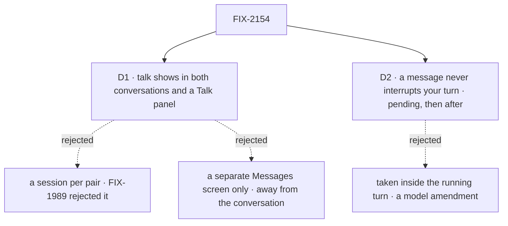

# FIX-2154 · Decisions

[Spec](SPEC.md) · **Decisions**

The epic's rules (ER-1 to ER-5) already say what the lab may hold, how it is set up and that its
front end runs on fixtures until wiring. The brief names three hard spots. Two are product calls
and come to sign-off here; the third, one conversation forever, is a package gap by the epic's
own call, recorded under *Decided, not asked*.

## The tree

Solid edges are what you're signing. Dashed edges lost, and the label says why.

## D1 · Worker talk shows in both conversations as one-line cards, and in a Talk panel

*A product call the brief leaves open ("visible enough to trust, but not noise").*

| | |
|---|---|
| **Instead of** | A session for each pair of workers, which the brief's wording suggests ("their own sessions"), or Shift Manager's way: one Messages screen listing every exchange |
| **Because** | A reply matters where it changes an answer, so it is drawn there: lead's message to researcher is a one-line card in lead's conversation, researcher sees it as a line from lead in its own, and the reply lands in lead's conversation under researcher's name. A card opens to the full text. The Talk panel lists one worker's exchanges grouped by the other worker, for the person who wants the whole thread. Both read the message log, so no new session or concept is added: a per-pair session was rejected by FIX-1989's D1, and fsd-architect agreed ([#46](https://github.com/fixpoint-labs/agent-mailbox/pull/46#issuecomment-6374763392), answer 4) |
| **Locks in** | What a person sees of worker talk is a view over the user's message log, keyed to the row FIX-2070 ships. A worker-to-worker exchange has no conversation of its own the person can type into; to steer it, they talk to either worker |

It comes down to keeping a reply next to the answer it changed.

**What would change my mind:** Grok Bot's own app showing bot-to-bot talk as its own thread in
the sidebar. Then the Talk panel becomes a sidebar entry per pair, still a view over the log, with
no new session.

## D2 · A message from another worker never interrupts your turn: it shows as pending, and lands after

*A product call the brief asks outright ("Where does it land? Does it interrupt?").*

| | |
|---|---|
| **Instead of** | Taking the message inside the recipient's running turn, before its next model call, the way the epic's D2 takes a background task's result |
| **Because** | The concept already answers it: a message to a busy session queues until the current request ends (rule 10), and in this lab every worker has only its default conversation, so the reply lands there. So the reply runs as its own `receive` turn right after lead answers you, and that turn's line uses it. The lab adds the part a person needs: a pending line the moment the reply is logged, so it is never silent. Taking it mid-turn would amend the model a second time, beside the epic's D2 |
| **Locks in** | A turn you started is never changed by another worker's message. The reply is a separate line after your answer, and the answer you are waiting for does not use it. A person who wants it used asks again, or waits one turn |

It comes down to the concept's queue rule: a message to a busy session waits.

**What would change my mind:** Grok Bot reading a teammate's message inside the turn it is running.
Then a gap carries messages on the epic's ER-6 path (taken before the next model call, once), and
the pending line becomes a line inside the turn.

## Decided, not asked

- **No session list, no new chat.** Choosing a worker opens its one conversation,
  `ensureWorkerSession({ worker })` with no criteria. The epic's sessions gap (ER-7) is not used.
- **One conversation forever is a package gap, not lab code** (the epic's *Decided before review*).
  The lab composes `@flow-state-dev/memory` into `defineAgentWorkerFlow`, reading through `uses`
  and recording each turn through `afterAnswer: mem.captureFromItems` (without the second, memory
  records nothing and the probe would fail for the wrong reason). That is configuration. A summary of turns past the 50-turn window, an opt-in option on core's
  `historyWindow` built on core's `summarizer` and off by default, and the mark the divider reads,
  is gap G1, tracked under FIX-1613 rather than a new entry. The lab never summarizes on its own, not even in a small flow.
- **The divider says what happened.** It marks where the turns read word for word begin, and
  reads *earlier turns summarized* only when G1's summary is on; otherwise *earlier turns out of
  view*. It never calls a plain window boundary a summary.
- **A probe at wiring says whether the script needs G1's summary.** Step 4 is run with memory
  alone. A pass means only that this script didn't need it (a conversation's history and memory
  never stand in for each other, FIX-1612); the mark is still owed. A fail makes G1 block this
  lab's wiring and the closure ([epic D1](../../epics/FIX-2152/DECISIONS.md#d1)).
- **Worker messages queue; task results take the ending path.** D2 is the queue rule for a
  message (a queued message is plain conversation, answered after the turn). The epic's D2
  (FIX-2159) is a task result reaching a running turn. They are separate paths, not rival designs.
- **The pending line is UI over two public reads.** A log row addressed to the open worker that
  has no line in its conversation yet is pending. That join needs the received line to carry its
  message id (gap G2, an ask of FIX-2070). Until G2 lands the pending line is best effort and
  nothing gates on it.
- **Worker status is UI over a public read.** The list reads each worker's conversation through
  `listSessionRequests`; a running request is *working*. Unread counts are per viewer, in browser
  storage.
- **Three workers in the lab:** lead (plans with you, messages the others), researcher and writer.
  Any worker may message any other on the roster (FIX-1989); the lab restricts nothing.
- **Names.** The lab and its adapter use FIX-2070's and FIX-2071's names (`sendMessage`, `receive`,
  `inReplyTo`, `respond`). Its docs say "worker", never the retired word.
- **The layout source.** No designs were provided and no screenshot of Grok Bot was available.
  The copy follows the brief (a list of workers, one long conversation each) and Grok Bot's public
  descriptions: a sidebar where each row is a named teammate with an ongoing role, and talk between
  bots the user can see. A screenshot that shows otherwise reopens D1 only.
- **Blocked by FIX-2070** for wiring, as fsd-architect asked (#46, answer 4): FIX-2070 isn't
  specced yet, and the view keys to its row (call ids, `{ task }` addresses), not today's `replyTo`.

## Considered and dropped

| Option | Why it lost |
|---|---|
| A session per pair of workers | A new concept for a view; FIX-1989's D1 rejected it |
| Only a Messages screen, as Shift Manager has | Talk is away from the answer it changed; the brief asks it to be trusted, not hunted for |
| A lab flow that summarizes old turns | Glue the package should own (ER-4); the next app would rewrite it |
| Group chats of several workers | Out of the brief's scope, and the concept has no group conversation |

## How it got here

- **Draft** — written against the epic spec (#3783) and fsd-architect's answers on #46. One gap
  first drafted (a busy read for the worker list) was dropped on reading the client:
  `listSessionRequests` already gives it.
- **Architect** — fsd-architect's coherence check ([comment](https://github.com/fixpoint-labs/flow-state-dev/pull/3787#issuecomment-6375046124))
  agreed with D2 and kept it apart from the epic's D2. G1 moved to core's `historyWindow` (opt-in,
  on core's `summarizer`), is tracked under FIX-1613, and a passing probe no longer reads as memory
  replacing it. D2 no longer names session-addressed delivery, which is FIX-2160's.
- **Review round 1, Codex** — memory is now recorded as well as read (`afterAnswer`), so the
  probe tests what it claims, and the divider is labelled *summarized* only when it is.
- **Review round 1** — Cursor's review approved the direction. Two of its points are folded in:
  the goal check now asserts the Talk panel (step 2), and G2 says plainly that it blocks no step,
  so the pending line is best effort until it lands. The rest is below.

## Notes from review

- *Three workers when the script uses two* ([thread](https://github.com/fixpoint-labs/flow-state-dev/pull/3787#discussion_r4364377391)). Kept: a list of workers that holds two rows doesn't read as Grok Bot's sidebar, and writer costs one `WORKER.md`.
- *`listTalk` and `workerActivity` are UI joins, not adapter seams* ([thread](https://github.com/fixpoint-labs/flow-state-dev/pull/3787#discussion_r4364377377)). Kept: each stands for one package read (the message log, `listSessionRequests`); the grouping and joins over them are React. Implementer may fold them if the adapter reads cleaner.
- *A card opening to its full text is unchecked polish* ([thread](https://github.com/fixpoint-labs/flow-state-dev/pull/3787#discussion_r4364377386)). Implementer's call; the one-line card is what D1 signs.
- *Trade-off figures repeat the mermaid; the SPEC restates the epic's rules.* The figures are the template's (one per signed decision); the ER table is cited, not restated.
- *Poll each worker's `listSessionRequests` through one cached hook, without items; long threads may need incremental render.* For the implementer.
