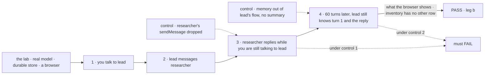

# FIX-2154 · A Grok Bot-style lab: a list of workers, one long conversation each, and workers that talk

**Spec** · [Decisions](DECISIONS.md)

## Five people, before and after

| Someone who… | Today | After |
|---|---|---|
| **evaluates Flow State and has used Grok Bot** | Meets Workforce through Shift Manager, a new way of working | Opens a list of workers, picks one, and talks to it in its one conversation, as in Grok Bot. Reads the lab's inventory to see how little the lab adds |
| **asks worker A to check something with worker B** | Sees B's answer only on Shift Manager's Messages screen, away from the conversation | Sees a one-line card in A's conversation where A messaged B, and B's reply land in the same conversation under B's name |
| **is mid-turn with A when B's reply arrives** | Nothing on screen says it came | Sees a pending line at once: "researcher replied · lead reads it after this turn". The reply lands as its own line right after A answers ([D2](DECISIONS.md#d2)) |
| **keeps one conversation going for weeks** | Turns past the history window (50) fall out with no trace | Sees where earlier turns were summarized, and A still knows what was said before it ([gap G1](#package-gaps)) |
| **hardens the workforce package** | Has no second app on the same pieces | Gets a gap list from a way of working already known to be right |

## The goal, and how we'll know it's met

**A person talks to worker A in a list-of-workers app that copies Grok Bot's core layout and
interaction, A messages worker B, B's reply reaches A while the person is still talking to A, and
the conversation stays coherent past its history window. With a real model, and lab code that is
only configuration, React UI and small flows.**

| Is it the right goal? | |
|---|---|
| **The real need** | Leg b of the epic's goal ([FIX-2152](../../epics/FIX-2152/SPEC.md#the-goal-and-how-well-know-its-met)): proof that worker messaging (FIX-1989, renamed by FIX-2070) and one long conversation per worker reproduce a way of working people already trust |
| **Smaller, and rejected** | "The screen looks like Grok Bot." The front end on fixtures meets it while the package can't run step 3 or 4. "Two workers trade one message." Misses step 4, the brief's first hard spot |
| **Bigger, and not this issue's** | Group chats of several workers, a worker's own screen (browser, terminal), connectors. Out of the brief's scope: core messaging and session management only |
| **Not done if** | The inventory has an *other* row · the lab imports a package's `src/` · a gap is worked around in the lab · a step passes only on fixtures · fixture code ships |

| How we verify | |
|---|---|
| **Goal check** | `goals/teammates-lab/a-worker-talks-to-another-while-you-talk/` · real model · run at wiring, re-run by the closure (FIX-2156) |
| **Signal** | 1: you ask lead *"Ask researcher for our launch date, and help me outline the post"*; lead's answer is in its conversation. 2: a card *to researcher* shows in lead's conversation, and a line *from lead* in researcher's. 3: you send lead a second line before researcher answers; researcher's reply shows in lead's conversation under researcher's name, after lead's answer to you, and lead's next line uses the date. 4: the script sends 60 more turns (past the 50-turn window), then asks lead for a fact you gave on turn 1 and for the launch date; both answers are right, and the divider shows where turns were summarized |
| **Anti-game** | Assert on what a person sees in the browser and on message rows read through the public log. Never on the lab's own state |
| **Control that must fail** | `GOAL_CONTROL=no-reply-tool`: researcher's `sendMessage` dropped from its tools; step 3 must FAIL. `GOAL_CONTROL=no-memory`: memory removed from lead's flow and no summary kept; step 4 must FAIL |

**Lead measure:** steps that pass on `main` with a real model, of 4. **0 today.**

## What changes

Grok Bot's core is copied: a sidebar where each row is a named worker with an ongoing role, and
one conversation per worker, never a list of sessions. The Talk panel on the right is this lab's
answer to the brief's "visible enough to trust, but not noise" ([D1](DECISIONS.md#d1)); it closes.

A new private lab, `labs/teammates`, launched with `fsdev dev --app` and themed by
`@flow-state-dev/design-system`, as the epic's ER-3 sets:

| Kind (ER-1) | What |
|---|---|
| Configuration | `fsdev.config.mts`, the host file, three `WORKER.md` (lead, researcher, writer), memory composed into each worker's flow through `defineAgentWorkerFlow({ uses })` |
| React UI | The worker list, the conversation with its talk cards and pending line, the Talk panel, the composer, registry components |
| Small flows | None planned |
| The adapter (ER-5) | One module; each function names the package call it stands for. See below |

| Adapter function | Stands for (post-refactor names) | Until wiring |
|---|---|---|
| `listWorkers()` | the workforce client's `roster()` | fixture |
| `openConversation(worker)` | `ensureWorkerSession({ worker })`, the default conversation only | fixture |
| `send(worker, text)` | the worker's `respond` entry in that conversation | fixture |
| `watchConversation(sessionId)` | the session's item stream (`@flow-state-dev/react`) | fixture |
| `listTalk(worker)` | the message log (`workerMessagesCollection`) as FIX-2070 ships its row: `sendMessage`, `receive`, `inReplyTo`, call ids | fixture |
| `workerActivity(worker)` | `listSessionRequests` on the worker's conversation | fixture |
| `summarizedUpTo(sessionId)` | gap G1 | fixture carrying G1's id |

**Docs:** the lab's README carries how to run it and the inventory. No `apps/docs` page (the
epic's call).

## Package gaps

For the epic thread to file ([D1 of the epic](../../epics/FIX-2152/DECISIONS.md#d1)). None is
worked around in the lab.

| # | Gap | Against | Blocks a step? |
|---|---|---|---|
| G1 | **A long conversation keeps working past its history window, opt-in per flow or worker.** The agent flow keeps the last 50 turns and drops the rest unsummarized (`workforce/src/agent-worker-flow.ts`, the `history` comment). Memory composed through `uses` keeps facts, not the thread, and neither stands in for the other (FIX-1612). Needs history handling a flow or worker turns on (how much is kept word for word, when to summarize), which the lab turns on for its workers and the stock agent flow leaves off, plus a mark a screen reads to draw the divider. **Not a new entry:** it points at [FIX-1613](https://linear.app/fixpoint-labs/issue/FIX-1613), the known gap (a block can't read items older than the window), extended or succeeded there | workforce (the agent flow, configured per flow or worker); core only if `historyWindow` itself must change | **Step 4, likely.** If a probe at wiring passes step 4 on memory alone, the lab's script didn't need the summary; that is not evidence memory replaces it, and only the mark is still owed |
| G2 | **A received message is its own item in the recipient's conversation**, carrying `from`, the message id and `inReplyTo`. Today it is a plain message line, `From researcher: …` (`messages/worker-message-entry.ts`). The talk cards and the pending line join the log to the stream by message id | an ask of FIX-2070, which redefines `receive`; filed only if FIX-2070 ships without it | Step 3's pending line, not the step |
| — | Whether a worker is working. Not a gap: a screen lists the requests of each worker's conversation (`listSessionRequests`) and reads the running one, which also catches a worker another worker woke | client | Not filed. Only if a queued `receive` is missing from that list |
| — | Paging the log by pair. A pair filter is UI code over the user's log (fsd-architect, [#46](https://github.com/fixpoint-labs/agent-mailbox/pull/46#issuecomment-6374763392)) | workforce | Not filed. Only if the log outgrows one read |

## What stays as it is

- **The worker model.** Each worker is an ordinary worker on the agent flow with one
  conversation. The lab adds no kind of worker, no role and no session ([D1](DECISIONS.md#d1)).
- **Messaging.** Where a message lands is FIX-2070's. The lab reads it and decides nothing.
- **The epic's sessions gap (ER-7).** Not used. A Grok Bot-style worker has one conversation.
- **Shift Manager.** Its Messages screen and its code are untouched; the lab copies, never
  imports, any UI it wants (ER-3).

## What's already here, and the debt

| Already here | What this does with it |
|---|---|
| `messageWorker` and `onWorkerMessage` (FIX-1989), renamed `sendMessage` and `receive` by FIX-2070 | **Builds on**, by FIX-2070's names. Wiring waits on FIX-2070 (fsd-architect) |
| The message log, user-scoped and client-readable (`messages/message-log.ts`) | **Builds on.** The Talk panel and the cards read it |
| `createWorkforceClient`: `roster`, `ensureWorkerSession` | **Builds on.** The worker list and the one conversation |
| Shift Manager's Messages screen, a flat list of exchanges | **Leaves alone.** The lab draws talk beside the conversation instead, and copies no code |
| `@flow-state-dev/memory`, composed through `uses` | **Builds on**, as configuration |

| The debt | |
|---|---|
| **Adds** | One private lab. Up to two package entries, one per gap filed |
| **Removes** | Nothing |

**Net: up, by one lab and the gaps it proves.** The lab is the evidence the epic exists to
produce; each gap is a piece the next app gets for nothing.

## Sign off

**[The goal](#the-goal-and-how-well-know-its-met):** four steps, a real model, an inventory with no
*other* row. If wrong: a lab that looks right on fixtures and proves nothing.

**[The debt](#whats-already-here-and-the-debt):** up, by one lab and up to two package entries.
If wrong: a lab that hides glue the package should own.

1. **[D2](DECISIONS.md#d2) · A message from another worker never interrupts your turn; it shows
   as pending and lands after.** The one to weigh. If wrong: the lab works differently from Grok
   Bot on the brief's second hard spot.
2. **[D1](DECISIONS.md#d1) · Worker talk shows in both conversations as one-line cards, and in a
   Talk panel, not as its own session.** If wrong: talk is easy to miss, or too loud.

**Open:** whether the lab's script needs G1's summary, settled by a probe at wiring (see the gap).

Feature · labs + workforce gaps · medium · second lab of epic FIX-2152 · blocked by FIX-2070 and
FIX-2056 (wiring only)
