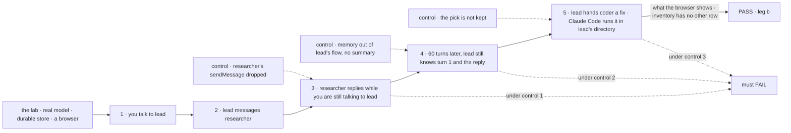

# FIX-2154 · A Grok Bot-style lab: a list of workers, one long conversation each, and workers that talk

**Spec** · [Decisions](DECISIONS.md)

## Seven people, before and after

| Someone who… | Today | After |
|---|---|---|
| **evaluates Flow State and has used Grok Bot** | Meets Workforce through Shift Manager, a new way of working | Opens a list of workers, picks one, and talks to it in its one conversation, as in Grok Bot. Reads the lab's inventory to see how little the lab adds |
| **asks worker A to check something with worker B** | Sees B's answer only on Shift Manager's Messages screen, away from the conversation | Sees a one-line card in A's conversation where A messaged B, and B's reply land in the same conversation under B's name |
| **is mid-turn with A when B's reply arrives** | Nothing on screen says it came | Sees a pending line at once: "researcher replied · lead reads it after this turn". The reply lands as its own line right after A answers ([D2](DECISIONS.md#d2)) |
| **keeps one conversation going for weeks** | Turns past the history window (50) fall out with no trace | Sees where the turns A reads word for word begin, and A still knows what was said before it ([gap G1](#package-gaps)) |
| **points a worker at the repo it works in** | Kitchen Sink's harness modes fall back to the server's own checkout when none is set | Talks to any worker with no project set. The first time a job needs files, the screen asks for a project and that run waits; the project then sticks to the worker. There is no fallback ([D3](DECISIONS.md#d3)) |
| **hands lead a coding job** | A coding run is a DevTeam worker, hired only in Shift Manager | lead files it as a task for coder, which runs it through Claude Code in lead's directory. A task card shows in lead's conversation, and the result lands there as a line from coder ([D4](DECISIONS.md#d4)) |
| **hardens the workforce package** | Has no second app on the same pieces | Gets a gap list from a way of working already known to be right |

## The goal, and how we'll know it's met

**A person talks to worker A in a list-of-workers app that copies Grok Bot's core layout and
interaction, A messages worker B, B's reply reaches A while the person is still talking to A, and
the conversation stays coherent past its history window. A coding job lead hands on runs through a
harness in lead's directory. With a real model, and lab code that is only configuration, React UI
and small flows.**

| Is it the right goal? | |
|---|---|
| **The real need** | Leg b of the epic's goal ([FIX-2152](../../epics/FIX-2152/SPEC.md#the-goal-and-how-well-know-its-met)): proof that worker messaging (FIX-1989, renamed by FIX-2070) and one long conversation per worker reproduce a way of working people already trust |
| **Smaller, and rejected** | "The screen looks like Grok Bot." The front end on fixtures meets it while the package can't run step 3 or 4. "Two workers trade one message." Misses step 4, the brief's first hard spot |
| **Bigger, and not this issue's** | Group chats of several workers, a worker's own screen (browser, terminal), connectors. Out of the brief's scope: core messaging and session management only |
| **Not done if** | The inventory has an *other* row · the lab imports a package's `src/` · a gap is worked around in the lab · a step passes only on fixtures · fixture code ships |

| How we verify | |
|---|---|
| **Goal check** | `goals/teammates-lab/a-worker-talks-to-another-while-you-talk/` · real model · run at wiring, re-run by the closure (FIX-2156) |
| **Signal** | 1: you ask lead *"Ask researcher for our launch date, and help me outline the post"*; lead's answer is in its conversation. 2: a card *to researcher* shows in lead's conversation, a line *from lead* in researcher's, and lead's Talk panel lists the exchange under *with researcher*. 3: you send lead a second line before researcher answers; researcher's reply shows in lead's conversation under researcher's name, after lead's answer to you, and lead's next line uses the date. 4: the script sends 60 more turns (past the 50-turn window), then asks lead for a fact you gave on turn 1 and for the launch date; both answers are right, and the divider marks where the turns lead reads word for word begin, labelled *summarized* only when G1's summary is on. 5: lead has no project yet; you ask lead *"Have coder fix the typo in the README's first line"*. coder's run is refused `no-project` before any file exists, and the screen asks for a project on that task card; for 30 s with no pick, no other run starts and nothing on disk changes. You pick `relay`, mapped to a scratch checkout, and lead files the task again. A task card for coder shows in lead's conversation; coder's run goes through Claude Code with that checkout as its workspace (read from the run); the README there changes, and nothing else on disk; the result lands in lead's conversation as a line from coder, after lead's turn |
| **Anti-game** | Assert on what a person sees in the browser and on message rows read through the public log. Never on the lab's own state |
| **Control that must fail** | `GOAL_CONTROL=no-reply-tool`: researcher's `sendMessage` dropped from its tools; step 3 must FAIL. `GOAL_CONTROL=no-memory`: memory removed from lead's flow and no summary kept; step 4 must FAIL. `GOAL_CONTROL=pick-not-kept`: the pick is shown but not stored on lead's conversation, so the task filed again still has no project; the README never changes; step 5 must FAIL |

**Lead measure:** steps that pass on `main` with a real model, of 5. **0 today.**

## What changes

Grok Bot's core is copied: a sidebar where each row is a named worker with an ongoing role, and
one conversation per worker, never a list of sessions. The Talk panel on the right is this lab's
answer to the brief's "visible enough to trust, but not noise" ([D1](DECISIONS.md#d1)); it closes.

A new private lab, `labs/teammates`, launched with `fsdev dev --app` and themed by
`@flow-state-dev/design-system`, as the epic's ER-3 sets:

| Kind (ER-1) | What |
|---|---|
| Configuration | `fsdev.config.mts`, the host file, four `WORKER.md` (lead, researcher, writer, and coder, which takes tasks only and names its harness, `harness: claude-code`), lead's `delegates: [teammates.coder]`, memory composed into each worker's flow through `defineAgentWorkerFlow`: the capability in `uses` to read it, and `afterAnswer: mem.captureFromItems` to record each turn |
| React UI | The worker list, the conversation with its talk cards and pending line, the Talk panel, the composer, registry components |
| Small flows | One coding worker flow: one `harnessManager({ harness, workspace })` per harness, with `localWorkspaceHost({ source: projectWorkspace() })`, routing each task by the worker's `harness` setting. Under 200 lines, copied, never imported, per ER-3 ([D4](DECISIONS.md#d4), the epic's ER-9) |
| The adapter (ER-5) | One module; each function names the package call it stands for. See below |

| Adapter function | Stands for (post-refactor names) | Until wiring |
|---|---|---|
| `listWorkers()` | the workforce client's `roster()` | fixture |
| `openConversation(worker)` | `ensureWorkerSession({ worker })`, the default conversation only | fixture |
| `send(worker, text)` | the worker's `respond` entry in that conversation | fixture |
| `watchConversation(sessionId)` | the session's item stream (`@flow-state-dev/react`) | fixture |
| `listTalk(worker)` | the message log (`workerMessagesCollection`) as FIX-2070 ships its row: `sendMessage`, `receive`, `inReplyTo`, call ids | fixture |
| `workerActivity(worker)` | `listSessionRequests` on the worker's conversation | fixture |
| `summarizedUpTo(sessionId)` | gap G1 | fixture carrying G1's id |
| `workProject(worker)`, `setWorkProject(worker, project)` | FIX-2161's `setWorkProject`, which writes `workProjectId` on the worker's default conversation and checks membership; the projects to pick from are the user's projects. A later change leaves tasks already filed on their project | fixture carrying FIX-2161's id |
| `listTasks(sessionId)` | the conversation board's rows for the tasks lead filed: the task cards | fixture |
| `watchRun(taskId)` | the harness run's items, read only: coder has no composer | fixture |

`listTasks` and `watchRun` compose reads that already exist, not new workforce exports: the board's `listTasks_tasks`, and the task row's `run` link with `followRequest` and `useSession`, as Shift Manager's `lib/conversation-tasks.ts` and `lib/run.ts` read them.

**Docs:** the lab's README carries how to run it and the inventory. No `apps/docs` page (the
epic's call).

## Package gaps

For the epic thread to file ([D1 of the epic](../../epics/FIX-2152/DECISIONS.md#d1)). None is
worked around in the lab.

| # | Gap | Against | Blocks a step? |
|---|---|---|---|
| G1 | **A long conversation keeps working past its history window, opt-in per flow.** Turns past the window (`historyWindow`, 50 by default) drop with no summary (`workforce/src/agent-worker-flow.ts`, the `history` comment). Memory composed through `uses` keeps facts, not the thread, and neither stands in for the other (FIX-1612). Needs an opt-in option on core's `historyWindow` that summarizes dropped turns with core's existing `summarizer` block, off by default (Jake's FIX-1775 direction), and a mark core emits that a screen reads to draw the divider. The agent flow turns it on for the lab's workers. No second summary path in workforce. **Not a new entry:** tracked under [FIX-1613](https://linear.app/fixpoint-labs/issue/FIX-1613), the known gap (a block can't read items older than the window), extended there | core (`historyWindow` in `core/src/types/flow.ts`), turned on by the workforce agent flow | **Step 4, always.** Step 4 asserts the divider, and only G1's mark places it, so G1 blocks this lab's wiring and the closure. A probe at wiring, on memory alone, decides only whether the summary half is needed too; a pass is not evidence memory replaces it |
| G2 | **A received message is its own item in the recipient's conversation**, carrying `from`, the message id and `inReplyTo`. Today it is a plain message line, `From researcher: …` (`messages/worker-message-entry.ts`). The talk cards and the pending line join the log to the stream by message id | an ask of FIX-2070, which redefines `receive`; filed as a linked gap, not a child, only if FIX-2070 ships without it | **No.** It blocks no step and not the wiring. Until it lands the pending line is best effort: without a message id the lab shows the reply when it lands, with no pending line first, and the script does not assert the pending line |
| FIX-2161 | **A worker's default conversation works in a project set for that worker, set from the screen.** Filed by the epic as FIX-2161 (an ordinary session of any worker opens on a project) and widened there to cover this, raised on the epic (#3803), so it is not a separate gap here. The pick is a server-written field the screen sets through a client call, never lab state passed in as config, since the run's project must come from stored data (BP-031). Today a conversation carries a project only when it is opened on one (`ensureWorkerSession({ worker, projectId })`), which is a different session from the worker's default one, and messages land at the default one (`messages/send-message.ts`). The tasks a conversation files take its project (`filingProjectId`, `conversation-board/filing-session.ts`), and `projectWorkspace()` turns that into a checkout or refuses `no-project`. Needs the project set per worker and per user, read by the default conversation, so its tasks inherit it, with no change to where messages land | workforce (`workers/derive-session-id.ts`, `conversation-board/filing-session.ts`), under FIX-2161 | **Step 5.** Without it lead's tasks name no project and the run is refused |
| — | Whether a worker is working. Not a gap: a screen lists the requests of each worker's conversation (`listSessionRequests`) and reads the running one, which also catches a worker another worker woke | client | Not filed. Only if a queued `receive` is missing from that list |
| — | Paging the log by pair. A pair filter is UI code over the user's log (fsd-architect, [#46](https://github.com/fixpoint-labs/agent-mailbox/pull/46#issuecomment-6374763392)) | workforce | Not filed. Only if the log outgrows one read |

## What stays as it is

- **The worker model.** Each worker is an ordinary worker on the agent flow with one
  conversation. The lab adds no kind of worker, no role and no session ([D1](DECISIONS.md#d1)).
- **Messaging.** Where a message lands is FIX-2070's. The lab reads it and decides nothing.
- **The epic's sessions gap (ER-7).** Not used. A Grok Bot-style worker has one conversation.
- **Conversation workers stay on our generator.** lead, researcher and writer run the agent flow
  with its generator, because their turns are where messages queue and land (D2). Only coder runs a
  harness ([D4](DECISIONS.md#d4)).
- **The local sandbox's directory.** The conversation workers carry no bash or file tools, so the
  sandbox's default directory (`tools/src/bash/resolve-sandbox.ts`, the server's) is never reached.
  A worker that gains those tools takes its project (FIX-2161) for it.
- **Shift Manager.** Its Messages screen and its code are untouched; the lab copies, never
  imports, any UI it wants (ER-3).

## What's already here, and the debt

| Already here | What this does with it |
|---|---|
| `messageWorker` and `onWorkerMessage` (FIX-1989), renamed `sendMessage` and `receive` by FIX-2070 | **Builds on**, by FIX-2070's names. Wiring waits on FIX-2070 (fsd-architect) |
| The message log, user-scoped and client-readable (`messages/message-log.ts`) | **Builds on.** The Talk panel and the cards read it |
| `createWorkforceClient`: `roster`, `ensureWorkerSession` | **Builds on.** The worker list and the one conversation |
| Shift Manager's Messages screen, a flat list of exchanges | **Leaves alone.** The lab draws talk beside the conversation instead, and copies no code |
| `@flow-state-dev/memory`, composed through `uses` and `afterAnswer` | **Builds on**, as configuration |
| `projectWorkspace()` and the operator's `checkouts` map (`projects/project-workspace.ts`) | **Builds on.** A task's directory comes from its project; the lab adds no path of its own |
| Delegates and the session board: a worker that lists a delegate taking tasks files through `createTask`, and the ending lands as a line under the delegate's name | **Builds on.** lead lists coder |
| `harnessManager({ harness, workspace })` and DevTeam's `coder` | **Builds on** the first, in one small lab flow; copies nothing from the second |
| Kitchen Sink's harness modes, which fall back to the server's checkout | **Leaves alone**, and does not copy the fallback |

| The debt | |
|---|---|
| **Adds** | One private lab, with one small flow. Up to two package entries, G1 and G2. FIX-2161 is the epic's |
| **Removes** | Nothing |

**Net: up, by one lab and the gaps it proves.** The lab is the evidence the epic exists to
produce; each gap is a piece the next app gets for nothing.

## Sign off

**[The goal](#the-goal-and-how-well-know-its-met):** five steps, a real model, an inventory with no
*other* row. If wrong: a lab that looks right on fixtures and proves nothing.

**[The debt](#whats-already-here-and-the-debt):** up, by one lab and up to two package entries.
If wrong: a lab that hides glue the package should own.

1. **[D2](DECISIONS.md#d2) · A message from another worker never interrupts your turn; it shows
   as pending and lands after.** The one to weigh. If wrong: the lab works differently from Grok
   Bot on the brief's second hard spot.
2. **[D1](DECISIONS.md#d1) · Worker talk shows in both conversations as one-line cards, and in a
   Talk panel, not as its own session.** If wrong: talk is easy to miss, or too loud.
3. **[D3](DECISIONS.md#d3) · Each worker has one directory, a project, asked for the first time a
   job needs one.** If wrong: a coding job stalls on a prompt the person missed, or a run lands in
   the wrong repo.
4. **[D4](DECISIONS.md#d4) · Only a task-taking coder runs a harness; the workers you talk to stay
   on our generator.** If wrong: a person can't talk to Claude Code directly in this lab.

**Open:** whether the lab's script needs G1's summary, settled by a probe at wiring (see the gap).

Feature · labs + core and workforce gaps · medium · second lab of epic FIX-2152 · blocked by FIX-2070 and
FIX-2056 (wiring only); step 5 by FIX-2161
