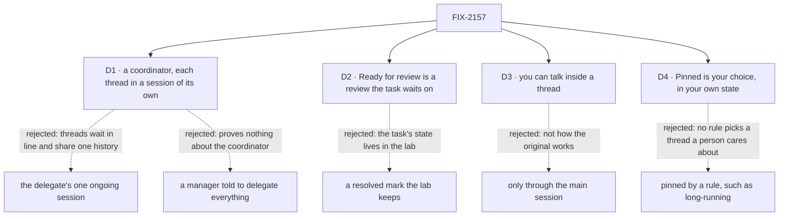

# FIX-2157 · Decisions

[Spec](SPEC.md) · **Decisions**

What was considered, what was chosen, and what each choice locks in. D1 and D2 are the sign-off
surface. D3 and D4 answer the issue's two open questions with the epic's recommendation; product
may overturn either without changing the rest. The epic's rules
([FIX-2152 DECISIONS](../../epics/FIX-2152/DECISIONS.md)) and FIX-2153's decisions bind this mode
and are not decided again here.

## The tree

Solid edges are what you're signing. Dashed edges lost, and the label says why.

## D1 · The main worker is a coordinator, and each thread runs in a session of its own

*An engineering call that adds a gap to the epic, so it comes to the owner.*

| | |
|---|---|
| **Instead of** | (a) Routed tasks in the delegate's one ongoing session, as the coordinator files them today. (b) A `manager` on the agent flow whose skill tells it to hand everything off, as FIX-2153's main worker does |
| **Because** | The issue exists to run Shift Manager's coordinator and board under a familiar UI, so the main worker is a `coordinator` (epic, [What stays](../../epics/FIX-2152/SPEC.md#what-stays-as-it-is)). But the coordinator works every routed task in the delegate's one session for the conversation, and a session works one task at a time (`coordinator-flow.ts`, `routed_session_ongoing`; FIX-2080). Three threads on one thread worker would run one after another in one history. Claude Code runs them side by side, each its own conversation. (b) avoids the gap, but "delegates everything" is then only a prompt, and the mode proves nothing FIX-2153 doesn't |
| **Locks in** | Gap A, a child of the epic ([FIX-2152 D1](../../epics/FIX-2152/DECISIONS.md#d1)): a coordinator can file a routed task in a new session of its delegate. Whether that is a worker setting or a per-task choice is the gap's call. A thread's view is its task's run session. Follow-ups go to that thread, not to the delegate's ongoing session |

It comes down to running Shift Manager's coordinator the way Claude Code runs threads: side by side.

**What would change my mind:** Jake preferring a smaller epic. Then the lab uses three
different delegates so the script passes on today's coordinator, and the copy is less close:
two requests of the same kind wait in line.

## D2 · *Ready for review* is a review the thread's task waits on, and *Resolve* answers it

*An engineering call that adds a gap to the epic, so it comes to the owner.*

| | |
|---|---|
| **Instead of** | A *resolved* mark the lab keeps per task: *Ready for review* is "completed and not marked", *Resolved* is "marked" |
| **Because** | A review is already a kind of wait in the package (FIX-2129, FIX-2131): the task waits on you, the Inbox lists it, an answer carries the work on, and revision words are a steer the work takes next. That gives *Request changes* for free, and *Resolve* means the task completes. A lab mark puts a task's state in the lab, where ER-4 says it can't go, and Shift Manager's empty *In review* column gains nothing |
| **Locks in** | Gap B, a child of the epic: an agent worker can end its task in a review, set in `WORKER.md`. *Resolve* and *Request changes* are the answer route's two verdicts. A review nobody answers completes at the person-stop deadline and lands in *Resolved*, so a week away doesn't fail a thread. That last point is the gap's to confirm |

It comes down to where a thread's state lives: on the task, where every app can read it.

**What would change my mind:** FIX-2131's review not fitting a model's turn, for example if
an agent worker can't end on a block. Then the lab keeps the mark, and the inventory names it.

## D3 · You can talk inside a thread directly

*The issue's first open question, answered with the epic's recommendation.*

| | |
|---|---|
| **Instead of** | Talking only to the main session, as FIX-2153's session mode does ([its D2](../FIX-2153/DECISIONS.md#d2)) |
| **Because** | Claude Code's threads mode opens a thread and lets you talk there. The package already takes it: a line from a person is a steer on the task through the public `updateTask_tasks` action (FIX-2086), and a steer that names the open question answers it (FIX-2131) |
| **Locks in** | A thread's view has a composer while its task is open. A line there is `updateTask({ id, message })`, naming the open question when there is one. A steer doesn't answer a review: the card's two buttons do. A finished thread's composer is off; you ask the main session to follow up. Asking the main session about a thread works too |

**What would change my mind:** product wanting the main session to stay the only voice, as in
session mode. Then the thread view is read only and step 3 is answered through the main session.

## D4 · *Pinned* is your choice, kept in your own state

*The issue's second open question, answered with the epic's recommendation.*

| | |
|---|---|
| **Instead of** | Pinning by a rule, such as "long-running", or a task status |
| **Because** | In the screenshot, the pinned thread is one the person keeps returning to. No rule picks that, and pinning is about the person, not the work |
| **Locks in** | One small flow, `pins`, with a user-scoped resource holding pinned task ids and `pin` and `unpin` actions. It is in the inventory. A pinned thread shows only under *Pinned*, with its status icon. Pins outlive the thread's status |

**What would change my mind:** product wanting the coordinator to pin, for example a thread it
expects to run for days. Then the coordinator gets a tool, and that is a gap.

## Decided, not asked

- **The board's columns, from the task row only.** *Working*: `pending`, `in_progress`, and
  `held` with no wait on you. *Waiting on you*: waiting on you with kind `approval` or `input`,
  a held question, or `errored` (it failed; ask the main session to retry). *Ready for review*:
  waiting on you with kind `review`. *Resolved*: `completed` and `cancelled`, collapsed with a
  count. *Pinned* comes first and takes its rows out of the others.
- **The original's layout, copied closely.** The same sessions list and main thread as session
  mode. Your line carries *Sent to a thread* when the coordinator routed it. A compact thread card
  sits where its `coordinator-route` item is: an icon, the title, a status line, the last
  progress note, and *View thread*, plus *Resolve* and *Request changes* when ready for review or
  *Answer* when waiting. The board's header has the title *Threads*; each group has a count and
  collapses. A row: status icon, title, last progress note, age, step progress when known. Flow
  State theme, square corners; `attention` only where a person owes something.
- **No linked PRs on a card.** The original shows them; scope is messaging and sessions.
- **The thread view replaces the board** in the right pane, with a back arrow, as the original
  opens a thread. The main thread stays in the center.
- **Fixtures play the script.** Until wiring, the adapter's fixtures run the five steps on a
  timer, with a question and a review, so the board can be seen and tested in the browser. Each
  fixture standing in for a gap carries the gap's issue id. They are deleted at wiring.
- **Two PRs.** The front end on fixtures first, stacked on FIX-2153's front end; the wiring and
  the goal check after FIX-2056, FIX-2058, and gaps A and B merge.

## Considered and dropped

| Alternative | Why not |
|---|---|
| A third lab for threads mode | The epic made it a mode of FIX-2153's app ([ER-3](../../epics/FIX-2152/DECISIONS.md#who-owns-what)) |
| React's `BoardColumns` for the board | Its columns are task statuses; this board's are what the person owes |
| A mode switch on an open session | [FIX-2153 D1](../FIX-2153/DECISIONS.md#d1): the mode is which main worker the session is with |
| Three different delegates to dodge gap A | Kept as D1's fallback; it copies the original less closely |

## How it got here

- **Draft:** built on FIX-2153's spec at its D1 (mode is which main worker) and adapter verbs;
  the board read from FIX-2129's and FIX-2131's waits; the two open questions answered with the
  epic's recommendation.

**Open: none.**
