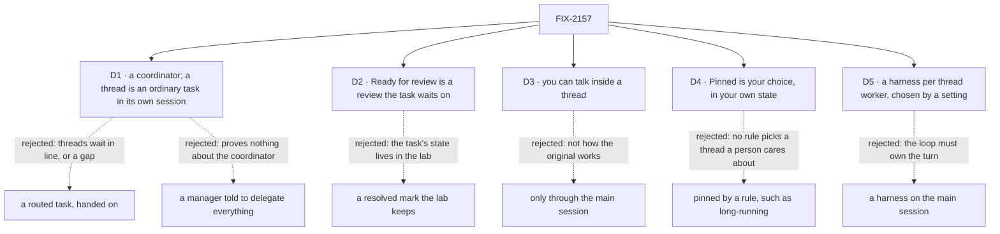

# FIX-2157 · Decisions

[Spec](SPEC.md) · **Decisions**

What was considered, what was chosen, and what each choice locks in. D1 and D2 are the sign-off
surface. D3 and D4 answer the issue's two open questions with the epic's recommendation; product
may overturn either without changing the rest. The epic's rules
([FIX-2152 DECISIONS](../../epics/FIX-2152/DECISIONS.md)) and FIX-2153's decisions bind this mode
and are not decided again here.

## The tree

Solid edges are what you're signing. Dashed edges lost, and the label says why.

## D1 · The main worker is a coordinator, and a thread is an ordinary task it files, in a session of its own

*It decides what leg c proves about the coordinator, so it comes to the owner.*

| | |
|---|---|
| **Instead of** | (a) A routed task, the coordinator's way to hand a message on (FIX-2083), which runs in the delegate's one ongoing session. (b) A `manager` on the agent flow whose skill tells it to hand everything off, as FIX-2153's main worker does |
| **Because** | The issue exists to run Shift Manager's coordinator and board under a familiar UI. (a) puts every thread for one delegate in one session, and a session works one task at a time (`routed_session_ongoing`, FIX-2080), so threads wait in line and share a history; making them side by side is a gap that amends epic ER-7. A thread isn't a message handed on: it is a piece of work with its own history, and the coordinator's turn can already file one. The board files a plain task unless the result goes to the conversation on a routing turn (`conversation-board/board.ts`, `addTask`), and a delegated task runs in a new session by default (`task.ts`). (b) proves nothing FIX-2153 doesn't |
| **Locks in** | No gap. The lead's `WORKER.md` tells it to file each piece with `createTask` for a delegate, leaving `resultTo` out, so the result comes back to the lead as a settled notice. Leg c proves the coordinator's delegate list and roster check, its judgment turn, its board and its settled notices under a status board. It does not prove routing; Shift Manager still does. A thread's session is another session of the same hired worker (epic D3): no new key on `WorkerSessionCriteria`, one task per session (FIX-2080), reached through its task and left out of FIX-2158's list, and reachable as `{ session: id }` once FIX-2160 lands |

It comes down to what a thread is: work with its own history, not a message handed on.

**What would change my mind:** wanting leg c to prove routing too. Then threads are routed
tasks, and a gap lets a routed task run in a new session of its delegate, amending epic ER-7.
Or the wiring check finding that three ordinary tasks for one delegate don't run side by side;
then that refusal is the gap.

## D2 · *Ready for review* is a review the thread's task waits on, and *Resolve* answers it

*An engineering call on where a thread's state lives, recorded for the owner.*

| | |
|---|---|
| **Instead of** | A *resolved* mark the lab keeps per task: *Ready for review* is "completed and not marked", *Resolved* is "marked" |
| **Because** | A review is already a kind of wait in the package (FIX-2129, FIX-2131): the task waits on you, the Inbox lists it, an answer carries the work on, and revision words are a steer the work takes next. That gives *Request changes* for free, and *Resolve* means the task completes. A lab mark puts a task's state in the lab, where ER-4 says it can't go, and Shift Manager's empty *In review* column gains nothing |
| **Locks in** | No gap. FIX-2131 gives a model on a task turn `waitForUser({ kind: "review", prompt })` (its *Decided* list; `agent-worker-flow.ts` composes `board.questions`), so the thread worker's `WORKER.md` tells it to ask for review when the work is ready. *Resolve* and *Request changes* are the answer route's two verdicts. At the person-stop deadline the tool returns a no-answer result, and the instructions say to finish then, so the thread lands in *Resolved*: FIX-2129's deadline, no second timeout path |

It comes down to where a thread's state lives: on the task, where every app can read it.

**What would change my mind:** the wiring finding that the model skips the review step too
often to rely on. Then a worker setting that ends every task in a review is a package gap; the lab
still doesn't keep the mark.

## D3 · You can talk inside a thread directly

*The issue's first open question, answered with the epic's recommendation.*

| | |
|---|---|
| **Instead of** | Talking only to the main session, as FIX-2153's session mode does ([its D2](../FIX-2153/DECISIONS.md#d2)) |
| **Because** | Claude Code's threads mode opens a thread and lets you talk there. The package already takes it: a line from a person is a steer on the task through the public `updateTask_tasks` action (FIX-2086), and a steer that names the open question answers it (FIX-2131) |
| **Locks in** | A thread's view has a composer while its task is open. A line there is `updateTask({ id, message })`, naming the open question when there is one. A steer doesn't answer a review: the card's two buttons do. A finished thread's composer is off; you ask the main session to follow up. Asking the main session about a thread works too |

**What would change my mind:** product wanting the main session to stay the only voice, as in
session mode. Then the thread view is read only and step 3 is answered through the main session.

## D4 · *Pinned* is your choice, kept in your own state

*The issue's second open question, answered with the epic's recommendation.*

| | |
|---|---|
| **Instead of** | Pinning by a rule, such as "long-running", or a task status |
| **Because** | In the screenshot, the pinned thread is one the person keeps returning to. No rule picks that, and pinning is about the person, not the work |
| **Locks in** | One small flow, `pins`, with a user-scoped resource holding pinned task ids and `pin` and `unpin` actions. It is in the inventory. A pinned thread shows only under *Pinned*, with its status icon. Pins outlive the thread's status |

**What would change my mind:** product wanting the coordinator to pin, for example a thread it
expects to run for days. Then the coordinator gets a tool, and that is a gap.

## D5 · A thread may run through a harness, chosen per worker by a setting; the main session never does

*Product's ask (fsd-product-lead on #46, relaying the owner), with the engineering calls it left open.*

| | |
|---|---|
| **Instead of** | (a) One worker flow per harness, a hire picking by its `flow:` line. (b) A harness on the main session too |
| **Because** | The harness is a slot fixed when a flow is built, and one flow copy serves every worker on it (DevTeam's `coder.mts`); so one flow builds a manager per harness and routes each task by the worker's own `harness` setting, which the hire already passes (`settingsOf`). That is config only, with no package change, and one flow instead of (a)'s two (epic ER-9, amended on review). (b) breaks the epic's D2 loop, which owns the main session's turn |
| **Locks in** | No new mechanism: the flow wraps `harnessManager` with `projectWorkspace()`, as `coder` does. A harness thread's question holds its task, so *Waiting on you* and step 3's answer work unchanged. A run that produced changes waits under *Ready for review*, with the judge's verdict shown as information, not approval; one with no changes lands in *Resolved*, and a failed one is errored. Harness-manager completes a run on its own check today, so the review wait is a gap that blocks step 6 (product's call, overturning a draft that skipped review). Not needed: FIX-1990, since a run asks the person, never a teammate. **Amended 2026-10-24 ([FIX-2163](https://github.com/fixpoint-labs/flow-state-dev/pull/3819) D2):** a harness thread's run that completes at the review deadline lands in *Resolved* with a required *not reviewed* mark, read from the task output's `review: "deadline"`; only `"accepted"` reads as approved. This doesn't depend on FIX-2129. A plain thread has no such signal yet; that is gap [FIX-2165](https://linear.app/fixpoint-labs/issue/FIX-2165), and the lab doesn't infer one |

**What would change my mind:** the gap proving large at its spec. Then that is raised with a
size on this PR's successor, not worked around by skipping review.

## Decided, not asked

- **Where a thread works:** the session's project, the same rule as FIX-2153's D3, stated in this
  spec too; opening an ordinary session on a project is FIX-2161; with none, the composer
  asks you to choose one. No scratch directory: a run that writes somewhere you didn't pick is
  the failure the ask is about. Details in the [spec](SPEC.md#where-a-thread-works).

- **The board's columns, from the task row only.** The one table; the
  spec's signals read from it.

  | Column | A task row lands here when |
  |---|---|
  | *Pinned* | its id is in your pins; it leaves every other column and keeps its status icon |
  | *Working* | `pending`, `in_progress`, or `held` with no open question |
  | *Waiting on you* | waiting on you with kind `approval` or `input`, a held question, or `errored` (it failed; you ask the main session to retry, there is no retry button) |
  | *Ready for review* | waiting on you with kind `review` |
  | *Resolved* | `completed` or `cancelled`; collapsed, with a count |
- **The original's layout, copied closely.** The same sessions list and main thread as session
  mode, under the *Projects* view; the view you're in is the mode (product lead, relaying the
  owner, on review). Your line carries *Sent to a thread* when the lead's turn filed threads for it. A compact thread
  card sits where the lead's `createTask` call is: an icon, the title, a status line, the last
  progress note, and *View thread*, plus *Resolve* and *Request changes* when ready for review or
  *Answer* when waiting. The board's header has the title *Threads*; each group has a count and
  collapses. A row: status icon, title, last progress note, age, step progress when known. Flow
  State theme, square corners; `attention` only where a person owes something.
- **No linked PRs on a card.** The original shows them; scope is messaging and sessions.
- **The thread view replaces the board** in the right pane, with a back arrow, as the original
  opens a thread. The main thread stays in the center.
- **Fixtures play the script.** Until wiring, the adapter's fixtures run the five steps on a
  timer, with a question and a review, so the board can be seen and tested in the browser. As in
  FIX-2153, fixture code carries a plain `fixture:` marker, not an issue id (BP-006), and the
  README lists which gap each one stands for. They are deleted at wiring.
- **Two PRs.** The front end on fixtures first, stacked on FIX-2153's front end; the wiring and
  the goal check after FIX-2056 and FIX-2058 (FIX-2129, FIX-2131) merge.

## Considered and dropped

| Alternative | Why not |
|---|---|
| A third lab for threads mode | The epic made it a mode of FIX-2153's app ([ER-3](../../epics/FIX-2152/DECISIONS.md#who-owns-what)) |
| React's `BoardColumns` for the board | Its columns are task statuses; this board's are what the person owes |
| A mode switch on an open session | [FIX-2153 D1](../FIX-2153/DECISIONS.md#d1): the mode is which main worker the session is with |
| Routed tasks, with a gap for a new session each | D1's fallback, if leg c must prove routing |
| Three different delegates, to run routed tasks side by side | Copies the original less closely: two requests of the same kind wait in line |

## How it got here

- **Draft:** built on FIX-2153's spec at its D1 (mode is which main worker) and adapter verbs;
  the board read from FIX-2129's and FIX-2131's waits; the two open questions answered with the
  epic's recommendation.
- **Review round 1:** fsd-architect pinned a thread's session to epic D3's shape and named the
  ER-7 amendment. A second look found that the coordinator's turn can file ordinary tasks, each
  in a new session, so D1 moved from "routed tasks plus a gap" to "ordinary tasks, no gap", and
  says what leg c no longer proves. Codex showed FIX-2131 already gives the model a review
  tool, so the review gap went too: D2 is now configuration.
- **Review round 2:** Codex found the lead's `WORKER.md` had no body, so nothing told it to file
  ordinary tasks while the routing turn's description says to route. The body now says so, and
  whether it wins is a wiring check. The routed control was replaced: a routed message goes to a
  delegate once per round, so it made one task, not three in one session.
- **Product answers:** yes to D1 to D4, with one refinement: the mode comes from the view
  (*Sessions* or *Projects*), not a choice at session start.

- **Product additions:** a working directory per session that threads inherit, and a harness on
  threads only. Folded as the session's project and D5; step 6 and its controls were added.
  Product then overturned a draft that let harness threads skip review: a run with changes waits
  for yours, and that gap blocks step 6. A control that
  removed the checkout mapping was first said to give `no-project`; an unmapped project gets a
  branch from its remote instead, so that control fails on step 6's directory check (Codex: a run
  works in a worktree of the mapped repository, so the check is the worktree's repository), and the
  `no-project` control is a session opened on no project.

## Notes from review

For the implementer, recorded and not folded:
- An unanswered review that completes at the deadline lands in *Resolved* beside accepted ones.
  Make it tell apart on the row, from the task row only, if FIX-2129's record of the stop allows.
  **Amended 2026-10-24 (FIX-2163 D2):** for a harness thread the *not reviewed* mark is required,
  read from the task output's `review: "deadline"` (see D5). For a plain thread, see gap FIX-2165;
  the lab doesn't infer a signal.
- Keep the `taskRow → column` projection a pure function in a leaf module with a table test,
  free of React, so it can sit beside Shift Manager's `columns.ts` and move later.
- Consider splitting the adapter into a task port and a pins port, and `resolve` and
  `requestChanges` into one `answerReview(task, verdict, words?)`.
- Weigh a pins resource on an existing flow against the `pins` flow; the inventory counts both.
- Keep the fixtures under one directory, so deleting them at wiring is one `git rm`.
- `sayInThread`, `resolve` and `requestChanges` are adapter bindings to public surfaces that
  already exist (`updateTask_tasks`, FIX-2129's answer route); only the pins verbs are new.

**Open: none.**
