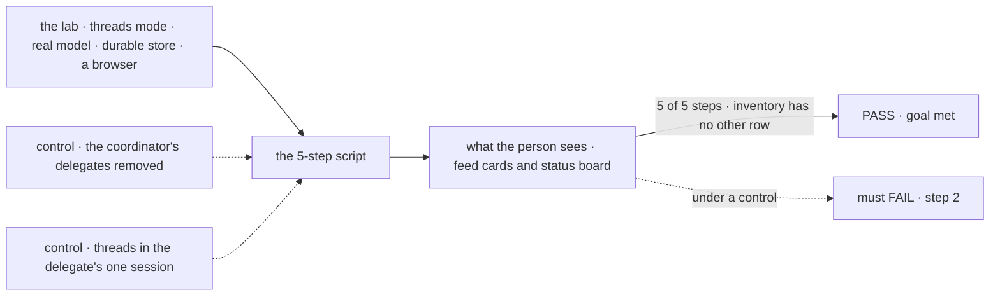
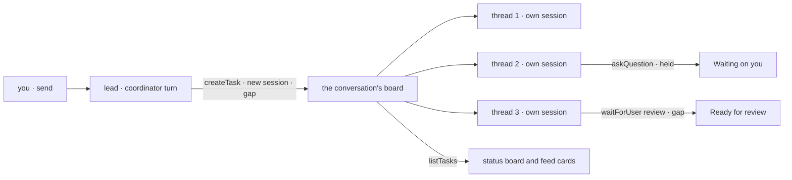

# FIX-2157 · Claude Code-style lab, threads mode

**Spec** · [Decisions](DECISIONS.md)

## Five people, before and after

| Someone who… | Today | After |
|---|---|---|
| **starts a session** | Gets session mode only; threads mode shows in *New session* but is disabled ([FIX-2153 D1](../FIX-2153/DECISIONS.md#d1)) | Picks *Threads*. The session is with the threads-mode main worker, a coordinator, and the right pane is a status board |
| **asks the main session for something** | n/a | Sees the main session hand it to background threads, each in a session of its own. Each thread is a compact card in the feed and a row on the board: *Pinned*, *Working*, *Waiting on you*, *Ready for review*, *Resolved* |
| **is asked a question by a thread** | n/a | Sees the thread under *Waiting on you*, opens it, and types the answer there. You can talk inside a thread directly, as well as through the main session ([D3](DECISIONS.md#d3)) |
| **gets a thread's finished work** | n/a | Sees it under *Ready for review*. *Resolve* accepts it and moves it to *Resolved*; *Request changes* sends it back to work with your words ([D2](DECISIONS.md#d2)) |
| **has a thread they keep coming back to** | n/a | Pins it. It stays at the top of the board under *Pinned* whatever its status ([D4](DECISIONS.md#d4)) |

The scope is the epic's: core messaging and session management. No linked PRs on a card, no
file diffs, no permission requests.

## The goal, and how we'll know it's met

**A person drives Claude Code's threads-mode way of working end to end in a browser, on a real
model: ask the main session, watch it start three threads, answer one that waits on them, see one
become ready for review, and resolve it. The app adds only configuration, React UI and small
flows.**

| Is it the right goal? | |
|---|---|
| **The real need** | The closest familiar app to Shift Manager's coordinator and task board, run on the same pieces. Leg c of [FIX-2152](https://linear.app/fixpoint-labs/issue/FIX-2152)'s goal |
| **Smaller, and rejected** | "The status board looks like Claude Code's." It ships on fixtures in this issue's first PR and proves nothing about the coordinator. "Threads mode is session mode with a different pane." A manager told by a skill to delegate everything meets it and proves nothing about Shift Manager's coordinator ([D1](DECISIONS.md#d1)) |
| **Not done if** | A step passes only on fixtures · two threads on one delegate wait in line or share one history · *Ready for review* or *Resolved* is a mark the lab keeps instead of the task's state · the lab's inventory has an *other* row · a gap is worked around in the lab |



The check reads the page a person sees and task rows read through the public task action, never
the lab's own state.

| How we verify | |
|---|---|
| **Goal check** | `goals/claude-code-style-lab/threads-mode-script/` · real model · Playwright, against `fsdev dev --app` · run by the implementer at wiring · verdict in the wiring PR. The epic's closure reruns it as leg c |
| **Signal** | 1 your line shows, marked *Sent to a thread* · 2 three thread cards show and three rows under *Working*; through `listTasks`, three tasks filed by this session's coordinator, each with a different run session, all `in_progress` at once · 3 one row moves to *Waiting on you* with its question; you type the answer in that thread's view; the row returns to *Working* and `getTask` shows the question answered on the same attempt · 4 one row moves to *Ready for review*; `getTask` shows it waiting on you with kind `review` · 5 you press *Resolve*; the row moves under *Resolved* and `getTask` reads `completed` |
| **Input** | "Research three vendors for a status page, one thread each, and draft a summary of each for me to review." The thread worker's instructions say to ask which region matters when the vendor has more than one. A different ask that starts three threads must pass too |
| **Anti-game** | Don't assert on fixtures, the adapter's return values, or the lab's React state. Don't answer or resolve through a package call from the test; click and type as a person does |
| **Control that must fail** | The lab with the coordinator's delegates removed: no thread starts, FAIL on step 2. Today's `main` with one delegate: the three routed tasks share its one session and two wait `pending`, FAIL on step 2. The thread worker without review on: FAIL on step 4. And the inventory check with a planted `src/glue.ts`: FAIL |

## What changes


This is the UI design. Every row and card reads one task row; the green card is ready for
review, and *Resolve* answers its review.

**The two workers, as a person writes them:**

```diff
+ # workforce/teams/desk/workers/lead/WORKER.md
+ ---
+ description: Hands each request to background threads and keeps you posted.
+ flow: coordinator
+ routing: judgment
+ delegates: [desk.thread]
+ ---
+ # workforce/teams/desk/workers/thread/WORKER.md
+ ---
+ description: Works one request in its own session and hands it back for review.
+ review: true             # gap: the task ends in a review (D2)
+ ---
```

**The modes config, its second entry** ([FIX-2153 D1](../FIX-2153/DECISIONS.md#d1)): `threads: {
main worker: desk.lead, right pane: status board }`. Nothing stores a session's mode; it is
which main worker the session is with.

**The adapter adds verbs** ([ER-5](../../epics/FIX-2152/DECISIONS.md#who-owns-what)):

```diff
  // src/adapter.ts: verbs only; wiring binds each to the package
  listSessions(mode) · openSession(mode) · send · interrupt · watchTasks · watchTaskWork
+ sayInThread(task, line)        // a steer on the thread's task; names its open question if any
+ resolve(task)                  // answers the thread's review: accepted
+ requestChanges(task, words)    // answers the thread's review: revise, with words
+ watchPins() · pin(task) · unpin(task)   // the pins flow (D4)
```

**Docs:** threads mode joins the lab's README (how to start it, the board's columns, its rows in
the inventory). No `apps/docs` page, per the epic.

## How a request becomes a thread



The board's columns are read from each task's status and what it waits on; the lab adds no
status of its own.

## What stays as it is

- **The worker model.** The main worker is a `coordinator`; the thread worker is an ordinary
  worker on the agent flow. No new role.
- **Session mode** and FIX-2153's pane, adapter and decisions. Threads mode is a second entry in
  the same modes config.
- **Shift Manager**, its board and its coordinator. This lab reads the same rows; it changes
  neither.
- **Core and engine.** Nothing here goes below workforce and orchestration.

## What's already here, and the debt

| Already here | What this does with it |
|---|---|
| FIX-2153's app: the sessions list, the main thread, the modes config, the adapter, the inventory check | **Builds on.** Threads mode is that app's second mode and shares its code ([ER-3](../../epics/FIX-2152/DECISIONS.md#who-owns-what)) |
| The coordinator flow, routed tasks and the `coordinator-route` item (FIX-2083) | **Builds on**, through gap A. A route item is where a feed card is drawn |
| Task statuses and `waitingOn` (`orchestration/src/tasks/schema/`); `waitForUser` with its kind, the row's record of its stop, and the answer route (FIX-2129); a question that holds its task, answered by a steer that names it (FIX-2131) | **Builds on.** The board's columns, step 3, and *Resolve* |
| The public `updateTask_tasks` action, where a person's `message` is a user steer (FIX-2086) | **Builds on.** Talking inside a thread |
| Shift Manager's board (`shift-manager/src/lib/columns.ts`): its *In review* column is drawn and stays empty, because no status means it | **Leaves alone**, and gap B is what could fill it |
| `@flow-state-dev/react`'s `BoardColumns` and `BoardCard` | **Not used.** Their columns are task statuses; this board's are what the person owes. The lab writes its own, as UI |

**Gaps** ([ER-4](../../epics/FIX-2152/DECISIONS.md#who-owns-what)). The epic files them:

| Gap | Blocks |
|---|---|
| **A. A routed task can run in a new session of its delegate**, so several threads run on one delegate at once, each with its own history. Today the coordinator refuses anything but the delegate's one ongoing session (`routed_session_ongoing`) ([D1](DECISIONS.md#d1)) | Step 2 · a child |
| **B. An agent worker's task can end in a review**, a worker setting over FIX-2131's `waitForUser({ kind: "review" })`: accepted completes it, revision words are a steer the work takes next, and an unanswered review completes at its deadline ([D2](DECISIONS.md#d2)) | Steps 4 and 5 · a child |
| **C. A task row carries its step progress** (done of total) | Nothing; without it *Working* shows the last progress note, not *2/7*. Filed in the project. Checked first at wiring: if the thread's run session's plan rows are readable, no gap |
| Checked at wiring: **a `coordinator-route` item names the task it filed** | The feed cards; a gap only if it doesn't |

| The debt | |
|---|---|
| **Removes** | Nothing |
| **Adds** | Threads mode in the lab: a status board, thread cards, a thread view, one small flow for pins, and their fixtures until wiring. Two package entries from gaps A and B, which Shift Manager can use too |
| **Leaves** | Shift Manager's empty *In review* column. Gap B gives it a source; wiring it there is Shift Manager's issue |

**Net: up, by one mode of a private lab and two package entries.** The mode is the epic's
evidence; each entry is a gap the lab proved.

## Sign off

**[The goal](#the-goal-and-how-well-know-its-met), at that size:** five steps, a real model, a
browser, and no *other* row. If wrong: a board that looks right on fixtures and proves nothing.

**[The debt](#whats-already-here-and-the-debt), net up:** one mode, two package entries. If
wrong: two entries no other app uses.

1. **[D1](DECISIONS.md#d1) · The main worker is a coordinator, and each thread runs in a session
   of its own.** If wrong: one more gap in the epic for a coordinator setting nobody else wants.
2. **[D2](DECISIONS.md#d2) · *Ready for review* is a review the thread's task waits on, and
   *Resolve* answers it.** If wrong: one more gap where a mark the lab keeps would have done.

**Decided from the epic's recommendation, open to product:** you can talk inside a thread
directly ([D3](DECISIONS.md#d3)); *Pinned* is your choice, kept in your own state ([D4](DECISIONS.md#d4)).

Feature · a mode of a private lab, two `workforce` gaps filed by the epic · medium · epic [FIX-2152](https://linear.app/fixpoint-labs/issue/FIX-2152)
