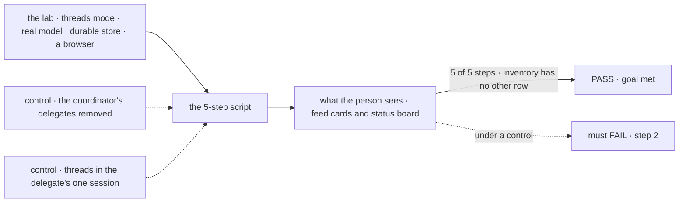
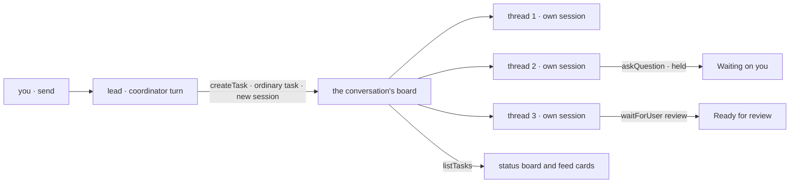

# FIX-2157 · Claude Code-style lab, threads mode

**Spec** · [Decisions](DECISIONS.md)

## Six people, before and after

| Someone who… | Today | After |
|---|---|---|
| **starts a session** | Gets the *Sessions* view only, which is session mode ([FIX-2153 D1](../FIX-2153/DECISIONS.md#d1)) | Opens the *Projects* view and starts a session there, picking the project it works in. The view is the mode: a session in *Projects* is with the threads-mode main worker, a coordinator, and the right pane is a status board |
| **asks the main session for something** | n/a | Sees the main session hand it to background threads, each in a session of its own. Each thread is a compact card in the feed and a row on the board: *Pinned*, *Working*, *Waiting on you*, *Ready for review*, *Resolved* |
| **is asked a question by a thread** | n/a | Sees the thread under *Waiting on you*, opens it, and types the answer there. You can talk inside a thread directly, as well as through the main session ([D3](DECISIONS.md#d3)) |
| **gets a thread's finished work** | n/a | Sees it under *Ready for review*. *Resolve* accepts it and moves it to *Resolved*; *Request changes* sends it back to work with your words ([D2](DECISIONS.md#d2)) |
| **asks for a code change** | n/a | Sees the thread run through Claude Code or Codex, tagged so on its card and row, in the session's project and never in the lab's own repository ([D5](DECISIONS.md#d5), [where it works](#where-a-thread-works)) |
| **has a thread they keep coming back to** | n/a | Pins it. It stays at the top of the board under *Pinned* whatever its status ([D4](DECISIONS.md#d4)) |

The scope is the epic's: core messaging and session management. No linked PRs on a card, no
file diffs, no permission requests. The main session stays on our generator; only threads may run
through a harness.

## The goal, and how we'll know it's met

**A person drives Claude Code's threads-mode way of working end to end in a browser, on a real
model: ask the main session, watch it start three threads, answer one that waits on them, see one
become ready for review, and resolve it. The app adds only configuration, React UI and small
flows.**

| Is it the right goal? | |
|---|---|
| **The real need** | The closest familiar app to Shift Manager's coordinator and task board, run on the same pieces. Leg c of [FIX-2152](https://linear.app/fixpoint-labs/issue/FIX-2152)'s goal |
| **Smaller, and rejected** | "The status board looks like Claude Code's." It ships on fixtures in this issue's first PR and proves nothing about the coordinator. "Threads mode is session mode with a different pane." A manager told by a skill to delegate everything meets it and proves nothing about Shift Manager's coordinator, its delegates or its board ([D1](DECISIONS.md#d1)) |
| **Not done if** | A step passes only on fixtures · two threads on one delegate wait in line or share one history · *Ready for review* or *Resolved* is a mark the lab keeps instead of the task's state · the lab's inventory has an *other* row · a gap is worked around in the lab |



The check reads the page a person sees and task rows read through the public task action, never
the lab's own state.

| How we verify | |
|---|---|
| **Goal check** | `goals/claude-code-style-lab/threads-mode-script/` · real model · Playwright, against `fsdev dev --app` · run by the implementer at wiring · verdict in the wiring PR. The epic's closure reruns it as leg c |
| **Signal** | 1 your line shows, marked *Sent to a thread* · 2 three thread cards show and three rows under *Working*; through `listTasks`, three tasks filed by this session's coordinator, each with a different run session, all `in_progress` at once · 3 one row moves to *Waiting on you* with its question; you type the answer in that thread's view; the row returns to *Working* and `getTask` shows the question answered on the same attempt · 4 one row moves to *Ready for review*; `getTask` shows it waiting on you with kind `review` · 5 you press *Resolve*; the row moves under *Resolved* and `getTask` reads `completed` · 6 you ask for a code change in the session's project; one card and row show tagged *Claude Code*, the run's working directory is a worktree of that project's mapped checkout (its git common directory is the mapped repository) and outside the lab's repository, and the row reaches *Ready for review* with the judge's verdict shown (*Waiting on you* first if the run asks), and *Resolve* moves it under *Resolved* |
| **Input** | "Research three vendors for a status page, one thread each, and draft a summary of each for me to review." The thread worker's instructions say to ask which region matters before it starts, so step 3 doesn't hang on the model's choice. A different ask that starts three threads must pass too. Step 6: "Add a CHANGELOG line for the vendor pick", in a session opened on a scratch project whose checkout the operator maps |
| **Anti-game** | Don't assert on fixtures, the adapter's return values, or the lab's React state. Don't answer or resolve through a package call from the test; click and type as a person does |
| **Control that must fail** | The lab with the coordinator's delegates removed: no thread starts, FAIL on step 2. The lead told to file each thread with `session: "ongoing"`: the three share the delegate's one session and two wait `pending`, FAIL on step 2. The thread worker's `WORKER.md` without its review line: FAIL on step 4. Step 6 in a session created with no project, the project question bypassed: the run is refused `no-project`, the composer shows *Choose a project*, and nothing is written in the lab's repository, FAIL on step 6. The checkout mapping removed: the run's worktree comes from a clone of the project's remote, not the mapped repository, FAIL on step 6's directory check. And the inventory check with a planted `src/glue.ts`: FAIL |

## What changes


This is the UI design. Every row and card reads one task row; the green card is ready for
review, and *Resolve* answers its review.

**The two workers, as a person writes them:**

```diff
+ # workforce/teams/desk/workers/lead/WORKER.md
+ ---
+ description: Hands each request to background threads and keeps you posted.
+ flow: coordinator
+ routing: judgment
+ delegates: [desk.thread, desk.coder]
+ ---
+ Split each request into pieces and start a thread for each: call createTask with
+ assignee desk.thread and a goal, and leave session and resultTo out, so each piece runs
+ in a new session of its own and its result comes back to you. Then tell the person what
+ you started. Don't hand the message on with resultTo "conversation".
+ A piece that changes code goes to desk.coder; everything else to desk.thread.
+ # workforce/teams/desk/workers/thread/WORKER.md
+ ---
+ description: Works one request in its own session and hands it back for review.
+ ---
+ Work the request. Ask which region matters before you start (askQuestion).
+ When the work is ready, call waitForUser({ kind: "review", prompt }) with a summary.
+ On "changes", take the words and work again; on no answer, finish as you are.
+ # workforce/teams/desk/workers/coder/WORKER.md
+ ---
+ description: Makes a code change in the session's project, through Claude Code.
+ flow: harness-thread
+ harness: claude-code
+ ---
```

**The modes config, its second entry** ([FIX-2153 D1](../FIX-2153/DECISIONS.md#d1)): `threads: {
view: Projects, main worker: desk.lead, right pane: status board }`. The mode comes from the view
you're in, not a choice when a session starts: *Sessions* is session mode, *Projects* is threads
mode. Nothing stores a session's mode; each view lists and starts sessions with its own main
worker.

**The adapter adds verbs** ([ER-5](../../epics/FIX-2152/DECISIONS.md#who-owns-what)):

```diff
  // src/adapter.ts: verbs only; wiring binds each to the package
  listSessions(mode) · openSession(mode) · send · interrupt · watchTasks · watchTaskWork
+ sayInThread(task, line)        // a steer on the thread's task; names its open question if any
+ resolve(task)                  // answers the thread's review: accepted
+ requestChanges(task, words)    // answers the thread's review: revise, with words
+ watchPins() · pin(task) · unpin(task)   // the pins flow (D4)
```

<a name="where-a-thread-works"></a>**Where a thread works.** The same rule as FIX-2153's session mode (its D3), stated here too. A
session works in a project you pick when you create it: *New session* asks before the composer
opens, and the adapter's `openSession` calls `setWorkProject(worker, project, { sessionId })`
after `createSession`, which writes the server-owned `workProjectId` and checks membership
([FIX-2161](#gaps)). A project whose repository the operator lists in the lab's
`CLAUDE_CODE_STYLE_REPOSITORIES` (by default the repository the lab starts in) is a repository on
this machine; each run works in a worktree of it, cut by the workspace host (`local-host.ts`),
as Claude Code's own threads and Kitchen Sink's harness sessions do, never in the checkout itself.
The lab maps it in `fsdev.config.mts`, not through `projectWorkspace({ checkouts })`, which maps
only shared projects in an organization: the lab's projects are private and its sessions carry
none. A project on any other repository gets a clone of it ([amendment](DECISIONS.md#worktrees)).
A thread inherits it: the hand-over copies the
session's project to the task session (`filingProjectId`), and `projectWorkspace()` reads it
there. A task always works in its session's project: the board writes the session's project over one a task names (`ownProjectIn`), and `projectWorkspace()` refuses a different one `other-project`. Work in another project takes a session opened on it. With none picked, it asks: the run's
`no-project` refusal shows as *Choose a project*. There is no
scratch directory and no fallback to the lab's own repository, so the lab doesn't copy Kitchen
Sink's `KITCHEN_SINK_HARNESS_WORKSPACE` default. If the lead has file or shell tools, their
sandbox's directory is set from the same project, never `process.cwd()`. A raw path outside any
project is not offered.

**A harness thread** ([D5](DECISIONS.md#d5)). One worker flow in the lab, `harness-thread`,
builds one `harnessManager({ harness, workspace })` per harness, each with `projectWorkspace()`
as its source, the way DevTeam's `coder` does, and routes each task by the worker's own `harness`
setting, which its `WORKER.md` declares and the hire passes as settings (`settingsOf`,
`workforce/src/hire.ts`). Epic ER-9 keeps it under 200 lines, or FIX-2153's spec raises the cap
once. On the board a harness thread is an ordinary row: the same columns, from the same task
row, plus a tag naming its harness, read from the assignee's `harness` setting (the row doesn't
carry it until FIX-1652). Its note is the run's last progress
line, or *Working* when the harness records none; a question it asks holds the task and puts it
under *Waiting on you*, answered in the thread view as in step 3. A run that produced changes
waits under *Ready for review*, like any thread, with the judge's verdict on its card as
information, not approval; *Resolve* completes it and *Request changes* sends your words back as
a steer. A run with no changes lands in *Resolved*, and a failed one shows as errored under
*Waiting on you*. The review wait is a [gap](#gaps) today: harness-manager completes a run on its
own check.

**Docs:** threads mode joins the lab's README (how to start it, the board's columns, its rows in
the inventory). No `apps/docs` page, per the epic.

## How a request becomes a thread



The board's columns are read from each task's status and what it waits on, by [one
table](DECISIONS.md#columns); the lab adds no status of its own.

## What stays as it is

- **The worker model.** The main worker is a `coordinator`; the thread worker is an ordinary
  worker on the agent flow. No new kind of worker.
- **Session mode** and FIX-2153's pane, adapter and decisions. Threads mode is a second entry in
  the same modes config, reached as the *Projects* view.
- **Shift Manager**, its board and its coordinator. This lab reads the same rows; it changes
  neither.
- **Core and engine.** Nothing here goes below workforce and orchestration.

## What's already here, and the debt

| Already here | What this does with it |
|---|---|
| FIX-2153's app: the sessions list, the main thread, the modes config, the adapter, the inventory check | **Builds on.** Threads mode is that app's second mode and shares its code ([ER-3](../../epics/FIX-2152/DECISIONS.md#who-owns-what)) |
| The coordinator flow: its delegate list, the roster check, its judgment turn, its board, and settled notices that wake it (FIX-2083) | **Builds on.** Its turn files ordinary tasks; the board files a plain task unless the result goes to the conversation on a routing turn (`conversation-board/board.ts`, `addTask`), and a delegated task runs in a new session by default (`orchestration/src/tasks/schema/task.ts`, FIX-2080) |
| Routed tasks and the `coordinator-route` item (FIX-2083) | **Not used.** A thread is not a message handed on ([D1](DECISIONS.md#d1)) |
| Task statuses and `waitingOn` (`orchestration/src/tasks/schema/`); `waitForUser` with its kind, the row's record of its stop, and the answer route (FIX-2129); a question that holds its task, answered by a steer that names it (FIX-2131) | **Builds on.** The board's columns, step 3, and *Resolve* |
| The public `updateTask_tasks` action, where a person's `message` is a user steer (FIX-2086) | **Builds on.** Talking inside a thread |
| Shift Manager's board (`shift-manager/src/lib/columns.ts`): its *In review* column is drawn and stays empty, because no status means it | **Leaves alone.** A review wait, the same as here, is what could fill it |
| `@flow-state-dev/react`'s `BoardColumns` and `BoardCard` | **Not used.** Their columns are task statuses; this board's are what the person owes. The lab writes its own, as UI |

<a name="gaps"></a>**Gaps** ([ER-4](../../epics/FIX-2152/DECISIONS.md#who-owns-what)). The epic files them:

| Gap | Blocks |
|---|---|
| **A harness run that produced changes waits on a person's review before it completes**: in `harnessManager`'s settle step, where a judge's `ask` already parks a run today, a run with commits parks on a review wait (FIX-2129's kind `review`), with the verdict in its prompt; an accepted answer completes it without running the harness again, and a revision is a steer the next attempt takes (FIX-2086's door). Medium: one issue in harness-manager, a few days with tests, after FIX-2129 lands | **Step 6** ([D5](DECISIONS.md#d5)). Filed when this spec merges |
| **[FIX-2161](https://linear.app/fixpoint-labs/issue/FIX-2161): an ordinary session of any worker can open on a project.** `setWorkProject(worker, project, { sessionId })` after `createSession` writes a server-owned `workProjectId`, membership-checked, and tasks filed from it inherit it as `filingProjectId`. Today only the project coordinator's session carries a `projectId`, at its derived id (`projectLinkCheck`, `workforce/src/workers/installation.ts`); spec #3805 | **The whole script**: every session opens on a project. Filed; blocks FIX-2153 too |
| Checked at wiring: **a session opened on a project passes it to the tasks its coordinator files** (`filingProjectId`) | Step 6; a gap only if it doesn't |
| **A task row carries its step progress** (done of total) | Nothing; without it *Working* shows the last progress note, not *2/7*. Filed in the project. Checked first at wiring: if the thread's run session's plan rows are readable, no gap |
| Checked at wiring: **the thread worker's model has FIX-2131's `waitForUser({ kind: "review" })` and `askQuestion` on its task turn** (`agent-worker-flow.ts` composes `board.questions`) | Steps 3 to 5; a gap only if they're missing |
| Checked at wiring: **the lead's instructions win over the routing turn's own description**, which tells the model to hand a message on with `session: "ongoing"` and `resultTo: "conversation"` (`coordinator-flow.ts`, `routes.routing`) | Step 2; a gap only if the model follows the routing description instead: then a coordinator setting that turns routing off for a worker |
| Checked at wiring: **three ordinary tasks for one delegate run side by side**, each in its own new session. Read from code (above), not yet run | Step 2; a gap only if it fails |
| Checked at wiring: **the coordinator's `createTask` call item names the task it filed** | The feed cards; a gap only if it doesn't |

| The debt | |
|---|---|
| **Removes** | Nothing |
| **Adds** | Threads mode in the lab: a status board, thread cards, a thread view, one small flow for pins, one harness worker flow, and their fixtures until wiring. No package entry |
| **Leaves** | Shift Manager's empty *In review* column. A review wait gives it a source; wiring it there is Shift Manager's issue |

**Net: up, by one mode of a private lab.** It is the epic's evidence. Two package changes
block steps: FIX-2161, a session on a project, blocks the script; a harness run's review wait
blocks step 6. The other gaps block nothing.

## Sign off

**[The goal](#the-goal-and-how-well-know-its-met), at that size:** six steps, a real model, a
browser, and no *other* row. If wrong: a board that looks right on fixtures and proves nothing.

**[The debt](#whats-already-here-and-the-debt), net up:** one mode of a private lab. If
wrong: a mode nobody maintains.

1. **[D1](DECISIONS.md#d1) · The main worker is a coordinator, and a thread is an ordinary task
   it files, in a session of its own.** No gap. If wrong: leg c proves the coordinator's board and
   delegates but not its routing, and routing stays proved only by Shift Manager.
2. **[D2](DECISIONS.md#d2) · *Ready for review* is a review the thread's task waits on, and
   *Resolve* answers it.** No gap: the thread worker's model asks for review with FIX-2131's tool.
   If wrong: a thread's state lives on the task when a mark in the lab would have done.
3. **[D5](DECISIONS.md#d5) · A thread may run through a harness, chosen per worker by a setting;
   the main session never does.** A run that produced changes waits for your review; that wait
   is a medium gap in harness-manager and blocks step 6. If wrong: step 6 waits on a package
   change a thread that skipped review wouldn't need.

**Decided from the epic's recommendation, open to product:** you can talk inside a thread
directly ([D3](DECISIONS.md#d3)); *Pinned* is your choice, kept in your own state ([D4](DECISIONS.md#d4)).

Feature · a mode of a private lab, two blocking gaps · medium · epic [FIX-2152](https://linear.app/fixpoint-labs/issue/FIX-2152)
