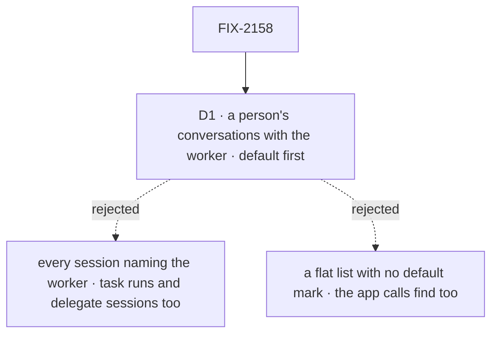

# FIX-2158 · Decisions

[Spec](SPEC.md) · **Decisions**

The epic's [D3](../../epics/FIX-2152/DECISIONS.md#d3) already chose the shape: a lab session is an
ordinary session of the worker, listed through the workforce client, with no criteria key and no
model amendment. One call is left: which sessions the list holds.

## The tree

Solid edges are what you're signing. Dashed edges lost, and the label says why.

## D1 · The list holds a person's conversations with the worker, the default first and marked

| | |
|---|---|
| **Instead of** | Every session that names the worker, task runs and delegate sessions included; or a flat list with no default mark, so the app calls `findWorkerSession` too to know where messages land |
| **Because** | A task's session is reached through its task (Jake's note on the issue, from FIX-2157: threads-mode threads are ordinary tasks, each in a new session of the delegate). Listed beside chats, every thread would show twice. The default is the one that receives messages, so a person needs to see it in the same list, and know which it is. Each excluded kind is already marked in existing state: task runs, delegate and workstream-lead sessions by `taskId`, `filingSessionId` and `workstreamId`, and the project coordinator's per-project conversations by their worker. The list adds no state ([tenet 3](../../../docs/philosophy.md)) |
| **Locks in** | `listWorkerSessions(worker)` on the workforce client. It returns the worker's top-level sessions on its current flow that are not task-run, delegate or workstream-lead sessions (`taskId`, `filingSessionId`, `workstreamId`), nor the project coordinator's per-project conversations, picked out by its worker. An ordinary session that carries `projectId` is listed. Each is marked default or not, the default first and the rest by latest activity. It never creates the default conversation. A person reaches the project coordinator's per-project conversations through their project. So the list is a person's own conversations with the worker: the default and the ones they opened |

**What would change my mind:** an app that needs a worker's task runs in the same list as its
chats. Then that is an option on the list, not a second list.

It comes down to threads mode: listing task runs shows every thread twice.

## Decided, not asked

- **No way to open a session on the workforce client.** Opening is the session client's create
  with the worker named in `workerId`, which the create check accepts and the docs already show.
  A workforce `open` would be a third way to start a session with a worker, differing from the
  session client's create only on the caller's side (issue-spec question 7).
- **The argument is a worker id, not `WorkerSessionCriteria`.** `filingSessionId`,
  `workstreamId` and `taskId` name session kinds the list leaves out, so taking them would invite a
  filter that returns nothing. Filtering ordinary sessions by `projectId` is not asked for here.
- **The default is found by its derived id**, the one `ensureWorkerSession` creates, so a session a
  person opened at a random id before the derived address existed is listed, not default.
- **Current flow only**, as `find` does. A session on a worker's former flow refuses new turns.
- **Every row is read.** The client asks the listing once with no `limit`, which every store
  answers with every row (as `findWorkerSession` reads today), so a person with many sessions gets
  all of them. It does not page by offset: rows ordered by activity move between pages while their
  sessions change. *(Amended at implementation, PR #3814: the first draft said the client pages.)*
- **Its type and field names are the implementer's**, beyond `listWorkerSessions` and a default
  mark on each entry.

## Considered and dropped

| Alternative | Why not |
|---|---|
| A new criteria key per extra session | Rejected by the epic's D3: the create check already accepts these sessions, so a key adds model surface for nothing |
| The lab filters the session client's listing itself | Glue in the lab (epic ER-4), and the exclusion rule would be copied into every app |
| A flat list with no default mark | The app then calls `findWorkerSession` too, to know where messages land |

## How it got here

- **Draft** — the Claude Code-style lab needs a person's sessions with one main worker; one read
  on the workforce client lists the person's conversations, default first, without task runs,
  built on the session listing and the keys that mark the other session kinds. The concept's base terms now say
  the derived conversation is the default, not the only one.

## Notes from review

- **FSD Architect (round 1):** the concept's base-terms paragraph is also rewritten by #3789
  (FIX-2160), and "the one a message lands in" is only true for a message addressed to the worker.
  Folded as a wording fix: this PR now carries #3789's paragraph verbatim, so the two merge as one
  rule. No direction change.
- **Codex (round 2), folded into the goal check:** the message signal is qualified to a message
  addressed to the worker (a message to a filer or a task lands elsewhere by rule), and a
  top-level, criterion-bearing session (the project coordinator's project session) joins the
  check with a control, since the listing's default already leaves dispatch runs out and
  `no-task-runs` alone could not catch a missing criteria-key filter. No direction change.
- **Codex (round 3), inline corrections, no round charged:** "Where it lands" now names the
  project coordinator's exception (`conversationAddress` in `workforce/src/messages/send-message.ts`
  targets the per-project session from project work); D1 says outright that per-project
  conversations are left out; and the goal check lists before the first ensure, so a list that
  secretly creates the default fails. `three-sessions` also asserts the two non-default sessions'
  order by latest activity, so a creation-order list fails.
- **FSD Architect (after round 3), coherence with FIX-2161 (#3805) and epic ER-8, folded as wording:**
  `projectId` is a criteria key, and FIX-2161 lets an ordinary session carry it, so "drop rows
  carrying any other criteria key" would hide every lab session that works in a project. D1 now names
  the excluded kinds (`taskId`, `filingSessionId`, `workstreamId`, and the project coordinator's
  per-project conversations, picked out by its worker); an ordinary session with `projectId` is listed.
  The control is now "the coordinator exclusion removed". The listed-project-session test belongs in
  FIX-2161's PR, which can create one. No direction change: today the two rules list the same sessions.
- **Cursor (round 1, approved), for the implementer:** "extract/shared filter with `findWorkerSession`
  in `client.ts` (criteria-key rule + filing top-level guard). That's the main code simplification;
  without it, list and find will drift."
- **Cursor (round 1), for the implementer:** "a footgun if the implementer pages with default
  `orderBy: updatedAt` while sessions are mutating — rows can move between pages. Either document
  single unbounded list when `limit` is omitted (today's store behavior), page on `createdAt` then
  re-sort, or a follow-up keyset helper." And: a UI that calls both `findWorkerSession` and
  `listWorkerSessions` on every refresh doubles the listing work; the lab should read the list's
  default mark.
- **Cursor (round 1), for the implementer:** an engine-side query ("workerId present, no other
  criteria keys") is simpler at runtime but a bigger change; an optional follow-up if conversation
  counts or polling hurt.

**Open: none.**
