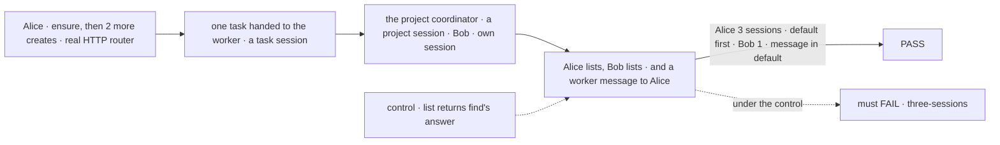
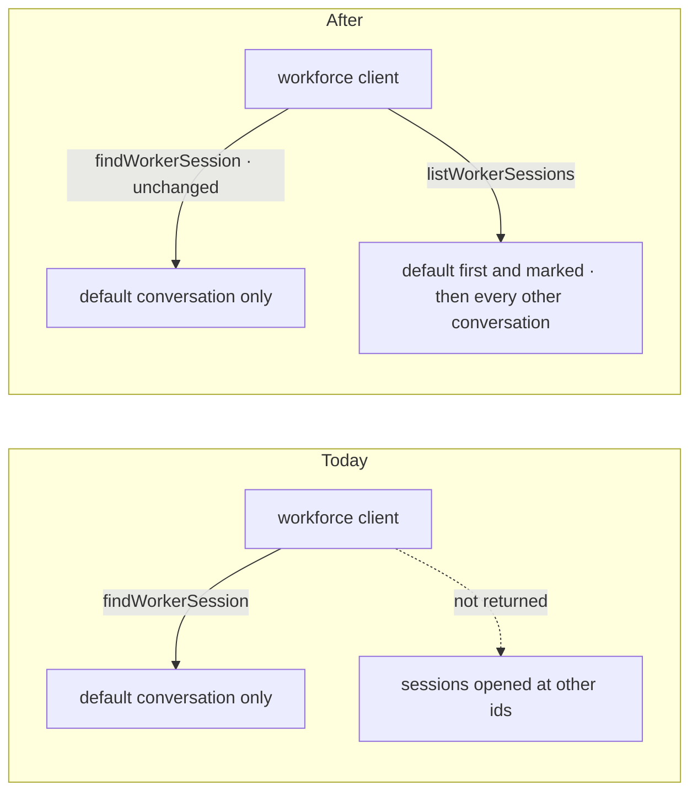
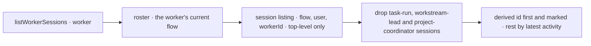

# FIX-2158 · The workforce client lists a person's sessions of one worker

**Spec** · [Decisions](DECISIONS.md)

## Four people, before and after

| Someone who… | Today | After |
|---|---|---|
| **builds an app where a person has many sessions with one main worker** (the Claude Code-style lab) | Opens a second session with the session client, but the workforce client can't list them: `findWorkerSession` returns only the default conversation, by design | Calls `listWorkerSessions(worker)` and gets every session the person opened with that worker, the default conversation first and marked |
| **opens a second and a third session with a worker** | Can't find them again from the workforce client | Sees all three in the list, newest activity first after the default |
| **is another person on the same worker id** | Never sees the first person's sessions | The same: the server scopes every listing to its caller |
| **waits on a background task or thread** (threads mode) | The task's session is a dispatch run, reached through its task | The same: the list leaves task-run sessions out, so a thread never shows up as a second chat |

A message another worker addresses to the worker still lands in the default conversation, however many sessions the
person opens.

## The goal, and how we'll know it's met

**A person who opens more sessions with one worker gets all of them, and only theirs, from the
workforce client, while messages addressed to the worker keep landing in the one default conversation.**

| Is it the right goal? | |
|---|---|
| **The real need** | "In the Claude Code-style app, a person has a list of sessions with one main worker and opens new ones" (the issue). The lab's session list (FIX-2153) and threads mode (FIX-2157) wire to it; under the epic's [ER-4](../../epics/FIX-2152/DECISIONS.md#who-owns-what) the lab can't list sessions itself |
| **Smaller, and rejected** | "The lab lists sessions with the session client and filters by `workerId`." It works, but it is glue in the lab, and it is exactly the filter the package must own: which sessions are conversations and which are task runs |
| **Bigger, and not this issue's** | A message landing in a session other than the default ([FIX-2160](https://linear.app/fixpoint-labs/issue/FIX-2160), session-to-session messaging; rule 21 forbids it today) · a new criteria key or a change to the worker model (rejected by the epic's [D3](../../epics/FIX-2152/DECISIONS.md#d3)) · titles or names for sessions |
| **Not done if** | The list misses a session the person opened at a random id · it returns another person's session · a task-run or project-coordinator session shows up · the default conversation is not first and marked · a message addressed to an ordinary worker lands anywhere but the default (the project coordinator's project-context messages keep going to that project's conversation) · listing creates the default |



The check reads what the client returns and where the message's request ran, never a stored key.

| How we verify | |
|---|---|
| **Goal check** | No `goals/` script: the path is model-free (session create, list, a scripted worker message), so a `packages/workforce` CI test on the real engine and HTTP router, as `test/worker-sessions.test.ts` already runs, covers it with nothing mocked. Verdict in the implementation PR |
| **Signal** | `no-create`: listed before Alice's first `ensureWorkerSession`, after one create at a random id, the list holds only that session, none is marked default, and `findWorkerSession` still returns nothing. `three-sessions`: Alice's list holds exactly her derived conversation and the two she created, the derived one first and marked default, then the two in order of latest activity (the one used last first, with distinct activity times so a creation-order list fails). `own-only`: Bob's list holds only his session. `no-task-runs`: the task's session is absent. `no-other-kinds`: on the installation's project coordinator, listed after `ensureWorkerSession({ worker, projectId })`, the top-level project session is absent and only its default conversation is listed. `message-in-default`: a message another worker addresses to Alice's worker (`to` the worker id, not a task) starts its `receive` in the derived conversation, after the other two were used more recently |
| **Input** | Two sessions created at random ids. Created before the first `ensureWorkerSession` must pass too |
| **Anti-game** | Assert on the client's answer and on where the `receive` request ran. Don't seed sessions in the store by hand |
| **Control that must fail** | `listWorkerSessions` returning `findWorkerSession`'s answer fails `three-sessions`. A list that ensures the default first fails `no-create`. The listing asked with `include: "dispatch-runs"` and no criteria filter fails `no-task-runs`. The top-level listing by `workerId` with the coordinator exclusion removed fails `no-other-kinds`. The PR shows each control's FAIL before the PASS |

## What changes



One new read on the client. Finding and ensuring keep returning only the default conversation, so
nothing that wires to them moves.

```diff
  const workforce = createWorkforceClient({ userId, baseUrl, fetcher })
  const main = await workforce.ensureWorkerSession({ worker: "main" })
- // a second session: open it with the session client, then keep its id yourself
- const sessions = await createSessionClient({ baseUrl, fetcher })
-   .listSessions({ flowKind: main.flowKind, userId, state: { workerId: "main" } })
-   // ...and drop project, task and delegate sessions by hand
+ const sessions = await workforce.listWorkerSessions("main")
+ // [{ session: { id: "wks_…", … }, isDefault: true }, { session: { id: "…", … }, isDefault: false }, …]
```

Opening a session stays the session client's create, naming the worker, as the docs show today.

**Docs:** update `packages/workforce/README.md` (the client table row and the paragraph on
`ensureWorkerSession`); extend `apps/docs/docs/workforce/workers-on-disk.md` → *Talking to a
worker*, where a second conversation is already shown, with the list; amend
`docs/internal/design/workforce-coordination-concept.md` → *Base terms* and *Messages* in this
PR: the derived conversation is the default and the message inbox, not the only one.

## How it reaches the list



The server already scopes the listing to the caller's user and organization, and leaves dispatch
runs out unless asked. The client adds the worker and drops task-run, workstream-lead and project-coordinator sessions.

## What stays as it is

- `findWorkerSession` and `ensureWorkerSession`: only the default conversation, at its derived
  address. A message, a routed task's result and a delegate's ongoing session key on it.
- The worker flow's create check. It already accepts a session at any id that isn't a derived one.
- `WorkerSessionCriteria`, the session-state keys, and the worker model.
- Rule 21: a message addresses a worker or a task, never a raw session.

## What's already here, and the debt

| Already here | What this does with it |
|---|---|
| `findWorkerSession` (`workforce/src/workers/client.ts`), the closest entry: one session by criteria. A list differs in what it returns (many, plus which one is the default), not by a flag, so it is a sibling read. Searches for another list of a worker's sessions (`listSessions` callers in `workforce/src`, `shift-manager/src`) found only the roster's own lookup. This is the **first** way to list a person's conversations with one worker | **Builds on.** The same roster lookup and flow |
| The session listing (`engine/src/routes/session-routes.ts`): scoped to the caller, top-level unless `include: "dispatch-runs"` | **Builds on.** No engine change |
| The create check (`workforce/src/workers/installation.ts`): any non-derived id is accepted; derived ids are reserved to their owner | **Kept.** Opening needs nothing new |
| Epic FIX-2152 [D3](../../epics/FIX-2152/DECISIONS.md#d3) and [ER-7](../../epics/FIX-2152/DECISIONS.md#who-owns-what) | **Built** as decided: no criteria key, no model amendment |
| Concept, *Base terms*: "one [conversation] per worker per user" | **Amended** in this PR: one default conversation per worker per user, and more a user opens |

| The debt | |
|---|---|
| **Adds** | One read on the workforce client. Permanent by design: it is the package's answer to which sessions are a person's conversations |
| **Removes** | Nothing |
| **Leaves** | A session on a worker's former flow is left out, as `find` leaves it out; turns there are refused anyway |

**Net: up by one read.** It replaces a filter every multi-session app would otherwise write.

## Sign off

**[The goal](#the-goal-and-how-well-know-its-met), at that size:** every conversation a person
opened with a worker, only theirs, and messages addressed to the worker still in the default. If wrong: the lab lists
sessions its own way, or a thread shows up as a second chat.

**[The debt](#whats-already-here-and-the-debt): up by one read on the client.** Adds
`listWorkerSessions`; removes nothing. If wrong: a list nobody but the lab calls.

1. **[D1](DECISIONS.md#d1) · The list holds a person's conversations with the worker: the
   default and any they opened. It leaves out task-run, delegate, workstream-lead and project
   sessions.** If wrong: an app that wants a worker's task runs in the same list must read them
   through its tasks.

**Open: none.** D1 is the one to weigh. Reasoning and what lost: [DECISIONS.md](DECISIONS.md).

Feature · `workforce` (client) + concept doc · small (1 source file, 1 test file, 3 doc surfaces) · 1 PR · epic FIX-2152
