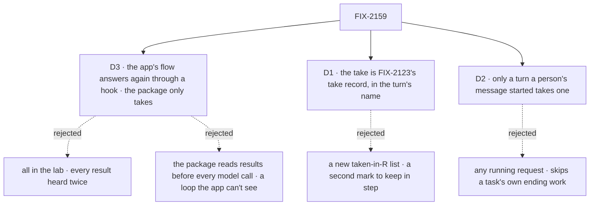

# FIX-2159 · Decisions

[Spec](SPEC.md) · **Decisions**

The epic already decided *that* a result reaches the running turn ([FIX-2152 D2](../../epics/FIX-2152/DECISIONS.md#d2)),
and its merge approved the amendment to rule 7. These three decide *how*, and each has a
consequence a person can see.

## The tree

Solid edges are what you're signing. Dashed edges lost, and the label says why.

## D3 · The app's flow decides to answer again, through one hook; the package only takes

*From the build Jake prefers, relayed on the epic's handle: the end-of-turn loop lives in the
lab's flow. Tested against the lab bar before it was drafted.*

| | |
|---|---|
| **Instead of** | (a) All of it in the lab, on public entries only. (b) The package reading results before every model call, through a context entry like the steer one, and answering once more itself |
| **Because** | (a) fails on public entries: nothing public takes a notice, and the agent flow has no step that may answer again (`afterAnswer` is a side step that can't change the answer). A lab that only *reads* finished rows leaves the notice owed, so the queued `onTaskSettled` says the line and wakes a second turn after the reply: heard twice ([POC](poc/take-in-turn/README.md), control). A lab that takes them itself must also report a failure, dedupe and free the delegate's session, which is package work in the lab (ER-4). (b) works, but the loop is package code no app can see or change, and the before-each-call read is a second mechanism step 4 doesn't need |
| **Locks in** | Two public entries: a hook on the agent worker flow, on the door a person's message comes through, that runs after the whole turn (its plan's answer included) in the same request and may hand the worker a message to answer again, at most three times per request; and a take on the workforce package that hands over what finished, once. An app that sets no hook behaves as today. A result that lands during a long tool loop waits for that answer to end, and one that lands after the last look waits for the turn to end, as today |

It comes down to hearing each result once: the lab alone can read a result but can't take it.

**What would change my mind:** the lab bar allowing a lab to call the package's notice handling
directly. Then the take could be lab code, and the package adds only the hook.

## D1 · The take is FIX-2123's take record, written in the turn's name, with the queued handling's order

| | |
|---|---|
| **Instead of** | A new "taken in request R" list on the conversation, kept like `steersTakenIn` on a task |
| **Because** | `onTaskSettled` already takes a notice in one conditional write that names its request, keeps that record after the clear, and takes a notice over once its taker ended without clearing it (FIX-2123). A turn that takes in its own name gets all three for nothing. The [POC](poc/take-in-turn/README.md) runs it on the real engine: taken in the turn and skipped by the queued copy; refused when the copy took it first; taken over after a turn that failed before clearing it |
| **Locks in** | A result taken in the turn has exactly the guarantees of one after the turn: never twice, and taken over if the turn dies before acknowledging it. The order is the queued handling's: take, report a failure, dedupe, free the session, acknowledge, then the line. A process death between the acknowledgement and the line drops the line, as it does today |

It comes down to one mark: a second one is a second rule the queued entry would have to learn.

**What would change my mind:** a store that can't keep the take record after the clear. Then
the turn needs its own list, and this card becomes the rejected one.

## D2 · Only a turn a person's own message started can take a result

| | |
|---|---|
| **Instead of** | Any running request of the filer's session: a turn a notice woke, a message from another worker (`receive`), a task's turn |
| **Because** | In a task session the queued handling also does the task's own ending work (`admitOwnTask`), and the entry refuses a notice once it is cleared, so a take there would skip it (epic D2). A `receive` is talk between workers, and its turn order is FIX-1989's. `isUserTurn` already marks exactly a person's turn in a conversation, and skips task and delegate sessions |
| **Locks in** | The take hands over nothing outside a person's turn, whatever the app's hook asks. A coordinator's woken turn, a worker answering another worker, and a worker on a task hear results after the turn, as today. Widening it later is a new decision, not a flag |

It comes down to the task's own ending work: a take outside a person's turn can skip it.

**What would change my mind:** a lab script that needs a worker on a task to hear a result
mid-turn. Then a task session's take has to carry `admitOwnTask` with it, which is a larger change.

## Decided, not asked

- **Which notices the take hands over:** the ones the queued handling says as a line or a woken
  turn, for a task whose result goes to the filer: a completion, a final failure, a cancel someone
  else made, a park that asks. Not a routed result, a retried marker, a held marker or a waited-on row.
- **The visible item is the queued handling's own line**, under the delegate's name, said in the
  turn's request by the take. FIX-2153 draws it; no new item kind. The take returns each line's
  words so the app can put them in its message.
- **One ending path.** The take runs Workforce's existing handling for a notice, with "say the line
  here and hand it back" in place of "say the line and wake a turn". Shared, never copied.
- **A failure the Error Reporter didn't take** stops the take before the acknowledgement. The take
  stays with the turn, the result isn't handed back, and the queued copy hears it after the turn.
- **The take reads committed rows**: a turn's snapshot of the board never shows an ending written
  after it started (POC, case 1). Only open rows this conversation filed are read.
- **The bound is the package's.** At most three answers again per request, so a hook that always
  returns a message can't loop a turn forever.
- **Where the hook sits.** On the person's door (`agent-user-turn`), after `run`, so after the
  plan's own answer (FIX-2076): once per request, never in a task or notice turn, and an app's
  hook never runs where D2 says nothing changes. An answer again is one more turn of `run`, so
  a result can make the worker plan again.
- **At most once, as today.** The take acknowledges before it says the line, the queued
  handling's order. A death before the acknowledgement: the queued copy takes it over and says
  it after the turn. A death after it: the line is dropped. No idempotency key on the line.

## Considered and dropped

| Alternative | Why not |
|---|---|
| Condition 2 in the issue text: a request holding the filer task's claim may take | Superseded by epic D2 at `a070af58`: the queued handling's `admitOwnTask` would be skipped |
| Run the queued `onTaskSettled` block from inside the turn | A handler doesn't call blocks (BP-011), and the woken-turn half has no place in a running turn |
| Stop the model loop from ending while a notice is owed | Needs a core change; the epic keeps this out of core and engine |
| One flag on the flow that turns the behaviour on: the package owns the take and the answer again, the app only opts in | The smallest public surface, one option instead of a hook and a take. It loses on where the loop lives: the app can't see or change it, and Jake asked for the loop in the lab's flow as a showcase |

## Settled

Evidence for both is in [`poc/take-in-turn/`](poc/take-in-turn/README.md), on `main` at `3d131544`.

- **The take record carries a take in the turn, exactly once** — **CONFIRMED**: cases 1 to 4, and
  case 1 red with the turn's clear removed.
- **A lab can do the end-of-turn loop on public entries alone** — **REFUTED**: case 5, a turn that
  only reads the finished row, is heard twice. The public surface has no take and no
  answer-again step (`afterAnswer` is a side step).
- **D2 is not POC evidence.** It rests on the epic's D2 and on reading `isUserTurn`.

## How it got here

- **Draft** — the epic's "one durable mark like `steersTakenIn`" turned out to exist as FIX-2123's
  take record; the POC confirmed it, so D1 reuses it.
- **Before review** — Jake's preferred build (relayed on the epic's handle) put the end-of-turn
  loop in the lab's flow. Tested against the lab bar: the loop fits, the take doesn't. D3 replaced
  a package-run answer and a before-each-call context entry with a hook and a public take.
- **Review round 1** — the crash guarantee stated as at most once in the goal (it had read as
  no loss); the hook placed on the person's door after the plan's answer; one-flag shape named
  as dropped.

## Notes from review

- "Have the implementer look at whether `planned`'s loop and the new hook can share one bounded
  'answer again' step (hook supplies the message, `planned` supplies its own). If they can't
  share, say why." — second-look review ([review](https://github.com/fixpoint-labs/flow-state-dev/pull/3799#pullrequestreview-5634917017))
- "The implementer's tests should own the interaction with `planned` explicitly, with the
  Error Reporter stop-before-ack and the answer-again bound." — same review

- "Parameterize `task-settled.ts` (a delivery mode) rather than a second copy of
  report/dedupe/free/line order, or FIX-2115, routed and Error Reporter paths drift." — cursor
  ([thread](https://github.com/fixpoint-labs/flow-state-dev/pull/3799#discussion_r4364611470))
- "Finding owed rows: reuse the `owesAnyNotice` prefilter, avoid a full scan plus a committed
  read per candidate on every hook call, cap work when many tasks finish together." — cursor
  ([thread](https://github.com/fixpoint-labs/flow-state-dev/pull/3799#discussion_r4364611475))
- "Consider exporting a default `answerAgain` helper (take, format the lines) that an app can use
  or override, so each app doesn't copy the same body; the loop stays visible in the flow." —
  cursor ([thread](https://github.com/fixpoint-labs/flow-state-dev/pull/3799#discussion_r4364611466))

These are inputs, not instructions. Adopt, adapt, or discard.

**Open: none.**
