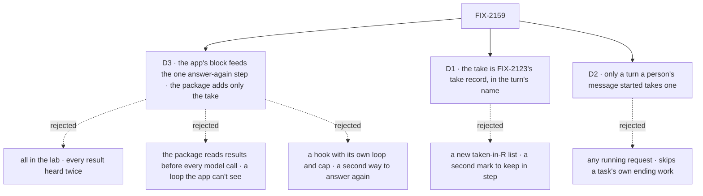

# FIX-2159 · Decisions

[Spec](SPEC.md) · **Decisions**

The epic already decided *that* a result reaches the running turn ([FIX-2152 D2](../../epics/FIX-2152/DECISIONS.md#d2)),
and its merge approved the amendment to rule 7. These three decide *how*, and each has a
consequence a person can see.

## The tree

Solid edges are what you're signing. Dashed edges lost, and the label says why.

## D3 · The app's block feeds the one answer-again step `planned` already runs; the package adds only the take

*From the build Jake prefers, relayed on the epic's handle: the end-of-turn loop lives in the
lab's flow. Tested against the lab bar before it was drafted.*

| | |
|---|---|
| **Instead of** | (a) All of it in the lab, on public entries only. (b) The package reading results before every model call, through a context entry like the steer one, and answering once more itself. (c) A hook on the agent flow with its own answer-again loop and its own cap of three, beside `planned`'s |
| **Because** | (a) fails on public entries: nothing public takes a notice, and the agent flow has no step that may answer again (`afterAnswer` is a side step that can't change the answer). A lab that only *reads* finished rows leaves the notice owed, so the queued `onTaskSettled` says the line and wakes a second turn after the reply: heard twice ([POC](poc/take-in-turn/README.md), control). A lab that takes them itself must also report a failure, dedupe and free the delegate's session, which is package work in the lab (ER-4). (b) works, but the loop is package code no app can see or change, and the before-each-call read is a second mechanism step 4 doesn't need. (c) works, and was this card's first draft, but `planned` (FIX-2076) already answers once more after a turn in the same request: a second step with a second limit is a second way to answer again |
| **Locks in** | `planned`'s answer-once-more step, extracted into one block with two sources (the plan's ended steps, and finished tasks) and one exported cap on answers again per request, the plan's included, built on core's `doWhile`. One option on the agent worker flow, `answerAgain`: `true` for the package's pre-built block (an exported factory: take, then turn the lines into a message), or a block that replaces it. A block underneath either way, never one the app must write. It adds no loop and no cap. The person's door is built inside the factory and `afterAnswer` can't answer, so without the option nothing can run after the turn. One public take, a handler block the workforce package exports, that hands over what finished, once. An app that sets no source behaves as today. A result that lands during a long tool loop waits for that answer to end, and one that lands after the last look waits for the turn to end, as today |

It comes down to hearing each result once: the lab alone can read a result but can't take it.

**What would change my mind:** the lab bar allowing a lab to call the package's notice handling
directly. Then the take could be lab code, and the package adds only the source slot. Or the agent
flow gaining a public way to compose its door: then the slot goes too, and the lab wraps the turn itself.

## D1 · The take is FIX-2123's take record, written in the turn's name, with the queued handling's order

| | |
|---|---|
| **Instead of** | A new "taken in request R" list on the conversation, kept like `steersTakenIn` on a task |
| **Because** | `onTaskSettled` already takes a notice in one conditional write that names its request, keeps that record after the clear, and takes a notice over once its taker ended without clearing it (FIX-2123). A turn that takes in its own name gets all three for nothing. The [POC](poc/take-in-turn/README.md) runs it on the real engine: taken in the turn and skipped by the queued copy; refused when the copy took it first; taken over after a turn that failed before clearing it |
| **Locks in** | A result taken in the turn has exactly the guarantees of one after the turn: never twice, and taken over if the turn dies before its dedupe write. The take goes only through `takeNotice` with `by:` the turn's request: no new metadata key, and no read or write of the running-filer hold (`heldFor`, `whileRunning`). The order is the queued handling's: take, report a failure, dedupe, free the session, acknowledge, then the line, with the part from report to acknowledge one function the queued `settle` shares. The point of no return is the dedupe write (`noteSeen`), which comes before the acknowledgement: a copy that takes over after it finds the key seen and says nothing. A process death from the dedupe write to the line drops the line, as it does today |

It comes down to one mark: a second one is a second rule the queued entry would have to learn.

**What would change my mind:** a store that can't keep the take record after the clear. Then
the turn needs its own list, and this card becomes the rejected one.

## D2 · Only a turn a person's own message started can take a result

| | |
|---|---|
| **Instead of** | Any running request of the filer's session: a turn a notice woke, a message from another worker (`receive`), a task's turn |
| **Because** | In a task session the queued handling also does the task's own ending work (`admitOwnTask`), and the entry refuses a notice once it is cleared, so a take there would skip it (epic D2). A `receive` is talk between workers, and its turn order is FIX-1989's. `isUserTurn` already marks exactly a person's turn in a conversation, and skips task and delegate sessions |
| **Locks in** | The take hands over nothing outside a person's turn, whatever the app's block asks. A coordinator's woken turn, a worker answering another worker, and a worker on a task hear results after the turn, as today. Widening it later is a new decision, not a flag. Two edges: the coordinator's round-0 post carries the mark, so it passes the gate, but this issue adds no source to the coordinator flow and its delegates' answers are routed, which the take never hands over. A person's request parked on a wait isn't running, so an ending during the park goes the queued way, as today |

It comes down to the task's own ending work: a take outside a person's turn can skip it.

**What would change my mind:** a lab script that needs a worker on a task to hear a result
mid-turn. Then a task session's take has to carry `admitOwnTask` with it, which is a larger change.

## Decided, not asked

- **Which notices the take hands over:** the ones the queued handling says as a line or a woken
  turn, for a task whose result goes to the filer: a completion, a final failure, a cancel someone
  else made, a park that asks. Not a routed result, a retried marker, a held marker or a waited-on row.
- **The visible item is the queued handling's own line**, under the delegate's name, said in the
  turn's request by the take. FIX-2153 draws it; no new item kind. The take returns each line's
  words so the app can put them in its message.
- **One ending path.** The take runs Workforce's existing handling for a notice, with "say the line
  here and hand it back" in place of "say the line and wake a turn". Shared, never copied.
- **A failure the Error Reporter didn't take** stops the take before the acknowledgement. The take
  stays with the turn, the result isn't handed back, and the queued copy hears it after the turn.
- **The take reads committed rows**: a turn's snapshot of the board never shows an ending written
  after it started (POC, case 1). It reads rows this conversation filed that still owe an
  eligible notice, finished rows included, never only open ones.
- **The cap is the shared step's.** At most three answers again per request, the plan's
  included, so a source that always returns a message can't loop a turn forever. One named,
  exported constant, apart from core's `maxSteps` and the board's `MAX_PASS_ROUNDS`. After the last
  allowed answer no source runs and the take hands over nothing: endings stay owed for the queued
  `onTaskSettled`.
- **Where it runs.** Wherever `planned` does: every turn of the worker on an installation. In a
  task or notice turn the take hands over nothing (D2), so the step answers only for the plan, as
  today. An answering turn files no step for itself, as `planned`'s does today; a task for a
  delegate is still dispatched.
- **At most once, as today.** The take dedupes and acknowledges before it says the line, the
  queued handling's order. A death before the dedupe write (`noteSeen`): the queued copy takes it
  over and says it after the turn. A death after it, the acknowledgement included: the line is
  dropped, because the copy finds the key seen. No idempotency key on the line. The window is the
  queued handling's own today; the shared function keeps it, and the implementer's tests cover a
  death between the dedupe write and the acknowledgement.

## Considered and dropped

| Alternative | Why not |
|---|---|
| Condition 2 in the issue text: a request holding the filer task's claim may take | Superseded by epic D2 at `a070af58`: the queued handling's `admitOwnTask` would be skipped |
| Run the queued `onTaskSettled` block from inside the turn | A handler doesn't call blocks (BP-011), and the woken-turn half has no place in a running turn |
| Stop the model loop from ending while a notice is owed | Needs a core change; the epic keeps this out of core and engine |
| One flag on the flow that turns the behaviour on: the package owns the take and the answer again, the app only opts in | The smallest public surface, one option instead of a source and a take. It loses on what the app decides: the app can't choose what the worker hears or how it's put, and Jake asked for that in the lab's flow as a showcase |

## Settled

Evidence for both is in [`poc/take-in-turn/`](poc/take-in-turn/README.md), on `main` at `3d131544`.

- **The take record carries a take in the turn, at most once and never lost before the
  acknowledgement** — **CONFIRMED** for the take record: cases 1 to 4b, with the line said after
  the acknowledgement; case 1 red with the turn's clear removed. The POC has no dedupe write, so
  with Workforce's handling the boundary moves earlier, to `noteSeen` (see *At most once* above;
  Codex, review round 4).
- **A lab can do the end-of-turn loop on public entries alone** — **REFUTED**: case 5, a turn that
  only reads the finished row, is heard twice. The public surface has no take and no
  answer-again step (`afterAnswer` is a side step).
- **D2 is not POC evidence.** It rests on the epic's D2 and on reading `isUserTurn`.

## How it got here

- **Draft** — the epic's "one durable mark like `steersTakenIn`" turned out to exist as FIX-2123's
  take record; the POC confirmed it, so D1 reuses it.
- **Before review** — Jake's preferred build (relayed on the epic's handle) put the end-of-turn
  loop in the lab's flow. Tested against the lab bar: the loop fits, the take doesn't. D3 replaced
  a package-run answer and a before-each-call context entry with a hook and a public take.
- **Review round 1** — the crash guarantee stated as at most once in the goal (it had read as
  no loss); the hook placed on the person's door after the plan's answer; one-flag shape named
  as dropped.
- **Review round 2** — Architect's follow-up: the take touches only the take record, never the
  hold; the shared handling named as one function with two callers; the bound exported and
  closed after its last answer; `planned`, the round-0 post, a park and messages placed. Jake asked
  whether this was a block: both pieces are now blocks, the hook a block slot like `afterAnswer`.
- **Review round 3** — Architect: the hook was a second answer-again beside `planned`'s. The step
  `planned` uses is now the one answer-again step, with the app's block as a second source and one
  cap. Asked to drop the slot entirely; kept as a source only, because the person's door is built
  inside the factory and has no other seam (`agent-worker-flow.ts`, `agent-user-turn`). `planned`
  answers once with no loop today, so the cap is new to it, not shared from it.
- **Jake** — the option shouldn't require a block: `answerAgain: true` uses the package's
  pre-built block, and a block overrides it. A block underneath either way.

## Notes from review

- "Have the implementer look at whether `planned`'s loop and the new hook can share one bounded
  'answer again' step (hook supplies the message, `planned` supplies its own). If they can't
  share, say why." — second-look review ([review](https://github.com/fixpoint-labs/flow-state-dev/pull/3799#pullrequestreview-5634917017))
- "The implementer's tests should own the interaction with `planned` explicitly, with the
  Error Reporter stop-before-ack and the answer-again bound." — same review

- "Parameterize `task-settled.ts` (a delivery mode) rather than a second copy of
  report/dedupe/free/line order, or FIX-2115, routed and Error Reporter paths drift." — cursor
  ([thread](https://github.com/fixpoint-labs/flow-state-dev/pull/3799#discussion_r4364611470))
- "Finding owed rows: reuse the `owesAnyNotice` prefilter, avoid a full scan plus a committed
  read per candidate on every hook call, cap work when many tasks finish together." — cursor
  ([thread](https://github.com/fixpoint-labs/flow-state-dev/pull/3799#discussion_r4364611475))
- *(Adopted after Jake's comment: `answerAgain: true` uses a pre-built block from an exported factory; a block overrides it.)*
  "Consider exporting a default `answerAgain` helper (take, format the lines) that an app can use
  or override, so each app doesn't copy the same body; the loop stays visible in the flow." —
  cursor ([thread](https://github.com/fixpoint-labs/flow-state-dev/pull/3799#discussion_r4364611466))

These are inputs, not instructions. Adopt, adapt, or discard.

**Open: none.**
