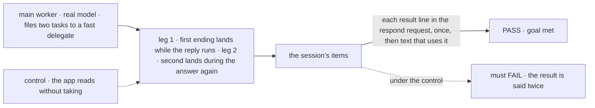
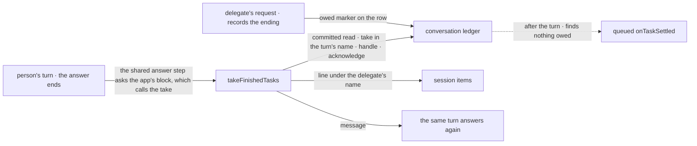

# FIX-2159 · A person's running turn hears the tasks that finished while it ran

**Spec** · [Decisions](DECISIONS.md)

## People, before and after

| Someone who… | Today | After |
|---|---|---|
| **asks the main session for work, and it starts two background tasks** | Sees the first result only after the reply ends, as a second turn that answers again | Sees the result appear in the reply that is still running, and the same reply answers once more with it |
| **builds an app on Workforce and wants that behaviour** | Can't: nothing public takes a result, and reading one leaves the after-the-turn notice to say it again | Sets `answerAgain: true` on the agent flow, or passes a block to change what the worker is told ([D3](DECISIONS.md#d3)) |
| **has a worker that runs a task, or two workers talking** | Results arrive after the turn | Unchanged. Only a turn a person's own message started can take one ([D2](DECISIONS.md#d2)) |
| **gets a failed result the Error Reporter didn't take yet** | Heard after the turn, once reported | Unchanged: the take never hands over a failure that wasn't reported |
| **loses the process mid-reply** | The result is never heard twice. A death after the dedupe write (`noteSeen`, just before the acknowledgement) drops the line | The same, both ways ([D1](DECISIONS.md#d1)) |

Claude Code shows a background result inside the running turn. Step 4 of FIX-2153's script asks
for it, and the epic signed it as [D2](../../epics/FIX-2152/DECISIONS.md#d2).

## The goal, and how we'll know it's met

**A person who asks the main session for work that starts background tasks sees the first
result inside the reply that is still running, once, and that reply goes on to use it.**

| Is it the right goal? | |
|---|---|
| **The real need** | The epic's leg a, step 4: "one result shows in the main thread while that turn is still running" ([FIX-2152](../../epics/FIX-2152/SPEC.md#the-goal-and-how-well-know-its-met)). FIX-2153's signal 4 checks that the result, the working indicator and the later text share the first request's id |
| **Smaller, and rejected** | "The app reads finished tasks after its answer." Doable in the lab today, and every result is then heard twice: once by the lab, once by the notice turn after the reply ([D1](DECISIONS.md#d1)) |
| **Bigger, and not this issue's** | A message from another worker reaching a running turn. A message is not an ending (FIX-2103); FIX-2070 owns where messages land |
| **Not done if** | The result shows only in a second request · it is heard twice · a crash before the dedupe write loses it (after it the line is dropped, as today: at most once) · the app can't choose what the worker answers about |



The check reads the session's items, which is what the lab draws, never the take record.

| How we verify | |
|---|---|
| **Goal check** | `goals/hand-offs/result-reaches-the-running-turn/` · `openai/gpt-5.4-mini` · run by the implementer at completion · verdict in the implementation PR |
| **Signal** | Each result line under the delegate's name carries the respond request's id, appears once in the session, and is followed in that request by text naming the result's nonce |
| **Input** | Each delegate answers with a nonce fixed per run. A different nonce, or the second task ending first, must pass too |
| **Anti-game** | Don't assert on the take record, the app block's return or a mocked model. All three pass while the line lands in a second request |
| **Control that must fail** | `GOAL_CONTROL=read-only`: the app's block reads finished rows instead of taking them. It must FAIL on *appears once in the session*, and today's `main` on *carries the respond request's id*. The PR shows both FAILs before the PASS |

## What changes


The top row is today. The middle row is the take after the answer and the answer again; the
bottom row is a second ending, which loops once more within the bound ([D3](DECISIONS.md#d3)).

**The app's side, as a lab writes it in its flow file:**

```diff
  export default defineAgentWorkerFlow({
    installation,
+   // In the same request, answer again with anything that finished while the worker answered.
+   answerAgain: true
  });
```

`true` uses the package's pre-built block. An app that wants its own wording passes a block
instead, usually the package's factory with an option, or its own sequencer around the take:

```ts
answerAgain: sequencer({ name: "lab-answer-again" })
  .step(takeFinishedTasks)
  .step(handler({
    name: "lab-finished-message",
    execute: (finished) => finished.length === 0 ? {} : { message: `Done while you answered:\n${finished.map((f) => f.line).join("\n")}` }
  }))
```

**One way to answer again, not two.** `planned` (FIX-2076) already wraps every turn of the
worker: the turn runs, its steps drain, and the worker answers once more, told how each step
ended. That answer-once-more step is extracted into one block with two sources: the plan's
ended steps, and the app's `answerAgain` block. After the turn it answers while a source has a
message, under one exported cap, built on core's `doWhile` as the board's round loop is. The
plan's answer counts toward the cap like any other. An answering turn files no step for itself,
as `planned`'s does today; a task for a delegate is still dispatched. After the last allowed
answer no source runs, so later endings stay owed for the queued `onTaskSettled` rather than
being taken with no answer to use them.

**A block underneath, never required.** The option is `true` or a block. `true` is the
package's pre-built block from an exported factory: take what finished, then turn the lines into
a message. A block replaces it. Either way the source is a block, so it shows in the trace and
composes like any other. An option is needed at all because the person's door is built inside the
factory (`agent-user-turn` runs `run`), and its one seam, `afterAnswer`, is a side step that can't
answer. The option adds no loop and no cap of its own: it is a second source for the existing
step. `takeFinishedTasks` is a handler the package exports. All names are working names.

**Where it runs.** Wherever `planned` does, which is every turn of the worker on an installation.
The take hands over nothing outside a person's turn ([D2](DECISIONS.md#d2)), so in a task or
notice turn the app's source finds nothing and the step answers only for the plan, as today.

**Docs:** rule 7 of `docs/internal/design/workforce-coordination-concept.md` gains the third
destination. The workforce README documents the `answerAgain` source and the take, with the lab's lines as the
example. No `apps/docs` page.

## How it reaches the turn



The take is the package's; the decision to answer again is the app's. The queued copy then
finds nothing owed ([POC](poc/take-in-turn/README.md)).

## What stays as it is

- **Core and engine.** The model loop and request concurrency are untouched.
- **Rules 5 and 6.** A take records no ending and settles nothing.
- **The queued `onTaskSettled`.** It still runs for every notice no turn took: in a task session,
  in a worker-to-worker exchange, between turns, after a crash, and in any app that sets no `answerAgain` source.
- **A wait.** A request waiting on the task with `getTask` resumes with the result; that row owes
  no notice to take.
- **Routed results.** A task whose result goes to the conversation stays with its routing.
- **`afterAnswer`.** It stays a side step that can't change the answer.
- **Messages.** A message from another worker, including FIX-2070's coming `{ session: id }` form, never goes through the take. It is not an ending (FIX-2103), so FIX-2070's spec doesn't widen it.
- **A parked turn.** While the person's request is parked, the queued copy isn't held for it, so an ending during a park goes the queued way. The take runs only in a running request, after an answer.

## What's already here, and the debt

| Already here | What this does with it |
|---|---|
| FIX-2123's take record: `takeNotice` / `noticeTakeWrite`, the `noticeTaken:` record, the takeover once a taker ended | **Builds on.** The take goes only through `takeNotice` with `by:` the turn's request. It is the durable "taken in R" mark: no new metadata key ([D1](DECISIONS.md#d1)) |
| The hold on a running filer: `heldFor`, the deferred notice's `whileRunning` (FIX-2123, FIX-2149) | **Neither read nor written by the take**, so `held`, `noticeTaken` and `whileRunning` can later fold into one marker. The queued copy turned away with `whileRunning: R` while R runs comes back after R, finds the notice cleared, and does nothing |
| FIX-2078's one ending path: `taskSettledEntry` and Workforce's handling in `task-settled.ts` | **Factors, then builds on.** The end, report, dedupe (`noteSeen`) and acknowledge part of the queued `settle` becomes one function that `settle` and the take both call. One handling, two callers: only where the line goes differs, said here and handed back, or a woken turn |
| FIX-2086's steer entry (`steer-context.ts`, `steersTakenIn`) | **Leaves alone.** It stays task-only; nothing reads a result before each model call |
| `isUserTurn` (FIX-1945) | **Builds on.** The gate inside the take ([D2](DECISIONS.md#d2)) |
| The worker turn's answer-once-more after its plan (FIX-2076) | **Extracts and shares.** It becomes the one answer-again step, with the plan and the app's block as its two sources and one exported cap. No second answer-again |
| `afterAnswer` on the agent flow | **Leaves alone.** A side step that can't answer, which is why the app's source needs its own slot |
| `AFTER_REPLY_CONCURRENCY` | **Leaves alone.** The queued copy still waits; with a source set it usually finds nothing owed |
| `maxSteps` (core, the tool loop) and `MAX_PASS_ROUNDS` (the board's drain rounds) | **Leaves alone.** The shared step's cap counts answers again in one request, which neither counts. Built on `doWhile` like the round loop |
| Rule 7 | **Amended** by epic D2, approved at its merge |
| Anything else that hands an ending to a running request | **None for a conversation.** Searched `prepareStep`, `takeNotice`, `takenIn`, `noticeTaken`, `afterAnswer` across `packages/`; only steers reach a running request, and only a task's |

| The debt | |
|---|---|
| **Removes** | Nothing |
| **Adds** | One public take on the workforce package · one source slot on the agent worker flow, feeding an existing step · one exported cap on that step · a second caller of the take record and of the factored handling, the person's turn |
| **Leaves** | The queued notice turn, as the path for every notice no turn took. Not debt: task sessions and worker-to-worker exchanges still need it |

**Net: up, a little.** One public take and one source slot; no new mark, no second ending path, no second answer-again, no context entry.

## Sign off

**[The goal](#the-goal-and-how-well-know-its-met):** the result shows inside the running reply,
once, measured on the session's items. If wrong: the lab's step 4 passes while the person sees
the result twice.

**[The debt](#whats-already-here-and-the-debt), up a little:** a public take and a source slot
on the answer step `planned` already runs, nothing removed. If wrong: two callers of one ending
handling that someone must keep in step.

1. **[D3](DECISIONS.md#d3) · Finished tasks feed the one answer-again step `planned` already
   runs (`answerAgain: true`, or a block to override); the package adds only the take and its
   default block.** If wrong: a factory option stands where a public way to compose the person's
   door should be.
2. **[D1](DECISIONS.md#d1) · The take is FIX-2123's take record, in the turn's name, with the
   queued handling's order.** If wrong: a result taken in the turn has weaker guarantees than one after it.
3. **[D2](DECISIONS.md#d2) · Only a turn a person's own message started can take a result.** If
   wrong: a worker on a task, or two workers talking, wait for results Claude Code would show at once.

**Open: none.** D3 is the one to weigh: the app decides what to answer about, the package keeps
one way to answer again and the part a lab can't do safely, the take.

Feature · `workforce` · small · epic [FIX-2152](../../epics/FIX-2152/SPEC.md)
