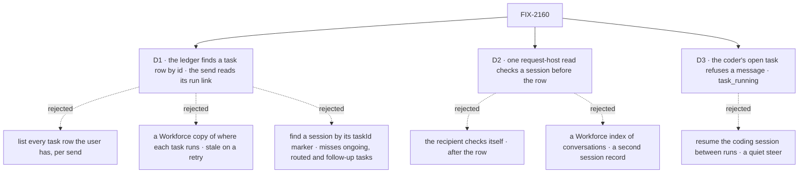

# FIX-2160 · Decisions

[Spec](SPEC.md) · **Decisions**

The epic decided the model ([FIX-2070](../../epics/FIX-2070/DECISIONS.md)): `{ task }` lands in
the task's session, `{ session }` is checked within the sender's tenant before anything is
written (ER-2, ER-3); FIX-2238 decided the coder hears only in its tasks' sessions and moved its
talk turn here. Two facts on `main` shape what is left. A task row lives at
`tasks/<conversation partition>/<id>`, so a bare task id finds no row without its partition
(`orchestration/tasks/collection/partition.ts`). And no block can read another session's record:
the dispatch guards read it and only refuse (`engine/context/create-request-host.ts`). D1 and D2
answer those; D3 is the coder's open task.

## The tree

Solid edges are what you're signing. Dashed edges lost, and the label says why.

## D1 · The task ledger finds a row by id across conversations; the send reads its run link

*An engineering call that adds a lookup to orchestration, so it is on the sign-off.*

| | |
|---|---|
| **Instead of** | Listing the user's whole task ledger and keeping the row with that id; finding a session whose readonly `taskId` marker names it; or a Workforce index that copies where each task runs |
| **Because** | The list loads every row of every conversation on each send (BP-033), and grows with the user's history. The marker misses three kinds of task: one filed `session: "ongoing"` (the delegate's session has no `taskId`), one routed to a workstream session, and a follow-up (its session carries the root's id). A Workforce copy of `run.sessionId` is a second record that a retry in a new session leaves stale. The run link on the row already names the session for every dispatched task, from its one writer, the claim gate. What is missing is only finding the row: the ledger stores it at `tasks/<partition>/<id>`. So the ledger learns to find a row by id, and nothing about where a task runs is copied |
| **How** | The partitioned ledger keeps, at the owner's scope, which partitions hold each task id, written in its own add, the one path every filing passes (a piece, a retry, a follow-up, a replan, a scheduled filing). Generic: orchestration knows no conversation. The send finds the row, reads `run.sessionId` and the row's status, then checks that session with D2's read, as a `{ session }` is checked. No row, no run link (not started, or an inline plan step), an id held in more than one partition (ids a caller picks are unique per partition only), or another user's: `no_task_session`, one answer, so a refusal tells nothing of another user's tasks. This is FIX-2255's ask, built here |
| **Locks in** | A lookup by id on a partitioned ledger; the refusal `no_task_session` |

**What would change my mind:** task ids becoming unique per user at filing. Then the index can be
the ledger's key and the "more than one" refusal goes.

It comes down to one send's cost: one read by id, or every row the user has.

## D2 · The server checks a `{ session }` with one new request-host read

*A product call: it widens the engine seam its header calls "closed at seven verbs", and says
an eighth is a reviewed decision.*

| | |
|---|---|
| **Instead of** | Letting the recipient's `onMessageReceived` check its own session's markers, after the row is written and the message dispatched; or a Workforce index of every conversation |
| **Because** | Epic ER-3 checks a target "before anything is written", so a refusal pays nothing and leaves no row. The markers, the worker and the org are on the target session's record, which only the engine reads today. A Workforce index would be a second record of every session, written at every create. The engine already has the rule: its dispatch guards refuse another user's or tenant's session as not found, and another flow's or org's as not addressable. Exposed as a read, the rule stays in one place ([tenet 2](../../../docs/philosophy.md)) |
| **How** | `requestHost.sessions.read(id)` returns `{ flowKind, flowId, state }` for a session of the running user, in the running tenant and org, with `state` cut to the flow's readonly fields (the rule the HTTP session list's state filter already keeps); `undefined` for any other or a missing one. The org and tenant rule is the guards' own (`matchesOrgFilter`), inside the engine, so it stays in one place and no capability sees another org's session. Identity is closed over. Layer 1 stays generic: Workforce reads the markers. The seam's header gains the verb, and its "neither is a session id" line names the dispatch `{ id }` target as the precedent |
| **Locks in** | The verb `sessions.read`, the request host's eighth; Workforce's refusals for `{ session }` (below) |

**What would change my mind:** a lab that needs `{ session }` across a host that can't read its
sessions. Then `{ session }` is refused on that host, as a call is without a wait gate.

It comes down to when a bad target is refused: at the send, before the row, or after it.

## D3 · A message to the coder's open task is refused `task_running`

*A product call: the epic says a message to an open task is conversation in its session, and the
coder can only talk by resuming a coding session its next attempt also resumes.*

| | |
|---|---|
| **Instead of** | Resuming the task's coding session with the message between runs, once the checkout's lease frees |
| **Because** | The coder's talk is a coding-agent run in the task's checkout (`session-door.ts`), which can change the files the task is working on, and the next attempt resumes the same coding session (`harness-manager/manager.ts`, LAB-154). So a message would act on the work itself, and a message never steers (rule 21). An agent worker's turn also reads its session's history, but a message's turn there changes no checkout and runs after the task's turn. A person who means to steer types in the session, and the door makes that a steer on the row. A finished task has no next attempt |
| **How** | The send reads the recipient's `hears` and the rows that run in the task's session: the task and its follow-ups, as the door's `sessionRow` reads them. `hears: "task-sessions"` and any of them open: refused `task_running`, before the row, naming `getTask` and the task's ending. A finished row: delivered, and `harnessTalkTurn` resumes the coding session once, outside any attempt, as the door's talk does; its reply is the answer in that session |
| **Locks in** | `task_running`; `harnessTalkTurn` as the door's talk half, shared |

**What would change my mind:** a lab where workers must ask a running coder what it is doing. Then
a read-only status turn answers from the run record, without resuming the coding session.

It comes down to what the next attempt resumes: the work's own history, or a message in it.

## Decided, not asked

- **`{ task }` to an agent worker's open task** is delivered, and runs after the task's turn, by
  the entry's existing `defer` concurrency (FIX-2238 keeps it). Nothing reads the row for it.
- **A `{ task }` that resolves to the sending session is refused `not_yourself`**, as a worker's own
  name is (rule 21). This settles Codex's question on #3789.
- **`{ session }`'s refusals, in order:** the read returns nothing (missing, another user's,
  another org's or tenant's) → `no_session` (one answer, so it tells nothing of another's sessions); a
  `taskId` or `filingSessionId` marker → `not_a_conversation`, naming `{ task }`; no `workerId`, or a
  worker not on the roster now → `no_worker`; the session's flow isn't the worker's flow now →
  `worker_unavailable`; the sending session's own id → `not_yourself`. A workstream's session and a
  project's conversation are conversations, and are reached. The recipient's `hears` applies as
  for a name: the coder has no conversation, so any `{ session }` to it is `not_a_conversation`.
- **Where the checks run:** in the send, after the text check and before the budget, the one
  convergence point every send passes (FIX-2238's `sendMessage` server function). The tool's
  description gains the two targets; its list of workers is unchanged.
- **The row** gains the target kind FIX-2238 added (`worker`, `task`, `session`) and, for
  `{ task }`, the task id, so the Messages view can say "to Researcher's task". `to` stays the
  recipient worker's id.
- **A `{ task }`'s session gets every `{ session }` check but the markers:** D2's read (so another
  org's task, which the user-scoped ledger would find, is refused before the row), the worker on the
  roster now, and its flow. A plan board's steps are on a ledger of their own; the lookup serves the
  conversation ledger, and a step's id is `no_task_session` (an inline step has no run anyway).
- **`harnessTalkTurn`** takes the door's board and harness options, finds the session's row
  (`sessionRow`), and refuses with the door's own reasons if the row has no coding session
  (`cannot-continue`). The door's talk calls it, so there is one talk path.
- **No lookup tool**: the user pastes the id (rule 21's first version).
- **`task_running` is decided before any queueing.** It is a send-time refusal, so a call to a
  running coder task is refused, never queued behind it as a busy session (FIX-2239's queue).
- **The goal's legs:** FIX-2160 owns legs 6, 7 and 8 of `workers-message-each-other`; FIX-2240 and
  FIX-2239, stacked after it, number theirs from 9.

## Considered and dropped

- **Task ids that carry their partition.** Every task id a model sees today is bare; changing the
  format moves every tool, notice and screen for one lookup.
- **A dispatch "check only" mode instead of a read.** It widens the dispatch seam just as much,
  and still can't answer the marker questions, which are Workforce's.
- **Refusing every `{ task }` to an open task.** An agent worker's open task already runs a
  message after its turn without touching the work; only the coder's resume is a steer.

## Open / Settled

**Open: none.**

No counted facts rest on hand derivation. The three places FIX-2160 builds on (the partition key,
the guards' rule, the run link's one writer) were each found by search on `main` at `9cc15c3`;
the implementer re-runs them.

## How it got here

- **Draft** — framed as the addressing child of FIX-2070 on FIX-2238's send path. Research on
  `main` found that a task id has no lookup across conversations and no block reads another
  session; D1 and D2 add the smallest piece for each, and D3 keeps a message from steering a coding
  run.
- **Analysis fold** — D1 moves from a Workforce index of where tasks run to the ledger's own lookup
  by id (FIX-2255, absorbed); every `{ task }` passes the session read; the read owns the org rule.

## Analysis

2026-10-27, a fresh reviewer at spec altitude, with `reuse-review` on Builds on / Adds, on the
draft at `9cc15c3`. Verdict: the right work; D1 reshaped. Reuse: the lookup extends the
partitioned ledger (it is FIX-2255); `sessions.read` extends the dispatch guards' predicates;
`harnessTalkTurn` is extracted from the door. Folded: D1 keeps only id → partition in the ledger and
reads the run link, instead of a Workforce copy that a retry makes stale; a `{ task }`'s session
passes D2's read too, since the user-scoped ledger crosses orgs; the read refuses another org
itself and returns only readonly state; D3's open check covers the session's follow-ups. Recorded
below.

## Notes from review

- **Cursor simplify review (#4000), approved; recorded for the implementer:** one `sessions.read`
  result serves every check on a `{ task }` (org, markers, roster, flow), never two reads; keep the
  read's return to what the refusals need, and a later lookup tool extends this verb rather than
  adding a ninth; write the ledger's id index in the row's own add, as the schedule index derives its
  key, rather than a new indexing pattern; an ordered table of the refusals, with a column for which
  apply to a `{ task }`, belongs in the implementation's tests and the messaging page. Dropped:
  probing each conversation's partition (no server read lists a user's conversations), and moving
  the goal's signal list out of `SPEC.md` (the template keeps it there).
- **FSD Architect (#4000), folded inline:** the goal-leg numbering and `task_running` before a call's
  queue, both in *Decided, not asked*. No fork.

- **Analysis, recorded:** D3's reason is the checkout, not history alone (folded into the card). The
  request host's header lines on session ids and records change with the verb (BP-034). A caller can
  pick a task id, so the same id can sit in two partitions; the lookup must keep both, never
  overwrite one with the other.
- **Cross-spec review of the FIX-2070 children, recorded at implementation:**
  - The door and the message check share one session-rows reader, `rowsInSession`. It lives in orchestration, because workforce doesn't depend on harness-manager.
  - The target checks are exported as `checkTaskTarget` and `checkTargetSession`, so FIX-2240's resend reruns them on a stored row.
  - `harnessTalkTurn` returns `{ reply, taskId }`, for FIX-2239's call to return the reply.
  - The row's target field is `addressedBy` (`task` | `session`), because the retired-terms guard refuses "kind" on Workforce's ground.
- **The goal's other-organization signals are not run in DevTeam.** The lab verifies every bearer into one organization. The engine's `request-sessions.test.ts` covers that refusal.
