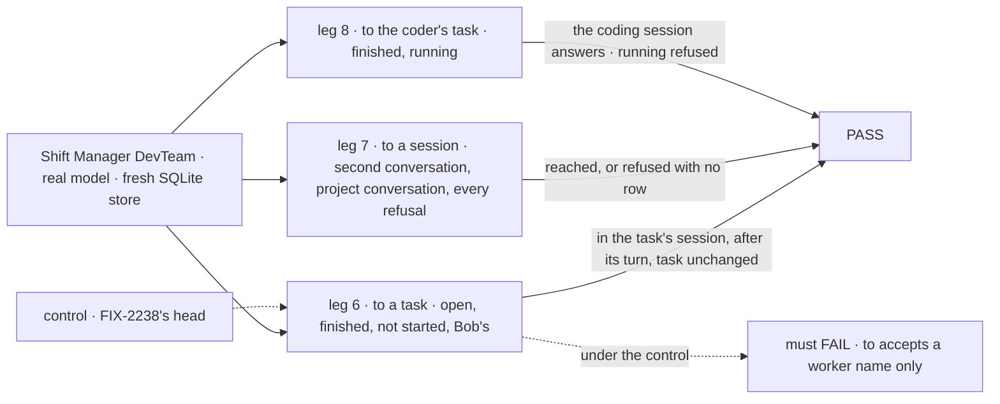
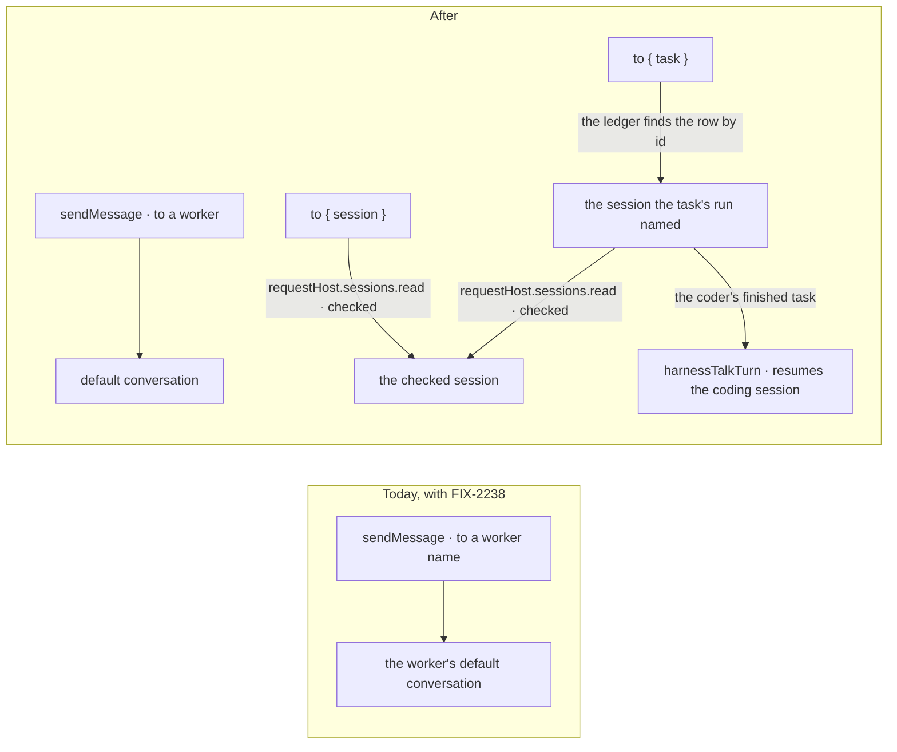
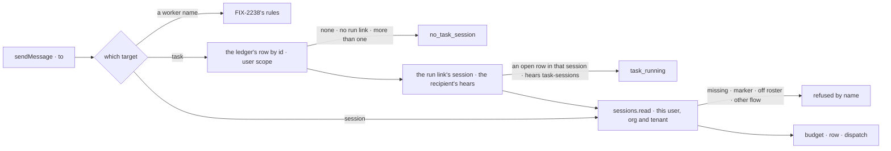

# FIX-2160 · A message addresses a task or one of the user's conversations

**Spec** · [Decisions](DECISIONS.md)

## Six people, before and after

| Someone who… | Today (with FIX-2238) | After |
|---|---|---|
| **builds a worker that asks about another worker's task** | Can only `sendMessage({ to: "researcher" })`. The question lands in Researcher's default conversation, away from the task's history | `sendMessage({ to: { task: id } })` lands in the session working that task, open or finished, and `onMessageReceived` runs there with the task's history. On an open task it runs after the task's turn. The task doesn't change |
| **pastes one of their conversations into another worker's chat** | Has no way to point a worker at a second conversation with Researcher, or at the Shift Coordinator's conversation for a project | `sendMessage({ to: { session: id } })` reaches that conversation, checked by the server before anything is written |
| **sends to a session that isn't theirs, or isn't a conversation** | (no such target) | Refused before the row: another user's or org's session reads as not found; a task's or a delegate's session is refused naming `{ task }`; a fired or moved worker's session is refused |
| **asks the coder about a finished coding task** | Refused `task_sessions_only` by name, with nowhere else to send it | `{ task }` reaches the task's coding session: one harness run resumes it with the message, outside any attempt, and its reply is the answer there (a call, FIX-2239, returns it) |
| **asks the coder about a coding task still running** | (no such target) | Refused `task_running` before the row: a message never steers, and the next attempt resumes that coding session ([D3](DECISIONS.md#d3)) |
| **messages a task that hasn't started, or its own task** | (no such target) | Refused before the row: `no_task_session` (file a message with `updateTask` instead), or `not_yourself` when the task's session is the sender's own |

Answers come back as FIX-2238 says: `inReplyTo` lands in the session that sent the original.

## The goal, and how we'll know it's met

**A worker reaches the session working any task of its user's, or any one of its user's own
conversations, by id, with every target checked by the server before anything is written, and the
coder answers a message about a finished coding task from that task's coding session.**

| Is it the right goal? | |
|---|---|
| **The real need** | The epic's "a worker can message any worker, task or conversation of its user … in the session it is about" ([epic SPEC](../../epics/FIX-2070/SPEC.md)), the `{ task }` and `{ session }` half: [ER-2](../../epics/FIX-2070/DECISIONS.md#who-owns-what)'s `{ task }` leg and [ER-3](../../epics/FIX-2070/DECISIONS.md#who-owns-what). Stories M-09 and M-10, and rule 21 |
| **Smaller, and rejected** | "`{ task }` only for the sender's own board's tasks." It is a lookup the board already has, while M-09's "coder can message researcher's task though it neither filed it nor shares its board" fails, and `{ session }` stays unchecked |
| **Bigger, and not this issue's** | A tool that looks up a user's sessions (rule 21's later step) · a call that waits (FIX-2239) · delivery that survives a crash (FIX-2240) |
| **Not done if** | A `{ task }` message lands anywhere but the session the task's run named · a finished task's status, output or attempts change · an open task's message runs during its turn · another user's task or session is reached, or its existence shows in the refusal · a task or delegate session is reached by `{ session }` · another org's or tenant's session is reached · a fired or moved worker's session is reached · a refused target leaves a log row or spends budget · the coder's finished task isn't answered from its coding session · an open coder task's coding session is resumed by a message |



The check reads the recipients' stored session items, the turns' tool outputs, the task rows and the message log, through Alice's and Bob's own clients.

| How we verify | |
|---|---|
| **Goal check** | `goals/shift-manager/workers-message-each-other/`, amended with legs 6, 7 and 8, as FIX-2238 left it. Real model, run by the implementer at completion with `GOAL_LEGS=6,7,8 pnpm tsx goals/shift-manager/workers-message-each-other/run.mts`; PASS is every leg in 3 of 3 runs; verdict in the implementation PR. The model-free checks (each refusal, the lookup by id, the read) are also `packages/workforce` and `packages/engine` CI tests |
| **Signal** | `6:lands-in-task-session` Helper A's `{ task }` message to Researcher's open task is a received item in that task's session, and its `onMessageReceived` turn starts after the task's turn ended; `6:finished-keeps-history` to the same task once finished, the turn runs there and its model input holds the task's earlier lines; `6:task-unchanged` the row's status, output and attempts are the same before and after; `6:not-started` a message to a pending task is refused `no_task_session` and writes no row; `6:bobs-task` Bob's task id is refused exactly as an unknown id; `6:own-task` a task session's message to its own task is refused `not_yourself`; `6:other-org` Alice's task in her second org, sent from her first, is refused as an unknown id and writes no row. `7:second-conversation` a message to Alice's second conversation with Researcher, from Researcher's default one, lands there; `7:project-conversation` one to the coordinator's conversation for one of Alice's projects lands there; `7:refusals` Bob's session, Alice's session in her second org, a task session, a delegate session, a fired worker's session, a moved worker's session and the sending session each are refused and write no row. `8:finished-answered` a message to the coder's finished task is answered by one harness run that resumes the task's coding session, as an item there, with the row unchanged; `8:running-refused` one to its running task is refused `task_running` and writes no row |
| **Input** | DevTeam's workers as the goal hires them, plus Alice's second conversation with Researcher (`ensureWorkerSession` is not it: a second session opened through the session client), a project with its coordinator conversation, a second org for Alice, `fired-helper` hired then fired, `moved-helper` hired then moved to another flow. The coder's task is an answer task (no issue, no phase). Ids are picked at run time and pasted into the workers' lines |
| **Anti-game** | Landings read from the recipients' stored items; refusals from each turn's own tool output; "no row" from the Messages view's list; the task's fields from its row before and after. Nothing seeded |
| **Control that must fail** | FIX-2238's head (the stack's base): every leg fails, `6:lands-in-task-session` first (`to` takes a worker name only). `GOAL_CONTROL=task-to-conversation` (a `{ task }` lands in the assignee's default conversation) fails `6:lands-in-task-session`. `no-kind-check` (the `{ session }` markers unread) fails `7:refusals`. `no-org-check` fails `7:refusals` on the second org. `coder-resumes-open` (the talk turn resumes an open task) fails `8:running-refused`. The PR shows each FAIL before the PASS |

## What changes



Two new targets, each resolved and checked by the server before the row: a task through a lookup by
id the task ledger gains, then the session its run named; both through one new engine read.

A worker's model calls the same tool with a new `to`:

```diff
- sendMessage({ to: "researcher", text: "Does the CSV have a month column?" })
+ sendMessage({ to: { task: "task_2026…" }, text: "Does the CSV have a month column?" })
+ sendMessage({ to: { session: "wks_…" }, text: "Alice wants this in her other thread too." })
```

The coder's flow gains its turn (FIX-2238 left it out):

```diff
 [MESSAGE_RECEIVED_ENTRY]: messageReceivedEntry({
   installation, flowKind: CODER_FLOW, hears: "task-sessions",
+  turn: harnessTalkTurn({ name: "coder", harness: options.harness, board }),
 }),
```

**Docs:** update `apps/docs/docs/workforce/messaging-workers.md` (the two targets, what each lands
in, the refusals `no_task_session`, `task_running`, `not_a_conversation`, and pasting a session
id); `packages/workforce/README.md` → Worker messages; `packages/harness-manager/README.md`
(`harnessTalkTurn`); `packages/orchestration/README.md` (finding a task by id); `docs/architecture/dispatched-work.md` (the request host's eighth verb,
`sessions.read`); `packages/core/README.md` if it lists the request host's verbs. No new page. A
changeset for `@flow-state-dev/core`, `@flow-state-dev/engine`, `@flow-state-dev/orchestration`,
`@flow-state-dev/workforce` and `@flow-state-dev/harness-manager`.

## How a target resolves



Every refusal is decided before the budget is paid or the row is written.

## What stays as it is

- FIX-2238's send path, budget, landing rules and refusals for a worker name. The new targets
  join its checks before the budget, as the epic's seam table says.
- The coder's door (`harnessSessionDoor`): a person's line still steers an open task and talks to
  a finished one. `harnessTalkTurn` is its talk half, shared, not a copy.
- The dispatch seam's `{ id }` guards: the delivery still passes them.
- The task ledger's partitions and key layout.

## What's already here, and the debt

| Already here | What this does with it |
|---|---|
| Ways a worker reaches a session of its user's, from searches of `packages/*/src` for `dispatchThroughSeam`, `SessionTarget`, `run.sessionId` and `findWorkerSession`: a task's hand-over (board), a notice to the filer (`{ from }`), FIX-2238's send to a worker's default conversation, and a person's own session client. None targets a task's session or a pasted id from a worker | **Extends** the send: two targets on the one tool, no new tool. Still three ways to reach a worker (FIX-2238's count) |
| FIX-2238 ([D1](../FIX-2238/DECISIONS.md#d1)): the coder hears only in its tasks' sessions, `hears: "task-sessions"`, with no turn | **Builds on**: adds `harnessTalkTurn`, and reads `hears` for the open-task refusal |
| The run link (`run.sessionId`, written once by the claim gate, `orchestration/task-board/task-entry.ts`) | **Kept** as the one truth of where a task runs; the send reads it off the row ([D1](DECISIONS.md#d1)) |
| The partitioned ledger (`orchestration/tasks/collection/partition.ts`): a row at `tasks/<partition>/<id>`, read one partition at a time | **Extended**: it finds a row by id across its partitions, through an id index it writes in its own add ([D1](DECISIONS.md#d1)). FIX-2255 asked for it and is closed into this issue |
| The dispatch guards (`engine/context/create-request-host.ts`, `resolveExistingSession`): another user's or tenant's session is `session-not-found`, another flow's or org's `session-not-addressable` | **Reused** as the read's rule: the read returns what the guards would let through ([D2](DECISIONS.md#d2)) |
| A session's readonly markers (`taskId`, `filingSessionId`, `workerId`) | **Read** for `{ session }`'s refusals, as the gaps file says |
| `harnessSessionDoor`'s talk path (`harness-manager/session-door.ts`) | **Extracted** into `harnessTalkTurn`; the door calls it |
| FIX-2152's rule 21 amendment (#3797) and the architect's shape on this issue | **Kept**; the `{ task }`-to-self question Codex raised on #3789 is settled: refused `not_yourself` |

| Builds on / Adds | Existing piece considered | Why that doesn't fit, or how this is composed |
|---|---|---|
| The ledger's lookup by id across partitions | Listing the user's whole `tasks` ledger (`list()` over `tasks/**`), as Shift Manager does; a Workforce index of where each task runs | The list loads every row of every conversation per send (BP-033); a Workforce copy of `run.sessionId` can go stale on a retry. The ledger's own index holds only id → partition, written by the one add every filing passes, so it never goes stale ([D1](DECISIONS.md#d1)) |
| `requestHost.sessions.read(id)` | The dispatch seam's guards; the store's `session.get` reached only by hosts (`devteam/host.mts`) | The guards refuse but never return the record, and a block can't reach the store. The read is the guards' rule, exposed ([D2](DECISIONS.md#d2)) |
| `harnessTalkTurn` | `harnessSessionDoor` | **Extracted** from it, not a second talk path |

| The debt | |
|---|---|
| **Removes** | Nothing beyond FIX-2238 |
| **Adds** | The ledger's id index: one key per task, growing with the ledger it indexes and never moving, since a row never changes partition. Permanent by design. An eighth request-host verb, `sessions.read`: permanent by design, the generic read a later session lookup tool also needs; its header's "neither is a session id" line is amended with the dispatch `{ id }` target as precedent |
| **Leaves** | A worker learns a session id only when pasted (rule 21's lookup comes later) |

**Net: up a little.** Two targets earn their place on the one tool; the ledger gains a lookup it
lacked, with no second record of where a task runs; the read widens a closed engine seam by one
reviewed verb.

## Sign off

**[The goal](#the-goal-and-how-well-know-its-met), at that size:** any task or own conversation
of the user's, by id, checked before the row, and the coder answering a finished task. If wrong:
the epic wraps with `{ task }` reaching only a sender's own board.

**[The debt](#whats-already-here-and-the-debt): up a little.** Adds a ledger lookup by id and one
engine verb. If wrong: the engine verb becomes a session reader capabilities lean on for more than checks.

1. **[D1](DECISIONS.md#d1) · The task ledger finds a row by id across conversations; the send reads its run link.**
   If wrong: an orchestration index nobody else uses.
2. **[D2](DECISIONS.md#d2) · The server checks a `{ session }` with one new request-host read.**
   The one to weigh: it widens a seam its header calls closed. If wrong: a session reader any
   capability can call.
3. **[D3](DECISIONS.md#d3) · A message to the coder's open task is refused `task_running`.** If
   wrong: workers can't ask a running coder anything by message.

**Open: none.** Engineering calls: [DECISIONS.md → Decided, not asked](DECISIONS.md#decided-not-asked).

Feature · `core`, `engine`, `orchestration`, `workforce`, `harness-manager`, `shift-manager` + docs · medium (two targets, a ledger lookup by id, one engine read, the coder's talk turn; one goal amended) · 1 PR, stacked on FIX-2238 · epic FIX-2070
