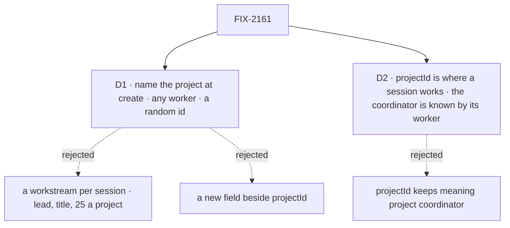

# FIX-2161 · Decisions

[Spec](SPEC.md) · **Decisions**

The epic's [D3](../../epics/FIX-2152/DECISIONS.md#d3) chose the lab session's shape: an ordinary
session of one worker. Two calls are left: how that session gets its project, and what the field
it carries means for the rest of the package.

## The tree

Solid edges are what you're signing. Dashed edges lost, and the label says why.

## D1 · A session opens on a project by naming it at create, not through a workstream per session

| | |
|---|---|
| **Instead of** | Opening a workstream for each lab session (`openWorkstream`, which already gives a roster worker's session a project through `workstreamId`), or a new session field beside `projectId` |
| **Because** | A workstream is a piece of project work, not a chat. It needs a title and a lead that lists delegates (BR-42); only members open one; every member sees it on the project's list; and each is a delegate record on its owner's project coordinator, which holds at most 25 (`MAX_DELEGATES`), so the 26th *New session* in a project is refused `too-many-workstreams`. Epic D3 already rejected a workstream per session. A new field would be a fourth way to say "this session's project", beside `projectId`, `workstreamId` and `filingProjectId`, for a meaning `projectId` already has ([tenet 2](../../../docs/philosophy.md)) |
| **Locks in** | The worker flow's create check accepts `projectId` on a session of any worker, at a caller's id that is not derived, when the creator can read the project: the coordinator's readability check, unchanged. The installation's project coordinator keeps its rule: `projectId` only at its derived id. A derived id naming `projectId` is refused for every other worker, so `ensureWorkerSession({ worker, projectId })` still means *the project coordinator*. `projectId` beside `workstreamId` is refused: a workstream already names its project |

**What would change my mind:** the labs needing what a workstream carries (a lead's goals, a due
date, a place on the project's list). Then a lab session is a workstream, and the cap is the
price.

It comes down to opening many sessions in one project: a workstream per session caps them at 25
and lists each one as project work.

## D2 · `projectId` means the project a session works in; the project coordinator is known by its worker

*An engineering call that changes what a public field means, so it is signed.*

| | |
|---|---|
| **Instead of** | Keeping `projectId` as "this session is a project coordinator", and giving ordinary sessions their project some other way |
| **Because** | Everything that follows a session to its project already reads `projectId` as *where it works*: the hand-over's `filingProjectId`, `runProjectOf`, `projectOfWrite`, the message route to the coordinator, the error reporter. One reader treats it as *I am a project coordinator*: the coordinator flow's delegate seed, which starts any coordinator-flow session on a project with the person's open workstream leads. Workstream writes keep those records current only on the coordinator's derived session, so on any other session the seed would be stale from birth. Narrowing that one reader is smaller than splitting the field ([tenet 3](../../../docs/philosophy.md)) |
| **Locks in** | `workstreamDelegateSeed` seeds only a session of the installation's project coordinator. `PROJECT_STATE_KEY`'s doc and the README say *the project the session works in*. `listWorkerSessions` (FIX-2158) lists an ordinary project session and leaves out the project coordinator's, by worker, not by the field |

**What would change my mind:** a second reader that must tell the two apart and can't by worker.
Then the coordinator gets its own marker.

It comes down to the readers: all but one already read `projectId` as where the session works.

## Decided, not asked

- **Readability, not membership, at create**, as the issue, the directory rule and the
  coordinator's link all say. Runs stay gated by membership at `projectWorkspace()`.
- **A random id only, for every worker but the coordinator.** A derived id would be a
  per-project default conversation for any worker, which nothing asks for.
- **No `open` call on the workforce client.** Opening stays the session client's create with
  `workerId` and `projectId` in its state, as FIX-2158 decided for sessions without a project.
- **`projectId` and `workstreamId` together are refused.** Today the project branch returns first
  and skips the workstream check; with any worker allowed, that would let a caller name a
  workstream unchecked.
- **The convergence point is the create check.** Every session that carries `projectId` is born
  through `installation.session()`'s `createCheck`: the session client's create, `ensureWorkerSession`,
  and a message's delivery to the coordinator's derived session. The one other writer, the error
  reporter's `withTrackerProject`, sets it on an in-memory view of a run's context and creates no
  session. Dispatch-opened task sessions carry `filingProjectId`, never `projectId`.
- **`readProject` and `projectOfWrite` stay keyed on the field**: right for any project session.
- **The list rule change lands in this issue's PR** if FIX-2158 merges first, and in FIX-2158's if
  it doesn't. Reported to the epic thread.

## Considered and dropped

| Alternative | Why not |
|---|---|
| A workstream per lab session | D1: a lead, a title, members only, listed as project work, 25 per project |
| A new field (`workProjectId`) for ordinary sessions | A fourth project field; every reader above would read two |
| An allow-list of workers in the installation | The next app asks for its own entry; the check is the same for every worker anyway |
| The lab keeps its own project and passes it on each task as `input.project` | Glue in the lab (epic ER-4), and the session's own run would have no project |

## Open / Settled

**Open: none.**

**Settled, from reading `main`:** a task filed from a session with `projectId` already carries
`filingProjectId` (`board.ts`, both hand-overs, through `filingProjectOf`), and `runProjectOf`
answers a session's own `projectId` on its path 2. No POC: the change is a branch of one check
and one gate, and the goal check runs the real path.

## How it got here

- **Draft** — the create check's coordinator-only branch is the only thing between an ordinary
  session and a project; open it to any worker at a random id, keep the coordinator's derived rule,
  gate the coordinator flow's workstream seed on the coordinator, and keep FIX-2158's list showing
  project sessions. Workstreams checked and not reused (D1).

## Notes from review

None yet.
