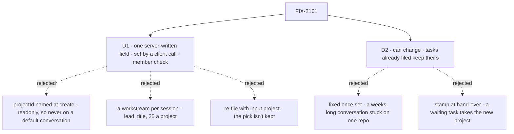

# FIX-2161 · Decisions

[Spec](SPEC.md) · **Decisions**

The epic's [D3](../../epics/FIX-2152/DECISIONS.md#d3) chose the lab session's shape: an ordinary
session of one worker. Its ER-8 (#3803) says a session or a worker's default conversation holds a
project, set from the screen and stored on the server. Two calls are left: where that project
lives, and whether it can change.

## The tree

Solid edges are what you're signing. Dashed edges lost, and the label says why.

## D1 · A person's conversation gets its project through one server-written field, set by a client call

| | |
|---|---|
| **Instead of** | Letting any worker name `projectId` at create, as the project coordinator does; or opening a workstream for each lab session (`openWorkstream`, which already gives a roster worker's session a project) |
| **Because** | `projectId` is readonly: the engine keeps it as the session was created (`refuseReadonlyStateChange`), so a Grok Bot-style worker's default conversation, created before any pick, could never get one. Loosening it would also give new sessions one way and default conversations another, and make every reader of `projectId` tell a coordinator from a chat (its coordinator flow seeds workstream delegates on it). A workstream is project work, not a chat: it needs a title and a lead that lists delegates (BR-42), every member sees it, and each one is a delegate record on its owner's coordinator, which holds 25, so the 26th *New session* would be refused. One field covers both lab kinds with one writer ([tenet 2](../../../docs/philosophy.md)) |
| **Locks in** | A session field, `workProjectId` (`<visibility>/<id>`), `serverOwned` so no create can seed it, written only by one workforce action every worker flow declares, beside the standing-rules action. The client's `setWorkProject(worker, project, { sessionId? })` runs it in the person's default conversation with the worker, or in one of their other conversations with it. The action admits the session's own user, on a session carrying `workerId` and no other link (not the project coordinator's, a task session, a delegate session or a workstream lead's), for a project they may work in: a member of a shared one, the owner of a private one, the predicate `runProjectOf` refuses runs on. `filingProjectOf` reads it after `projectId` and before `filingProjectId` |

**What would change my mind:** no conversation needing a project after it starts. Then naming
`projectId` at create is the smaller change, and the field goes.

It comes down to the default conversation: it exists before any pick, and `projectId` can't be
added later.

## D2 · The project can be changed later; tasks already filed keep theirs

*A product call: the issue said "keeps that project for its life", and a default conversation has
no life's end.*

| | |
|---|---|
| **Instead of** | Fixing the project once it is set, as Claude Code fixes a session's directory |
| **Because** | A Grok Bot-style worker has one conversation for weeks and no *new session*, so a fixed project would pin it to one repo for good. A change is safe where it lands: a task's project is stamped on its row when it is filed, the hand-over copies that stamp (`filingProjectId`, readonly on the task session), and a run reads it when it starts, so nothing filed moves, even a task still waiting for a delegate. The Claude Code-style lab simply doesn't offer the change |
| **Locks in** | `setWorkProject` sets or replaces. It doesn't clear: a conversation that had a project keeps one. The board stamps the filer's project on each row at filing (in a delegate's ongoing session, the held task's stamp), and the hand-over and a held row's run read that stamp, not the conversation's project now |

**What would change my mind:** people losing track of which repo a long conversation is in. Then
the conversation records each change as a line the person sees.

It comes down to the one long conversation: fixed once, it is pinned to one repo for good.

## Decided, not asked

- **Membership, not readability**, as the directory rule now says. A reader who isn't a member
  would store a project whose every run is refused `not-a-member`.
- **The convergence point is the action.** `serverOwned` refuses the field in any caller's create
  state (the create route, an action's seed, `fsdev run`). Flow code could set it in a dispatch's
  child state, and none does: the hand-over copies the filer's project as `filingProjectId`.
  Each set is checked when it's made; `projectWorkspace()` checks membership again at each run, so
  a person removed from the project later can't run there.
- **Only the person's own conversations.** A task session, a delegate session and a workstream
  lead take their project from where they were filed or opened; a second source there would let a
  task leave its filer's project, which `projectWorkspace()` refuses (`other-project`). The project
  coordinator keeps its derived link.
- **No create-time option.** New session is two calls, create then set, so there is one writer. The
  lab asks for the project before the composer opens, so no turn runs between them.
- **The precedence** is the coordinator's `projectId`, then `workProjectId`, then `filingProjectId`.
  The action's refusals keep any two from meeting on one session.
- **Messages to the project coordinator** follow `filingProjectAddressOf`, as they do from a task
  session: from a conversation set to apollo, they reach apollo's coordinator conversation.
- **Names beyond `workProjectId` and `setWorkProject`** are the implementer's.

## Considered and dropped

| Alternative | Why not |
|---|---|
| `projectId` named at create on any worker (this spec's first draft) | D1: never reaches a default conversation, and it overloads the coordinator's link |
| A workstream per lab session | D1: a lead, a title, members only, listed as project work, 25 per project |
| The project on the worker's row | Standard workers are shared by every user; the field must be per user per conversation |
| The lab keeps the project and passes it as each task's `input.project` | Lab state as config, which ER-8 forbids, and the conversation's own runs would have none |
| The default conversation's project carried only by re-filing the task with `input.project` (an existing path) | The pick isn't kept on the server: the next task, or the conversation's own run, forgets it, which is FIX-2154's `pick-not-kept` control. `input.project` stays as the fallback it is today |
| The hand-over stamping the conversation's project as it is at hand-over (today's code) | A task filed under apollo and assigned after a change to beta would run in beta, against D2 |

## Open / Settled

**Open: none.**

**Settled, from reading `main`:** a session's readonly field can't be added after create
(`refuseReadonlyStateChange` compares against the created state, `engine/src/context/session-birth.ts`);
session state changes only through flow code, since the state route is read-only; and
`filingProjectOf` feeds both the board's hand-over and `runProjectOf`, so one reader change reaches
every run. No POC: the goal check runs the real path.

## How it got here

- **Draft** — opened the create check's coordinator-only branch so any worker could name
  `projectId` at create, gated the coordinator flow's workstream seed, and kept FIX-2158's list
  showing project sessions.
- **Re-draft, epic amendment** — the epic's ER-8 (#3803) widened the issue to a worker's default
  conversation, set from the screen. `projectId` is readonly, so a default conversation could never
  get one; the approach moved to one server-written field set by a client call, which leaves
  `projectId`, the seed and FIX-2158's list untouched. Membership replaced readability, per the
  updated directory rule.
- **Review, filed tasks** — Codex found that a task filed under one project but handed over after
  a change would take the new one, and that a task routed to a delegate's ongoing session carries no
  project at all. Both close with one stamp on the row at filing, read by the hand-over and by
  `runProjectOf`'s held-row step; `waiting` and `ongoing` joined the goal check.
- **Review, nested filing** — Codex found that a piece an ongoing delegate files while holding a
  routed task would get no stamp, since that session has no project field. The stamp at filing now
  falls back to the held row's stamp, so the project travels every hop; `ongoing` checks one hop down.

## Notes from review

- Wording nits from the first draft (Cursor) were on text the re-draft replaced. The "path 2" label
  in the run diagram is gone; the diagram now names each route.
- The sign-off repeats each decision's one line by design: it is what the reader signs, and the
  reasoning stays here.
