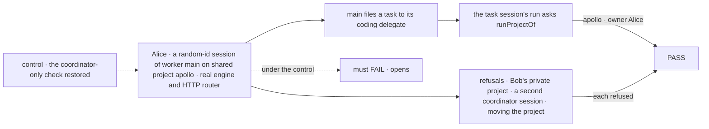
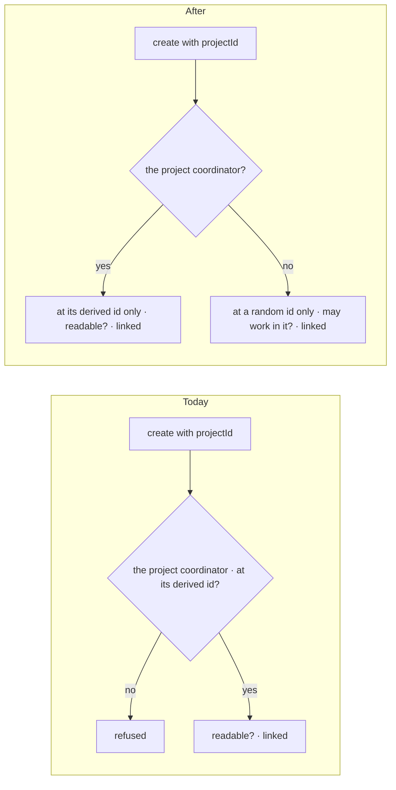
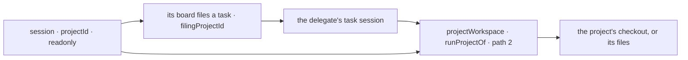

# FIX-2161 · An ordinary session of any worker can open on a project

**Spec** · [Decisions](DECISIONS.md)

## Five people, before and after

| Someone who… | Today | After |
|---|---|---|
| **opens a new session in the Claude Code-style lab and picks a project** | Can't: the create check refuses `projectId` on any worker but the project coordinator, so the lab would have to fall back to its own checkout | Gets a new session of the main worker that names the project for its life. Its coding tasks run in that project's checkout |
| **asks that session for a code change** | n/a | The task the session files carries `filingProjectId`, so the coding worker runs in the same project, through `projectWorkspace()` as today |
| **picks a project they can't work in** | n/a | Another user's private project or another org's is refused "not found". A shared project they read but aren't a member of is refused `not-a-member` at create, not at their first coding run |
| **opens the threads-mode main worker (a coordinator) on a project where they lead workstreams** | n/a | Gets an empty delegate list from the worker's own file. Their workstreams stay on their project coordinator, not on this session |
| **talks to their project coordinator** | One session per project, at its derived id | The same |

## The goal, and how we'll know it's met

**A person opens any number of ordinary sessions of any worker on a project they may work in (a member of a shared one, the owner of a private one); each
keeps that project for its life, its own runs and the tasks it files work in that project, and
nothing else about the session changes: no workstream, no coordinator behaviour, and the project
coordinator stays one per user per project.**

| Is it the right goal? | |
|---|---|
| **The real need** | "A session works in a project you pick when you create it … Delegates and threads inherit it" (the epic's session directory rule, FIX-2153 D3 in #3788), and "an ordinary session of any worker must be able to open on a project the person may work in … reading it is not enough" (its gap line, which filed this issue). It unblocks FIX-2153's and FIX-2157's wiring, and nothing in the lab may stand in for it (epic [D1](../../epics/FIX-2152/DECISIONS.md#d1)) |
| **Smaller, and rejected** | "Only the lab's main worker may carry a project": an allow-list in the installation that every next app adds to |
| **Bigger, and not this issue's** | A raw folder outside any project · moving a session to another project · a per-project default conversation for every worker · messages to a non-default session (FIX-2160) |
| **Not done if** | A session opens on a project its runs would be refused in · the session can be moved to another project · another user's private project or another org's shared one is found · a second project coordinator session for the same project can be created · a coordinator-flow session on a project starts with the person's workstream leads as delegates · the lab's session list (FIX-2158) drops the session |



The check reads the create's answer and the run's project answer, never a stored key.

| How we verify | |
|---|---|
| **Goal check** | Model-free, so no `goals/` script: a `packages/workforce` CI test on the real engine and HTTP router, nothing mocked. Verdict in the implementation PR |
| **Signal** | `opens`: Alice creates two sessions of `main` on `shared/apollo` at random ids; both are created and carry it. `files-there`: a task the first session files reaches its delegate's task session with `filingProjectId` `shared/apollo`, and `runProjectOf` there answers apollo with owner Alice; the session's own run answers the same. `not-found`: a create naming Bob's private project, or another org's shared one, is refused 404. `not-a-member`: Carol, who reads apollo but isn't a member, is refused at create. `stays`: a later write of `projectId` on the session is refused. `one-coordinator`: a project coordinator create with `projectId` at a random id is refused; `ensureWorkerSession({ worker: coordinator, projectId })` still returns the one derived session. `no-derived`: a create of `main` at the id derived for `{ worker: main, projectId }` is refused. `no-seed`: Alice has an open workstream in apollo; a coordinator-flow session of a hired worker on apollo lists only its file's delegates |
| **Input** | Shared apollo with Alice a member and Carol not, Bob's private project, one open workstream of Alice's |
| **Anti-game** | Assert on the server's create answer and `runProjectOf`'s answer, never on state written by hand |
| **Control that must fail** | The coordinator-only branch restored fails `opens`. The coordinator's readability check used for ordinary sessions fails `not-a-member`. The seed ungated fails `no-seed`. The PR shows all three FAILs before the PASS |

## What changes



One branch of the create check opens, and one coordinator-flow read narrows.

```diff
  // the lab's New session, after the person picks a project
  await sessions.createSession({
    flowKind: "lab-main",
    userId,
    state: {
      workerId: "main",
+     projectId: "shared/apollo", // refused today: "Only a session of the project coordinator links to a project"
    },
  })
```

**Docs:** update `packages/workforce/README.md` (the `projectId` paragraph under *The project
coordinator*, and `linkedProjectOf`'s row); extend `apps/docs/docs/workforce/projects.md` with a
short section after *Talking to a project*, *Working in a project from any session*, and add the
case to the list under *Coding work in a project* ("the project the task came from"). No new page.

## How a session's project reaches its runs



All of this is on `main` today (`filingProjectOf`, the board's hand-over, `runProjectOf`). Only
the create check stands in front of it.

## What stays as it is

- **The project coordinator**: one session per user per project, at its derived id. Workstream
  records still reach only that session.
- **The project coordinator's readability check**, and `projectWorkspace()`'s membership gate. An
  ordinary session's create asks the same question the gate asks, so it can't open where its runs
  would be refused.
- **`projectId` is readonly.** The engine already refuses a write that changes it.
- **Workstreams, `filingProjectId`, `projectWorkspace()`.** Unchanged.
- **Messages.** A message to the project coordinator from a project session reaches that
  project's coordinator conversation, as one from a task session filed in it already does.
- **Core and engine.** Unchanged.

## What's already here, and the debt

| Already here | What this does with it |
|---|---|
| `projectLinkCheck` (`workers/installation.ts`), the closest entry. This is the **same way** to link a session to a project, open to any worker. Searches of `packages/*/src` for `PROJECT_STATE_KEY`, `linkedProjectOf`, `filingProjectOf` and `openWorkstream` found two others: a workstream lead's `workstreamId` and a task session's `filingProjectId`. Neither is a session a person opens freely | **Extended**, with the run's membership predicate for non-coordinators |
| Workstreams (FIX-1883; `openWorkstream` in `projects/workstream-writes.ts`): a roster worker's session in a project | **Not used** ([D1](DECISIONS.md#d1)). A workstream is a piece of project work with a lead, and its owner's coordinator holds at most 25 of them |
| `workstreamDelegateSeed` (`projects/project-coordinator.ts`), run by every coordinator-flow session that carries `projectId` | **Narrowed** ([D2](DECISIONS.md#d2)) to the installation's project coordinator |
| `listWorkerSessions` (FIX-2158, #3796, in review): drops every session carrying a criteria key but `workerId` | **Amended** at implementation: an ordinary project session is listed; the project coordinator's project sessions stay out |
| Epic FIX-2152 [D3](../../epics/FIX-2152/DECISIONS.md#d3) (a lab session is an ordinary session of one worker; no workstream per session) and the session directory rule | **Built on** |
| `PROJECT_STATE_KEY`'s doc (`workers/keys.ts`): "only on a session of the standard coordinator" | **Amended**: the project the session works in |

| The debt | |
|---|---|
| **Adds** | No surface. One rule to keep straight: `projectId` alone doesn't make a project coordinator. Permanent by design ([D2](DECISIONS.md#d2)) |
| **Removes** | The coordinator-only refusal |
| **Leaves** | `projectOfWrite` and `readProject` key on `projectId` alone, which is right for any project session |

**Net: flat.** One refusal goes, one read narrows, and no field, key or call is added.

## Sign off

**[The goal](#the-goal-and-how-well-know-its-met), at that size:** any worker, any number of
sessions, a project they may work in, kept for life, its tasks run there, and the coordinator unchanged.
If wrong: FIX-2153 and FIX-2157 can't pick a directory and their wiring stays blocked.

**[The debt](#whats-already-here-and-the-debt): flat.** Removes a refusal, narrows one read, adds
no surface. If wrong: a later reader takes `projectId` alone to mean *project coordinator*.

1. **[D1](DECISIONS.md#d1) · A session opens on a project by naming it at create, not through a
   workstream per session.** If wrong: lab sessions skip the project's lead, goals and listing,
   which a workstream would have given them.
2. **[D2](DECISIONS.md#d2) · `projectId` means the project a session works in; the project
   coordinator is known by its worker, not by the field.** If wrong: a coordinator-flow session
   on a project misses the workstream delegates it should have had.

**Open: none.** D1 is the one to weigh. Reasoning and what lost: [DECISIONS.md](DECISIONS.md).

Feature · `workforce` (create check, coordinator seed, client list rule) + docs · small (3 source files, 1 test file, 2 doc surfaces) · 1 PR · epic FIX-2152
