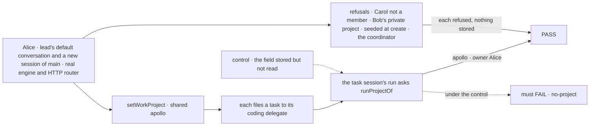
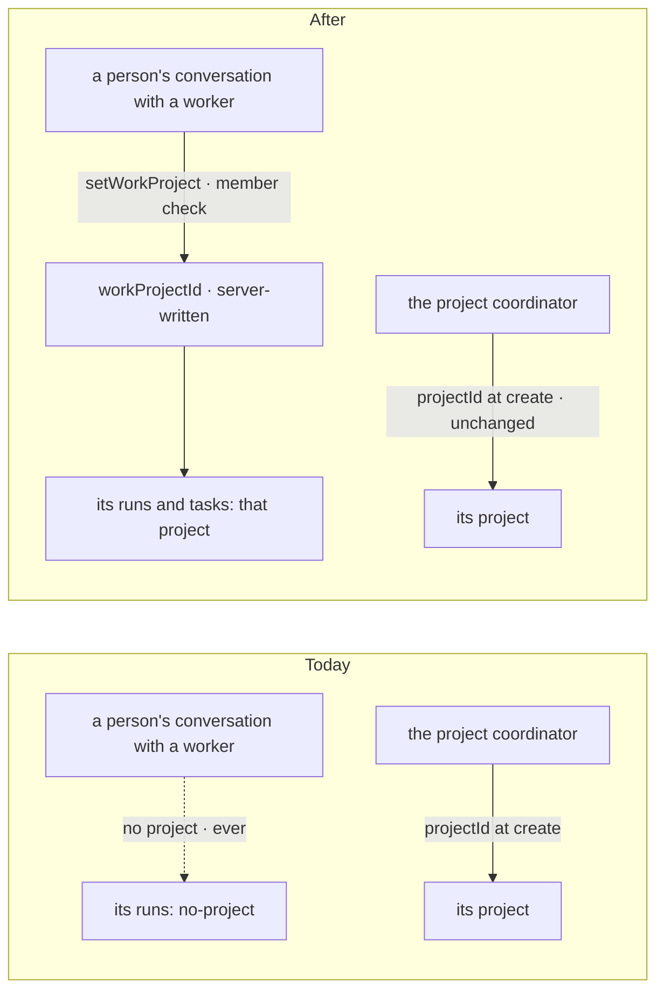
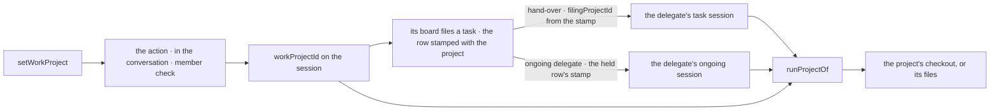

# FIX-2161 · An ordinary session of any worker can open on a project

**Spec** · [Decisions](DECISIONS.md)

## Five people, before and after

| Someone who… | Today | After |
|---|---|---|
| **opens a new session in the Claude Code-style lab and picks a project** | Can't: only the project coordinator's session can carry a project, so the lab would fall back to its own checkout | The screen creates the session and sets its project with one client call. Its coding tasks run in that project's checkout |
| **talks to a Grok Bot-style worker and hits the first job that needs files** | The worker's one conversation can never carry a project: it exists before any pick, and a session's project is fixed at create | Picks a project on the screen. The same call stores it on that worker's conversation, and the job filed again runs there |
| **asks either one for a code change** | n/a | The board stamps the conversation's project on the task row when it is filed, and the coding worker runs there through `projectWorkspace()`: in a task session (`filingProjectId`, from the stamp) or in a delegate's ongoing session (from the row it holds) |
| **picks a project they can't work in** | n/a | Is refused, and nothing is stored. Another user's private project or another org's is "not found"; a shared one they read but aren't a member of is `not-a-member` |
| **moves a long conversation to another repo** | n/a | Sets a different project. New tasks run there; tasks already filed keep the one they were filed in, even one still waiting on the board for a delegate |

The project coordinator doesn't change: one session per user per project, linked at create.

## The goal, and how we'll know it's met

**A person sets the project any of their conversations with a worker works in (a new session, or
the worker's one default conversation, at any time), from the screen, stored on the server and
checked against their membership; the runs and tasks of that conversation then work in that
project, and nothing else about the conversation or the project coordinator changes.**

| Is it the right goal? | |
|---|---|
| **The real need** | "An ordinary session of any worker must be able to open on a project the person may work in … reading it is not enough" (the session directory rule's gap line, which filed this issue), widened by the epic's ER-8 (#3803): "or a worker's default conversation … set from the screen and stored on the server, never read from lab config". FIX-2153, FIX-2157 and FIX-2154's step 5 wire to it, and no lab may stand in for it (epic [D1](../../epics/FIX-2152/DECISIONS.md#d1)) |
| **Smaller, and rejected** | "Let `projectId` be named at create on any worker." It covers a new session but never the default conversation, which exists before any pick, and the engine keeps a readonly field as it was created ([D1](DECISIONS.md#d1)) |
| **Bigger, and not this issue's** | A raw folder outside any project · moving a run already started · messages to a non-default session (FIX-2160) |
| **Not done if** | The project comes from anything but a stored, server-written field · a non-member can store one · a caller can seed it at create · a task the conversation files runs anywhere but its project · a task already filed moves when the project changes · the project coordinator's link, its messages or its workstream records change |



The check reads the call's answer and the run's project answer, never a stored key.

| How we verify | |
|---|---|
| **Goal check** | Model-free, so no `goals/` script: a `packages/workforce` CI test on the real engine and HTTP router, nothing mocked. Verdict in the implementation PR |
| **Signal** | `default`: Alice ensures `lead`'s conversation, talks once, then sets it to `shared/apollo` through the client; a task it files reaches the delegate's task session with `filingProjectId` apollo, and `runProjectOf` there answers apollo with owner Alice. `new-session`: a session of `main` created at a random id and set the same way answers the same. `change`: lead is set to `shared/beta`; the earlier task still answers apollo, a new one beta. `waiting`: a task filed under apollo with no assignee, assigned only after the change to beta, still answers apollo. `ongoing`: a task routed to a delegate whose session is ongoing (no task session) answers apollo from the row it holds, not `no-project`; a coding piece that delegate files while holding it answers apollo too, one hop further down. `not-a-member`: Carol, who reads apollo, is refused and stores nothing; Bob's private project is not found. `not-seeded`: a create that seeds the field is refused 400. `not-these`: setting it on the project coordinator's session, a task session or a workstream lead's session is refused. `messages`: a message to `lead` still lands in its default conversation |
| **Input** | Shared apollo and beta with Alice a member and Carol not, Bob's private project, a workstream of Alice's |
| **Anti-game** | Assert on the client's answer and `runProjectOf`'s answer, never on state written by hand |
| **Control that must fail** | The field stored but not read by `filingProjectOf` fails `default` (`no-project`). The hand-over reading the conversation's current project instead of the row's stamp fails `waiting` (beta). The membership check removed fails `not-a-member`. The PR shows each FAIL before the PASS |

## What changes



One new session field, written only by one workforce action, and read where a session's project
is already read; and one server-written stamp on each task row, so a task keeps the project it was
filed in.

```diff
  const workforce = createWorkforceClient({ userId, baseUrl, fetcher })

  // Grok Bot-style: the worker's one conversation, at the first job that needs files
+ await workforce.setWorkProject("lead", { visibility: "shared", id: "apollo" })

  // Claude Code-style: New session, after the person picks a project
  const session = await sessions.createSession({ flowKind: "lab-main", userId, state: { workerId: "main" } })
+ await workforce.setWorkProject("main", { visibility: "shared", id: "apollo" }, { sessionId: session.id })
```

**Docs:** update `packages/workforce/README.md` (the client table and its paragraph, and the
session fields); extend `apps/docs/docs/workforce/projects.md` → *Coding work in a project* with
the conversation's own project as the second place `projectWorkspace` looks, and a short
*Setting the project a conversation works in* under it. No new page.

## How a conversation's project reaches its runs



`filingProjectOf` already gives a session's project to its board and its runs (`projectId`, else
`filingProjectId`); it reads the new field between the two. Two smaller changes make a filed task
keep its project. The board stamps the filer's project on the row when the task is filed (`filingProjectOf`, or,
in a delegate's ongoing session, the stamp on the task it holds, so a piece filed there carries it
on), a server-written marker beside `filedAtHop` that `callerMetadata` strips from a caller's metadata, and
the hand-over copies `filingProjectId` from that stamp rather than from the conversation as it is
at hand-over. A task can wait on the board, unassigned or held, past a change. And `runProjectOf`'s
third step, the held row, reads the stamp before `input.project`, so a task routed to a delegate's
ongoing session (which carries no `filingProjectId`) runs in the project too. Its refusals stay as
they are.

## What stays as it is

- **The project coordinator's link**: `projectId`, readonly, named at create, one session per user
  per project at its derived id. Its seed, its messages and workstream records don't change.
- **Where messages land.** A message to a worker still lands in its default conversation.
- **`projectWorkspace()`'s membership gate**, which still checks every run.
- **Workstreams and `filingProjectId`.** A task session and a workstream lead get their project
  from where they were filed or opened, as today.
- **Core and engine.** The field uses the engine's `serverOwned`, which exists for this.

## What's already here, and the debt

| Already here | What this does with it |
|---|---|
| `projectId` and `projectLinkCheck` (`workers/installation.ts`), the closest entry: a session linked to a project at create. It can't serve: it is readonly (set at create, never changed, `engine/src/context/session-birth.ts`), so a default conversation created before any pick can never get one; and it is the project coordinator's identity | **Kept**, coordinator only ([D1](DECISIONS.md#d1)) |
| Two other ways a session gets a project, from searches of `packages/*/src` for `PROJECT_STATE_KEY`, `filingProjectOf` and `openWorkstream`: a workstream lead's `workstreamId`, and a task session's `filingProjectId`. Neither is set by the person on their own conversation. This is the **fourth way**, and the only one a person sets | **Built beside**, below them in `filingProjectOf`'s order; refused on sessions that carry either |
| `standingRules(worker, input)` on the workforce client: runs one action in the person's conversation with the worker | **Copied in shape** for `setWorkProject` |
| Workstreams (FIX-1883): a roster worker's session in a project | **Not used** ([D1](DECISIONS.md#d1)) |
| `listWorkerSessions` (FIX-2158, #3796, in review): drops sessions carrying a criteria key | **Unaffected**: the new field is not a criteria key |
| `PROJECT_STATE_KEY`'s doc: "only on a session of the standard coordinator" | **Kept**, and now true by design |

| The debt | |
|---|---|
| **Adds** | One session field (`workProjectId`), one action every worker flow declares, one client call, and one row stamp the hand-over and the run read. Permanent by design: it is the package's answer to where a person's conversation works |
| **Removes** | Nothing |
| **Leaves** | The error reporter attributes a failure to a session's `projectId` only, so a lab session's failure carries no project. Not needed by any script; noted for its owner |

**Net: up, by one field, one action, one call and one row stamp.** Each lab would otherwise keep the project in
its own state, which ER-8 forbids.

## Sign off

**[The goal](#the-goal-and-how-well-know-its-met), at that size:** any of a person's conversations
with a worker, the default one included, set from the screen, checked, and its tasks run there.
If wrong: FIX-2153, FIX-2157 and FIX-2154's step 5 can't pick a directory.

**[The debt](#whats-already-here-and-the-debt): up, by one field, one action, one call and one row stamp.**
Removes nothing. If wrong: a fourth project field a later reader has to learn.

1. **[D1](DECISIONS.md#d1) · A person's conversation gets its project through one server-written
   field set by a client call, not by naming `projectId` at create.** If wrong: two ways for an
   ordinary session to get a project, or a default conversation that never gets one.
2. **[D2](DECISIONS.md#d2) · The project can be changed later; tasks already filed keep theirs.**
   If wrong: a Claude Code-style session's directory can move, which that app never does.

**Open: none.** D1 is the one to weigh. Reasoning and what lost: [DECISIONS.md](DECISIONS.md).

Feature · `workforce` (one session field, one action, one client call, one reader, one row stamp) + docs · small (6 source files, 1 test file, 2 doc surfaces) · 1 PR · epic FIX-2152
