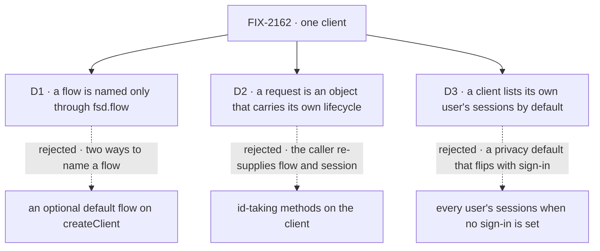

# FIX-2162 · Decisions

[Spec](SPEC.md) · **Decisions**

The owner set the frame: one client replaces the five factories, no compatibility wrappers, every
caller moves in the same change, and the same client also runs embedded, with no web server.
Three calls shape what that client is.

## The tree



Solid edges are what you're signing. Dashed edges lost, and the label says why.

<a name="d1"></a>
## D1 · A flow is named only through `fsd.flow(kind)`; the client has no default flow

| | |
|---|---|
| **Instead of** | An optional default `flowKind` on `createClient`, with `fsd.flow(kind)` for other flows |
| **Because** | Two ways to name a flow is the incoherence this issue removes, back on day one (tenet 3). The repo's three placeholder flow names (`"flow-navigator"`, `"unknown-flow"`, `"__devtool__"`) exist only because today's client wants a flow before it can list flows; a default invites them back |
| **Locks in** | `client.flow(kind)` is the one public way to send or reach a request, in every app, page and goal. A default can be added later without breaking anyone; removing one would break |


It comes down to how many ways there are to name a flow: a default makes two.

**What would change my mind:** most apps you've seen talk to one flow and never list flows. Then a
default saves a line everywhere.

<a name="d2"></a>
## D2 · A request is an object you get back from a send, by id, or from the interrupted list, and its lifecycle lives on it

| | |
|---|---|
| **Instead of** | Id-taking methods on the client: `fsd.requests.continue({ flowKind, sessionId, requestId })` |
| **Because** | The server addresses a request by flow, and to continue or retry it by session too. A caller holding only an id re-supplies both, and a wrong one is a runtime "Flow mismatch" (`recovery-routes.ts`). The object carries them, so carrying on after a crash is `lost.continue()`. Temporal and LangGraph converged on the same handle |
| **Locks in** | One public request type: `status`, `wait`, `abort`, `continue`, `retry` (a new request), `resume` (answers a suspension), `stream`. From `send`, `flow(kind).request(id)` and `fsd.requests.interrupted()`. Three server changes so an object found by id can act: a read of the user's interrupted requests; the session id on the status read, with the tenant check that read lacks; the instance id on the interrupted list |


It comes down to the crash path: id-taking methods make every caller carry the flow and session.

**What would change my mind:** callers that hold requests from many flows without knowing which.
Then a lookup by id alone wins, and it needs a new server route.

<a name="d3"></a>
## D3 · A client lists its own user's sessions unless it asks for another

| | |
|---|---|
| **Instead of** | Today's default: no user filter, which on a server without sign-in returns every user's sessions |
| **Because** | The client is built for one user, so its list is theirs. Every caller in the repo already passes the user it acts as. With sign-in on, the server narrows any list to the signed-in user (`session-routes.ts`); this makes a server without sign-in show the same, so turning sign-in on changes nothing a person sees |
| **Locks in** | A privacy default on every list. A `userId` filter can still name another user; with sign-in on, the server narrows it to the signed-in user without an error (the workforce-privacy goal relies on that). Every user's sessions is no longer a client call |


It comes down to an app before sign-in: today it shows everyone's sessions, then changes when sign-in lands.

**What would change my mind:** an operator view you've promised that lists every user's sessions
through the client.

## Decided, not asked

- **Transport and user, once:** `createClient({ userId, baseUrl?, apiPath?, fetcher? })`, no module
  global. Another user or server is another client. `baseUrl` is required without a fetcher; with
  one it defaults to a fixed internal origin, which `createInProcessFetch` ignores (it reads only
  the path), so no embedded caller or doc writes a made-up URL. `userId` stays required, caller-supplied and
  untrusted (BP-031); there is no per-call override. Making it optional is FIX-1503's.
- **The in-process transport is the owner's call.** One engine export, `createInProcessFetch(app,
  { basePath? })`, returns a `ClientFetch` that the client takes as its `fetcher`. The client
  stays engine-free (package boundaries), so there is no `createClient({ flowState })` overload.
  This fixes the public name `createInProcessFetch` in `@flow-state-dev/engine`.
- **One dispatch path, owned by the engine.** `createInProcessFetch` is the function that turns a
  Request into a router call: it waits for store init (500 if init failed), picks the router
  method (405 for any other), takes the path from the URL with `decodePathSegments` under
  `basePath`, and calls the router. That is exactly what `node`'s `createServerApp` dispatch does
  today (`packages/node/src/app.ts`, its `dispatch` and `pathSegments`), so `node` delegates to it
  and stops deriving paths itself; it takes a `FlowState` or a router, as `createServerApp` does.
  `node` keeps what is a host's: the Hono mount at `basePath`, `/healthz`, the dedicated-route
  fallback, JSON errors, `dispose` and `serve`'s static files. Engine, not `node`: the engine runs
  everywhere, Next included, and `node` carries Hono. The census flags code outside the engine
  that derives router paths, so a second path can't come back.
- **In-process identity is HTTP identity.** The router sees `source: "http"`; credentials ride
  request headers as over the network. No "trust in-process" header or shortcut: a resolver that
  trusts loopback can't tell. A caller that needs the `cli` principal uses
  `resolveInProcessPrincipal`, outside this issue.
- **Every call and stream goes through the client's fetcher.** React's `useRequestStream` and
  `useSession` take it from the client; today they call `createSSEClient` without it and fall back
  to the network fetch.
- **One client is one transport.** Every call and stream goes through one route builder and one
  transport per `createClient`; every failure is a `ClientHttpError`. How the client's code splits
  across files is the implementer's. Two checks hold it, each for what it can see: the goal's
  one-transport unit test (an instrumented fetcher sees every namespace on one closure) for
  structure, and the census for names: no second `create*Client`, exported or internal, no removed
  method, and no module outside the client building router Requests by hand. The census can't see
  a facade built from neutrally named helpers, and its control proves that limit. The two
  removals without a name to search, the three copies of a required-id check and plain `Error`
  failures, are the client's unit tests'. Each `*Stream`
  twin becomes an option on its call. One topic encoding for resource paths (the implementer
  picks; today's two disagree).
- **Namespaces follow route addressing.** The root is user-level: flows, capabilities, sessions,
  resources, interrupted requests. `flow(addr)` holds a flow's actions and `request(id)`. The
  request object holds its lifecycle ([D2](#d2)). A stream sits on the thing it streams. For
  example:

  ```
  fsd                 .sessions · .resources · .requests.interrupted() · .flows() · .stream()
  fsd.flow("support") .send() · .createSession() · .request(id)
  request             .status() · .continue() · .resume() · .stream() …
  ```

  The full method set is the implementer's, derived from the route map and from
  `createLabClients` in `packages/shift-manager/src/lib/connection.ts`, the closest thing already
  here. `sessions.list` keeps every filter `listSessions` takes today (`flowKind`, `flowId`,
  `userId`, `include`, `state`, `limit`, `offset`), all applied at the server (BP-033); workforce's
  `findWorkerSession`, FIX-2158's `listWorkerSessions` and Shift Manager's `reads.ts` depend on
  them.
- **`flow(...)` takes an instance address:** the kind of a singleton flow, the instance id of a
  collection flow, as every route does. The docs say so, or `flow("kind").request(id)` 404s on a
  collection flow.
- **Typed actions are a type parameter** on `flow()`, checking `send`'s action name and input. No
  runtime definition, so the collection refusal goes.
- **Recovery reads, then acts.** `request(id)` is the first path: a caller that saved the id needs
  nothing else, and the session is read lazily from the status read, only for `continue` or
  `retry`. `fsd.requests.interrupted({ staleThresholdMs? })` pokes `check-interrupted`, then reads
  the user's interrupted requests; the read is the answer, so a request a sweep already marked is
  still listed. A request with no session rejects `continue()` and `retry()` with a client error
  before any call.
- **The server changes, kept to three.** (a) A read of one user's interrupted requests, with the
  owner and tenant checks `check-interrupted` applies, and the same per-entry admission
  `/active-requests` uses (tenant first, then the instance's own resolver or the host rule). It is
  a second listing because the data is: see *Considered and dropped*. (b) `sessionId` on the request status
  response, plus the `callerReachesRequest` check that the abort and recovery routes already make.
  (c) `flowId` on the interrupted listing, which `request()` reads, falling back to `flowKind` for
  rows written before it (BP-030). `/active-requests` is untouched: it gets no client method, so
  nothing would read a field added there.
- **`createSSEClient({ url })` leaves the exports:** every caller hand-built a request URL for it.
- **React components take `client`**, typed as the slice they read; the `sessionClient` and
  `resourceClient` props go, in `packages/ui` stories too.
- **D3 changes `FlowNavigator`:** with no `userId` it lists every user's sessions today, and only
  the client's user's after. The `react` changeset says so.
- **`createWorkforceClient(fsd)`**, amending FIX-1788.
- **Open PRs this meets.** FIX-2158 ([#3796](https://github.com/fixpoint-labs/flow-state-dev/pull/3796))
  edits `createWorkforceClient`: whichever lands second moves the other. Its `listWorkerSessions`
  becomes a filter over `fsd`'s own-user session list (the worker flow, top-level sessions, no
  task, delegate or lead runs), not a route call of its own. FIX-2161
  ([#3805](https://github.com/fixpoint-labs/flow-state-dev/pull/3805)) adds `setWorkProject` to
  `createWorkforceClient`, and its examples teach the old shape
  (`createWorkforceClient({ userId, baseUrl, fetcher })` and `sessions.createSession`): the same
  rule, and the new method sits on `createWorkforceClient(fsd)`. FIX-1498 ([#2080](https://github.com/fixpoint-labs/flow-state-dev/pull/2080))
  edits the same docs text in four files: a text rebase. FIX-2063
  ([#3782](https://github.com/fixpoint-labs/flow-state-dev/pull/3782)) makes file-backed hosts
  durable by default; leg a relies on it.
- **No aliases or deprecated names** (owner). Minor changesets with a migration table.
- **Two PRs, server first.** A: the engine and server, all additive (the interrupted read,
  `sessionId` on status with its tenant check, `flowId` on the interrupted listing, `createInProcessFetch` and
  `node` delegating to it); no caller moves. B: the client, every caller and the docs, atomic.
  The no-alias rule holds on `main` once B lands. The detail is the implementer's;
  `issue-multi-pr` can drive it.

## Considered and dropped

| Alternative | Why not |
|---|---|
| A facade over the five factories (simplest: no caller moves) | Two ways to do every job; recovery still takes flow and session per call |
| Flow passed per call (`fsd.send(kind, …)`) | The flow repeats on every call and every request method |
| `actions.<name>(input)` beside `send` | A second way to send (tenet 3). A types-only handle would also need a proxy, which answers any property |
| Keep the typed client taking the definition | Ships server code to the browser; the type parameter checks the same |
| Sessions and resources also under the flow handle | Their routes aren't flow-addressed: two paths to one route |
| `createClient({ flowState })` for the embedded case | The client would depend on the engine, which the package boundaries forbid |
| `/active-requests`, with a status filter, as the interrupted read | It lists the in-flight registry (`stores.activeRequests`: heartbeat, age), not request records. The sweep that marks a record `interrupted` deregisters its entry in the same pass (`request-recovery.ts`), so an interrupted request is never in that list. Carrying D2 there would make one route read two stores with two meanings. The two share the admission rule instead |
| `interrupted()` as the sweep's own answer | Racy: the startup sweep or the 30 s sweeper marks the request first, and that call then returns nothing |

## Settled

- **The counted facts — CONFIRMED** by `poc/caller-census/check.mjs` at `origin/main` e5a27866
  (the commit this branch sits on). Default mode: every one of 6,464 tracked text files is
  classified; 79 files name a factory (53 code, 26 docs); 14 import a factory's type; 32 name a
  route-addressed SSE factory; 52 pass, declare or call a sub-client; 3 take `transcribe`
  standalone; 32 call `createWorkforceClient` with options; 26 name a removed method (the three
  `*Stream` twins, `state.getSnapshot`, `bearerFetcher`); 3 placeholder flow names. Hand-built
  in-process clients: 25 files dispatch on a computed router method with a hand-built path, 19 use
  or teach `httpActions`, 43 in all; one file outside the engine derives router paths
  (`packages/node/src/app.ts`). Twelve raw-router callers are excluded by name, each with its
  reason in the script: the Vercel handler and two deploy-guide host snippets (hosts, not
  clients) and nine engine route-auth tests (router unit tests). About ninety other files, router tests mostly, call
  one route inline; they build no client and are not flagged. In all, 195 files
  change: 159 code (61 tests or stories), 36 docs. `--after` FAILS today with 403 references.
  `--control` plants an unlisted homonym and 20 violations, a named facade, a hand-built router
  helper, `httpActions`, a path derivation and each removed method among them, and names every
  one; history alone passes; its own copy at the goal path passes; and a facade built inside `createClient` from neutrally named helpers
  passes, as stated: the census reads names, and the one-transport test reads structure.
- **The client runs in-process today — CONFIRMED** by a probe: `createFlowState` with in-memory
  stores, the client's `fetcher` set to call the router. `sendAction`, `getRequestStatus`,
  `listSessions`, `getSessionState`, `abortRequest` and a request stream all worked; an abort
  mid-stream ended the body in about 200 ms. The raw router 404s without a path, so the fetch
  must take the path from the URL. React's request streams ignored the fetcher.
- **`node`'s dispatch is the in-process transport — read in code** (`packages/node/src/app.ts`,
  `dispatch` and `pathSegments`): await the router, index it by method or answer 405, derive the
  path from the raw URL under `basePath`, call the handler with the Web `Request`. Nothing in it is
  Hono's beyond the mount, so it moves to the engine whole.
- **`check-interrupted` returns only what that call changed — read in code**
  (`recovery-routes.ts`). The read in D2 is why.
- **Continuing over HTTP after a host SIGKILL, on a file-backed host — not run here.** The
  implementer runs goal leg a first; a failure there is an engine bug to file, not a reason to
  weaken the leg.

## Notes from review

- **cursor** ([#3810 r4365044812](https://github.com/fixpoint-labs/flow-state-dev/pull/3810#discussion_r4365044812)):
  "Worth labeling **(A)** interrupted read + sweep semantics fix vs **(B)** status `sessionId` +
  list `flowId` for id-only `request(id)`. Same end state, but (A) unblocks Pi recovery even if
  handles are minimal closures on `send()` return values first." Sequencing is the implementer's.
- **cursor** ([#3810 r4365044825](https://github.com/fixpoint-labs/flow-state-dev/pull/3810#discussion_r4365044825)):
  "Agree facade is the wrong simplification. For implementers: **`createLabClients` is the
  positive template** — lift to public `createClient` rather than designing a new composition
  story. Flat `sessions`/`resources`/`recovery` fields are isomorphic to nested `fsd.sessions.*`;
  nesting is a discoverability choice, not a transport win."
- **Second look, #2** ([#3810](https://github.com/fixpoint-labs/flow-state-dev/pull/3810#issuecomment-6376729578)): "Keep D3 but make it its own commit (and its own test
  asserting the old leak is closed) so it's bisectable and revertable independently of the client
  reshape."
- **Second look, #5** ([#3810](https://github.com/fixpoint-labs/flow-state-dev/pull/3810#issuecomment-6376729578)): "make it explicit in the spec that the handle caches it (one
  status read per handle, not per call) and that a status read racing a state change (request
  completed between read and `continue`) surfaces as a typed `ClientHttpError`, not a plain Error.
  The "second-path" checklist (BP-035: concurrent-409, cancel-error) isn't mentioned for these
  new methods."
- **Second look, #6** ([#3810](https://github.com/fixpoint-labs/flow-state-dev/pull/3810#issuecomment-6376729578)): "hooks that previously built a client internally from
  `baseUrl`/`userId` need that client memoized (`useMemo`), or a new client per render will
  re-open streams. Worth one line in the spec's React section and a test that a re-render doesn't
  reconnect."
- **Second look, #7b** ([#3810](https://github.com/fixpoint-labs/flow-state-dev/pull/3810#issuecomment-6376729578)): "Consider promoting the `--after` rules to a permanent repo
  check at implementation time; otherwise the "one route builder / one request helper"
  invariant erodes the first time someone adds a stream."
- **Second look, #8a** ([#3810](https://github.com/fixpoint-labs/flow-state-dev/pull/3810#issuecomment-6376729578)): "35 docs files: dispatch `docs-writer` → `docs-editor`
  rather than hand-editing them while holding the spec (per CLAUDE.md), and run `polish-docs` on
  `client/` after."

## How it got here

- **Draft** — the owner's frame, widened before publication to an embedded transport and the
  server changes the client needs; research's scoped handles; the route map placed each
  namespace; validation turned the interrupted list into a read and widened the census.

**Open: none.**
