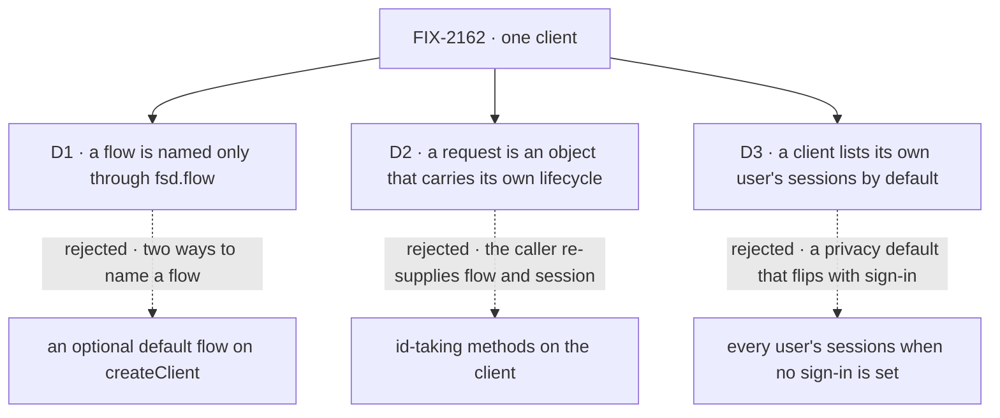

# FIX-2162 · Decisions

[Spec](SPEC.md) · **Decisions**

The owner set the frame: one client replaces the five factories, no compatibility wrappers, every
caller moves in the same change. Three calls shape what that client is.

## The tree

Solid edges are what you're signing. Dashed edges lost, and the label says why.

## D1 · A flow is named only through `fsd.flow(kind)`; the client has no default flow

| | |
|---|---|
| **Instead of** | An optional default `flowKind` on `createClient`, with `fsd.flow(kind)` for other flows |
| **Because** | Two ways to name a flow is the incoherence this issue removes, back on day one (tenet 3). The repo's three placeholder flow names (`"flow-navigator"`, `"unknown-flow"`, `"__devtool__"`) exist only because today's client wants a flow before it can list flows; a default invites them back |
| **Locks in** | `client.flow(kind)` is the one public way to send or reach a request, in every app, page and goal. A default can be added later without breaking anyone; removing one would break |

It comes down to how many ways there are to name a flow: a default makes two.

**What would change my mind:** most apps you've seen talk to one flow and never list flows. Then a
default saves a line everywhere.

## D2 · A request is an object you get back from a send, by id, or from the interrupted list, and its lifecycle lives on it

| | |
|---|---|
| **Instead of** | Id-taking methods on the client: `fsd.requests.continue({ flowKind, sessionId, requestId })` |
| **Because** | The server addresses a request by flow, and to continue it by session too. A caller holding only an id re-supplies both, and a wrong one is a runtime "Flow mismatch" (`recovery-routes.ts`). The object carries them, so carrying on after a crash is `lost.continue()`. Temporal and LangGraph converged on the same handle |
| **Locks in** | One public request type: `status`, `wait`, `abort`, `continue`, `retry` (a new request), `resume` (answers a suspension), `stream`. From `send`, `flow(kind).request(id)` and `fsd.requests.interrupted()`. Two server fields so an object found by id can act: the status read returns the session id, the interrupted list the instance id |

It comes down to the crash path: id-taking methods make every caller carry the flow and session.

**What would change my mind:** callers that hold requests from many flows without knowing which.
Then a lookup by id alone wins, and it needs a new server route.

## D3 · A client lists its own user's sessions unless it asks for another

| | |
|---|---|
| **Instead of** | Today's default: no user filter, which on a server without sign-in returns every user's sessions |
| **Because** | The client is built for one user, so its list is theirs. Every caller in the repo already passes the user it acts as. With sign-in on, the server lists only the signed-in user's either way (`session-routes.ts`); this makes a server without sign-in show the same, so turning sign-in on changes nothing a person sees |
| **Locks in** | A privacy default on every list. A `userId` filter can still ask for another user, and the server decides (the workforce-privacy goal relies on that refusal). Every user's sessions is no longer a client call |

It comes down to an app before sign-in: today it shows everyone's sessions, then changes when sign-in lands.

**What would change my mind:** an operator view you've promised that lists every user's sessions
through the client.

## Decided, not asked

- **Transport and user, once:** `createClient({ userId, baseUrl?, apiPath?, fetcher? })`, no module
  global. Another user or server is another client. `userId` stays required, caller-supplied and
  untrusted (BP-031); making it optional is FIX-1503's.
- **A namespace sits where its route is addressed.** On the client: `sessions` (with `debug`, its
  stream and its requests), `resources`, the user stream, `requests.interrupted()`, the flow list,
  capabilities, `transcribe`. On the flow handle: `send`, `createSession`, `request(id)`. Nothing
  repeats under the handle; `sessions.list({ flowKind })` filters at the server (BP-033).
- **Typed actions are a type parameter** on `flow()`, checking `send`'s action name and input. No
  runtime definition, so the collection refusal goes: the argument is an address, as on every route.
- **The convergence point is one route builder and one request helper**, every call and stream
  through them. Every failure is a `ClientHttpError`. Each `*Stream` twin becomes an option on its
  call. One topic encoding for resource paths (the implementer picks; today's two disagree).
- **`request(id)` reads its session lazily** from the status read, only for `continue` or `retry`.
- **`createSSEClient({ url })` leaves the exports:** every caller hand-built a request URL for it.
- **React components take `client`**, typed as the slice they read; `sessionClient` and
  `resourceClient` props go. Hooks build one client each.
- **`createWorkforceClient(fsd)`**, amending FIX-1788. FIX-2158 (#3796) edits the same function:
  whoever lands second rebases, and its new read goes through `fsd.sessions`.
- **No aliases or deprecated names** (owner). Minor changesets with a migration table.

## Considered and dropped

| Alternative | Why not |
|---|---|
| A facade over the five factories (simplest: no caller moves) | Two ways to do every job; recovery still takes flow and session per call |
| Flow passed per call (`fsd.send(kind, …)`) | The flow repeats on every call and every request method |
| `actions.<name>(input)` through a proxy | A second way to send; a proxy answers any property, `then` included, so awaiting it misbehaves |
| Keep the typed client taking the definition | Ships server code to the browser; the type parameter checks the same |
| Sessions and resources also under the flow handle | Their routes aren't flow-addressed: two paths to one route |

## Settled

- **The counted facts — CONFIRMED** by `poc/caller-census/check.mjs` on `origin/main` e5a27866.
  Every one of 6,461 tracked text files is classified. Outside retained history: 79 files name a
  factory (53 code, 26 docs), 14 import a factory's type, 61 code files change (16 tests), 3
  placeholder flow names. `--after` FAILS today with 168 references. `--control` plants an
  unlisted homonym and four violations; both checks name every plant, and history alone passes.
  The first run's totality check caught 11 goal and comment callers the research table missed, and
  showed `packages/tools`' `_createClient` is an MCP homonym, not a caller.
- **Continuing over HTTP after a host SIGKILL, on a file-backed host — not run here.** The
  implementer runs goal leg a first; a failure there is an engine bug to file, not a reason to
  weaken the leg.

## How it got here

- **Draft** — the owner's frame; research's scoped handles; the route map placed each namespace;
  the census corrected the caller counts.

**Open: none.**
