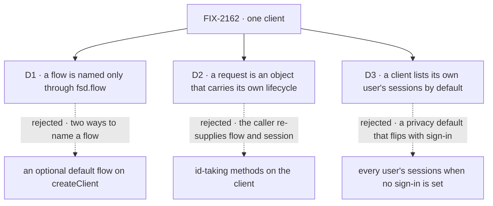

# FIX-2162 · Decisions

[Spec](SPEC.md) · **Decisions**

The owner set the frame: one client replaces the five factories, no compatibility wrappers, every
caller moves in the same change, and the same client also runs embedded, with no web server.
Three calls shape what that client is.

## The tree

Solid edges are what you're signing. Dashed edges lost, and the label says why.

## D1 · A flow is named only through `fsd.flow(kind)`; the client has no default flow

| | |
|---|---|
| **Instead of** | An optional default `flowKind` on `createClient`, with `fsd.flow(kind)` for other flows |
| **Because** | Two ways to name a flow is the incoherence this issue removes, back on day one (tenet 3). The repo's three placeholder flow names (`"flow-navigator"`, `"unknown-flow"`, `"__devtool__"`) exist only because today's client wants a flow before it can list flows; a default invites them back |
| **Locks in** | `client.flow(kind)` is the one public way to send or reach a request, in every app, page and goal. A default can be added later without breaking anyone; removing one would break |

It comes down to how many ways there are to name a flow: a default makes two.

**What would change my mind:** most apps you've seen talk to one flow and never list flows. Then a
default saves a line everywhere.

## D2 · A request is an object you get back from a send, by id, or from the interrupted list, and its lifecycle lives on it

| | |
|---|---|
| **Instead of** | Id-taking methods on the client: `fsd.requests.continue({ flowKind, sessionId, requestId })` |
| **Because** | The server addresses a request by flow, and to continue or retry it by session too. A caller holding only an id re-supplies both, and a wrong one is a runtime "Flow mismatch" (`recovery-routes.ts`). The object carries them, so carrying on after a crash is `lost.continue()`. Temporal and LangGraph converged on the same handle |
| **Locks in** | One public request type: `status`, `wait`, `abort`, `continue`, `retry` (a new request), `resume` (answers a suspension), `stream`. From `send`, `flow(kind).request(id)` and `fsd.requests.interrupted()`. Three server changes so an object found by id can act: a read of the user's interrupted requests; the session id on the status read, with the tenant check that read lacks; the instance id on the interrupted and active-request lists |

It comes down to the crash path: id-taking methods make every caller carry the flow and session.

**What would change my mind:** callers that hold requests from many flows without knowing which.
Then a lookup by id alone wins, and it needs a new server route.

## D3 · A client lists its own user's sessions unless it asks for another

| | |
|---|---|
| **Instead of** | Today's default: no user filter, which on a server without sign-in returns every user's sessions |
| **Because** | The client is built for one user, so its list is theirs. Every caller in the repo already passes the user it acts as. With sign-in on, the server narrows any list to the signed-in user (`session-routes.ts`); this makes a server without sign-in show the same, so turning sign-in on changes nothing a person sees |
| **Locks in** | A privacy default on every list. A `userId` filter can still name another user; with sign-in on, the server narrows it to the signed-in user without an error (the workforce-privacy goal relies on that). Every user's sessions is no longer a client call |

It comes down to an app before sign-in: today it shows everyone's sessions, then changes when sign-in lands.

**What would change my mind:** an operator view you've promised that lists every user's sessions
through the client.

## Decided, not asked

- **Transport and user, once:** `createClient({ userId, baseUrl?, apiPath?, fetcher? })`, no module
  global. Another user or server is another client. `userId` stays required, caller-supplied and
  untrusted (BP-031); there is no per-call override. Making it optional is FIX-1503's.
- **The in-process transport is the owner's call.** One engine export, `createInProcessFetch(flowState,
  { basePath? })`, returns a `ClientFetch` that the client takes as its `fetcher`. It calls the
  router from `getRouter()`, takes the path from the URL with `decodePathSegments`, and answers
  405 to other methods. The client stays engine-free (package boundaries), so there is no
  `createClient({ flowState })` overload. Engine, not `node`: `node` carries Hono and a host's
  lifecycle; the engine runs everywhere, Next included. This fixes the public name
  `createInProcessFetch` in `@flow-state-dev/engine`. Whether `baseUrl` may be left out with it is
  the implementer's.
- **In-process identity is HTTP identity.** The router sees `source: "http"`; credentials ride
  request headers as over the network. No "trust in-process" header or shortcut: a resolver that
  trusts loopback can't tell. A caller that needs the `cli` principal uses
  `resolveInProcessPrincipal`, outside this issue.
- **Every call and stream goes through the client's fetcher.** React's `useRequestStream` and
  `useSession` take it from the client; today they call `createSSEClient` without it and fall back
  to the network fetch.
- **The convergence point is one route builder and one request helper**, every call and stream
  through them; every failure is a `ClientHttpError`. The census enforces it: the fetcher is
  called from one file in `packages/client/src`, and no other `create*Client` is defined in
  client-facing code. Each `*Stream` twin becomes an option on its call. One topic encoding for
  resource paths (the implementer picks; today's two disagree).
- **A namespace sits where its route is addressed.** On the client: `sessions` (with `debug`, its
  stream and its requests), `resources`, the user stream, `requests.interrupted()`, the flow list,
  capabilities, `transcribe`. On the flow handle: `send`, `createSession`, `request(id)`.
  `sessions.list({ flowKind })` filters at the server (BP-033).
- **`flow(...)` takes an instance address:** the kind of a singleton flow, the instance id of a
  collection flow, as every route does. The docs say so, or `flow("kind").request(id)` 404s on a
  collection flow.
- **Typed actions are a type parameter** on `flow()`, checking `send`'s action name and input. No
  runtime definition, so the collection refusal goes.
- **Recovery reads, then acts.** `request(id)` is the first path: a caller that saved the id needs
  nothing else, and the session is read lazily from the status read, only for `continue` or
  `retry`. `fsd.requests.interrupted({ staleThresholdMs? })` pokes `check-interrupted`, then reads
  the user's interrupted requests; the read is the answer, so a request a sweep already marked is
  still listed. A request with no session rejects `continue()` and `retry()` with a client error
  before any call.
- **The server changes, kept to three.** (a) A read of one user's interrupted requests, with the
  owner and tenant checks `check-interrupted` applies. (b) `sessionId` on the request status
  response, plus the `callerReachesRequest` check that the abort and recovery routes already make.
  (c) `flowId` on the interrupted and `/active-requests` projections, falling back to `flowKind`
  for rows written before it (BP-030). `/active-requests` gets no client method.
- **`createSSEClient({ url })` leaves the exports:** every caller hand-built a request URL for it.
- **React components take `client`**, typed as the slice they read; the `sessionClient` and
  `resourceClient` props go, in `packages/ui` stories too.
- **D3 changes `FlowNavigator`:** with no `userId` it lists every user's sessions today, and only
  the client's user's after. The `react` changeset says so.
- **`createWorkforceClient(fsd)`**, amending FIX-1788.
- **Open PRs this meets.** FIX-2158 ([#3796](https://github.com/fixpoint-labs/flow-state-dev/pull/3796))
  edits `createWorkforceClient`: whoever lands second reworks, and its new read goes through
  `fsd.sessions`. FIX-1498 ([#2080](https://github.com/fixpoint-labs/flow-state-dev/pull/2080))
  edits the same docs text in four files: a text rebase. FIX-2063
  ([#3782](https://github.com/fixpoint-labs/flow-state-dev/pull/3782)) makes file-backed hosts
  durable by default; leg a relies on it.
- **No aliases or deprecated names** (owner). Minor changesets with a migration table.

## Considered and dropped

| Alternative | Why not |
|---|---|
| A facade over the five factories (simplest: no caller moves) | Two ways to do every job; recovery still takes flow and session per call |
| Flow passed per call (`fsd.send(kind, …)`) | The flow repeats on every call and every request method |
| `actions.<name>(input)` beside `send` | A second way to send (tenet 3). A types-only handle would also need a proxy, which answers any property |
| Keep the typed client taking the definition | Ships server code to the browser; the type parameter checks the same |
| Sessions and resources also under the flow handle | Their routes aren't flow-addressed: two paths to one route |
| `createClient({ flowState })` for the embedded case | The client would depend on the engine, which the package boundaries forbid |
| `interrupted()` as the sweep's own answer | Racy: the startup sweep or the 30 s sweeper marks the request first, and that call then returns nothing |

## Settled

- **The counted facts — CONFIRMED** by `poc/caller-census/check.mjs` at `origin/main` e5a27866
  (the commit this branch sits on). Default mode: every one of 6,464 tracked text files is
  classified; 79 files name a factory (53 code, 26 docs); 14 import a factory's type; 32 name a
  route-addressed SSE factory; 52 pass, declare or call a sub-client; 3 take `transcribe`
  standalone; 32 call `createWorkforceClient` with options; 3 placeholder flow names. In all, 153
  files change: 118 code (49 tests or stories), 35 docs, `packages/ui` among them. `--after`
  FAILS today with 320 references, the facade rules among them: eleven extra `create*Client`
  definitions, and the fetcher called from five files. `--control` plants an unlisted homonym and
  13 violations, a facade and two request helpers included; it names every one, and history alone
  passes. The first draft's census missed the SSE factories, the props, `transcribe` and
  `packages/ui`; this run counts them.
- **The client runs in-process today — CONFIRMED** by a probe: `createFlowState` with in-memory
  stores, the client's `fetcher` set to call the router. `sendAction`, `getRequestStatus`,
  `listSessions`, `getSessionState`, `abortRequest` and a request stream all worked; an abort
  mid-stream ended the body in about 200 ms. The raw router 404s without a path, so the fetch
  must take the path from the URL. React's request streams ignored the fetcher.
- **`check-interrupted` returns only what that call changed — read in code**
  (`recovery-routes.ts`). The read in D2 is why.
- **Continuing over HTTP after a host SIGKILL, on a file-backed host — not run here.** The
  implementer runs goal leg a first; a failure there is an engine bug to file, not a reason to
  weaken the leg.

## How it got here

- **Draft** — the owner's frame, widened before publication to an embedded transport and the
  server changes the client needs; research's scoped handles; the route map placed each
  namespace; validation turned the interrupted list into a read and widened the census.

**Open: none.**
