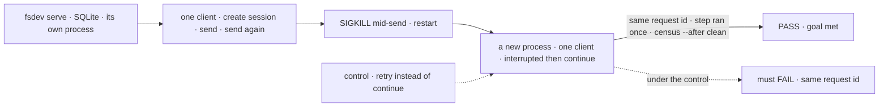
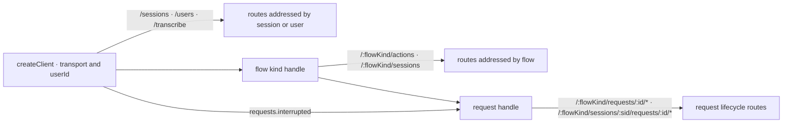

# FIX-2162 · One client: a single createClient for actions, sessions, requests and resources

**Spec** · [Decisions](DECISIONS.md)

## Six people, before and after

| Someone who… | Today | After |
|---|---|---|
| **starts a session, sends, and carries on after a crash, from a script or CLI** | Builds three clients; the flow and the user are bound on one and passed per call to the others | One client from an address and a user. `fsd.flow("support")` sends; the request it returns has `continue()` |
| **stored a request id and comes back after a restart** | Must also have kept its flow and session | `support.request(id)` returns the same request object |
| **wants typed actions** | `createTypedClient` pulls the flow definition into the bundle and refuses a collection flow | `fsd.flow<typeof supportFlow>("support")`: types only; any instance by its id |
| **lists their sessions** | Passes the same user again; leaving it out, without sign-in, lists everyone's | `fsd.sessions.list()` lists the client's user's ([D3](DECISIONS.md#d3)) |
| **renders FSD in React** | `FlowNavigator` takes `client` and `sessionClient`; panels take `resourceClient` | Hooks unchanged; each component takes the one `client` |
| **builds a workforce client** | `createWorkforceClient({ userId, baseUrl, fetcher })` builds its own | `createWorkforceClient(fsd)` |

The case is [Pi Durable](https://earendil.com/posts/pi-durable/): "start, send, continue after a
crash" is three lines there; ours needed three client objects. React hides it; servers and CLIs don't.

## The goal, and how we'll know it's met

**Someone driving FSD from code can start a session, send to it, and carry on a request the host
lost in a crash, holding one client, and nothing in the repo teaches another way to build one.**

| Is it the right goal? | |
|---|---|
| **The real need** | The owner, on FIX-2162: one client replaces the five factories; no wrappers; every caller in the repo moves |
| **Smaller, and rejected** | "A facade over the five factories." Met while the five stay exported and taught, and recovery still takes the flow and session per call |
| **Bigger, and not this issue's** | "The client proves who the caller is." That is verified identity, FIX-1503. `userId` stays caller-supplied and untrusted (BP-031) |
| **Not done if** | It runs in-process, not against a host that died · the request object is assembled from saved fields · a README or docs page still shows an old factory · an old name survives as an alias · a placeholder flow name survives |



The check reads the request through the client a user holds, and the repo through the census; the
dashed path carries on the wrong way and must fail.

| How we verify | |
|---|---|
| **Goal check** | `goals/client/starts-sends-and-continues-with-one-client/` · model `n/a` · run by the implementer at completion · verdict in the implementation PR |
| **Signal** | a: each client process builds exactly one client (counted at runtime). Session created, first send completes, host killed mid-second-send and restarted; a fresh process finds the request through `fsd.requests.interrupted()` and continues it. It completes under the same id, the step before the kill ran once (a counter row), and the session lists both turns. b: `poc/caller-census/check.mjs --after` reports zero; its `--control` names every plant |
| **Input** | A two-turn exchange whose second action holds on a latch. A different flow, action or turn count must pass too |
| **Anti-game** | No in-process engine and no mocked fetch: the host is a separate process, SIGKILLed. The continued request comes from `interrupted()` or `request(id)`. The census skips only retained history (`specs/`, `docs/internal/`, CHANGELOGs, changesets) |
| **Control that must fail** | `GOAL_CONTROL=retry-instead` calls `retry()`: it must FAIL on *same request id* and *ran once*. Today's `main` fails leg a on *one client from an address and a user* (`createClient` without a flow throws) and leg b with 168 references |

## What changes


Read where the user and the flow sit: today each box binds them somewhere else; after, the user sits
once on the client, the flow once on its handle, and a request carries both.

**The Pi case, as a server script writes it:**

```diff
- import { createClient, createSessionClient, createRecoveryClient } from "@flow-state-dev/client";
- const transport = { baseUrl: "http://localhost:3000" };
- const sessions = createSessionClient(transport);
- const support = createClient({ ...transport, flowKind: "support", userId: "u1" });
- const recovery = createRecoveryClient(transport);
- const session = await sessions.createSession({ flowKind: "support", userId: "u1" });
- await support.sendAction("reply", { text: "Hi" }, { sessionId: session.id });
- // …the host crashed and restarted
- const [lost] = await recovery.checkInterrupted({ userId: "u1" });
- await recovery.continue({ flowKind: lost.flowKind, sessionId: lost.sessionId!, requestId: lost.requestId });
+ import { createClient } from "@flow-state-dev/client";
+ const fsd = createClient({ baseUrl: "http://localhost:3000", userId: "u1" });
+ const support = fsd.flow("support");
+ const session = await support.createSession();
+ await support.send("reply", { text: "Hi" }, { sessionId: session.id });
+ // …the host crashed and restarted
+ const [lost] = await fsd.requests.interrupted();
+ await lost.continue();
```

**A typed flow, and a request found again by id in a webhook handler:**

```diff
- import { createTypedClient, createClient } from "@flow-state-dev/client";
- import { supportFlow } from "../server/flows/support";      // the definition, in the bundle
- const typed = createTypedClient({ flow: supportFlow, userId, baseUrl });
- await typed.actions.reply({ text });
- const raw = createClient({ flowKind: "support", userId, baseUrl });
- const { status } = await raw.getRequestStatus(requestId);
+ import { createClient } from "@flow-state-dev/client";
+ import type { supportFlow } from "../server/flows/support"; // types only
+ const support = createClient({ baseUrl, userId }).flow<typeof supportFlow>("support");
+ await support.send("reply", { text });                       // name and input checked
+ const { status } = await support.request(requestId).status();
```

**React, where a component takes a client:**

```diff
- <FlowNavigator client={client} sessionClient={sessionClient} userId={userId} />
- <Roster resourceClient={resources} … />
+ <FlowNavigator client={fsd} />
+ <Roster client={fsd} … />
```

**Docs:** rewrite `apps/docs/docs/client/overview.md` (a tour of the one client),
`configuration/client.md` and `api/client.md`; update `resources/client-access.md` and the examples
in `fundamentals/actions.md`, `fundamentals/state-and-scopes.md`, `persistence/overview.md`,
`streaming/items.md`, `server/host-adapters.md`, `guides/background-work.md` and nine `workforce/`
pages; re-check pages that show a client method (`advanced/durable-execution.md`,
`server/connection-resilience.md`, `guides/human-in-the-loop.md`, `getting-started/quick-start.md`,
`client/react.md`). Rewrite `docs/architecture/server-and-client.md` → *Client Setup*; update the
`client`, `workforce`, `node` and root READMEs. No new page. Minor changesets: `client`, `react`,
`workforce`; `core` and `engine` for the two fields.

## How a call reaches the server



Each namespace sits where the server addresses it; a request object carries the flow and session
its routes need.

## What stays as it is

- **Every server route and its auth.** The only engine change is two additive response fields.
- **`userId` is caller input:** set once, sent as today, never trusted. "Required caller input: `userId`" holds.
- **React hooks' public API.** Inside, each builds one client instead of three.
- **Pure stream helpers:** `createSSEClientFromResponse`, `createRequestStreamStore`, `bindStoreToCallbacks`.
- **Request semantics:** continue keeps the id, retry starts a new one, resume answers a suspension ([execution and errors](../../../docs/architecture/execution-and-errors.md#durable-execution-suspend-and-resume)).

## What's already here, and the debt

| Already here | What this does with it |
|---|---|
| The five factories and `transcribe` | **Replaces** with one `createClient`. 79 files name a factory, 14 import their types ([census](DECISIONS.md#settled)) |
| Shift Manager's `LabClients`: sessions, resources, recovery and `actions(flowKind)` over one transport and user | **Replaces.** The closest thing already here: this client, built by hand. Searched `create*Client`, `bearerFetcher`, `transport` across `packages/`, `apps/`, `goals/` |
| The DevTool's four `createDevTool*Client` and two copies of `bearerFetcher` | **Removes.** They only add a fetcher |
| `createSSEClient({ url })`, `createSessionSSEClient`, `createUserSSEClient`; six hand-built stream URLs | **Replaces** with a stream on the request, the session and the client |
| `RequestStatusSnapshot` and the interrupted list | **Extends** with the session id and the instance id ([D2](DECISIONS.md#d2)) |
| [server-and-client.md → Client Setup](../../../docs/architecture/server-and-client.md#client-setup) | **Superseded**, rewritten in the same change (BP-034) |
| [Locked Contracts](../../../docs/contributing/architecture-reference.md#locked-contracts-phase-1): "Required caller input: `userId`", "react wraps client" | **Kept.** `userId` is set once, not per call |
| [authentication.md → Contract](../../../docs/architecture/authentication.md#contract): `body.userId` is not the principal | **Kept** |
| [FIX-1788 → What changes](../FIX-1788/SPEC.md#what-changes): `createWorkforceClient` takes `createSessionClient`'s options | **Amended:** it takes the client |
| The client README's "createClient vs createTypedClient" and its collection refusal | **Superseded** by `flow()`'s type parameter |

| The debt | |
|---|---|
| **Removes** | Four factories; `transcribe`'s own transport; three placeholder flow names; three `*Stream` twins; `state.getSnapshot`; three copies of a required-id check; two `bearerFetcher`s; the DevTool's four builders; six hand-built stream URLs; plain `Error` failures |
| **Adds** | Two server response fields. Permanent by design: an object found by id needs the address the server holds |
| **Leaves** | `useFlow`'s `"devuser"` fallback user; a client with no `userId` once verified identity mints one (FIX-1503). Neither is this change's |

**Net: down.** Six ways to build a client become one, and two fields are added.

## Sign off

**[The goal](#the-goal-and-how-well-know-its-met), at that size:** one client starts, sends and
continues after a real crash, and nothing in the repo teaches the old five. If wrong: we ship a
facade, and the docs teach two ways.

**[The debt](#whats-already-here-and-the-debt), net down:** six builders to one, two server fields
added. If wrong: the one client grows a namespace per feature and becomes the next grab-bag.

1. **[D1](DECISIONS.md#d1) · A flow is named only through `fsd.flow(kind)`; the client has no
   default flow.** If wrong: one more line in every single-flow app, forever.
2. **[D2](DECISIONS.md#d2) · A request is an object you get back from a send, by id, or from the
   interrupted list, and its lifecycle lives on it.** If wrong: a public type every recovery path
   writes against, plus two server fields.
3. **[D3](DECISIONS.md#d3) · A client lists its own user's sessions unless it asks for another.**
   If wrong: a tool that needs every user's sessions has to call the route itself.

**Open: none.** D1 is the one to weigh: it decides how every call site in every app reads.

Improvement · `client`, `react`, `workforce`, `devtool`, `shift-manager`, `core` + `engine` (two
fields), apps and goals · large: 61 code files, 26 docs files; four factories and `transcribe` removed, `createClient` reshaped · no epic ·
couples with FIX-2158 ([#3796](https://github.com/fixpoint-labs/flow-state-dev/pull/3796))
