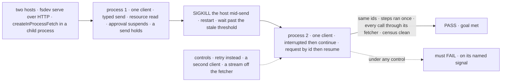
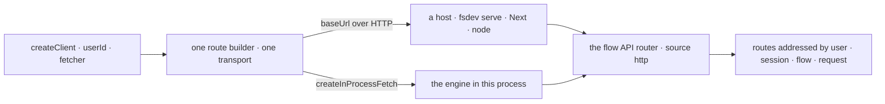

# FIX-2162 · One client: a single createClient for actions, sessions, requests and resources

**Spec** · [Decisions](DECISIONS.md)

## Six people, before and after

| Someone who… | Today | After |
|---|---|---|
| **starts a session, sends, and carries on after a crash, from a script or CLI** | Builds three clients; the flow and the user are bound on one and passed per call to the others | One client from an address and a user. `fsd.flow("support")` sends; the request it returns has `continue()` |
| **saved a request id, and comes back after a restart or an approval** | Must also have kept its flow and session. The interrupted list empties itself: it returns only what that call swept | `support.request(id)` gives the request back, with `continue()`, `retry()` and `resume()`. `fsd.requests.interrupted()` reads the same records every time |
| **runs FSD inside their own process, with no web server** | Starts a web server, or hand-writes a fetch that routes to the engine. React's request streams ignore it and call the network | Passes `fetcher: createInProcessFetch(flowState)` to the same client. Every call and stream, React's included, stays in the process |
| **wants typed actions** | `createTypedClient` pulls the flow definition into the bundle and refuses a collection flow | `fsd.flow<typeof supportFlow>("support")`: types only, and any instance by its id |
| **lists their sessions** | Passes the same user again; leaving it out, without sign-in, lists everyone's | `fsd.sessions.list()` lists the client's user's ([D3](DECISIONS.md#d3)) |
| **renders FSD in React, or builds a workforce client** | `FlowNavigator` takes `client` and `sessionClient`; panels take `resourceClient`; `createWorkforceClient` builds its own | Each takes the one client: `<FlowNavigator client={fsd} />`, `createWorkforceClient(fsd)`. Hooks unchanged |

The case is [Pi Durable](https://earendil.com/posts/pi-durable/): "start, send, continue after a
crash" is three lines there; ours needed three client objects.

## The goal, and how we'll know it's met

**Someone driving FSD from code, against a server or inside their own process, does every job
with one client: send an action, typed or not; work with sessions and resources; check, stop,
continue, retry or resume a request, one the host lost in a crash included. Nothing in the repo
teaches another way to build a client.**

| Is it the right goal? | |
|---|---|
| **The real need** | The owner, on FIX-2162: one client replaces the five factories; no wrappers; every caller moves. Since the first draft, also the owner's: the same client runs embedded, with no web server |
| **Smaller, and rejected** | "Start, send and continue with one client." Pi's three lines pass while resources, resume and typed actions still need a second client. And "a facade over the five factories": met while the five stay taught |
| **Bigger, and not this issue's** | "The client proves who the caller is." Verified identity is FIX-1503. `userId` stays caller-supplied and untrusted (BP-031); an embedded caller gets no trusted shortcut |
| **Not done if** | It continues only after an interruption set by hand · the request object is built from saved fields · `interrupted()` returns only what that call swept · the client builds a transport per namespace, or takes a per-call `userId` · a call or stream bypasses the fetcher · a goal or test hand-builds router Requests where the client would do · `flow<typeof X>` imports `X` at runtime or refuses a collection flow · `createWorkforceClient` or a component builds its own client · the stale threshold can't be set · a doc shows an old factory, an alias or a placeholder flow name survives |



The check reads requests, sessions and resources through the client a user holds, on both
transports, and the repo through the census; each dashed control must fail.

| How we verify | |
|---|---|
| **Goal check** | `goals/client/does-every-job-with-one-client/` · model `n/a` · run by the implementer at completion · verdict in the implementation PR. Leg c: the implementer copies `poc/caller-census/check.mjs` to `goals/client/does-every-job-with-one-client/check.mjs`; the checker excludes itself at both paths, and `--control` plants that copy and requires it to stay clean. Prior art: `goals/continue-interrupted-run/` sets `interrupted` by hand and avoids a real crash on purpose; this check adds the crash |
| **Signal** | Legs a and b run on both transports: `fsdev serve` on SQLite in its own process, and `createInProcessFetch` in a child process over a file store. Process 1 creates a session, sends a typed turn, reads the resource it wrote, sends an action that suspends for approval, then one that holds on a latch. The host is SIGKILLed and restarted with a short `staleSweepThresholdMs` on `createFlowState` (2 s, set in the goal's `fsdev.config` and in-process host alike): that is the path. Only a host that can't take it makes the check wait past the router default, 60 s (`DEFAULT_STALE_SWEEP_THRESHOLD_MS`). `interrupted()` pokes `check-interrupted` itself, so no sweep tick is waited for; a passed `staleThresholdMs` only widens the host's floor. **a:** in process 2, two reads of `fsd.requests.interrupted()` list the held request; `continue()` completes it under the same id, and the step before the kill ran once (a counter row). **b:** `request(savedId).resume(…)` completes the approval under its id; the resource read equals the input; the session lists every turn; each process called `createClient` once, and every route served for it came through its fetcher. **One transport, structurally:** a unit test beside the client gives one `createClient` an instrumented fetcher and drives every namespace (`sessions`, `resources`, `flow().send`, `request().continue`, the streams); every call lands on that one fetcher closure and no other transport is built. **c:** `check.mjs --after` reports zero; `--control` names all 20 plants |
| **Input** | A support exchange: a typed reply, an approval, a latched action. Second input: a collection flow addressed by its instance id, three turns, a different approval. Both must pass |
| **Anti-game** | The in-process leg uses the public `createInProcessFetch`, never engine internals or a mocked fetch. The HTTP host is a separate process, SIGKILLed. Requests come back from `interrupted()` or `request(id)`, never from saved fields. The census skips only retained history (`specs/`, `docs/internal/`, CHANGELOGs, changesets) and itself at its two paths |
| **Control that must fail** | `GOAL_CONTROL=retry-instead` calls `retry()`: FAIL on *same request id* and *ran once*. `GOAL_CONTROL=two-clients` builds a second client for recovery: FAIL on *one client per process*. `GOAL_CONTROL=stream-off-fetcher` reads one stream with the global fetch: FAIL on *every call through its fetcher*. The one-transport test, given a client that builds a second fetcher wrapper for one namespace: FAIL on *one transport*. `--control` plants a named facade, a hand-built router helper, `httpActions` and each removed method: the census names every one. It also plants a facade built from neutrally named helpers and requires that the census *passes* it: the census reads names and props, and structure is the one-transport test's. Today's `main` fails leg a on *one client from an address and a user* and leg c with 403 references |

## What changes


Read where the user, the flow and the transport sit: today each box binds them somewhere else;
after, the user sits once on the client, the flow on its handle, the transport in one fetcher.

**The Pi case, as a server script writes it:**

```diff
- import { createClient, createSessionClient, createRecoveryClient } from "@flow-state-dev/client";
- const transport = { baseUrl: "http://localhost:3000" };
- const sessions = createSessionClient(transport);
- const support = createClient({ ...transport, flowKind: "support", userId: "u1" });
- const recovery = createRecoveryClient(transport);
- const session = await sessions.createSession({ flowKind: "support", userId: "u1" });
- await support.sendAction("reply", { text: "Hi" }, { sessionId: session.id });
- // …the host crashed and restarted
- const [lost] = await recovery.checkInterrupted({ userId: "u1" }); // empty if a sweep got there first
- await recovery.continue({ flowKind: lost.flowKind, sessionId: lost.sessionId!, requestId: lost.requestId });
+ import { createClient } from "@flow-state-dev/client";
+ const fsd = createClient({ baseUrl: "http://localhost:3000", userId: "u1" });
+ const support = fsd.flow("support");
+ const session = await support.createSession();
+ const sent = await support.send("reply", { text: "Hi" }, { sessionId: session.id });
+ // …the host crashed and restarted. Saved the id? Use it:
+ await support.request(sent.id).continue();
+ // Saved nothing? Read the user's interrupted requests:
+ for (const lost of await fsd.requests.interrupted()) await lost.continue();
```

**The same client inside the process, with no web server:**

```diff
+ import { createFlowState, createInProcessFetch } from "@flow-state-dev/engine";
+ const flowState = createFlowState({ flows: { support }, stores: { default: { primary: stores } } });
+ const fsd = createClient({ userId: "u1", fetcher: createInProcessFetch(flowState) });
+ // the same fsd.flow("support"), fsd.sessions, requests and streams as above
```

**A typed flow, and a request found again by id:**

```diff
- import { createTypedClient, createClient } from "@flow-state-dev/client";
- import { supportFlow } from "../server/flows/support";      // the definition, in the bundle
- const typed = createTypedClient({ flow: supportFlow, userId, baseUrl });
- await typed.actions.reply({ text });
- const raw = createClient({ flowKind: "support", userId, baseUrl });
- const { status } = await raw.getRequestStatus(requestId);
+ import { createClient } from "@flow-state-dev/client";
+ import type { supportFlow } from "../server/flows/support"; // types only
+ const support = createClient({ baseUrl, userId }).flow<typeof supportFlow>("support");
+ await support.send("reply", { text });                       // name and input checked
+ const { status } = await support.request(requestId).status();
```

**React and Workforce, where a component or helper takes a client:**

```diff
- <FlowNavigator client={client} sessionClient={sessionClient} userId={userId} />
- <Roster resourceClient={resources} … />
- const workforce = createWorkforceClient({ userId, baseUrl, fetcher });
+ <FlowNavigator client={fsd} />
+ <Roster client={fsd} … />
+ const workforce = createWorkforceClient(fsd);
```

**Docs:** rewrite `apps/docs/docs/client/overview.md` (a tour of the one client, on both
transports), `configuration/client.md` (the options) and `api/client.md`; update
`resources/client-access.md` and `server/host-adapters.md` (`createInProcessFetch` beside the
hosts); update the `engine`, `client`, `react` and `workforce` READMEs; rewrite
[server-and-client.md → Client Setup](../../../docs/architecture/server-and-client.md#client-setup).
Every other page or README that shows an old factory, a removed method or a sub-client prop is
found by the census: `check.mjs --after` is the checklist. No new page; the sidebar is unchanged.
Minor changesets: `client`, `react` (with `FlowNavigator`'s list
change, [D3](DECISIONS.md#d3)), `workforce`, `engine`, and `core` (`sessionId` on
`RequestStatusSnapshot`, in `core/src/types/request.ts`). `node` needs none: what it serves is
unchanged.

## How a call reaches the server



Both transports reach the same router with the same caller source, so auth is the same; each
namespace sits where its route is addressed, and a request object carries the flow and session
its routes need.

## What stays as it is

- **Every route's auth.** In-process calls go through the router as `source: "http"`, like a real
  request. The server changes are one read and two fields, below.
- **`userId` is caller input:** set once, sent as today, never trusted. "Required caller input: `userId`" holds.
- **React hooks' public API.** Inside, each builds one client and passes its fetcher to every stream.
- **Pure stream helpers:** `createSSEClientFromResponse`, `createRequestStreamStore`, `bindStoreToCallbacks`.
- **Request semantics:** continue keeps the id, retry starts a new one, resume answers a suspension ([execution and errors](../../../docs/architecture/execution-and-errors.md#durable-execution-suspend-and-resume)).

## What's already here, and the debt

| Already here | What this does with it |
|---|---|
| The five factories and `transcribe` | **Replaces** with one `createClient`. 79 files name a factory; 195 files change by the census rules, 36 of them docs ([census](DECISIONS.md#settled)) |
| Shift Manager's `LabClients`: sessions, resources, recovery and `actions(flowKind)` over one transport and user | **Replaces.** The closest thing already here: this client, built by hand. Searched `create*Client`, `bearerFetcher`, `transport` across `packages/`, `apps/`, `goals/` |
| `node`'s `createServerApp(...).app.fetch`: waits for store init, picks the router method, takes the path from the URL, calls the router | **Reuses, by moving it.** That dispatch becomes the engine's `createInProcessFetch`, and `node` delegates to it; health, the dedicated-route fallback, JSON errors and dispose stay in `node`. No in-process transport ships today; the Next and Vercel handlers take their path from the framework ([decided](DECISIONS.md#decided-not-asked)) |
| `httpActions` in `goals/lib/http-actions.mts`, and 24 more hand-built router helpers in goals and tests: an in-process client that builds Requests and calls `getRouter()` raw | **Replaces.** 19 files use or teach `httpActions`; with the helpers, 43 files move onto `createClient` + `createInProcessFetch`. Hosts and router unit tests that must hit the router raw are excluded by name ([census](DECISIONS.md#settled)) |
| The DevTool's four `createDevTool*Client` and two copies of `bearerFetcher` | **Removes.** They only add a fetcher |
| `createSSEClient({ url })`, `createSessionSSEClient`, `createUserSSEClient`; six hand-built stream URLs | **Replaces** with a stream on the request, the session and the client, through the client's fetcher |
| `POST /users/:userId/check-interrupted` | **Kept as the trigger.** It sweeps and returns what it changed. A new read lists the records ([D2](DECISIONS.md#d2)) |
| `RequestStatusSnapshot`; the interrupted list | **Extends:** the session id on status, with the tenant check that route lacks; the instance id on the interrupted list. `/active-requests` is untouched ([D2](DECISIONS.md#d2)) |
| [server-and-client.md → Client Setup](../../../docs/architecture/server-and-client.md#client-setup) | **Superseded**, rewritten in the same change (BP-034) |
| [Locked Contracts](../../../docs/contributing/architecture-reference.md#locked-contracts-phase-1): "Required caller input: `userId`", "react wraps client" | **Kept.** `userId` is set once, not per call |
| [authentication.md → Contract](../../../docs/architecture/authentication.md#contract): `body.userId` is not the principal | **Kept**, in-process too |
| [FIX-1788 → What changes](../FIX-1788/SPEC.md#what-changes): `createWorkforceClient` takes `createSessionClient`'s options | **Amended:** it takes the client |
| The client README's "createClient vs createTypedClient" and its collection refusal | **Superseded** by `flow()`'s type parameter |

| The debt | |
|---|---|
| **Removes** | Four factories; three route-addressed SSE factories and six hand-built stream URLs; `transcribe`'s own transport; three placeholder flow names; the `sendActionStream`, `continueStream` and `resumeSuspensionStream` twins; `state.getSnapshot`; three copies of a required-id check; two `bearerFetcher`s; the DevTool's four builders; plain `Error` failures; `httpActions` and the hand-built router helpers; `node`'s own path derivation |
| **Adds** | A read of the user's interrupted requests; two response fields (`sessionId` on status, `flowId` on the interrupted list), with a fallback to the flow kind for rows written before the instance id (BP-030); `createInProcessFetch`, the one function that turns a Request into a router call, which `node` now calls too. Permanent by design: an object found by id needs the address the server holds, and the owner asked for the embedded transport |
| **Leaves** | `useFlow`'s `"devuser"` fallback user, and a client with no `userId` once verified identity mints one (FIX-1503). `GET /active-requests` has no client method, before or after. An embedded caller that needs the `cli` principal uses `resolveInProcessPrincipal`, not the fetcher |

**Net: down.** Six ways to build a client, plus the goals' own, become one; two ways to dispatch a Request become one; one read, two fields and one engine export are added.

## Sign off

**[The goal](#the-goal-and-how-well-know-its-met), at that size:** one client does every job,
over HTTP and in-process, after a real crash, and nothing in the repo teaches the old five. If
wrong: we ship a facade, the docs teach two ways, and an embedded host still needs a web server.

**[The debt](#whats-already-here-and-the-debt), net down:** six builders to one; one read, two
fields and `createInProcessFetch` added, which `node` serves through too. If wrong: the one client grows a namespace per feature
and becomes the next grab-bag.

1. **[D1](DECISIONS.md#d1) · A flow is named only through `fsd.flow(kind)`; the client has no
   default flow.** If wrong: one more line in every single-flow app, forever.
2. **[D2](DECISIONS.md#d2) · A request is an object you get back from a send, by id, or from the
   interrupted list, and its lifecycle lives on it.** If wrong: a public type every recovery path
   writes against, plus a read and two fields on the server.
3. **[D3](DECISIONS.md#d3) · A client lists its own user's sessions unless it asks for another.**
   If wrong: a tool that needs every user's sessions has to call the route itself.

**Open: none.** D1 is the one to weigh: it decides how every call site in every app reads.

Improvement · `client`, `react`, `workforce`, `devtool`, `shift-manager`, `ui`, `engine` (a read,
two fields, `createInProcessFetch`), `node`, `core`, apps and goals · large: 159 code files (61
tests), 36 docs files; seven factories and `httpActions` removed, `createClient` reshaped · no
epic · couples with FIX-2158 ([#3796](https://github.com/fixpoint-labs/flow-state-dev/pull/3796))
and FIX-2161 ([#3805](https://github.com/fixpoint-labs/flow-state-dev/pull/3805)): whichever lands
second moves the other onto `createWorkforceClient(fsd)` · leg a needs FIX-2063
([#3782](https://github.com/fixpoint-labs/flow-state-dev/pull/3782))
