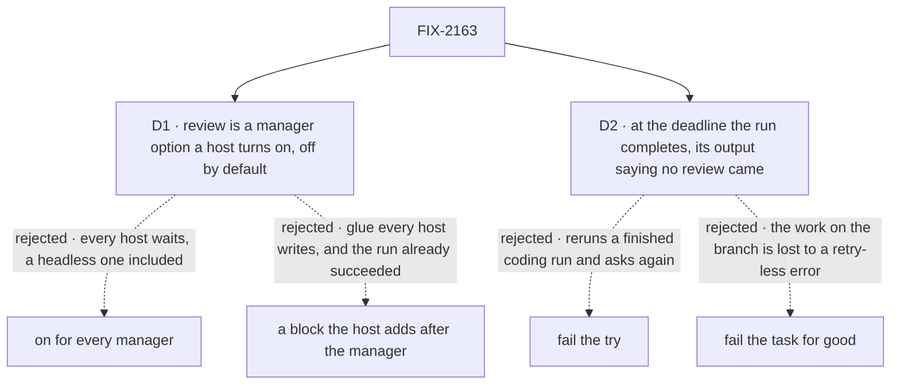

# FIX-2163 · Decisions

[Spec](SPEC.md) · **Decisions**

The shape is settled above this issue. A review is FIX-2129's `waitForUser({ kind: "review" })`
and FIX-2131's two verdicts; a revision's words are the user's steer (FIX-2131 D1); questions hold
and never suspend (ER-1, ER-8, FIX-2132). The product rule (agent-mailbox #46): a harness run that
changed code waits under *Ready for review*, the judge's verdict is information, not approval,
review is never skipped as a fallback, and the existing person-stop deadline is the only clock.
Two calls are left, both about what a host and a person get.

## The tree

Solid edges are what you sign. Dashed edges lost, and the label says why.

## D1 · Review is a manager option a host turns on, off by default

| | |
|---|---|
| **Instead of** | (a) Every manager waits for review on a run with changes. (b) The host adds its own block after the manager that waits for the review |
| **Because** | (a) changes every host that runs today: DevTeam's `coder`, the conductor lab with its automated review phase, the goal checks, and any headless host with nobody to answer. Each would hold finished work until someone answered, since a stop has no default deadline. (b) is glue every host writes again, which the epic forbids in a lab (ER-4); and by the time a block after the manager runs, the run record already says it succeeded and the verdict's reason is gone from the output, so a revision can't continue the run's session on the same try. Inside the settle step the manager has the verdict, the commits and its own steer step |
| **Locks in** | `harnessManager({ reviewChanges: true })`. The lab's harness thread flow sets it (FIX-2157, configuration under ER-1). With it off, every run settles exactly as today. Shift Manager's `coder` turning it on, and its *In review* column, are Shift Manager's own wiring, not this issue |

It comes down to who waits: only a host that has a person to answer.

**What would change my mind:** every host we ship turning it on. Then the default flips to on, and
a headless host turns it off.

## D2 · At the person-stop deadline, an unreviewed run completes, and its output says no review came

| | |
|---|---|
| **Instead of** | (a) Letting FIX-2129's deadline fail the try, as an uncaught review deadline does. (b) Failing the task for good |
| **Because** | (a) starts a new try that runs the whole coding run again, only to ask the same review again: three tries are three deadlines of asking and three coding runs, then an error. (b) throws away a finished change nobody rejected. Completing keeps the work on its branch, ends the task once, and matches the lab's other threads, which finish at the same deadline (FIX-2157 D2). Nothing merges on completion: the branch still needs whatever the host does next. This is the existing deadline, the host's person-stop setting where the host sets one; with none, the review waits until it is answered or the task is cancelled ([FIX-2058 D3](../../epics/FIX-2058/DECISIONS.md#d3), owner, 2026-10-24). The manager adds no clock (the product rule). Catching it is FIX-2129's own contract, not an exception to it: its D1 says the block "may catch" a review's `SuspensionTimeoutError`, its SPEC's example catches it "to go ahead, end, or ask again", and its leg b passes when "a caught one completes it". FIX-2129 has no deadline ending to use instead |
| **Locks in** | The manager catches `SuspensionTimeoutError` from its own review and completes the task. Its output gains `review: "accepted" \| "deadline" \| null` (null when no review was asked), so a screen can show *no review came*. A completed run whose `review` is `"deadline"` must never read as approved: `"accepted"` is the only value that means a person accepted it, and a screen shows the deadline case as *not reviewed* (the product lead's condition, agent-mailbox #46). FIX-2157's board settles a harness thread's run under *Resolved* with a *not reviewed* mark, read from this output. The mark is required, not optional. FIX-2157's own text carries that through an amendment on its review PR (#3788). This condition covers harness runs only. A plain thread's review is the model's `waitForUser` tool, and nothing on its task says the deadline ended it; that signal is gap [FIX-2165](https://linear.app/fixpoint-labs/issue/FIX-2165), which the lab doesn't infer A revised run that reaches the deadline on its next review completes the same way |

It comes down to what a forgotten review costs: a mark on finished work, or a coding run repeated.

**What would change my mind:** hosts where *done* triggers something irreversible, like a merge.
Then the deadline fails the task for good, and the work stays on its branch.

## Decided, not asked

- **"Made changes" is commits on the run's branch over its base** at the end of the run: the
  count `readRunCommits` already reads, and the output's `commits`. Kept files and an
  uncommitted tree don't count. The test is of the branch, so a revised run is reviewed again
  even if it adds no commit.
  **Only a verified zero skips review.** `readRunCommits` answers zero when git can't read the
  checkout or the base (a fallback built for reporting), so the review step needs a read that
  tells "no commits" apart from "couldn't tell". When it can't tell, the run waits for review,
  and its prompt says the commits couldn't be read. Review is never skipped as a fallback.
- **Where it sits:** its own step between the judge and `steerBeforeSettle`, not inside `settle`.
  `settle` runs after the last loop back, so a review inside it couldn't reach the steer loop
  without a new loop back. *not-done* fails the try and *ask* holds on a question, both as today
  (FIX-2132). A *done* run, one under the judge's floor, or one with no judge goes to review when it
  has changes and the option is on. A run with no changes goes on as today. A failed run never
  reaches it. After the review, the existing `steerBeforeSettle` → `stepForSteer` → loop back does
  the rest: a revision's words are a steer on the row (FIX-2131 D1), so it takes them; an accept
  with a steer still pending goes the same way; and `settle` only writes the success. This is the
  POC's order (review, loop back, report) and the convergence point: the review is the manager's
  only `waitForUser` call, and no other path waits for a review.
- **The prompt** names the commit count and subjects (at most 20, as the output already caps them)
  and the judge's verdict, confidence and reason, or that no judge ran. It says the verdict is
  information. It is set once and never changes (FIX-2129 copies it to the row).
- **An accept** writes the run record's success and completes the task, with no harness run. A
  steer that arrived while it waited is not lost: one more run takes it, as FIX-2131 D1 requires,
  and that run is reviewed again if it has changes.
- **A revision** is FIX-2131's revision verdict; its words are already the user's steer on the
  row. The manager goes round through its steer step (`stepForSteer` and its loop back, FIX-2086)
  in the same request: same attempt, resuming the session this attempt confirmed, the words in
  the prompt. No second loop, and no cap of the manager's own: the words are steers, so the task's
  steer cap bounds them (ER-8's write).
- **A revision when no session was confirmed fails the try.** There `stepForSteer` returns
  nothing and the task would complete over the steer, as any steer on such a run does today;
  changing that would change every steer, not just reviews. So the review step itself fails the
  try, and the words, a steer that stays on the row (FIX-2131), are in the next try's brief. It
  spends a try, the cost rejected below for the general case, but only on a run whose harness
  confirmed no session, which is rare.
- **The answer's order is FIX-2131's, required here.** The steer loop only runs when the row has
  an untaken steer, so FIX-2131's answer route writes the revision's steer before it resolves the
  review, and refuses a revision with no words. Otherwise the task completes over the request for
  changes. FIX-2131's DECISIONS carries the same line, dated, in this PR.
- **A cancel** while it waits: the review resumes `cancelled` (FIX-2129); the manager records
  nothing, starts no run, and the branch and kept files stay. A user's stop cancels the task
  (FIX-2129).
- **The wait holds the claim and not the checkout.** The harness step's `onSettled` already
  released the checkout lease, and FIX-2129's mark drops the task's lease.
- **Durable execution is required** for the wait, as it is for any `waitForUser` (FIX-2063). The
  manager's request is a durable sequencer when the option is on. A host with no durability
  provider that turns the option on fails loudly when the request starts, among the manager's
  start-of-run checks, before any coding run; it never completes unreviewed, and never spends a
  coding run on work it can't hold for review.
- **FIX-2132's sweep line** ("`waitForUser` has none in `harness-manager`") becomes "one, the
  review step"; its D1's "the manager itself suspends no request" becomes "suspends only for a
  review of a run's changes, when the host turns it on". Questions still never suspend. This
  merges after FIX-2132. FIX-2132's D1 and its sweep line carry the same amendment, dated, in
  this PR: its implementation keeps no `waitForUser` reference, and this one's makes it one.
- **No new screen work here.** The lab's board, *Resolve* and *Request changes* are FIX-2157's;
  they answer through FIX-2129's route.

## Considered and dropped

| Alternative | Why not |
|---|---|
| A held question instead of a suspension ("Accept or describe changes?") | ER-1: a review suspends and a question holds. The Inbox and the board would show a question, not a review, and *Resolve* would be free text |
| A revision fails the try, its words the next try's feedback (the issue's first wording) | Kept only for a run with no confirmed session. In general it spends a retry per round of changes and, after a failure, the next try resumes through the retry path instead of the same request. The steer step already continues the session on the same try |
| A separate review timeout on the manager | The product rule: the person-stop deadline is the only clock. Two clocks for one wait |
| Review every *done* run, changes or not | A run with nothing on its branch has nothing to review, and the lab sends it straight to *Resolved* (FIX-2157 D5) |

## Notes from review

For the implementer; none of these changes the approach. Recorded verbatim from #3819.

- **Cursor, one commit read:** "`decide` already has full `RunCommits` via `commitsOf()`. When building the review prompt here, reuse that snapshot rather than calling `readRunCommits` again in settle—cheap relative to the harness, but it's an easy accidental duplication given only `commits` count is on `decided.output` today." *The snapshot must also carry whether the read was verified (Codex, round 1), so reuse means one read that answers both.*

## Settled

- **A review after the coding run resumes without running it again, and a revision loops back
  once — CONFIRMED, traces off and on.** `poc/review-loops-back/` (`bash
  specs/issues/FIX-2163/poc/review-loops-back/run.sh`), on `main` at `31d68caa`: accept, one
  coding run; revise then accept, two, with the words in the second and no state doubled. The
  same harness in FIX-2132's POC printed six runs for three passes before FIX-2137; at `31d68caa`
  it prints three, so the green here is FIX-2137's fix. `ctx.suspend` stands in for
  `waitForUser`, which is not on `main`; the goal check runs the real one.
- **No counted facts carry the approach**, so no checker.

## How it got here

- **Draft** — framed as FIX-2157's gap: the manager's settle step asks FIX-2129's review for a
  run with commits, behind a host option; accept completes with no run, a revision goes round the
  steer step on the same try, and the deadline completes the run marked unreviewed. Builds on
  FIX-2129, FIX-2131 and FIX-2132; a POC re-checked FIX-2137's fix for this shape.
- **Review round 1** — FIX-2132's D1 and its sweep line amended in this PR, with a dated note,
  so the two merged specs agree and each implementation knows its sweep count (FSD Architect).
- **Product review** — D1 and D2 agreed, on one condition folded into D2: a run completed at the
  deadline never reads as approved; its output says so, and FIX-2157's board marks it *not reviewed*.
  Scoped to harness runs on the architect's review; plain threads' signal filed as FIX-2165.
- **Codex, round 1** — an unreadable commit count no longer skips review: only a verified zero does.
- **Architect, revision path** — the review is its own step before `steerBeforeSettle`, not inside
  `settle`; a revision with no confirmed session fails the try; FIX-2131's answer writes the steer
  before it resolves; durability is checked at the start; leg c restarts the host. D2 cites
  FIX-2129's catch.
- **2026-10-24, from FIX-2058's amendment** — a person's stop has no default deadline (FIX-2058 D3,
  owner): the people row and D2 say a review waits until answered unless the host sets a deadline,
  and leg f sets one, and checks a review with none still waits.

**Open: none.**
