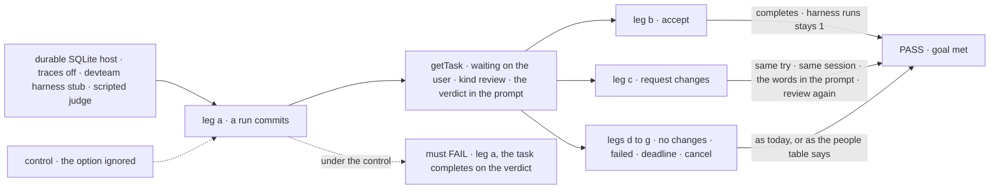
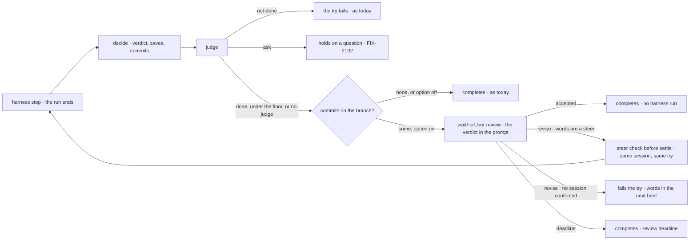

# FIX-2163 · A harness run that made changes waits for a person's review

**Spec** · [Decisions](DECISIONS.md)

## Six people, before and after

| Someone who… | Today | After |
|---|---|---|
| **filed a coding task that made changes** | The task completes on the judge's verdict. Nobody accepts the work | The task waits on them for review, with the commits and the judge's verdict shown as information, not approval. *Resolve* (accepted) completes it with no second coding run |
| **asks for changes on that work** | Can't. They file a follow-up task, which starts cold | Their words go to the next run, which continues the same coding session on the same try, and it comes back for review |
| **gets a run with no changes, or a failed one** | Completes, or fails its try | The same: no changes completes, a failure fails the try |
| **leaves the review unanswered** | n/a | It waits until someone reviews it or the task is cancelled: a review has no deadline unless the host sets one ([FIX-2058 D3](../../epics/FIX-2058/DECISIONS.md#d3)). At a set deadline the task completes, its output saying no review came, so a screen shows it as *not reviewed*, never as approved ([D2](DECISIONS.md#d2)) |
| **cancels the task while it waits** | n/a | The review closes, no run starts, and the branch and its kept files stay |
| **builds a host that didn't ask for review** (DevTeam's `coder`, the conductor lab) | Runs complete on the verdict | Unchanged. Review is a manager option the host turns on ([D1](DECISIONS.md#d1)) |

This is the gap the Claude Code-style lab's threads mode found ([FIX-2157 D5 and its gaps
table](https://github.com/fixpoint-labs/flow-state-dev/blob/claude/project-thread-ul1hzg/specs/issues/FIX-2157/DECISIONS.md#d5)):
a harness thread that changed code waits under *Ready for review*, and *Resolve* and *Request
changes* answer it. The product lead's rule (agent-mailbox #46): review is never skipped as a
fallback, and it runs under the existing person-stop deadline only.

## The goal, and how we'll know it's met

**A coding run that ends with changes on its branch holds its task on a person's review, with the
judge's verdict shown as information; accepting completes it with no second coding run, and asking
for changes continues the same coding session on the same try with the person's words.**

| Is it the right goal? | |
|---|---|
| **The real need** | The issue: "a person should review them before the task completes … with the judge's verdict on its card as information, not approval." FIX-2157's step 6: the row reaches *Ready for review* and *Resolve* moves it under *Resolved*. The epic's goal: a lab gap is solved in the package, not the lab ([ER-4](../../epics/FIX-2152/DECISIONS.md#who-owns-what)) |
| **Smaller, and rejected** | "The run waits for review." Met while an accept runs the coding run again (a replayed step, FIX-2137's class), or while a revision fails the try and starts a fresh session, so each round of changes spends a retry and loses what the run had read |
| **Bigger, and not this issue's** | Shift Manager's *In review* column and DevTeam's `coder` turning review on (Shift Manager's own wiring) · the lab's board and buttons (FIX-2157) · the answer route and the Inbox's review item (FIX-2129, FIX-2131) · a diff view (the epic's fence) |
| **Not done if** | An accept starts a harness run · a revision spends an attempt or starts a fresh coding session when one was confirmed · a run with no commits waits · a failed run waits · a judge's *ask* waits for review instead of holding on a question · a cancel loses the branch or the kept files · a host without the option waits · the check ran with trace observability on only |



The check reads the task through `getTask`, answers the way a screen does, and counts what each
harness run was handed.

| How we verify | |
|---|---|
| **Goal check** | `goals/harness-manager/a-runs-changes-wait-for-review/` · model-free (`n/a`): the devteam harness stub makes commits and confirms a session, and a scripted judge returns *done* · run by the implementer at completion · verdict in the implementation PR |
| **Signal** | a: a run that commits leaves `getTask` at `in_progress` with `waitingOn: "user"`, `waitingFor.kind` `review`, and a prompt that holds the commit count and subjects and the judge's verdict, confidence and reason; `attempts` 1; the checkout lease is free; one harness run. b: the answer route's *accepted* completes the task with output `review: "accepted"`, and the harness run count stays 1. c: *revise* with "Keep the old flag name" starts one more harness run on the same try (`attempts` 1), resuming the session the first run confirmed, with the words in its prompt; it commits and waits for review again; an accept then completes it, two harness runs in all. The host process is restarted between the stop and the revision, as in FIX-2129's leg e, since the POC never runs `stepForSteer` and this leg is the only proof of the real chain. c′: a revision on a run whose harness confirmed no session fails try 1, and try 2's brief holds the words. d: a run with no commits completes with no wait and `review: null`. e: a failed run fails its try, with no wait. f: with the host's person-stop deadline set (a review has none by default), the task completes after the sweep with `review: "deadline"`, and no harness run starts; with the setting unset, the task still waits on the user after the sweeper's interval, and no harness run starts. g: a cancel while it waits closes the review, no harness run starts, and the branch's commit and a kept file are still there. h: the same run on a manager built without the option completes on the verdict, as today. i: a judge's *ask* holds the task on a question (FIX-2132), with no review |
| **Input** | A coding task whose stub run commits one file; for leg d, one that commits nothing; for leg e, one that errors; for leg i, a judge scripted to *ask* |
| **Anti-game** | Run with `FSDEV_TRACE_OBSERVABILITY=0`, production's default, so a resume that runs the harness step again shows as a second harness run. Count runs from the stub's own log, not item counts. Answer through FIX-2129's answer route, never the store |
| **Control that must fail** | `GOAL_CONTROL=no-review` (the manager ignores the option) fails leg a on *waiting on the user*. `GOAL_CONTROL=fail-on-revise` (a revision fails the try) fails leg c on *`attempts` 1*. Today's `main` fails leg a: it has no `waitForUser` and no option |

## What changes


Read down each column: every red cell today is a change that lands with nobody accepting it.

**A host turns review on:**

```diff
  const claudeCode = harnessManager({
    name: "thread-claude-code",
    harness: claudeCodeHarness(),
    uses: [projectWorkspaceCapability],
    judge,
+   reviewChanges: true,   // a run that ends with commits waits for a person's review
  });
```

**What a screen reads, and how a person answers** (FIX-2129's mark and answer route, FIX-2131's
review verdicts):

```diff
  { id: "t1", status: "in_progress", attempts: 1,
+   waitingOn: "user",
+   waitingFor: { kind: "review", prompt: "2 commits: Add CHANGELOG line, … · The judge: done (0.86): the line is in" } }
+ // Resolve → the review's accepted verdict: the task completes, no harness run
+ // Request changes → its revision verdict with words: the next run takes them, same session, same try
```

**The manager's output:**

```diff
  { commits: 2, judged: true,
+   review: "accepted" }   // or "deadline"; null when no review was asked
```

**Docs:** update the `harness-manager` README (a *Reviewing a run's changes* section beside
*Continuing a run*, the option in the quick start's list, the output field, *Limits*: the host
needs durable execution) and `apps/docs/docs/orchestration/harness-manager.md` (a *Reviewing a
run's changes* section after *Asking and being answered*: what counts as changes, the verdict as
information, accept, request changes, the deadline, cancel). A changeset for
`@flow-state-dev/harness-manager` (minor: the option and the output field). No new page.

## Where the review sits



The review is its own step between the judge and the steer check before the settle
(`steerBeforeSettle`), not inside the settle, which runs after the last loop back. The wait is a
suspension of the manager's own request (FIX-2129), so the task keeps its claim and the checkout
lease is already free. An accept resumes after the harness step, which a durable resume no longer
runs again ([POC](DECISIONS.md#settled)). A revision's words are a steer on the row, so the steer
check that already follows takes them and loops back through the steer step FIX-2086 built: no
second loop. A run whose harness confirmed no session can't be continued, so there a revision fails
the try and its words reach the next try's brief.

## What stays as it is

- **The judge** and its three verdicts. *not-done* fails the try; *ask* holds on a question
  (FIX-2132). Only a *done* run, or one with no judge or under the judge's floor, is reviewed.
- **Questions never suspend.** A run's question, a judge's *ask* and a saved-work mismatch all
  hold the task (FIX-2132, ER-8). The review is the manager's one suspension.
- **The steer step and `stopsOnAbort`** (FIX-2086): a revision uses them as any steer does.
- **Hosts that don't turn review on**: every run settles as today.
- **Core and engine.** Nothing here goes below `harness-manager`.

## What's already here, and the debt

| Already here | What this does with it |
|---|---|
| Ways to wait for a person's review, across `packages/` and `labs/`: FIX-2129's `waitForUser({ kind: "review" })` for a block (the closest), FIX-2131's model tool for it, the board's `awaitReview` park (FIX-2131 removes it), harness-manager's own `awaitReview` calls (questions, which FIX-2132 moves to the hold), and the conductor lab's review phase (an automated phase, no person). Searched `review`, `awaitReview`, `waitForUser`, `verdict`, `approve`, `accept` | **Builds on** the closest. This is a caller of the one way to wait for a review, not a second way |
| `HarnessJudge` and its verdict (`manager.ts`, the settle step): *done* completes, *not-done* fails, *ask* parks | **Kept.** With review on, a *done* is the information the person reads, not the approval |
| The run's commits over its base (`commits.ts`, `readRunCommits`), already on the output as `commits` | **Reused** as the one test of "made changes" |
| [FIX-2132 D1](../FIX-2132/DECISIONS.md#d1): "The manager itself suspends no request; the sweep checks `waitForUser` has no references in `harness-manager`" | **Amended in part.** Questions still never suspend. The manager suspends for one reason, a review of a run's changes when the host turns it on, and the sweep allows that one call |
| [FIX-2131 D1](../FIX-2131/DECISIONS.md#d1): a revision's words are the user's steer; a steer into a waiting review is kept and taken by one more turn | **Builds on.** The revision's run is that turn |
| FIX-2086's steer step (`stepForSteer`, the loop back to the harness step) | **Builds on.** A revision goes round through it, in the same request |
| FIX-2137 (#3749, merged): a durable resume runs no completed step again, traces off | **Relied on**, and re-checked by this spec's POC |
| [FIX-2157 D5](https://github.com/fixpoint-labs/flow-state-dev/blob/claude/project-thread-ul1hzg/specs/issues/FIX-2157/DECISIONS.md#d5) and its gaps row | **Delivered.** This issue is that gap |
| Shift Manager's *In review* column, drawn and empty | **Left.** DevTeam's `coder` turning the option on is Shift Manager's wiring |

| The debt | |
|---|---|
| **Adds** | One manager option, `reviewChanges` · one output field, `review` · a review step between the judge and the steer check before the settle. All permanent by design |
| **Removes** | Nothing |
| **Leaves** | Shift Manager's empty *In review* column, until its host turns the option on |

**Net: up, by one option and one output field.** The wait itself is FIX-2129's; the manager only
asks it.

## Depends on

| Blocked by | Why |
|---|---|
| FIX-2129 | `waitForUser` with kind `review`, its mark on the row, its answer route and its endings |
| FIX-2131 | The Inbox lists reviews, and a revision's words land as the user's steer |
| FIX-2132 | It reshapes the settle step this changes (the judge's *ask* moves to the hold), and its sweep line on `waitForUser` is the one this amends. This merges after it |
| FIX-2137 (merged, #3749) | A resume with traces off runs no completed step again |

Blocks FIX-2157's step 6 wiring and the closure FIX-2156.

## Sign off

**[The goal](#the-goal-and-how-well-know-its-met), at that size:** changes wait for a person;
accept runs nothing again; changes continue the same session on the same try. If wrong: the lab's
step 6 shows a review that costs a retry or a second coding run.

**[The debt](#whats-already-here-and-the-debt), net up:** one option and one output field; the
wait is FIX-2129's. If wrong: a second way to wait for a review grows in harness-manager.

1. **[D1](DECISIONS.md#d1) · Review is a manager option a host turns on, off by default.** If
   wrong: Shift Manager's coding runs keep completing unreviewed until its host turns it on.
2. **[D2](DECISIONS.md#d2) · At the person-stop deadline, an unreviewed run completes, and its
   output says no review came.** If wrong: a change is marked done that nobody looked at.

**Open: none.** Both are decided. D2 costs the most if it's wrong, because it decides what a forgotten review does.

Feature · `harness-manager`, a goal check · medium · epic FIX-2152 · blocked by FIX-2129, FIX-2131, FIX-2132 (FIX-2137 merged)
