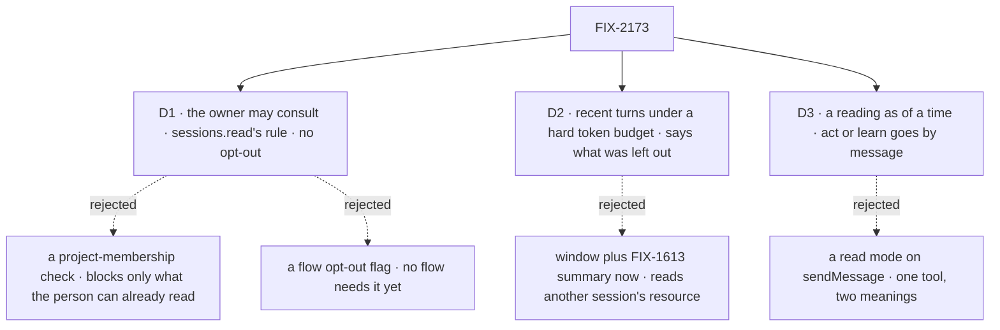

# FIX-2173 · Decisions

[Spec](SPEC.md) · **Decisions**

The issue left four questions open: who may consult a session, what a long history costs, how the
answer is labelled, and when the real session must still be messaged. D1 answers the first and
D2 the second. The last two are one decision, D3, because both are about what the asking model
takes the answer to be.

## The tree

Solid edges are what you're signing. Dashed edges lost, and the label says why.

## D1 · Who may consult a session: its owner, by `sessions.read`'s rule. No project check, no opt-out

| | |
|---|---|
| **Instead of** | Also requiring the asker to be a member of the project the other conversation works in (FIX-2280 makes that project readable). Or letting a flow declare its sessions can't be consulted |
| **Because** | A consult can only reach the asker's own person's sessions: the same user, tenant and organization, the rule `sessions.read` and the dispatch seam already apply, shared rather than copied ([tenet 5](../../../docs/philosophy.md)). Everything it reads, that person can already read on screen through the session's items. A project check would block only a person taken off a project from having a model read their own old conversation, which they can still scroll. An opt-out flag guards no case anyone has named, and adding it later is additive. The engine part stays generic: membership is a Workforce idea, and a check on it would put Layer 2 in the engine or a second gate in Workforce |
| **Locks in** | Any session of the person is consultable by any of their sessions that has the tool, task sessions included. A refused or missing session answers `undefined`, so the read is no existence oracle. A shared conversation (read by people other than its owner) is out of reach until it has a reading rule of its own |

It comes down to what the person can already see: a check that blocks only that adds a gate and no safety.

**What would change my mind:** sessions shared between people, or a flow whose items hold
something its person may see but a model should not carry elsewhere. Then the read follows the
items' own reading rule, or a flow gets the opt-out.

## D2 · Long history: the most recent turns under a hard token budget, and the answer says what was left out

| | |
|---|---|
| **Instead of** | The other session's own window plus its FIX-1613 summary of everything before it |
| **Because** | The budget is the cost control, and cost is why the tool exists. The read packs whole turns from the end under `{ tokens }` with the existing `selectRequestsByLimit`; where the newest turn alone is over the budget, the tool cuts it to its last messages rather than send it whole, so no consult sends more than its budget. The summary lives in a session resource that a capability installs (#4085, still open); reading it from another session needs a cross-session resource read the engine doesn't have, and a generic read can't know one capability's resource. Its turns and `historyStart` are on #4085's open head, which this builds after |
| **Locks in** | A default budget of 24,000 tokens, which the tool's factory and the capability can change. The result always says how many turns it read, whether earlier ones were left out, and whether the newest was cut. The hard cut is the tool's: `sessions.history` packs its `limit` as a window does. Old decisions in a long conversation are out of reach until the follow-up adds the summary |

It comes down to the summary's home: no read of another session's resource exists, and the budget needs none.

**What would change my mind:** the Teammates conversations, which go on for weeks, asking about
decisions older than the budget in the goal check or the lab. Then the follow-up comes first:
the summary capability publishes its summary on a readonly field the read can carry.

## D3 · The answer is a reading as of a time, never the worker's reply; anything that needs the worker to act or learn goes by message

| | |
|---|---|
| **Instead of** | A read-only mode on `sendMessage` (`read: true`), answering from history in the shape of a reply |
| **Because** | `sendMessage`'s contract is "it lands in that worker's conversation and wakes it". A mode that does neither, writes no log row, takes task sessions a message refuses, and runs another model would give one tool two meanings, and the model would have to tell them apart from a flag. The risk the issue names is the model taking a reading for the worker's word. So the tool is its own, its result is `{ reading, of, asOf: { requestId, at }, turnsRead, earlierTurnsLeftOut, cut }`, its description says the other conversation doesn't know it was asked (the Workforce tool says "worker"; core's stays neutral), and the generator answers only from the history and says so when the answer isn't there. `sendMessage`'s description gains one line: a read-only question about what a conversation already holds goes to the consult; a request to act, decide, or use knowledge the conversation doesn't hold goes by message |
| **Locks in** | The public names `consultSessionHistory`, `consultSessionHistoryTool`, `consultSessionsCapability` with its preset `consult`, and `requestHost.sessions.history`, and the result's field names. A consult never sees a worker's instructions, tools or resources: researcher's facts in its `WORKER.md` are a message's job |

It comes down to the contract: "it lands and wakes" can't also mean "nothing happens there".

**What would change my mind:** models that pick the wrong one of `sendMessage` and the consult in
the goal check or the labs, both ways. Then one tool with an explicit `mode` and a description
built around the choice is the better teacher.

## Decided, not asked

- **One settled-turns read, the convergence point.** The window load in `createExecutionContext`
  and `sessions.history` call the same function: list the session's past turns under its
  `sessionRequestScope`, drop the retried and parked ones, keep an interrupted turn's settled
  items, sort oldest first. A turn running, suspended or parked is never read; what it says isn't
  final. This is the "no second path" the issue asks for, and fork's read later.
- **`history` takes `ItemQuery`'s `limit` and nothing that names identity.** The owner, tenant
  and org close over the running request, as every `RequestHost` verb does. The flow is not
  checked: any of the person's sessions answers, as `read` does.
- **`history` returns #4085's shapes.** Settled `HistoryTurn`s oldest first, and `startRequestId` when earlier turns were left out, as a window marks it. `createRequestSessions` gains the request store, the durability provider (for the parked filter) and the token counter it needs. Its `limit` packs as a window does, the newest turn whole even over a `{ tokens }` limit, so its docs never call it a hard budget: the tool's cut is the hard one. The retried filter is read for the other session, not from the running request's metadata.
- **The engine answers `undefined`; the tools refuse.** A missing or foreign session reads `undefined` from `sessions.history`, as from `read`. Both tools turn that into `no_session`, and `self` is the tools' own refusal.
- **The cross-session read is bounded at the store.** It lists from the newest turn back and stops at what the `limit` can use, the way the window lists `historyWindowTurns`; it never loads a whole long session to trim it (BP-033).
- **`asOf` is the newest settled turn read**: its request id and when it settled. A turn still
  running there is named in the result (`running: true`), not read.
- **The model is a factory option, not a model-facing parameter.** The issue's `model?` stays on
  `consultSessionHistoryTool({ model })` and the capability's options, default `intent/utility`.
  A model that picks its own model is a cost hole. Adding a model-facing choice later is additive.
- **The labs set `models.intents.utility`** (with `models.default`, which the resolver requires beside any intent) to a model smaller than their main one, so "cheaper"
  is the app's word, said once, as the repair pass already reads it.
- **The generator runs inside the asker's turn and is not the asker's reply.** Its message items
  stay out of the asker's history and client view; the tool result is what the asker reads, cut
  under BP-042's bound.
- **A consult of the running session itself is refused** (`self`): its own history is already in
  its context.
- **`of` resolves by `sendMessage`'s own lookups.** A worker's id reads the person's existing
  conversation with that worker and never creates one (`no_conversation`). `{ task }` reads the
  task's run session, open or finished, coding or not. `{ session }` reads it whatever it runs.
  Each miss is the message tool's refusal text where one exists.
- **Its own capability, preset off by default.** A worker opts in from its file (`consultSessions: [consult]`), as FIX-2285's reads do. Per-worker selection reads only the app's own `uses`, and the board's `workerMessages` is added inside the flow, so a preset there couldn't be picked; a
  worker that never asks about other conversations doesn't carry a tool it won't use.
- **Fork moves to its own issue, filed when this spec merges.** FIX-2173 was filed as fork; Jake's scope addition is the read
  and the consult. Fork reuses this read, bounded at a request id the way #4085 bounds
  `afterRequestId`, and gets its own spec, with FIX-395's evaluation framing.
- **It lands after #4085.** Both change the window load; building on its head avoids two
  rewrites of the same lines. #4124 touches the Teammates lab's screen, not its worker files.
- **Changesets:** `@flow-state-dev/core`, `@flow-state-dev/engine`, `@flow-state-dev/workforce`,
  minor. The labs are private.

## Considered and dropped

| Alternative | Why not |
|---|---|
| Message with `wait: true` | Wakes the worker and runs its model: the cost this removes |
| A read-only mode on `sendMessage` | One tool, two meanings ([D3](#d3)) |
| Copy the other session's items into the asker's context, as the coordinator's routed brief does | The asker's own model pays for the whole history, and the copy drifts |
| A project-membership check | Blocks only what the person can already read ([D1](#d1)) |
| The window plus the FIX-1613 summary now | Needs a cross-session resource read ([D2](#d2)) |
| A ninth `RequestHost` verb | The header asks for `sessions` to grow instead |

## Settled

No POC. The one premise, that the engine can read another session's past turns under the same
scope a turn's window uses, is the window load's own code (`sessionRequestScope` and
`stores.request.list`), which takes any session id.

## Notes from review

- cursor[bot], 2026-10-28: "Consider calling out extracting `resolveConsultTarget(of)` shared with write-path refusals (minus `task_running`, plus `self`) so consult doesn't grow a second target matrix." Also: "justify or trim redundant tool result tallies (`turnsRead`, `earlierTurnsLeftOut`) vs `HistoryTurn[]` + `startRequestId`."

## Analysis

2026-10-28 · **Right work, at the right size**, after two folds. Fresh analyst, with `reuse-review` on Builds on / Adds.

- **Folded:** the consult is its own capability in the app's `uses` (the board's `workerMessages` can't be picked from a worker's file); `history` reuses #4085's `HistoryTurn` and `startRequestId` (reuse, not a parallel shape).
- **Fixed:** the labs set `models.default` beside the intent; `createRequestSessions` needs the request store, the durability provider and a token counter; the `no-owner-check` control sits on the shared owner rule; core's tool text stays free of Workforce words.
- **Recorded** for the implementer: a retry still running in the other session; `history`'s `limit` is not a hard budget, the tool's cut is.
- **Noted:** the coordinator's routed brief copies another conversation's lines; it is the shape dropped here.

## How it got here

- **Draft** — framed as a read-only question to another of the person's conversations; one
  settled-turns read shared with the window load, on `sessions`, a core tool with a cheap
  default model and a hard budget, and a Workforce preset that resolves `of` as a message does.
- **Analysis** — the consult became its own capability, because a worker can't pick a preset of the board's `workerMessages` from its file; `history` returns #4085's `HistoryTurn`s and `startRequestId` instead of a new shape; the `no-owner-check` control moved onto the shared owner rule, because the Workforce lookup's own `sessions.read` would refuse first.
