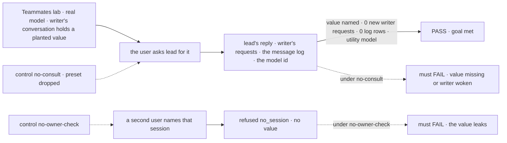
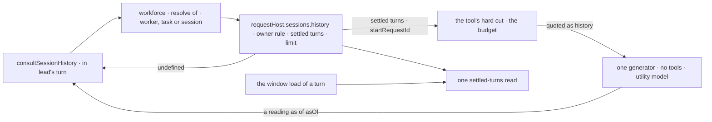

# FIX-2173 · Consult another session's history, without waking it

**Spec** · [Decisions](DECISIONS.md)

## Six people, before and after

| Someone who… | Today | After |
|---|---|---|
| **asks lead "what did I tell writer about the venue?"** | lead messages writer, which wakes writer, runs a whole turn on writer's model, adds a message to writer's conversation, and the answer comes back later | lead reads writer's conversation in its own turn, on a cheaper model, and answers now. writer runs nothing and gets nothing |
| **asks the main session what a finished background task said along the way** | Gets the task's result only, or a message that lands in the task's session and runs it again | Gets an answer read from the task session's turns. The task session runs nothing |
| **names another of their own conversations by id** ("what did I decide in my other session?") | Is asked to paste it | Gets an answer read from that conversation |
| **tries to consult a conversation that isn't theirs** | n/a | Is refused `no_session`, the same answer as a session that doesn't exist. Nothing is read ([D1](DECISIONS.md#d1)) |
| **consults a conversation longer than the consult's budget** | n/a | Gets an answer from its most recent turns, and the answer says earlier turns were left out ([D2](DECISIONS.md#d2)) |
| **needs the other worker to do something, or to know something new** | Messages it | Still messages it. A consult reads only what that conversation already holds, and says so ([D3](DECISIONS.md#d3)) |

Jake asked for this after the history-window work (agent-mailbox PR 46, comment 6483134362):
"Lets build FIX-2173 and add it to our Claude code lab (and probably grok as well)." The
scope is his addition to the issue on 2026-10-28.

## The goal, and how we'll know it's met

**A worker answers a read-only question about another of the same person's conversations from
that conversation's own history, in its own turn, on a cheaper model, and the other conversation
runs nothing, receives nothing and stays exactly as it was.**

| Is it the right goal? | |
|---|---|
| **The real need** | "`consultSessionHistory({ sessionId, question, model? })`: runs one generator with no tools over that history, returns text, writes nothing to the other session and never wakes it. The model … defaults to a cheaper, faster one than the main session's, which is the main reason to have it." The read under it uses "the same user/tenant/org rule as today's `ctx.request.sessions.read(id)`", and fork reuses it ([FIX-2173](https://linear.app/fixpoint-labs/issue/FIX-2173), scope addition) |
| **Smaller, and rejected** | "Message the worker with `wait: true`." It works today, and it is the cost this removes: it wakes the other worker and runs its model. "Expose the read." Hittable while no model can use it |
| **Bigger, and not this issue's** | Forking a conversation from a point in another one, the issue's first ask. It reuses this read, and it moves to its own issue ([Decided, not asked](DECISIONS.md#decided-not-asked)). Reading the other conversation's history summary (FIX-1613), a follow-up filed when this spec merges ([D2](DECISIONS.md#d2)) |
| **Not done if** | The answer is right only because the value was in the asking conversation too · the other session got a request, an item, a message-log row or a wake · the consult ran on the main model · another person's conversation was read · the answer reads as the other worker's own reply · a long history was sent to the model uncapped |



Leg 1 reads what a person sees and what the store holds, never the tool call alone. The value
lives only in writer's conversation, so nothing but a read of it can produce it.

| How we verify | |
|---|---|
| **Goal check** | `goals/teammates-lab/consults-a-conversation-without-waking-it/`, driven over the lab's HTTP API against `fsdev dev --config labs/teammates/fsdev.config.mts`, with one leg against `labs/claude-code-style/fsdev.config.mts` · real model · run by the implementer at completion · `VERDICT.md` with each leg's PASS or FAIL, and each control's, in the implementation PR |
| **Signal** | **Leg 1** (Teammates): the user tells writer, in writer's conversation, *"For the record, the venue is `<value>`."* Then, in lead's conversation: *"What venue did I give writer?"* PASS when lead's reply contains the value; writer's session has the same number of requests (`listSessionRequests`) and items as before the question; the message log has no row from lead; and the consult's generator item names the lab's utility model, not lead's. **Leg 2**: a second user asks their own lead to consult that session by its id. No value, and the turn holds a consult refused `no_session`. **Leg 3** (Claude Code-style, session mode): the user says a planted value in session A, then in session B asks `desk.main` what they said in session A, by its id. The value comes back and session A has no new request. Each leg passes 3 runs of 3 |
| **Input** | A value that is in no worker file, no project and no other conversation, such as `Hall K-41`. A different value and wording must pass too |
| **Anti-game** | Leg 1 asserts nothing on the tool call. A leg 2 with no consult call FAILs; it does not pass on the model declining |
| **Control that must fail** | `GOAL_CONTROL=no-consult`: lead's file doesn't pick `consultSessions: [consult]`. Leg 1 must FAIL on *value named* or *0 new writer requests*. `GOAL_CONTROL=no-owner-check`: the engine's one owner rule, shared by `sessions.read` and `sessions.history`, skips its user check, so the Workforce target lookup can't refuse first. Leg 2 must FAIL on *no value*. The PR shows both FAILs before the PASS |
| **Below the goal check** | Package tests carry what a question can't exercise: the read's tenant and org refusals, a running and a parked turn left out, an interrupted turn's settled items only, an interrupted turn in the other session whose retry is still running (the retried filter reads the running request's metadata today), the budget and its cut, a session of a flow not registered here, consulting the running session itself, and that nothing is written to the read session |

## What changes


Read the bottom row: the read and the generator both run inside lead's turn, and nothing crosses
into writer's side of the line.

**The app installs the capability on its worker flow, and says what "cheaper" is, once:**

```diff
  flows = {
-   agent: defineAgentWorkerFlow({ installation, model }),
+   agent: defineAgentWorkerFlow({ installation, model, uses: [consultSessionsCapability(installation)] }),
  };
  export default createFlowState({
    flows,
    stores,
+   models: { default: model, intents: { utility: ["openai/gpt-6-luna"] } },
  });
```

**A worker opts in from its own file:**

```diff
  ---
  name: lead
  description: Plans the launch with you, and asks the other workers when it needs a fact or a draft.
  delegates: [teammates.coder]
+ capabilities:
+   consultSessions: [consult]
  ---
```

The worker then has `consultSessionHistory({ of, question })`, where `of` names a conversation the
way `sendMessage`'s `to` does: a worker's id, `{ task: id }` or `{ session: id }`.

**An app without Workforce uses the core tool and the engine read directly:**

```diff
+ import { consultSessionHistoryTool } from "@flow-state-dev/core";
  const chat = generator({
    name: "chat",
    model: "openai/gpt-5.4",
-   tools: [],
+   tools: [consultSessionHistoryTool()],   // { sessionId, question }; model defaults to "intent/utility"
  });
```

```diff
  // in any block: another of the principal's sessions
  const view = await ctx.requestHost.sessions.read(sessionId);
+ const history = await ctx.requestHost.sessions.history(sessionId, { limit: { turns: 20 } });
+ // { turns: HistoryTurn[], startRequestId?, asOf?: { requestId, atMs }, running } | undefined
+ // settled turns only, oldest first; asOf is the newest one's settle time, running says a turn is open
```

**Docs:** update `apps/docs/docs/workforce/messaging-workers.md` with a *Consulting a
conversation instead of messaging it* section before *Message or delegate?*, which becomes
*Message, consult or delegate?*; add the tool to `apps/docs/docs/patterns/utility-blocks/core.md`
beside the other core blocks; add `sessions.history` and the tool to `packages/core/README.md`,
the capability to `packages/workforce/README.md`; and each lab's README (*What the screen reads*,
the inventory). No new page.

## How a consult reaches the history



The read and every turn's own window load go through one settled-turns read, so what a consult
sees is exactly what the other session's model would read next. The owner rule is
`sessions.read`'s, shared, not copied.

## What stays as it is

- **`sessions.read`.** It still answers flow and readonly state only. `history` sits beside it
  on the same `sessions` member, so the request host stays at eight verbs, as its header asks.
- **`sendMessage`**, its targets, its calls and its budget. Its description gains one sentence
  pointing a read-only question at the consult ([D3](DECISIONS.md#d3)).
- **The other session.** No request, no item, no state, no message-log row, no wake, no lease.
- **Item visibility.** A consult reads only items whose visibility puts them in history, the
  same ones that session's own model reads.
- **The history window** of a turn, and FIX-1613's summary, `afterRequestId` and `turns()`.

## What's already here, and the debt

| Already here | What this does with it |
|---|---|
| Ways to ask another conversation something. Searched `sendMessage`, `callWorker`, `getTask`, `listTasks`, `read`, `history`, `selectForContext`, `consult` across `packages/`. Four hits: `sendMessage` (lands and wakes), `sendMessage` with `wait: true` (a call: wakes, runs, waits), a message to `{ task }` (lands in the task's session), and `getTask` (the row's status and result, not its turns). **This would be the fifth way to ask another conversation a question, and the first that runs nothing there.** The closest is the call | **Beside it.** A read-only mode on `sendMessage` was weighed and dropped ([Considered and dropped](DECISIONS.md#considered-and-dropped)) |
| `requestHost.sessions.read` (FIX-2160 D2) and its owner rule | **Extends** `sessions` with `history`. One owner check serves both |
| The window load in `createExecutionContext`: `stores.request.list` with `sessionRequestScope`, `PAST_TURN_STATUSES`, the retried and parked filters, the settled items of an interrupted turn, then `loadLLMHistory` | **Builds on.** Extracted into one settled-turns read that the window and `history` both call |
| `MessageLimit` and `selectRequestsByLimit`: whole turns from the end under `{ tokens }` | **Builds on** for `history`'s `limit`, which packs as a window does and is never called a budget. The budget is only the tool's: a hard cap on the history tokens its generator receives, cut where the newest turn alone is over it ([D2](DECISIONS.md#d2)) |
| `intent/utility`, core's cheap-model intent (the repair pass, `memoryExtractor`) | **Builds on.** It is the default model |
| `checkTaskTarget`, `checkTargetSession` and the by-name lookup in `send-message.ts` | **Builds on** for `of`. The refusals that exist because a message runs the target (a coding task still open, a task session addressed as a conversation) don't apply to a read |
| Per-worker preset selection (FIX-1459): a worker picks presets of capabilities in the app's `uses` | **Builds on.** The consult is its own capability the app puts in `uses`, because the board's `workerMessages` is added inside the flow and can't be picked from a file |
| #4085's `HistoryTurn`, `turnScope` and `historyStart` (FIX-1613, merged) | **Builds on.** `history` returns `HistoryTurn`s and the same `startRequestId` mark a window carries; no parallel shape |
| The coordinator's routed brief (`coordinator/routed-brief.ts`), which copies another conversation's recent lines into a turn | **Kept.** It is the copying shape this drops for a read ([Considered and dropped](DECISIONS.md#considered-and-dropped)) |
| FIX-1613's `historySummary` capability (#4085, merged) | **Kept apart.** A consult doesn't read the other session's summary yet ([D2](DECISIONS.md#d2)) |

| Adds | Existing piece considered | Why it doesn't fit, or how this is composed |
|---|---|---|
| `requestHost.sessions.history` | `sessions.read`; a block's own `ctx.session.items.history()` | `read` is flow and readonly state by design; `items.history()` is the running session's. Composed from the window's own read and `sessions.read`'s owner rule |
| `consultSessionHistoryTool` in core | `summarizer`, `memoryExtractor` | Both summarise the running session. Composed: a read step and one tool-less generator. Its one caller today is the Workforce capability; no app calls it directly yet |
| `consultSessionsCapability` (preset `consult`) and its tool in Workforce | `sendMessage` and the board's `workerMessages` | Composed from core's tool and `sendMessage`'s target lookup. Its own capability so a worker can pick it from its file |

| The debt | |
|---|---|
| **Removes** | Nothing in a package. In the labs, the habit of messaging a worker to learn what it already said |
| **Adds** | A fifth way to ask another conversation a question. Permanent by design: it is the only one that runs nothing on the other side, and its output says it is a reading ([D3](DECISIONS.md#d3)). One more member on `sessions`, which its header already allows |
| **Leaves** | Fork (FIX-2173's first ask), filed as its own issue on this read when this spec merges. The consulted session's history summary, filed then as a follow-up ([D2](DECISIONS.md#d2)) |

**Net: up**, by one engine read, one core tool and one Workforce capability. The window load gets
simpler: it calls the shared read.

## Sign off

**[The goal](#the-goal-and-how-well-know-its-met), at that size:** a read-only answer from another
of your conversations, in the asker's turn, on a cheaper model, with nothing written there. Fork
moves to its own issue. If wrong: we ship a read that no worker reaches, or a second way to wake
a worker.

**[The debt](#whats-already-here-and-the-debt), net up:** one read, one tool, one capability, all
composed from what exists; the window load shares the read. If wrong: a fifth way to talk to a
worker that models confuse with the other four.

1. **[D1](DECISIONS.md#d1) · Who may consult a session: its owner, by `sessions.read`'s rule. No
   project check, no opt-out.** If wrong: a model reads a conversation its person can read but
   a flow wanted closed.
2. **[D2](DECISIONS.md#d2) · Long history: the most recent turns under a hard token budget, and
   the answer says what was left out. The summary comes later.** If wrong: a weeks-long
   conversation's old decisions are out of reach until the follow-up.
3. **[D3](DECISIONS.md#d3) · The answer is a reading as of a time, never the worker's reply;
   anything that needs the worker to act or learn goes by message.** If wrong: a model trusts a
   stale reading over a live answer.

**Open: none.** D2 is the one to weigh. Reasoning and what lost: [DECISIONS.md](DECISIONS.md).

Feature · `core` + `engine` + `workforce` + the Teammates and Claude Code-style labs · medium ·
epic [FIX-2171](https://linear.app/fixpoint-labs/issue/FIX-2171) · builds on #4085 (FIX-1613, merged)
